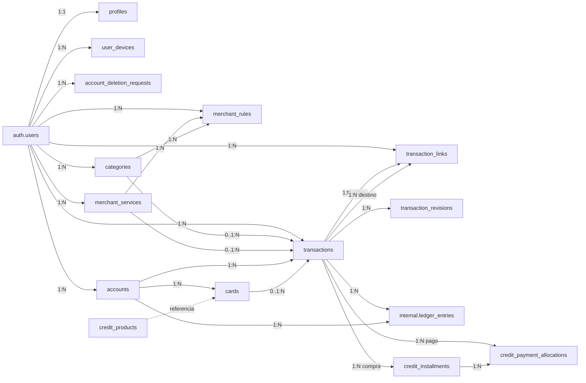
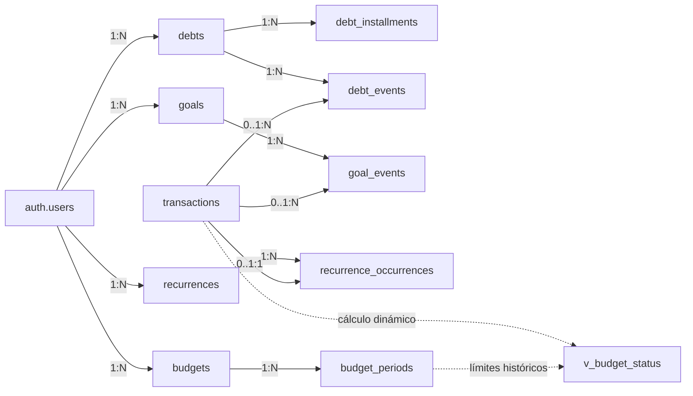
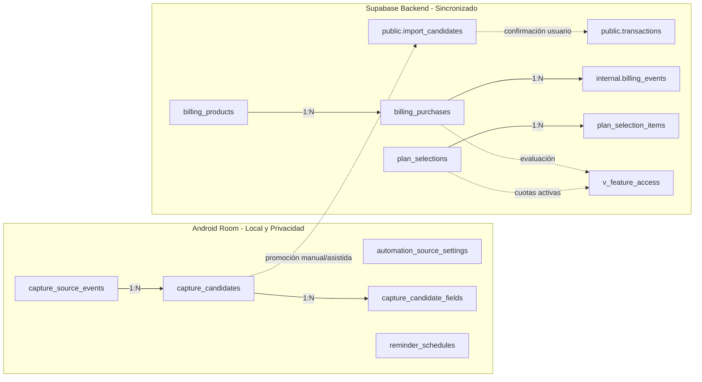
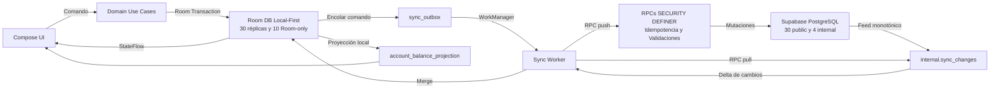

# KIPU V4.2 - Arquitectura y Modelado de Datos

> **Modelo global integrado — 2026-10-20.** Documento completo procedente de `KipuApp/Kipu md/03_Kipu_V4.2_Arquitectura_y_Datos.md`, versión de modelado **2.1 del 20/09/2026**. Es la base global de diseño, no un inventario verificado del esquema desplegado. Los conteos, columnas y contratos originales deben contrastarse con los [refinamientos por épica](README.md) antes de implementar. En particular, no extender el alcance de captura a Plin/SMS por menciones de este modelo: el [backlog](../producto/backlog.md) y la [constitución](../../.specify/memory/constitution.md) delimitan las fuentes aprobadas. Ver también [entidades](entidades.md), [MER](modelo-entidad-relacion.md) y [diferencias registradas](../control-documental.md).

> **Arquitectura técnica y modelo lógico/físico para Android nativo + Room/SQLite + Supabase/PostgreSQL, alineados con las 12 épicas y 60 HU de Kipu V4.2.**

| Base | Decisión |
| :--- | :--- |
| **Documento funcional** | Kipu V4.2 - Especificación integral y Product Backlog (60 HUs) |
| **Cronograma** | Cronograma Scrum Kipu V4.1 - 10 sprints / 9 integrantes |
| **Arquitectura** | Android nativo, Kotlin, Room/SQLite, Supabase/PostgreSQL, WorkManager, ML Kit, Google Play Billing |
| **Estrategia** | Local-first, UUID generado en cliente, sincronización idempotente, RLS por usuario |
| **Versión del modelado** | **2.1 Canónica Alineada** - 20/09/2026 (Consolidación a 34 tablas remotas + 10 tablas Room-only) |

---

## 1. Propósito y alcance

Este documento define cómo persistir y relacionar la información de Kipu sin convertir las pantallas en la fuente de verdad. El objetivo es que el equipo pueda implementar las 60 HU de V4.2 con una estructura de datos común, auditable, sincronizable y coherente con las reglas financieras, Free/Premium y captura asistida.

- **Fuente de verdad:** Las tablas financieras representan hechos y relaciones contables; dashboard, calendario, estadísticas y saldos son proyecciones derivadas de solo lectura o vistas SQL.
- **Seguridad y privacidad:** No se almacenan credenciales bancarias, CVV, número completo de tarjeta, plantilla biométrica ni contraseñas. Supabase Auth (`auth.users`) administra las credenciales de Kipu.
- **Privacidad en captura:** El OCR de Yape, Plin y notificaciones bancarias se procesa localmente en Android. Las imágenes y datos efímeros de captura nunca se suben a la nube por defecto y residen en **tablas exclusivas de Room**, pasando a Supabase únicamente a través de la bandeja `import_candidates` tras validación.
- **Aislamiento RLS:** Cada fila de negocio propiedad del usuario lleva `user_id` y queda protegida por RLS. Las tablas contables del libro mayor y facturación verificada residen en el esquema `internal` con escritura prohibida al cliente.
- **Aritmética monetaria:** Las cantidades monetarias se almacenan como enteros en unidad mínima (`amount_minor`, `BIGINT`) para evitar errores de coma flotante; `currency_code` usa ISO-4217 (ej. S/ 12.34 = 1234).
- **Identidad offline:** Los identificadores primarios se generan en el cliente (`UUIDv4`) para poder crear datos offline y sincronizarlos después sin colisiones ni reescritura de claves.
- **Modelo optimizado:** Se consolidan las tablas en un esquema canónico de **34 tablas remotas** (30 en `public` + 4 en `internal`), **6 vistas dinámicas** y **10 tablas locales exclusivas de Room**.

---

## 2. Arquitectura técnica y principios de diseño

| Principio | Aplicación en Kipu |
| :--- | :--- |
| **Local-first** | Room confirma la escritura local en una transacción y la UI observa el resultado inmediatamente vía `StateFlow`. La red nunca bloquea el registro de un movimiento. |
| **Ledger auditable** | Un movimiento de negocio se guarda en `transactions`; sus efectos inmutables por cuenta viven en `internal.ledger_entries`. Transferencias y pagos se aplican atómicamente y se vinculan explícitamente en `transaction_links`. |
| **Idempotencia estricta** | Comandos, sincronización y billing usan claves estables (`idempotency_key` en `internal.command_receipts`); los reintentos no duplican efectos contables. |
| **Historia antes que borrado** | Movimientos se anulan lógicamente (`status = 'VOIDED'`). Las eliminaciones de entidades conservan tombstone (`deleted_at`) para propagar la eliminación a otros dispositivos. |
| **Separación de dominio** | Deudas (`debts`), metas (`goals`), recurrencias y presupuestos no inventan movimientos: se vinculan a `transactions` mediante eventos y asignaciones. |
| **Plan no altera contabilidad** | Free/Pro controla capacidad y creación de nuevos recursos (vía `v_feature_access`), pero nunca altera ni oculta los hechos financieros históricos ya registrados. |
| **Servidor desconfiado del cliente** | El cliente propone cambios; RLS, `revision`, validaciones de RPC (`SECURITY DEFINER`) protegen propiedad e idempotencia. Billing se valida exclusivamente en backend. |

---

## 3. Convenciones físicas y campos comunes

| Concepto | Decisión |
| :--- | :--- |
| **PK** | `id UUID` generado en Android (`UUID.randomUUID()`) antes de insertar en Room. |
| **Propietario** | `user_id UUID NOT NULL -> auth.users.id` para todo dato privado remoto con RLS. |
| **Tiempo** | `created_at`, `updated_at TIMESTAMPTZ` en UTC. `occurred_at`/`due_date` conservan el instante o fecha civil real del dominio. |
| **Versión** | `revision BIGINT NOT NULL DEFAULT 1` incremental para control de concurrencia optimista y deltas de sincronización. |
| **Borrado sincronizable** | `deleted_at TIMESTAMPTZ NULL`; el cliente nunca ejecuta `DELETE` físico en tablas remotas. |
| **Moneda** | `amount_minor BIGINT` + `currency_code CHAR(3)`. En V4.2 no hay conversión multimoneda automática; las transferencias exigen misma moneda. |
| **Porcentaje / Tasa** | `rate_bps INTEGER` (basis points: 100 bps = 1.00%) para tasas de tarjeta, umbrales y confianza. |
| **Enums y Estados** | PostgreSQL `TEXT` con restricciones `CHECK` para facilitar extensibilidad y migraciones sin bloqueos DDL. |
| **Esquema Internal** | Tablas críticas (`ledger_entries`, `command_receipts`, `billing_events`, `sync_changes`) residen en `internal`; los clientes tienen `REVOKE ALL` sobre este esquema. |

---

## 4. Vista general del modelo

### 4.1 Núcleo financiero y tarjetas
*Identidad, cuentas, tarjetas, categorías, comercios/servicios, transacciones, enlaces, libro mayor y cuotas de crédito.*

---

### 4.2 Planificación financiera
*Deudas/préstamos (`debts`), metas de ahorro (`goals`), recurrencias y presupuestos vinculados con movimientos reales.*

---

### 4.3 Captura asistida y monetización
*Aislamiento local de datos sensibles (Room-only), bandeja de ingesta `import_candidates` y ciclo de vida de compras verificado.*

---

### 4.4 Sincronización local-first
*Room como fuente inmediata de verdad para la UI; outbox + WorkManager sincronizan con Supabase vía RPCs.*

---

## 5. Diccionario de datos - Identidad y dispositivos (3 tablas)

### profiles
**Propósito:** Perfil principal y configuración central del usuario, preferencias visuales, moneda por defecto, día de inicio de mes y bolsa JSONB de personalización/privacidad (incluyendo flag para la máscara `MoneyText`).  
**Persistencia:** Supabase (`public`) + Room.

| Campo | Tipo lógico | Nulo | Clave / default | Uso |
| :--- | :--- | :--- | :--- | :--- |
| `user_id` | UUID | No | PK / FK auth.users | Identidad única del usuario. |
| `display_name` | TEXT | Sí | | Nombre visible del usuario. |
| `currency_code` | CHAR(3) | No | 'PEN' | Moneda principal para presentación (Soles por defecto). |
| `time_zone` | TEXT | No | 'America/Lima' | Zona horaria IANA para proyección de fechas civiles. |
| `month_start` | SMALLINT | No | 1 | Día de inicio de mes financiero (1..28). |
| `hide_balances` | BOOLEAN | No | false | Enmascaramiento de saldos en UI (`MoneyText`). |
| `theme_mode` | TEXT | No | 'LIGHT' | Preferencia visual: LIGHT, DARK, SYSTEM. |
| `biometric_enabled` | BOOLEAN | No | false | Flag de bloqueo biométrico local. |
| `preferences` | JSONB | No | '{}' | Preferencias estéticas y funcionales ampliables. |
| `created_at` | TIMESTAMPTZ | No | now() | Fecha de creación del registro. |
| `updated_at` | TIMESTAMPTZ | No | now() | Última actualización. |

- **Restricciones:** PK `user_id`. CHECK `month_start BETWEEN 1 AND 28`.
- **Índices:** PK `user_id`.
- **Trazabilidad:** HU-01, HU-02, HU-04.

---

### account_deletion_requests
**Propósito:** Gestión auditable del flujo regulatorio de eliminación de cuenta y derecho al olvido con periodo de gracia de 30 días.  
**Persistencia:** Supabase (`public`) + Room.

| Campo | Tipo lógico | Nulo | Clave / default | Uso |
| :--- | :--- | :--- | :--- | :--- |
| `id` | UUID | No | PK | Identificador de la solicitud. |
| `user_id` | UUID | No | FK auth.users | Propietario de la cuenta. |
| `status` | TEXT | No | 'REQUESTED' | REQUESTED / PROCESSING / COMPLETED / FAILED / CANCELED. |
| `requested_at` | TIMESTAMPTZ | No | now() | Momento de la solicitud. |
| `scheduled_for` | TIMESTAMPTZ | No | | Fecha programada de ejecución (30 días). |
| `completed_at` | TIMESTAMPTZ | Sí | | Momento de purga física. |
| `error_details` | TEXT | Sí | | Detalle en caso de fallo técnico. |

- **Restricciones:** PK `id`. Solo administrable por RPCs y procesos batch del servidor.
- **Índices:** `user_id`, `status`; `scheduled_for` WHERE `status = 'REQUESTED'`.
- **Trazabilidad:** HU-06.

---

### user_devices
**Propósito:** Control de dispositivos autorizados para sincronizar y cumplimiento del límite estricto de **HU-52** (Free: máx. 1 dispositivo activo; Pro: máx. 5 dispositivos activos).  
**Persistencia:** Supabase (`public`) + Room.

| Campo | Tipo lógico | Nulo | Clave / default | Uso |
| :--- | :--- | :--- | :--- | :--- |
| `id` | UUID | No | PK | Identificador de la instalación en el dispositivo. |
| `user_id` | UUID | No | FK auth.users | Cuenta Kipu vinculada. |
| `device_fingerprint` | TEXT | No | | Hash seguro del dispositivo para dedupe. |
| `device_name` | TEXT | No | 'Android Device' | Nombre legible del equipo (ej. Pixel 8). |
| `platform` | TEXT | No | 'ANDROID' | Plataforma del cliente. |
| `app_version` | TEXT | Sí | | Versión de Kipu instalada. |
| `last_sync_at` | TIMESTAMPTZ | No | now() | Última sincronización confirmada. |
| `is_active` | BOOLEAN | No | true | Estado de autorización. |
| `revoked_at` | TIMESTAMPTZ | Sí | | Fecha de revocación manual o por cupo. |
| `created_at` | TIMESTAMPTZ | No | now() | Alta del dispositivo. |

- **Restricciones:** PK `id`. En `sync_pull` se verifica que el conteo de dispositivos activos no supere la cuota del plan del usuario.
- **Índices:** `user_id`, `is_active`; `user_id`, `device_fingerprint`.
- **Trazabilidad:** HU-02, HU-52, HU-55, HU-60.

---

## 6. Diccionario - Catálogos y clasificación (5 tablas)

### currencies
**Propósito:** Catálogo oficial de monedas ISO 4217 admitidas en la aplicación.  
**Persistencia:** Supabase (`public`, lectura pública autenticada) + Room cache.

| Campo | Tipo lógico | Nulo | Clave / default | Uso |
| :--- | :--- | :--- | :--- | :--- |
| `code` | CHAR(3) | No | PK | Código ISO 4217 (ej. 'PEN', 'USD'). |
| `name` | TEXT | No | | Nombre descriptivo de la moneda. |
| `symbol` | TEXT | No | | Símbolo visual (ej. 'S/', '$'). |
| `scale` | SMALLINT | No | 2 | Número de decimales para conversión a unidades menores. |
| `is_active` | BOOLEAN | No | true | Habilitada para nuevas cuentas. |

- **Restricciones:** PK `code`. Solo modificable por el administrador.
- **Trazabilidad:** HU-07, HU-18.

---

### categories
**Propósito:** Jerarquía de categorías de gasto e ingreso. Árbol de **máximo 2 niveles** (raíz y subcategoría) mediante `parent_id`. En estricto cumplimiento del requisito **RF-K10**, no existen tags ni etiquetas.  
**Persistencia:** Supabase (`public`) + Room.

| Campo | Tipo lógico | Nulo | Clave / default | Uso |
| :--- | :--- | :--- | :--- | :--- |
| `id` | UUID | No | PK | Identificador de la categoría. |
| `user_id` | UUID | Sí | FK auth.users | Propietario (NULL si es de catálogo global). |
| `name` | TEXT | No | | Nombre visible. |
| `icon_key` | TEXT | Sí | 'category_default' | Clave del icono en la app. |
| `color_argb` | INTEGER | Sí | | Color numérico entero (legacy). |
| `color_token` | TEXT | Sí | | Token semántico de color Stitch/Material 3. |
| `parent_id` | UUID | Sí | FK categories | Categoría padre (NULL = raíz; not null = subcategoría). |
| `is_system` | BOOLEAN | No | false | Indica si es inmutable del sistema. |
| `is_active` | BOOLEAN | No | true | Vigencia de uso. |
| `revision` | BIGINT | No | 1 | Control de versión para sincronización. |
| `deleted_at` | TIMESTAMPTZ | Sí | | Tombstone de eliminación lógica. |

- **Restricciones:** PK `id`. En plan Free, se permiten hasta 5 raíces personalizadas activas de gastos y 5 de ingresos; las subcategorías no consumen cupo adicional.
- **Índices:** `user_id`, `parent_id`; `user_id`, `deleted_at`.
- **Trazabilidad:** HU-14, HU-17, HU-57.

---

### merchant_services
**Propósito:** Catálogo de comercios habituales y servicios de suscripción (Netflix, Spotify, Luz, Agua). Es **independiente de la categoría**, permitiendo reclasificar gastos sin alterar el comercio.  
**Persistencia:** Supabase (`public`) + Room.

| Campo | Tipo lógico | Nulo | Clave / default | Uso |
| :--- | :--- | :--- | :--- | :--- |
| `id` | UUID | No | PK | Identificador del comercio/servicio. |
| `user_id` | UUID | Sí | FK auth.users | Propietario (NULL si es comercio global predefinido). |
| `name` | TEXT | No | | Nombre canónico visible (ej. 'Netflix', 'Plaza Vea'). |
| `normalized_name` | TEXT | No | | Texto normalizado en mayúsculas sin signos. |
| `is_system` | BOOLEAN | No | false | Comercio predefinido de la plataforma. |
| `revision` | BIGINT | No | 1 | Versión de sincronización. |
| `deleted_at` | TIMESTAMPTZ | Sí | | Eliminación lógica. |

- **Restricciones:** PK `id`. UNIQUE(`user_id`, `normalized_name`) WHERE `deleted_at IS NULL`.
- **Índices:** `user_id`, `normalized_name`.
- **Trazabilidad:** HU-15, HU-16.

---

### merchant_rules
**Propósito:** Reglas de inferencia y clasificación automática. Asocia patrones de texto observados en comprobantes/notificaciones con su comercio y categoría correspondiente.  
**Persistencia:** Supabase (`public`) + Room.

| Campo | Tipo lógico | Nulo | Clave / default | Uso |
| :--- | :--- | :--- | :--- | :--- |
| `id` | UUID | No | PK | Identificador de la regla. |
| `user_id` | UUID | Sí | FK auth.users | Propietario (NULL si es regla global del sistema). |
| `pattern` | TEXT | No | | Patrón regex o substring observado en comprobante/notificación. |
| `merchant_service_id` | UUID | Sí | FK merchant_services | Comercio/servicio canónico asignado. |
| `category_id` | UUID | Sí | FK categories | Categoría asignada automáticamente si aplica. |
| `priority` | INTEGER | No | 100 | Prioridad de evaluación (mayor = se evalúa antes). |
| `is_system` | BOOLEAN | No | false | Regla global predefinida. |
| `revision` | BIGINT | No | 1 | Versión de sincronización. |
| `deleted_at` | TIMESTAMPTZ | Sí | | Eliminación lógica. |

- **Restricciones:** PK `id`. UNIQUE(`user_id`, `pattern`) WHERE `deleted_at IS NULL`.
- **Índices:** `user_id`, `priority` DESC; `merchant_service_id`; `category_id`.
- **Trazabilidad:** HU-16, HU-17, HU-50, HU-58.

---

### credit_products
**Propósito:** Catálogo de productos de crédito de emisores locales con tasas referenciales de mercado (TEA). Evita la proliferación de tablas auxiliares.  
**Persistencia:** Supabase (`public`, lectura pública) + Room cache.

| Campo | Tipo lógico | Nulo | Clave / default | Uso |
| :--- | :--- | :--- | :--- | :--- |
| `id` | UUID | No | PK | Identificador del producto. |
| `institution_code` | TEXT | No | | Código de la entidad financiera (ej. 'BCP', 'INTERBANK'). |
| `product_name` | TEXT | No | | Nombre comercial (ej. 'Visa Signature', 'CMR'). |
| `card_network` | TEXT | Sí | | Red de la tarjeta: VISA, MASTERCARD, AMEX, DINERS, OTHER. |
| `reference_tea_bps` | INTEGER | Sí | | Tasa efectiva anual referencial en basis points (ej. 4500 = 45.00%). |
| `effective_from` | DATE | No | CURRENT_DATE | Fecha de vigencia inicial de la tasa. |
| `effective_to` | DATE | Sí | | Fecha de expiración de la referencia. |

- **Restricciones:** PK `id`. CHECK `reference_tea_bps >= 0`.
- **Índices:** `institution_code`, `card_network`.
- **Trazabilidad:** HU-10, HU-11.

---

## 7. Diccionario - Cuentas, tarjetas y núcleo contable (8 tablas)

### accounts
**Propósito:** Lugares físicos o digitales donde el usuario almacena su propio dinero (efectivo, ahorros, débito, billeteras digitales Yape/Plin). Incluye cuentas virtuales de metas y de pasivo crediticio.  
**Persistencia:** Supabase (`public`) + Room.

| Campo | Tipo lógico | Nulo | Clave / default | Uso |
| :--- | :--- | :--- | :--- | :--- |
| `id` | UUID | No | PK | Identificador generado en Android. |
| `user_id` | UUID | No | FK auth.users | Propietario de la cuenta. |
| `name` | TEXT | No | | Nombre visible (ej. 'Sueldo BCP', 'Billetera Yape'). |
| `account_type` | TEXT | No | | CASH, BANK, WALLET, SAVINGS, GOALS_VIRTUAL, CREDIT_LIABILITY. |
| `currency_code` | CHAR(3) | No | 'PEN' | Moneda ISO 4217 de la cuenta. |
| `institution_code` | TEXT | Sí | | Banco o entidad emisora. |
| `color_argb` | INTEGER | Sí | | Color visual en UI. |
| `icon_key` | TEXT | Sí | 'account_default' | Icono asociado. |
| `is_archived` | BOOLEAN | No | false | Oculta la cuenta sin borrar historia. |
| `revision` | BIGINT | No | 1 | Versión de sincronización. |
| `deleted_at` | TIMESTAMPTZ | Sí | | Eliminación lógica. |

- **Regla contable:** `accounts` **NO almacena un saldo mutable**. El saldo actual se calcula exclusivamente mediante la vista `v_account_balances` desde `internal.ledger_entries`.
- **Cupos de plan:** Efectivo (`CASH`), `GOALS_VIRTUAL` y `CREDIT_LIABILITY` no consumen cupo de cuentas del plan Free.
- **Índices:** `user_id`, `is_archived`; `user_id`, `account_type`.
- **Trazabilidad:** HU-07, HU-08, HU-18-HU-24, HU-57.

---

### cards
**Propósito:** Tarjetas de débito y líneas de crédito (pasivos). Registra únicamente metadatos no sensibles (`last4`, `network`, `style_preset_id`), parámetros financieros (`credit_limit_minor`, `closing_day`, `due_day`, `personal_tea_bps`) y enlace al producto referencial.  
**Persistencia:** Supabase (`public`) + Room.

| Campo | Tipo lógico | Nulo | Clave / default | Uso |
| :--- | :--- | :--- | :--- | :--- |
| `id` | UUID | No | PK | Identificador generado en Android. |
| `user_id` | UUID | No | FK auth.users | Propietario del instrumento. |
| `account_id` | UUID | No | FK accounts | Cuenta base asociada (activo para débito; pasivo `CREDIT_LIABILITY` para crédito). |
| `network` | TEXT | Sí | | VISA, MASTERCARD, AMEX, DINERS, OTHER. |
| `alias` | TEXT | No | | Nombre personalizado (ej. 'Mi Tarjeta CMR'). |
| `last4` | CHAR(4) | Sí | | Últimos 4 dígitos para reconocimiento (nunca PAN completo). |
| `is_credit` | BOOLEAN | No | false | Diferencia débito de crédito. |
| `credit_limit_minor` | BIGINT | Sí | | Línea de crédito total en céntimos (si `is_credit = true`). |
| `closing_day` | SMALLINT | Sí | | Día de cierre mensual de facturación (1..28). |
| `due_day` | SMALLINT | Sí | | Día de vencimiento de pago mensual (1..28). |
| `personal_tea_bps` | INTEGER | Sí | | Tasa personal pactada con el banco en bps. |
| `product_id` | UUID | Sí | FK credit_products | Producto de referencia del catálogo offline. |
| `style_preset_id` | TEXT | Sí | | Preset visual para renderizado en UI de tarjeta. |
| `revision` | BIGINT | No | 1 | Versión de sincronización. |
| `deleted_at` | TIMESTAMPTZ | Sí | | Eliminación lógica. |

- **Restricciones:** PK `id`. CHECK: Si `is_credit = true`, `credit_limit_minor >= 0`. `closing_day` y `due_day` BETWEEN 1 AND 28.
- **Índices:** `user_id`, `account_id`; `user_id`, `is_credit`.
- **Trazabilidad:** HU-08, HU-09-HU-13, HU-48, HU-57.

---

### transactions
**Propósito:** El **Ledger de Movimientos**. Es el libro contable principal de la app. Registra la transacción financiera vinculando cuenta origen, tarjeta opcional, categoría, comercio/servicio, montos en céntimos (`amount_minor`), fecha (`occurred_at`) y estado (`CONFIRMED`, `REVISED`, `VOIDED`).  
**Persistencia:** Supabase (`public`) + Room.

| Campo | Tipo lógico | Nulo | Clave / default | Uso |
| :--- | :--- | :--- | :--- | :--- |
| `id` | UUID | No | PK | Identificador de la transacción generado en Android. |
| `user_id` | UUID | No | FK auth.users | Propietario de la operación. |
| `account_id` | UUID | No | FK accounts | Cuenta principal afectada. |
| `card_id` | UUID | Sí | FK cards | Tarjeta utilizada si aplica. |
| `category_id` | UUID | Sí | FK categories | Clasificación de gasto o ingreso. |
| `merchant_service_id` | UUID | Sí | FK merchant_services | Comercio o servicio identificado. |
| `transaction_type` | TEXT | No | | EXPENSE, INCOME, TRANSFER. |
| `operation_kind` | TEXT | No | 'STANDARD' | STANDARD, CARD_PURCHASE, CARD_PAYMENT, DEBT_DISBURSEMENT, DEBT_PAYMENT, GOAL_FUNDING, REFUND, ADJUSTMENT. |
| `amount_minor` | BIGINT | No | | Importe monetario absoluto en céntimos (> 0). |
| `currency_code` | CHAR(3) | No | 'PEN' | Moneda de la operación. |
| `transfer_group_id` | UUID | Sí | | Identificador que enlaza los dos asientos de una transferencia. |
| `occurred_at` | TIMESTAMPTZ | No | now() | Instante real en que ocurrió la operación. |
| `installment_count` | SMALLINT | No | 1 | Número de cuotas (para compras con tarjeta de crédito). |
| `interest_mode` | TEXT | No | 'NONE' | Modalidad de interés: NONE, INCLUDED, REFERENTIAL. |
| `merchant_raw_text` | TEXT | Sí | | Texto sin procesar obtenido en la captura. |
| `notes` | TEXT | Sí | | Nota o comentario del usuario. |
| `refund_of_transaction_id` | UUID | Sí | FK transactions | Transacción original en caso de reembolso. |
| `status` | TEXT | No | 'CONFIRMED' | CONFIRMED, REVISED, VOIDED. |
| `revision` | BIGINT | No | 1 | Versión para control optimista y merge. |
| `deleted_at` | TIMESTAMPTZ | Sí | | Tombstone de anulación/eliminación lógica. |

- **Restricciones:** PK `id`. CHECK `amount_minor > 0`. Una transacción `VOIDED` no participa en saldos ni presupuestos.
- **Índices:** `user_id`, `occurred_at` DESC; `user_id`, `category_id`, `occurred_at`; `user_id`, `merchant_service_id`; `transfer_group_id`.
- **Trazabilidad:** HU-18-HU-25, HU-39-HU-41, HU-47-HU-51.

---

### transaction_links
**Propósito:** Enlaces de Transacciones. Se encarga de emparejar transacciones relacionadas para transferencias entre cuentas, pagos de tarjeta de crédito (**RN-06**), amortizaciones de deudas (**RN-06**), reembolsos o anulaciones parciales/totales (**RN-12**, **DTV-09**). Garantiza que el dinero se traslade sin duplicar gastos ni distorsionar la analítica.  
**Persistencia:** Supabase (`public`) + Room.

| Campo | Tipo lógico | Nulo | Clave / default | Uso |
| :--- | :--- | :--- | :--- | :--- |
| `id` | UUID | No | PK | Identificador único del enlace. |
| `user_id` | UUID | No | FK auth.users | Propietario de la relación. |
| `source_transaction_id` | UUID | No | FK transactions | Transacción origen (salida de fondos o pago). |
| `target_transaction_id` | UUID | No | FK transactions | Transacción destino (abono, recepción o reembolso). |
| `link_type` | TEXT | No | | TRANSFER, CARD_PAYMENT, DEBT_AMORTIZATION, REFUND, REVERSAL. |
| `metadata` | JSONB | No | '{}' | Metadatos contextuales del enlace. |
| `created_at` | TIMESTAMPTZ | No | now() | Fecha de emparejamiento. |

- **Restricciones:** PK `id`. CHECK `source_transaction_id <> target_transaction_id`. UNIQUE(`source_transaction_id`, `target_transaction_id`, `link_type`).
- **Índices:** `user_id`; `source_transaction_id`; `target_transaction_id`.
- **Trazabilidad:** HU-18, HU-22, HU-24, RN-06, RN-12.

---

### transaction_revisions
**Propósito:** Historial inmutable y auditable de modificaciones de transacciones.  
**Persistencia:** Supabase (`public`, append-only vía RPCs) + Room.

| Campo | Tipo lógico | Nulo | Clave / default | Uso |
| :--- | :--- | :--- | :--- | :--- |
| `id` | UUID | No | PK | Identificador de la revisión. |
| `transaction_id` | UUID | No | FK transactions | Transacción modificada. |
| `user_id` | UUID | No | FK auth.users | Usuario que realizó el cambio. |
| `revision_number` | BIGINT | No | | Número correlativo de revisión (1, 2, 3...). |
| `previous_payload` | JSONB | No | | Snapshot completo antes de la modificación. |
| `new_payload` | JSONB | No | | Snapshot con los nuevos valores aplicados. |
| `change_reason` | TEXT | Sí | | Motivo declarado del cambio o corrección. |
| `created_at` | TIMESTAMPTZ | No | now() | Momento exacto de la revisión. |

- **Restricciones:** PK `id`. UNIQUE(`transaction_id`, `revision_number`). Estrictamente append-only.
- **Índices:** `transaction_id`, `revision_number` DESC.
- **Trazabilidad:** HU-20, HU-21, HU-60.

---

### internal.ledger_entries
**Propósito:** Asientos contables inmutables de partida doble. Constituye la **única autoridad de saldos** en el sistema.  
**Persistencia:** Supabase (`internal`, protegida contra escritura directa de clientes) + Room.

| Campo | Tipo lógico | Nulo | Clave / default | Uso |
| :--- | :--- | :--- | :--- | :--- |
| `id` | UUID | No | PK | Identificador del asiento contable. |
| `transaction_id` | UUID | No | FK transactions | Transacción económica que originó el asiento. |
| `user_id` | UUID | No | FK auth.users | Propietario. |
| `account_id` | UUID | No | FK accounts | Cuenta afectada. |
| `signed_amount_minor` | BIGINT | No | | Importe con signo (+ incrementa saldo contable, - lo reduce; <> 0). |
| `currency_code` | CHAR(3) | No | 'PEN' | Moneda del asiento (coincide con la cuenta). |
| `entry_role` | TEXT | No | | PRIMARY, SOURCE, DESTINATION, LIABILITY, REVERSAL. |
| `occurred_at` | TIMESTAMPTZ | No | now() | Fecha contable efectiva. |
| `created_at` | TIMESTAMPTZ | No | now() | Creación del asiento. |

- **Seguridad:** Los clientes no pueden ejecutar `INSERT`, `UPDATE` ni `DELETE` en esta tabla. Solo las RPCs financieras (`register_transaction`, `allocate_credit_payment`, `record_debt_payment`) pueden insertar asientos.
- **Índices:** `account_id`, `occurred_at`; `transaction_id`; `user_id`, `occurred_at`.
- **Trazabilidad:** HU-18-HU-21, HU-24, HU-25.

---

### credit_installments
**Propósito:** Cronograma de cuotas pactadas para una compra realizada con tarjeta de crédito (`operation_kind = 'CARD_PURCHASE'`).  
**Persistencia:** Supabase (`public`) + Room.

| Campo | Tipo lógico | Nulo | Clave / default | Uso |
| :--- | :--- | :--- | :--- | :--- |
| `id` | UUID | No | PK | Identificador de la cuota. |
| `user_id` | UUID | No | FK auth.users | Propietario. |
| `transaction_id` | UUID | No | FK transactions | Transacción de compra a crédito asociada. |
| `installment_number` | SMALLINT | No | | Número secuencial de cuota (1..N). |
| `due_date` | DATE | No | | Fecha de vencimiento pactada. |
| `principal_minor` | BIGINT | No | | Amortización al capital de la compra (>= 0). |
| `interest_minor` | BIGINT | No | 0 | Interés estimado asignado a la cuota (>= 0). |
| `status` | TEXT | No | 'PENDING' | PENDING, PARTIAL, PAID, VOIDED. |
| `revision` | BIGINT | No | 1 | Versión de sincronización. |
| `deleted_at` | TIMESTAMPTZ | Sí | | Eliminación lógica. |

- **Restricciones:** PK `id`. UNIQUE(`transaction_id`, `installment_number`). El reparto de centavos del capital es determinista y suma exactamente el total de la compra.
- **Índices:** `transaction_id`, `installment_number`; `user_id`, `status`, `due_date`.
- **Trazabilidad:** HU-13, HU-40.

---

### credit_payment_allocations
**Propósito:** Registro N:M inmutable que vincula una transacción de pago de tarjeta (`CARD_PAYMENT`) con las cuotas amortizadas.  
**Persistencia:** Supabase (`public`) + Room.

| Campo | Tipo lógico | Nulo | Clave / default | Uso |
| :--- | :--- | :--- | :--- | :--- |
| `id` | UUID | No | PK | Identificador de la asignación. |
| `user_id` | UUID | No | FK auth.users | Propietario. |
| `payment_transaction_id` | UUID | No | FK transactions | Transacción de pago de tarjeta ejecutada. |
| `installment_id` | UUID | No | FK credit_installments | Cuota a la que se aplicó el dinero. |
| `allocated_minor` | BIGINT | No | | Importe amortizado a la cuota (> 0). |
| `created_at` | TIMESTAMPTZ | No | now() | Fecha de registro de la asignación. |

- **Restricciones:** PK `id`. CHECK `allocated_minor > 0`.
- **Índices:** `payment_transaction_id`; `installment_id`; `user_id`.
- **Trazabilidad:** HU-13, HU-24, HU-40.

---

## 8. Diccionario - Deudas y préstamos (3 tablas)

### debts
**Propósito:** Módulo de Deudas. Modelo unificado para deudas contraídas por el usuario (`PAYABLE`) y préstamos otorgados a terceros (`RECEIVABLE`). Almacena capital inicial (`total_minor`), moneda, vencimiento y estado. Si es deuda propia, registra condicionalmente si generó dinero recibido incrementando el activo correspondiente sin generar un ingreso operativo falso.  
**Persistencia:** Supabase (`public`) + Room.

| Campo | Tipo lógico | Nulo | Clave / default | Uso |
| :--- | :--- | :--- | :--- | :--- |
| `id` | UUID | No | PK | Identificador generado en Android. |
| `user_id` | UUID | No | FK auth.users | Propietario. |
| `obligation_type` | TEXT | No | | PAYABLE (deuda propia) o RECEIVABLE (préstamo otorgado). |
| `counterparty_name` | TEXT | No | | Nombre de la persona o entidad prestamista/deudora. |
| `total_minor` | BIGINT | No | | Principal pactado inicial en céntimos (> 0). |
| `currency_code` | CHAR(3) | No | 'PEN' | Moneda del préstamo. |
| `opened_on` | DATE | No | current_date | Fecha de registro/apertura de la obligación. |
| `opening_mode` | TEXT | No | 'HISTORICAL' | `NEW_CASH_FLOW` si el efectivo se mueve ahora; `HISTORICAL` si ya estaba reflejado. |
| `due_date` | DATE | Sí | | Fecha de vencimiento pactada general. |
| `reminder_lead_days` | SMALLINT | Sí | | Anticipación de aviso (0..365); nulo desactiva el aviso. |
| `notes` | TEXT | Sí | | Notas adicionales. |
| `status` | TEXT | No | 'ACTIVE' | ACTIVE, SETTLED, CANCELLED. CANCELLED conserva visible el saldo no pagado. |
| `revision` | BIGINT | No | 1 | Versión de sincronización. |
| `deleted_at` | TIMESTAMPTZ | Sí | | Eliminación lógica. |

- **Límites de plan:** En el plan Free, el usuario puede tener un máximo de **2 deudas/obligaciones activas combinadas** (sumando `PAYABLE` y `RECEIVABLE`).
- **Índices:** `user_id`, `status`; `user_id`, `due_date`.
- **Trazabilidad:** HU-26-HU-29, HU-57.

---

### debt_installments
**Propósito:** Cronograma pactado de cuotas para la amortización de una deuda o cobro de un préstamo.  
**Persistencia:** Supabase (`public`) + Room.

| Campo | Tipo lógico | Nulo | Clave / default | Uso |
| :--- | :--- | :--- | :--- | :--- |
| `id` | UUID | No | PK | Identificador de la cuota. |
| `user_id` | UUID | No | FK auth.users | Propietario. |
| `debt_id` | UUID | No | FK debts | Deuda/préstamo a la que pertenece. |
| `installment_number` | SMALLINT | No | | Número correlativo de cuota. |
| `due_date` | DATE | No | | Fecha de vencimiento de la cuota. |
| `amount_minor` | BIGINT | No | | Monto a pagar/cobrar en la cuota en céntimos (> 0). |
| `status` | TEXT | No | 'PENDING' | PENDING, PARTIAL, PAID, CANCELLED. Una cuota planificada no acredita un pago. |
| `revision` | BIGINT | No | 1 | Versión de sincronización. |
| `deleted_at` | TIMESTAMPTZ | Sí | | Eliminación lógica. |

- **Restricciones:** PK `id`. UNIQUE(`debt_id`, `installment_number`).
- **Índices:** `debt_id`, `due_date`; `user_id`, `status`.
- **Trazabilidad:** HU-29, HU-40.

---

### debt_events
**Propósito:** Hechos financieros que modifican el saldo de la deuda (desembolsos, amortizaciones, ajustes o condonaciones) sin contaminar los gastos operativos.  
**Persistencia:** Supabase (`public`) + Room.

| Campo | Tipo lógico | Nulo | Clave / default | Uso |
| :--- | :--- | :--- | :--- | :--- |
| `id` | UUID | No | PK | Identificador del evento. |
| `user_id` | UUID | No | FK auth.users | Propietario. |
| `debt_id` | UUID | No | FK debts | Deuda afectada. |
| `transaction_id` | UUID | Sí | FK transactions | Transacción contable si hubo movimiento de dinero en cuenta. |
| `interest_transaction_id` | UUID | Sí | FK transactions | Movimiento separado del interés real, si aplica. |
| `installment_id` | UUID | Sí | FK debt_installments | Cuota específica amortizada si aplica. |
| `event_type` | TEXT | No | | DISBURSEMENT, PAYMENT, ADJUSTMENT, FORGIVENESS. |
| `amount_minor` | BIGINT | No | | Monto del evento (> 0). |
| `principal_delta_minor` | BIGINT | Sí | | Cambio firmado del principal: pagos/condonaciones reducen, ajustes pueden aumentar o reducir. Nulo mantiene compatibilidad con PAYMENT heredado. |
| `occurred_at` | TIMESTAMPTZ | No | now() | Momento en que ocurrió el evento. |
| `created_at` | TIMESTAMPTZ | No | now() | Registro del evento. |

- **Restricciones:** El saldo pendiente de una deuda se calcula dinámicamente mediante `v_debt_summary` a partir de sus eventos.
- **Índices:** `debt_id`, `occurred_at`; `transaction_id`.
- **Trazabilidad:** HU-24, HU-26-HU-29.

### 8.1 Semántica operativa incorporada en Sprint 5

- Las aperturas nuevas PAYABLE y RECEIVABLE crean un movimiento de efectivo con `operation_kind=DEBT_DISBURSEMENT` y su dirección de cuenta correspondiente. Ese principal no es ingreso ni gasto operativo. Una apertura `HISTORICAL` crea la obligación sin volver a mover efectivo.
- Una liquidación se confirma como una sola operación idempotente. `DEBT_PAYMENT` representa solo el principal; el interés real, si existe, es una transacción separada `DEBT_AMORTIZATION`, categorizada y ligada a la transacción de principal. Anular cualquiera de las dos anula el grupo y recalcula saldo y cuotas.
- Los eventos nuevos llevan `principal_delta_minor` firmado. Los PAYMENT heredados sin delta conservan la interpretación previa de `-amount_minor`; la migración no deduce el sentido de ADJUSTMENT/FORGIVENESS heredados y aborta si no tienen una resolución explícita. Los movimientos enlazados VOIDED no reducen el saldo derivado.
- `SETTLE` solo cierra saldo cero. `CANCEL` es un estado administrativo sin movimiento financiero: conserva y muestra el saldo pendiente, mantiene el historial y libera el cupo activo. ADJUST y FORGIVE registran motivo auditable en el recibo del comando.
- Las RPCs validan `auth.uid()` y cada referencia de deuda, cuenta, cuota y movimiento. Las claves foráneas compuestas protegen la propiedad; las escrituras cliente directas siguen restringidas por RLS. `open_debt_v1` serializa el conteo combinado PAYABLE/RECEIVABLE del plan Free con un advisory transaction lock por usuario y guarda recibos idempotentes.
- Room mantiene el estado local inmediato, recibos y outbox por usuario. WorkManager sincroniza comandos con retry/backoff y aplica el feed privado `internal.sync_changes` por cursor, rechazando propietarios, referencias o revisiones incoherentes. Los recordatorios usan trabajo único por usuario/deuda/cuota/fecha, revisan permiso al publicarse y abren el detalle de la obligación; nunca crean pagos.
- La migración Supabase S5 es solo para desarrollo local hasta reconciliar el historial y la estructura del proyecto remoto. El preflight detecta cuotas duplicadas, referencias entre propietarios y eventos heredados ambiguos antes de aceptar el cambio; no se infiere ni se borra historia para forzar la migración.

---

## 9. Diccionario - Metas de ahorro (2 tablas)

### goals
**Propósito:** Objetivos de ahorro financiero del usuario (`target_minor`, `target_date`). Se asocia a la única Cuenta Metas virtual unificada (`GOALS_VIRTUAL`) encargada de acumular y centralizar aportes de ahorro de forma lógica, evitando duplicar activos reales sobre cuentas bancarias físicas.  
**Persistencia:** Supabase (`public`) + Room.

| Campo | Tipo lógico | Nulo | Clave / default | Uso |
| :--- | :--- | :--- | :--- | :--- |
| `id` | UUID | No | PK | Identificador generado en Android. |
| `user_id` | UUID | No | FK auth.users | Propietario. |
| `name` | TEXT | No | | Nombre de la meta (ej. 'Fondo de Emergencia'). |
| `target_minor` | BIGINT | No | | Monto objetivo a alcanzar en céntimos (> 0). |
| `currency_code` | CHAR(3) | No | 'PEN' | Moneda del objetivo. |
| `target_date` | DATE | Sí | | Fecha límite deseada para completar el ahorro. |
| `icon_key` | TEXT | Sí | 'goal_default' | Icono representativo. |
| `color_argb` | INTEGER | Sí | | Color visual en UI. |
| `status` | TEXT | No | 'ACTIVE' | ACTIVE, COMPLETED, ARCHIVED. |
| `revision` | BIGINT | No | 1 | Versión de sincronización. |
| `deleted_at` | TIMESTAMPTZ | Sí | | Eliminación lógica. |

- **Límites de plan:** En el plan Free, el usuario puede tener un máximo de **2 metas de ahorro activas**.
- **Índices:** `user_id`, `status`; `user_id`, `target_date`.
- **Trazabilidad:** HU-30-HU-32, HU-57.

---

### goal_events
**Propósito:** Historial de aportes, reservas y liberaciones hacia la meta. Los movimientos de ahorro o aportes hacia la Cuenta Metas virtual se unifican contablemente bajo el tipo Transferencia.  
**Persistencia:** Supabase (`public`) + Room.

| Campo | Tipo lógico | Nulo | Clave / default | Uso |
| :--- | :--- | :--- | :--- | :--- |
| `id` | UUID | No | PK | Identificador del evento. |
| `user_id` | UUID | No | FK auth.users | Propietario. |
| `goal_id` | UUID | No | FK goals | Meta beneficiada o afectada. |
| `transaction_id` | UUID | Sí | FK transactions | Movimiento bancario real si existió transferencia. |
| `event_type` | TEXT | No | | ALLOCATION, RELEASE, DIRECT_DEPOSIT, ADJUSTMENT. |
| `amount_minor` | BIGINT | No | | Monto aportado (+) o liberado (-) (<> 0). |
| `occurred_at` | TIMESTAMPTZ | No | now() | Fecha del movimiento. |
| `created_at` | TIMESTAMPTZ | No | now() | Registro del evento. |

- **Regla contable:** El avance acumulado de la meta se deriva de la vista `v_goal_summary`.
- **Índices:** `goal_id`, `occurred_at`; `transaction_id`.
- **Trazabilidad:** HU-24, HU-31, HU-32.

---

## 10. Diccionario - Recurrencias y calendario (2 tablas)

### recurrences
**Propósito:** Reglas de movimientos periódicos (sueldos, suscripciones, alquileres, servicios).  
**Persistencia:** Supabase (`public`) + Room.

| Campo | Tipo lógico | Nulo | Clave / default | Uso |
| :--- | :--- | :--- | :--- | :--- |
| `id` | UUID | No | PK | Identificador generado en Android. |
| `user_id` | UUID | No | FK auth.users | Propietario. |
| `template_transaction` | JSONB | No | | Plantilla de transacción (monto, tipo, categoría, cuenta, comercio). |
| `frequency` | TEXT | No | | WEEKLY, BIWEEKLY, MONTHLY, ANNUALLY, CUSTOM. |
| `interval_count` | INTEGER | No | 1 | Multiplicador de frecuencia (ej. cada 2 semanas). |
| `start_date` | DATE | No | | Fecha de inicio de la recurrencia. |
| `end_date` | DATE | Sí | | Fecha de fin opcional. |
| `next_due_date` | DATE | No | | Próxima fecha proyectada en calendario. |
| `is_active` | BOOLEAN | No | true | Indica si la regla sigue generando ocurrencias. |
| `revision` | BIGINT | No | 1 | Versión de sincronización. |
| `deleted_at` | TIMESTAMPTZ | Sí | | Eliminación lógica. |

- **Índices:** `user_id`, `is_active`, `next_due_date`.
- **Trazabilidad:** HU-33, HU-35.

---

### recurrence_occurrences
**Propósito:** Vencimientos proyectados individuales generados por la regla recurrente. Permite recordar y emparejar con transacciones reales confirmadas.  
**Persistencia:** Supabase (`public`) + Room.

| Campo | Tipo lógico | Nulo | Clave / default | Uso |
| :--- | :--- | :--- | :--- | :--- |
| `id` | UUID | No | PK | Identificador de la ocurrencia. |
| `user_id` | UUID | No | FK auth.users | Propietario. |
| `recurrence_id` | UUID | No | FK recurrences | Regla generadora. |
| `due_date` | DATE | No | | Fecha de vencimiento proyectada. |
| `expected_amount_minor` | BIGINT | Sí | | Monto esperado si está definido (> 0). |
| `matched_transaction_id` | UUID | Sí | FK transactions | Transacción real que satisfizo la ocurrencia. |
| `status` | TEXT | No | 'EXPECTED' | EXPECTED, CONFIRMED, SKIPPED. |
| `revision` | BIGINT | No | 1 | Versión de sincronización. |
| `deleted_at` | TIMESTAMPTZ | Sí | | Eliminación lógica. |

- **Restricciones:** UNIQUE(`recurrence_id`, `due_date`) WHERE `deleted_at IS NULL`.
- **Índices:** `user_id`, `status`, `due_date`; `matched_transaction_id`.
- **Trazabilidad:** HU-34, HU-44, HU-46, HU-51.

---

## 11. Diccionario - Presupuestos (2 tablas)

### budgets
**Propósito:** Configuración de Presupuestos. Almacena las reglas y límites de gastos que el usuario impone sobre sí mismo en un ámbito específico (total general, categoría o subcategoría). Registra periodicidad, importe límite en céntimos (`limit_minor`) y umbrales de alerta (`alert_thresholds_bps`: 50%, 80%, 100%). En plan Free, el sistema restringe a un máximo de **2 presupuestos activos**.  
**Persistencia:** Supabase (`public`) + Room.

| Campo | Tipo lógico | Nulo | Clave / default | Uso |
| :--- | :--- | :--- | :--- | :--- |
| `id` | UUID | No | PK | Identificador generado en Android. |
| `user_id` | UUID | No | FK auth.users | Propietario. |
| `category_id` | UUID | Sí | FK categories | Categoría límite (NULL = Presupuesto Total General). |
| `name` | TEXT | No | | Nombre descriptivo (ej. 'Comida mensual'). |
| `limit_minor` | BIGINT | No | | Techo de gasto permitido por periodo (> 0). |
| `currency_code` | CHAR(3) | No | 'PEN' | Moneda del presupuesto. |
| `period_type` | TEXT | No | 'MONTHLY' | MONTHLY, WEEKLY, CUSTOM. |
| `alert_thresholds_bps` | SMALLINT[] | No | '{5000,8000,10000}' | Porcentajes de alerta (50%, 80%, 100%). |
| `is_active` | BOOLEAN | No | true | Presupuesto vigente. |
| `revision` | BIGINT | No | 1 | Versión de sincronización. |
| `deleted_at` | TIMESTAMPTZ | Sí | | Eliminación lógica. |

- **Límites de plan:** En plan Free, máx. **2 presupuestos activos simultáneamente**.
- **Índices:** `user_id`, `is_active`; `category_id`.
- **Trazabilidad:** HU-36, HU-38, HU-57.

---

### budget_periods
**Propósito:** Historial de Períodos de Presupuesto. Registra las vigencias y consumos acumulados reales de cada presupuesto activo a lo largo de sus ciclos de renovación con límites congelados para que las ediciones futuras no alteren los meses pasados.  
**Persistencia:** Supabase (`public`) + Room.

| Campo | Tipo lógico | Nulo | Clave / default | Uso |
| :--- | :--- | :--- | :--- | :--- |
| `id` | UUID | No | PK | Identificador del periodo. |
| `user_id` | UUID | No | FK auth.users | Propietario. |
| `budget_id` | UUID | No | FK budgets | Presupuesto asociado. |
| `starts_on` | DATE | No | | Fecha física de inicio de la vigencia. |
| `ends_on` | DATE | No | | Fecha física de fin de la vigencia. |
| `limit_minor` | BIGINT | No | | Snapshot del límite asignado al periodo (> 0). |
| `created_at` | TIMESTAMPTZ | No | now() | Creación de la vigencia. |

- **Cálculo dinámico:** El consumo acumulado se calcula directamente desde las transacciones operativas confirmadas (`v_budget_status`) sin duplicar saldos de cuentas reales.
- **Restricciones:** UNIQUE(`budget_id`, `starts_on`, `ends_on`).
- **Índices:** `budget_id`, `starts_on` DESC; `user_id`, `ends_on`.
- **Trazabilidad:** HU-36-HU-38, HU-40.

---

## 12. Diccionario - Notificaciones y captura sincronizada (2 tablas)

### app_notifications
**Propósito:** Centro de alertas del usuario generadas por el sistema (alertas de presupuesto, vencimiento de tarjetas/deudas, hitos de metas y avisos de billing).  
**Persistencia:** Supabase (`public`) + Room.

| Campo | Tipo lógico | Nulo | Clave / default | Uso |
| :--- | :--- | :--- | :--- | :--- |
| `id` | UUID | No | PK | Identificador de la notificación. |
| `user_id` | UUID | No | FK auth.users | Destinatario. |
| `title` | TEXT | No | | Título del mensaje. |
| `body` | TEXT | No | | Cuerpo explicativo de la alerta. |
| `notification_type` | TEXT | No | | BUDGET_ALERT, BILLING_DUE, GOAL_REACHED, SYSTEM. |
| `reference_entity_type` | TEXT | Sí | | Entidad vinculada ('budget', 'card', 'goal', 'debt'). |
| `reference_entity_id` | UUID | Sí | | ID de la entidad para navegación directa en la app. |
| `is_read` | BOOLEAN | No | false | Estado de lectura. |
| `created_at` | TIMESTAMPTZ | No | now() | Momento de emisión de la alerta. |
| `deleted_at` | TIMESTAMPTZ | Sí | | Eliminación lógica por el usuario. |

- **Índices:** `user_id`, `is_read`, `created_at` DESC.
- **Trazabilidad:** HU-42, HU-43.

---

### import_candidates
**Propósito:** Bandeja de Entrada de Automatización sincronizada. Almacena temporalmente los datos preliminares detectados por el motor de captura (SMS, notificaciones o Sharesheet OCR de Yape vía Google ML Kit local). Permanece aquí con nivel de confianza y estado (`PENDING`, `CONFIRMED`, `DISCARDED`) hasta que el usuario confirma el movimiento para ingresarlo al ledger real, o lo descarta.  
**Persistencia:** Supabase (`public`) + Room.

| Campo | Tipo lógico | Nulo | Clave / default | Uso |
| :--- | :--- | :--- | :--- | :--- |
| `id` | UUID | No | PK | Identificador del candidato de importación. |
| `user_id` | UUID | No | FK auth.users | Propietario. |
| `raw_hash` | TEXT | No | | Huella digital / fingerprint del texto original para evitar duplicados. |
| `source_app` | TEXT | No | | Origen de la captura: 'PE_YAPE', 'PE_PLIN', 'SMS_BCP', etc. |
| `raw_text` | TEXT | No | | Texto original recibido. |
| `extracted_data` | JSONB | No | '{}' | Datos extraídos (monto, comercio, fecha, sugerencia de categoría). |
| `confidence_score` | NUMERIC(4,3) | No | 1.000 | Nivel de confianza calculado (0.000 a 1.000). |
| `status` | TEXT | No | 'PENDING' | PENDING, CONFIRMED, DISCARDED. |
| `confirmed_transaction_id` | UUID | Sí | FK transactions | Transacción real creada tras la confirmación del usuario. |
| `created_at` | TIMESTAMPTZ | No | now() | Fecha de detección. |
| `updated_at` | TIMESTAMPTZ | No | now() | Última actualización de estado. |

- **Restricciones:** PK `id`. UNIQUE(`user_id`, `raw_hash`). CHECK `confidence_score BETWEEN 0.000 AND 1.000`.
- **Índices:** `user_id`, `status`; `user_id`, `raw_hash`.
- **Trazabilidad:** HU-45-HU-51.

---

## 13. Diccionario - Billing, monetización y cuotas (5 tablas)

### billing_products
**Propósito:** Definición de los productos y planes de suscripción de Kipu ofertados en Google Play.  
**Persistencia:** Supabase (`public`, lectura pública autenticada).

| Campo | Tipo lógico | Nulo | Clave / default | Uso |
| :--- | :--- | :--- | :--- | :--- |
| `id` | TEXT | No | PK | Identificador interno del plan. |
| `store_product_id` | TEXT | No | | ID de producto en Google Play Console (SKU). |
| `base_plan_id` | TEXT | Sí | | Base plan ID para suscripciones recurrentes. |
| `name` | TEXT | No | | Nombre comercial (ej. 'Kipu Pro Mensual'). |
| `plan_type` | TEXT | No | | FREE, PRO_MONTHLY, PRO_ANNUAL. |
| `features` | JSONB | No | '{}' | Capacidades y límites incluidos en el plan. |
| `is_active` | BOOLEAN | No | true | Habilitado para nuevas contrataciones. |

- **Restricciones:** PK `id`. Modificable exclusivamente por el administrador.
- **Trazabilidad:** HU-52, HU-53.

---

### billing_purchases
**Propósito:** Compras y suscripciones verificadas en Google Play Store. El cliente Android **nunca puede escribir directamente** en esta tabla; se actualiza mediante Edge Functions con el webhook RTDN o verificación de token.  
**Persistencia:** Supabase (`public`, solo lectura para el cliente vía RLS).

| Campo | Tipo lógico | Nulo | Clave / default | Uso |
| :--- | :--- | :--- | :--- | :--- |
| `id` | UUID | No | PK | Identificador de la compra. |
| `user_id` | UUID | No | FK auth.users | Propietario de la suscripción. |
| `order_id` | TEXT | Sí | | Número de pedido de Google Play (GPA.XXXX). |
| `purchase_token_hash` | TEXT | No | UNIQUE | Hash SHA-256 del purchase token (el token completo no se expone). |
| `product_id` | TEXT | No | FK billing_products | Plan contratado. |
| `purchase_state` | TEXT | No | | PURCHASED, PENDING, CANCELLED. |
| `entitlement_state` | TEXT | No | | ACTIVE, GRACE_PERIOD, ON_HOLD, PAUSED, EXPIRED. |
| `starts_at` | TIMESTAMPTZ | No | now() | Inicio de la vigencia. |
| `expires_at` | TIMESTAMPTZ | Sí | | Fin de vigencia (NULL para compra vitalicia). |
| `verified_at` | TIMESTAMPTZ | No | now() | Última validación exitosa con la API de Google Play. |
| `created_at` | TIMESTAMPTZ | No | now() | Alta del registro. |
| `updated_at` | TIMESTAMPTZ | No | now() | Último cambio de estado. |

- **Restricciones:** UNIQUE(`purchase_token_hash`). Un purchase token no puede asignarse a más de un `user_id`. Un estado `PENDING` nunca concede acceso Pro.
- **Índices:** `user_id`, `entitlement_state`; `purchase_token_hash`.
- **Trazabilidad:** HU-53-HU-56, HU-60.

---

### internal.billing_events
**Propósito:** Historial inmutable de auditoría y notificaciones en tiempo real de Google Play (RTDN).  
**Persistencia:** Supabase (`internal`, protegida contra acceso de clientes).

| Campo | Tipo lógico | Nulo | Clave / default | Uso |
| :--- | :--- | :--- | :--- | :--- |
| `id` | UUID | No | PK | Identificador del evento. |
| `user_id` | UUID | Sí | FK auth.users | Usuario afectado. |
| `purchase_token_hash` | TEXT | No | | Correlación con la compra. |
| `event_type` | TEXT | No | | PURCHASE, RENEWAL, CANCELLATION, RTDN_UPDATE, VERIFICATION. |
| `raw_payload` | JSONB | No | | Payload saneado recibido del webhook de Google. |
| `received_at` | TIMESTAMPTZ | No | now() | Momento de recepción del evento. |

- **Seguridad:** Append-only estricto. Protege la trazabilidad legal y financiera de cobros.
- **Índices:** `purchase_token_hash`; `user_id`, `received_at` DESC.
- **Trazabilidad:** HU-54-HU-56.

---

### plan_selections
**Propósito:** Registro de las selecciones activas de recursos del usuario que están sujetos a cuotas del plan (presupuestos, deudas, dispositivos).  
**Persistencia:** Supabase (`public`) + Room.

| Campo | Tipo lógico | Nulo | Clave / default | Uso |
| :--- | :--- | :--- | :--- | :--- |
| `id` | UUID | No | PK | Identificador de la selección. |
| `user_id` | UUID | No | FK auth.users | Propietario. |
| `feature_key` | TEXT | No | | 'BUDGETS', 'OBLIGATIONS', 'DEVICES'. |
| `revision` | BIGINT | No | 1 | Versión de sincronización. |
| `updated_at` | TIMESTAMPTZ | No | now() | Última actualización de la selección. |

- **Restricciones:** UNIQUE(`user_id`, `feature_key`).
- **Trazabilidad:** HU-52, HU-57.

---

### plan_selection_items
**Propósito:** Elementos específicos seleccionados por el usuario para ocupar sus cupos disponibles en el plan Free (ej. las 2 deudas o los 2 presupuestos activos).  
**Persistencia:** Supabase (`public`) + Room.

| Campo | Tipo lógico | Nulo | Clave / default | Uso |
| :--- | :--- | :--- | :--- | :--- |
| `id` | UUID | No | PK | Identificador del ítem. |
| `plan_selection_id` | UUID | No | FK plan_selections | Selección a la que pertenece. |
| `resource_id` | UUID | No | | ID de la entidad seleccionada (presupuesto, deuda, etc.). |
| `resource_type` | TEXT | No | | Tipo del recurso seleccionado. |
| `created_at` | TIMESTAMPTZ | No | now() | Momento de inclusión en la cuota. |

- **Restricciones:** UNIQUE(`plan_selection_id`, `resource_id`).
- **Trazabilidad:** HU-52, HU-57.

---

## 14. Diccionario - Sincronización e idempotencia (2 tablas)

### internal.command_receipts
**Propósito:** Garantía de idempotencia en comandos de mutación enviados por los clientes móviles.  
**Persistencia:** Supabase (`internal`, acceso exclusivo vía RPCs).

| Campo | Tipo lógico | Nulo | Clave / default | Uso |
| :--- | :--- | :--- | :--- | :--- |
| `id` | UUID | No | PK | Identificador del recibo. |
| `user_id` | UUID | No | FK auth.users | Usuario emisor. |
| `idempotency_key` | TEXT | No | | Clave de idempotencia provista por Android. |
| `command_type` | TEXT | No | | Tipo de comando (ej. 'REGISTER_TRANSACTION'). |
| `request_hash` | TEXT | No | | Hash del payload recibido para verificar consistencia. |
| `response_payload` | JSONB | Sí | | Respuesta previa para reenvío idéntico en caso de reintento. |
| `status` | TEXT | No | | APPLIED o REJECTED. |
| `created_at` | TIMESTAMPTZ | No | now() | Momento de recepción. |

- **Restricciones:** UNIQUE(`user_id`, `idempotency_key`). Evita procesamiento doble de pagos o compras.
- **Trazabilidad:** HU-18, HU-60.

---

### internal.sync_changes
**Propósito:** Registro cronológico de cambios (delta log) y tombstones. Alimenta la función `sync_pull` para mantener sincronizados los dispositivos del usuario sin lecturas completas.  
**Persistencia:** Supabase (`internal`, poblada automáticamente por triggers de auditoría).

| Campo | Tipo lógico | Nulo | Clave / default | Uso |
| :--- | :--- | :--- | :--- | :--- |
| `sequence` | BIGSERIAL | No | PK | Secuencia global monotónica creciente. |
| `user_id` | UUID | No | FK auth.users | Usuario afectado. |
| `entity_type` | TEXT | No | | Nombre de la tabla modificada ('transactions', 'accounts', etc.). |
| `entity_id` | UUID | No | | ID de la entidad mutada. |
| `revision` | BIGINT | No | 1 | Versión resultante tras la mutación. |
| `operation` | TEXT | No | | UPSERT o DELETE. |
| `payload` | JSONB | Sí | | Snapshot mínimo de datos sincronizables. |
| `occurred_at` | TIMESTAMPTZ | No | now() | Momento del cambio. |

- **Índices:** `user_id`, `sequence` (crítico para la consulta delta de `sync_pull`).
- **Trazabilidad:** HU-02, HU-60.

---

## 15. Tablas exclusivas de Room (10 tablas locales en Android SQLite)

> [!IMPORTANT]
> **Aislamiento por privacidad y rendimiento local:**
> Estas 10 tablas residen **únicamente** en el SQLite local de Android (Room) y **nunca** se sincronizan a Supabase.
> Los SMS bancarios, notificaciones push de billeteras y capturas OCR contienen información confidencial que jamás debe salir del dispositivo del usuario.

| Tabla local | Campos principales | Responsabilidad técnica |
| :--- | :--- | :--- |
| **`sync_outbox`** | `operation_id PK`, `user_id`, `aggregate_type`, `contract_version`, `status`, `attempt_count`, `next_attempt_at`, `created_at` | Cola de operaciones realizadas offline en el cliente pendientes de sincronizar con el servidor de forma atómica e idempotente. |
| **`sync_checkpoint`** | `user_id PK`, `last_sequence BIGINT`, `updated_at` | Almacena el cursor más reciente (`sequence`) confirmado por `sync_pull` para no descargar todo el historial. |
| **`sync_conflicts`** | `id PK`, `entity_type`, `entity_id`, `local_revision`, `remote_revision`, `conflict_details`, `resolved` | Bitácora de discrepancias de versión que requirieron resolución asistida o reglas especiales. |
| **`feature_access_cache`** | `user_id PK`, `policy_version`, `effective_tier`, `entitlement_expires_at`, `verified_at`, `source` | Caché local de capacidades Pro con límite estricto de funcionamiento offline de **hasta 72 horas**. |
| **`account_balance_projection`** | `account_id PK`, `balance_minor`, `calculated_revision`, `updated_at` | Saldo local proyectado en tiempo real para actualización instantánea de la interfaz gráfica. |
| **`automation_source_settings`** | `id PK`, `source_type`, `is_enabled`, `consent_granted_at` | Registro local del consentimiento explícito del usuario para leer SMS, notificaciones o accesibilidad. |
| **`reminder_schedules`** | `id PK`, `entity_type`, `entity_id`, `scheduled_at`, `reminder_type`, `status` | Alarmas programadas gestionadas directamente por el `AlarmManager` y `WorkManager` de Android. |
| **`capture_source_events`** | `id PK`, `source_type`, `raw_fingerprint`, `source_package`, `observed_at` | Huella digital de notificaciones/SMS capturados para evitar reprocesar el mismo mensaje. |
| **`capture_candidates`** | `id PK`, `source_event_id`, `extracted_amount_minor`, `extracted_merchant`, `confidence_bps`, `status` | Borradores transaccionales locales pendientes de confirmación o descarte por el usuario antes de pasar a `import_candidates`. |
| **`capture_candidate_fields`** | `id PK`, `candidate_id FK`, `field_name`, `raw_value`, `confidence_bps` | Evidencia extraída por campo individual (fecha, monto, comercio) con su respectiva certidumbre. |

---

## 16. Vistas y proyecciones de información financiera

Las vistas SQL se ejecutan con `security_invoker = true` respetando las políticas RLS:

| Vista | Tablas fuente | Propósito y resultado |
| :--- | :--- | :--- |
| **`v_account_balances`** | `accounts`, `internal.ledger_entries` | Saldo confirmado por cuenta y moneda, calculando la suma algebraica de asientos contables válidos. |
| **`v_credit_summary`** | `cards`, `accounts`, `internal.ledger_entries` | Límite de crédito, deuda utilizada, crédito disponible, fecha de cierre (`closing_day`) y vencimiento (`due_day`) por tarjeta. |
| **`v_credit_installments_summary`** | `credit_installments`, `credit_payment_allocations` | Resumen de cuotas pagadas vs cuotas pendientes de cada compra a crédito. |
| **`v_debt_summary`** *(alias `v_obligation_summary`)* | `debts`, `debt_events` | Principal pendiente, amortizaciones acumuladas y estado de cumplimiento por deuda o préstamo. |
| **`v_goal_summary`** | `goals`, `goal_events` | Monto acumulado ahorrado, porcentaje de avance hacia la meta y saldo restante. |
| **`v_budget_status`** | `budgets`, `budget_periods`, `transactions` | Gasto real confirmado del periodo vs límite asignado, porcentaje de consumo y detección de alertas. |
| **`v_feature_access`** | `billing_purchases`, `billing_products`, `plan_selections`, `user_devices` | Evaluación de derechos y cuotas vigentes (Free vs Pro) según compras verificadas y límites normativos. |

---

## 17. Operaciones atómicas y contratos RPC principales

Todas las operaciones que involucran dinero, conciliación o sincronización se ejecutan mediante RPCs transaccionales con `SECURITY DEFINER`:

| Función RPC | Parámetros | Acciones atómicas garantizadas |
| :--- | :--- | :--- |
| **`register_transaction`** | `command JSONB` | 1. Valida idempotencia en `command_receipts`. 2. Inserta en `transactions` y crea revisión inicial en `transaction_revisions`. 3. Genera asientos inmutables en `internal.ledger_entries`. 4. Si es compra a crédito, calcula el cronograma en `credit_installments`. 5. Emite delta en `internal.sync_changes`. |
| **`allocate_credit_payment`** | `command JSONB` | 1. Registra transacción de transferencia/pago (`CARD_PAYMENT`). 2. Aplica pagos parciales o totales a cuotas en `credit_payment_allocations`. 3. Actualiza estados de cuotas en `credit_installments`. 4. Reduce pasivo en `internal.ledger_entries`. |
| **`record_debt_payment`** | `command JSONB` | 1. Registra transacción de salida/entrada (`DEBT_PAYMENT`). 2. Inserta asiento contable en `internal.ledger_entries`. 3. Registra evento en `debt_events` y actualiza cuota en `debt_installments`. 4. Si se completa el principal, marca la deuda en `debts` como `SETTLED`. |
| **`allocate_goal_funds`** | `goal_id UUID`, `amount_minor BIGINT`, `from_account_id UUID` | 1. Registra transacción de aporte hacia la cuenta virtual `GOALS_VIRTUAL`. 2. Asiento contable en cuenta de origen. 3. Inserta evento `ALLOCATION` en `goal_events`. 4. Si se alcanza el objetivo, notifica y actualiza `goals`. |
| **`release_goal_funds`** | `goal_id UUID`, `amount_minor BIGINT`, `to_account_id UUID` | 1. Registra abono a la cuenta bancaria de destino. 2. Asiento contable de retorno. 3. Inserta evento `RELEASE` negativo en `goal_events`. |
| **`apply_sync_command`** | `command JSONB` | Despachador transaccional e idempotente que procesa comandos offline (`REGISTER_TRANSACTION`, `ALLOCATE_CREDIT_PAYMENT`, `RECORD_DEBT_PAYMENT`, `UPSERT_ACCOUNT`, `UPSERT_CARD`, `UPSERT_BUDGET`, etc.). |
| **`get_feature_access`** | *(sin parámetros, usa `auth.uid()`)* | Evalúa permisos, vigencia y cuotas del usuario en tiempo real sin confiar en estados locales. |

---

## 18. Seguridad, RLS y aislamiento

| Área | Política de seguridad implementada |
| :--- | :--- |
| **Tablas públicas con `user_id`** | RLS habilitado y forzado (`FORCE ROW LEVEL SECURITY`) al 100%. `SELECT`, `INSERT`, `UPDATE`, `DELETE` condicionados estrictamente a `(select auth.uid()) = user_id`. |
| **Tablas del esquema `internal`** | `REVOKE ALL ON SCHEMA internal FROM public, anon, authenticated`. Los clientes no tienen acceso directo; únicamente las RPCs con `SECURITY DEFINER` interactúan con este esquema. |
| **Catálogos de lectura** | `currencies`, `credit_products`, `billing_products`: `SELECT` público para usuarios autenticados; mutaciones reservadas exclusivamente a `service_role`. |
| **Compras y facturación** | `billing_purchases` es de solo lectura para el usuario mediante RLS. Las escrituras solo ocurren mediante webhooks de Google Play o Edge Functions administrativas. |
| **Integridad referencial** | Triggers y restricciones `CHECK` impiden enlazar cuentas, tarjetas, categorías o presupuestos que pertenezcan a un `user_id` diferente. |

---

## 19. Implementación del modelo por sprint y relación con Spec Kit

| Sprint | Entidades y migraciones principales | Historias de usuario cubiertas |
| :--- | :--- | :--- |
| **S1** | `profiles`, `user_devices`, `account_deletion_requests`, infra de sync (`internal.command_receipts`, `internal.sync_changes`), `feature_access_cache` local. | HU-01..06 (EP-APS), HU-52 (EP-PLA) |
| **S2** | `accounts`, `cards` base, `currencies`, `categories`, `merchant_services`, `merchant_rules`, `transactions`, `transaction_links`, `internal.ledger_entries`. | HU-07..09 (EP-CTA), HU-14..17 (EP-CCO), HU-18..24 (EP-MOV) |
| **S3** | `credit_products`, `credit_installments`, `credit_payment_allocations`, `app_notifications`, `billing_products`, `billing_purchases`, `internal.billing_events`. | HU-10..13 (EP-CTA), HU-42..43 (EP-NOT), HU-53..56 (EP-PLA) |
| **S4** | `transaction_revisions`, RPCs de reversión contable, resolución de conflictos en `sync_outbox`. | HU-20..25 (EP-MOV), HU-60 (EP-PLA) |
| **S5** | `debts`, `debt_installments`, `debt_events`, reglas de inferencia en `merchant_rules`. | HU-26..29 (EP-DEU), HU-50 (EP-AUT) |
| **S6** | `goals`, `goal_events`, `recurrences`, `recurrence_occurrences`, alarmas locales en `reminder_schedules`. | HU-30..32 (EP-MET), HU-33..35 (EP-REC), HU-44 (EP-NOT) |
| **S7** | `budgets`, `budget_periods`, vistas de consumo `v_budget_status` y resúmenes de dashboard/calendario. | HU-36..38 (EP-PRE), HU-39..41 (EP-INF) |
| **S8** | Ingesta en `import_candidates` y captura en Room (`capture_source_events`, `capture_candidates`, `capture_candidate_fields`, `automation_source_settings`). | HU-45..51 (EP-AUT) |
| **S9** | OCR local de Yape/Plin sin subida de imágenes, `v_analytics_monthly` y exportación de datos. | HU-05 (EP-APS), HU-41 (EP-INF), HU-49 (EP-AUT) |
| **S10** | Hardening de seguridad, índices de rendimiento de claves foráneas y RLS, pgTAP y pruebas de estrés. | Cobertura integral de las 12 épicas |

---

## 20. Datos que NUNCA deben persistirse

- Contraseña de Kipu o refresh tokens en tablas de negocio.
- Número completo de tarjeta (PAN), CVV, PIN, claves bancarias o claves SMS.
- Plantillas biométricas (huella o rostro); Android Keystore y BiometricPrompt gestionan la autenticación local.
- Imágenes o bitmaps de comprobantes de Yape/Plin en la nube; el procesamiento OCR es 100% local y efímero.
- Texto completo de notificaciones del sistema operativo no relacionadas con operaciones financieras autorizadas.
- Purchase tokens de Google Play en texto plano en logs o esquemas públicos.
- Saldos calculados como campos mutables en tablas de cuentas.
