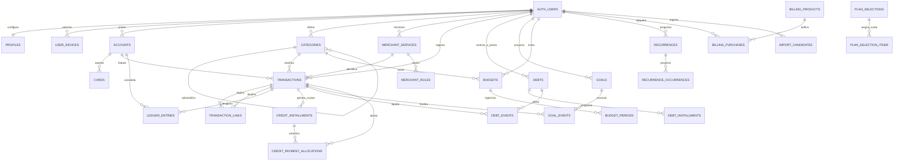
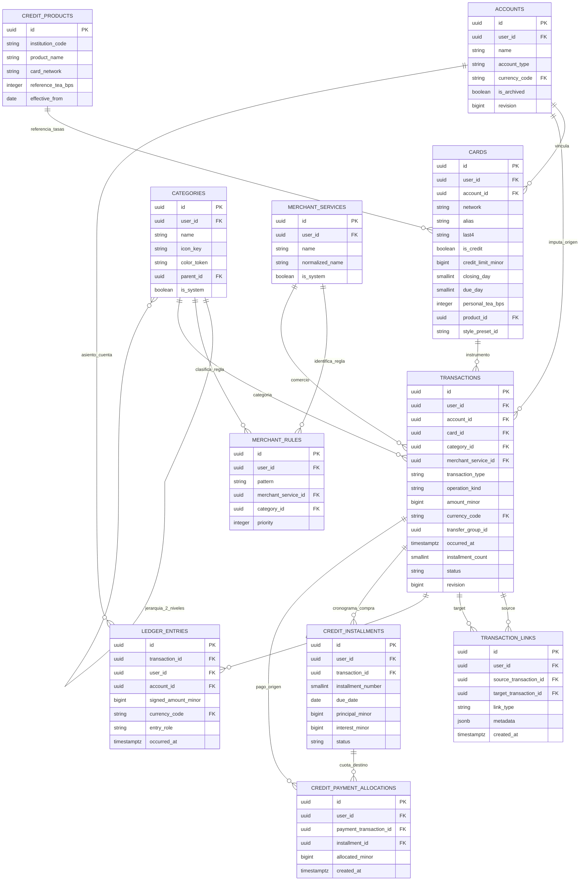
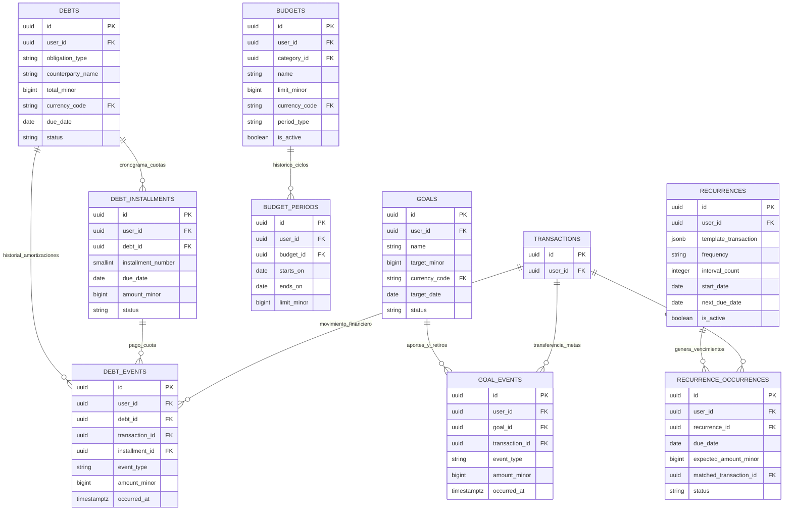
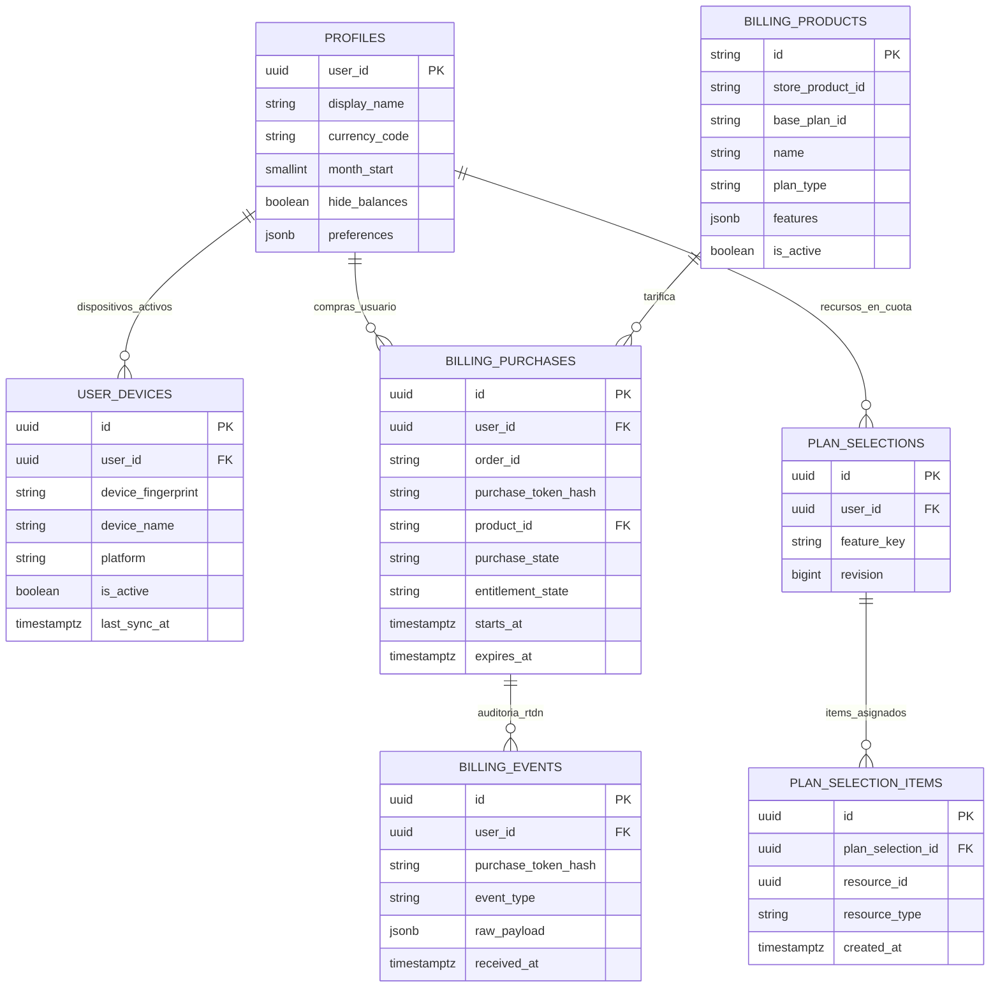
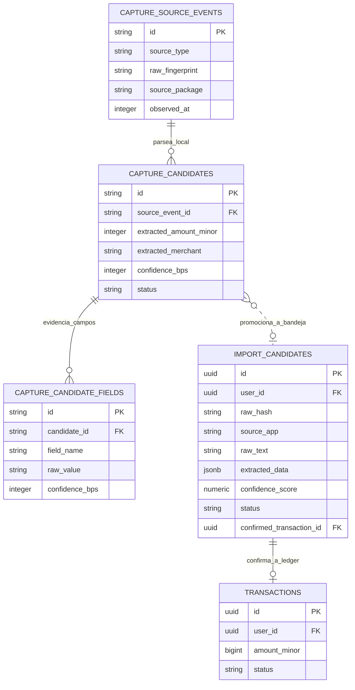

# KIPU V4.2 - Modelo Entidad-Relación (MER / DER)

> **MER completo integrado — 2026-10-20.** Origen: `KipuApp/Entidades/V4.2_Modelo_Entidad_Relacion.md`, versión **2.1 del 20/09/2026**. Contiene los diagramas Mermaid y cardinalidades del diseño base; no es un diagrama extraído de una base desplegada. Contrastar con los [refinamientos por épica](README.md). En particular, la regla original de metas mediante `GOALS_VIRTUAL` no autoriza reinterpretar las reservas actuales: consultar [EP-MET](../../specs/006-ep-met-metas-reservas/data-model.md) y la [constitución](../../.specify/memory/constitution.md). Los modelos de `Entidades antiguas/` y Bizagi siguen excluidos.

> **Diagramas de Entidad-Relación, matriz de cardinalidades, integridad referencial y restricciones relacionales para Android (Room/SQLite) y Backend (Supabase/PostgreSQL).**  
> **Versión:** 2.1 Canónica Alineada — Fecha: 20/09/2026.  
> **Referencias:** [Especificación de producto](../producto/especificacion.md), [Product Backlog](../producto/backlog.md), [Arquitectura y modelado](modelo-de-datos.md), [Catálogo de entidades](entidades.md).

---

## 1. Convenciones de Notación Relacional

Los diagramas utilizan la notación estándar de **Crow's Foot** (Pata de Gallo) soportada en Mermaid `erDiagram`:

| Símbolo | Significado de Cardinalidad | Interpretación en Dominio Kipu |
| :---: | :--- | :--- |
| <code>&#124;&#124;--&#124;&#124;</code> | Uno a Uno estricto (1:1) | Ejemplo: `auth.users` con `profiles`. |
| <code>&#124;&#124;--&#124;{</code> | Uno a Muchos obligatorio (1:N) | Cada elemento hijo debe pertenecer exactamente a un padre. |
| <code>&#124;&#124;--o{</code> | Uno a Muchos opcional (1:0..N) | El padre puede tener cero, uno o muchos hijos. |
| <code>}&#124;--&#124;{</code> | Muchos a Muchos (N:M) | Se resuelve mediante tabla intermedia asociativa (ej. `credit_payment_allocations`). |
| <code>o&#124;--&#124;{</code> | Cero o Uno a Muchos (0..1:N) | Referencias globales o anulables (ej. categorías globales del sistema con `user_id IS NULL`). |

---

## 2. Diagrama Entidad-Relación Global (Macro-DER)

Visión panorámica de alto nivel que conecta los 6 subsistemas principales de Kipu:

---

## 3. DER Núcleo Contable, Cuentas, Tarjetas y Movimientos

Detalle del subsistema transaccional y libro mayor de doble partida:

---

## 4. DER Planificación Financiera (Deudas, Metas, Presupuestos y Recurrencias)

Detalle de metas, obligaciones y reglas de presupuesto enlazadas con transacciones:

---

## 5. DER Facturación, Planes, Dispositivos e Identidad

Detalle de suscripciones de Google Play Store, control de cuotas y dispositivos autorizados:

---

## 6. DER Captura Asistida e Ingesta Offline (Room + Supabase)

Detalle del flujo desde la captura OCR/SMS local en Android hasta la bandeja `import_candidates` y su confirmación en `transactions`:

---

## 7. Matriz Completa de Relaciones y Cardinalidades

| Entidad Origen | Cardinalidad | Entidad Destino | Clave Foránea (FK) | Regla ON DELETE | Semántica de Negocio |
| :--- | :---: | :--- | :--- | :--- | :--- |
| `auth.users` | `1 : 1` | `public.profiles` | `user_id` | CASCADE | Perfil único por usuario autenticado. |
| `auth.users` | `1 : N` | `public.user_devices` | `user_id` | CASCADE | Instalaciones autorizadas del usuario. |
| `auth.users` | `1 : N` | `public.accounts` | `user_id` | CASCADE | Cuentas patrimoniales del usuario. |
| `auth.users` | `1 : N` | `public.categories` | `user_id` | CASCADE | Categorías personalizadas (NULL = globales). |
| `auth.users` | `1 : N` | `public.merchant_services` | `user_id` | CASCADE | Comercios propios del usuario (NULL = globales). |
| `auth.users` | `1 : N` | `public.transactions` | `user_id` | CASCADE | Movimientos contables del usuario. |
| `public.accounts` | `1 : N` | `public.cards` | `account_id` | RESTRICT | Una cuenta bancaria o de pasivo respalda tarjetas. |
| `public.credit_products` | `0..1 : N` | `public.cards` | `product_id` | SET NULL | Catálogo referencial de tasas para simulación. |
| `public.categories` | `0..1 : N` | `public.categories` | `parent_id` | RESTRICT | Jerarquía de categorías (máx. 2 niveles). |
| `public.merchant_services`| `1 : N` | `public.merchant_rules` | `merchant_service_id` | CASCADE | Reglas de texto que asignan a un comercio. |
| `public.categories` | `0..1 : N` | `public.merchant_rules` | `category_id` | SET NULL | Categoría sugerida automáticamente por la regla. |
| `public.accounts` | `1 : N` | `public.transactions` | `account_id` | RESTRICT | Cuenta afectada por la transacción. |
| `public.cards` | `0..1 : N` | `public.transactions` | `card_id` | SET NULL | Tarjeta empleada en la operación (opcional). |
| `public.categories` | `0..1 : N` | `public.transactions` | `category_id` | SET NULL | Clasificación del gasto/ingreso (opcional). |
| `public.merchant_services`| `0..1 : N` | `public.transactions` | `merchant_service_id` | SET NULL | Comercio o servicio identificado (opcional). |
| `public.transactions` | `1 : N` | `public.transaction_links` | `source_transaction_id`| CASCADE | Transacción origen del emparejamiento. |
| `public.transactions` | `1 : N` | `public.transaction_links` | `target_transaction_id`| CASCADE | Transacción destino del emparejamiento. |
| `public.transactions` | `1 : N` | `internal.ledger_entries` | `transaction_id` | CASCADE | Asientos contables inmutables de partida doble. |
| `public.accounts` | `1 : N` | `internal.ledger_entries` | `account_id` | RESTRICT | Cuenta afectada en el balance contable. |
| `public.transactions` | `1 : N` | `public.credit_installments` | `transaction_id` | CASCADE | Cronograma de cuotas de una compra a crédito. |
| `public.transactions` | `1 : N` | `public.credit_payment_allocations` | `payment_transaction_id`| CASCADE | Transacción de pago que amortiza cuotas. |
| `public.credit_installments`| `1 : N`| `public.credit_payment_allocations` | `installment_id` | CASCADE | Cuota crediticia amortizada. |
| `auth.users` | `1 : N` | `public.debts` | `user_id` | CASCADE | Deudas y préstamos del usuario. |
| `public.debts` | `1 : N` | `public.debt_installments` | `debt_id` | CASCADE | Cronograma de cuotas de la deuda/préstamo. |
| `public.debts` | `1 : N` | `public.debt_events` | `debt_id` | CASCADE | Hechos de amortización o ajuste de deuda. |
| `public.transactions` | `0..1 : N` | `public.debt_events` | `transaction_id` | SET NULL | Transacción bancaria vinculada al pago de deuda. |
| `auth.users` | `1 : N` | `public.goals` | `user_id` | CASCADE | Metas de ahorro del usuario. |
| `public.goals` | `1 : N` | `public.goal_events` | `goal_id` | CASCADE | Aportes o retiros de la meta. |
| `public.transactions` | `0..1 : N` | `public.goal_events` | `transaction_id` | SET NULL | Transferencia bancaria asociada al ahorro. |
| `auth.users` | `1 : N` | `public.budgets` | `user_id` | CASCADE | Presupuestos definidos por el usuario. |
| `public.categories` | `0..1 : N` | `public.budgets` | `category_id` | RESTRICT | Categoría presupuestada (NULL = Total General). |
| `public.budgets` | `1 : N` | `public.budget_periods` | `budget_id` | CASCADE | Historial inmutable de vigencias presupuestarias. |
| `auth.users` | `1 : N` | `public.recurrences` | `user_id` | CASCADE | Reglas de gastos/ingresos recurrentes. |
| `public.recurrences` | `1 : N` | `public.recurrence_occurrences`| `recurrence_id` | CASCADE | Instancias proyectadas en el calendario. |
| `public.transactions` | `0..1 : 1` | `public.recurrence_occurrences`| `matched_transaction_id`| SET NULL | Transacción real que satisfizo la ocurrencia. |
| `public.billing_products`| `1 : N` | `public.billing_purchases` | `product_id` | RESTRICT | Producto de suscripción contratado. |
| `public.plan_selections` | `1 : N` | `public.plan_selection_items` | `plan_selection_id` | CASCADE | Elementos que ocupan cuotas del plan Free. |
| `public.transactions` | `0..1 : 1` | `public.import_candidates` | `confirmed_transaction_id`| SET NULL | Transacción creada tras confirmación en bandeja. |

---

## 8. Invariantes y Reglas de Integridad Relacional

1. **Aislamiento Multi-Tenant Estricto (`user_id`):**
   * Toda tabla que guarde información del usuario incluye `user_id UUID NOT NULL REFERENCES auth.users(id) ON DELETE CASCADE`.
   * En consultas y uniones (`JOIN`), el motor SQL y las políticas RLS exigen que ambas tablas coincidan en `user_id`. Jamás se permite que una transacción de usuario $A$ enlace una cuenta o tarjeta de usuario $B$.

2. **Inmutabilidad Contable del Libro Mayor (`internal.ledger_entries`):**
   * Un asiento contable insertado **nunca se actualiza ni se elimina físicamente**.
   * Las correcciones o anulaciones se realizan insertando nuevos asientos contables compensatorios de reversión (`entry_role = 'REVERSAL'`).

3. **No Duplicación de Saldos en Metas (`GOALS_VIRTUAL`):**
   * Los fondos destinados a metas de ahorro residen en la cuenta virtual unificada `GOALS_VIRTUAL`.
   * Todo aporte a una meta se procesa contablemente como una transferencia (`TRANSFER`) desde una cuenta de activo real hacia `GOALS_VIRTUAL`, evitando duplicar saldos en la vista consolidada de patrimonio.

4. **Emparejamiento Bidireccional Limpio (`transaction_links`):**
   * En transferencias entre cuentas propias o pagos de tarjeta (**RN-06**), se generan dos transacciones vinculadas mediante un registro en `transaction_links` con `link_type = 'TRANSFER'` o `'CARD_PAYMENT'`.
   * En reembolsos (**RN-12**, **DTV-09**), se enlaza la transacción de egreso original con la de reintegro bajo `link_type = 'REFUND'`, neutralizando el gasto en las proyecciones analíticas.

5. **Restricción Estricta de Jerarquía de Categorías (RF-K10):**
   * `categories.parent_id` solo puede apuntar a una categoría raíz (`parent_id IS NULL`).
   * No se permiten sub-subcategorías (profundidad máxima = 2).
   * No existen tablas intermedias de etiquetas o tags.
