# Auditoría funcional de Kipu — Sprint 6

> **Estado del informe: auditoría parcial ampliada.** Reanudada el 2026-10-20. Se verificaron búsquedas exacta/parcial/sin coincidencias, rechazos UI de importe cero, categoría ausente y tres decimales, el cobro parcial de una receivable QA, una transferencia interna asociada a meta y persistencia local de recurrencias CANCELLED y ACTIVE tras relanzar Kipu. Ninguno demuestra sync remoto ni completa HU-24. El hash del APK instalado coincide con el candidato local QA Premium debug APK; siguen sin acreditarse una build reproducible, la fecha histórica ni su correspondencia con un release Sprint 6.

## 1. Resumen ejecutivo

- **Fecha:** iniciada 2026-10-19; reanudada 2026-10-20.
- **Alcance:** reanudación exploratoria funcional en dispositivo real, cobertura acumulada S1–S6 y verificación focalizada de HU-20/21, HU-28/29, HU-30–33/35. No se completó una regresión exhaustiva.
- **Versión y provenance del artefacto actual:** `com.kipu.app`, `versionName=0.1.0`, `versionCode=1`, `targetSdk=36`. En lectura ADB posterior, el SHA-256 del `base.apk` instalado coincidió con el candidato local QA Premium debug APK: `e218941857b805335e932ac78b6412ef31e316607a0775ca2824db4eda8c2864`. El candidato reside en el worktree `012-ep-pla-qa-premium`, HEAD `d5943e8748490765caec95638802bef160e50d30`, cuyo merge-base es `dd6758a01a236aa61053ebf8ab24f25e0c835ba5`; el delta inspeccionado es de provisioning/docs QA Premium, no de pantallas/deuda/movimientos. Esto vincula bytes actuales al artefacto local disponible, pero no es una atestación reproducible de build ni prueba por sí solo el artefacto exacto en la fecha de cada síntoma; no atribuirlo a un release Sprint 6.
- **Dispositivo:** Samsung SM-A165M, Android 16 / API 36. ADB detectó el dispositivo autorizado; sesión iniciada. Red observada: Wi-Fi validada, sin marcador de portal cautivo; la conectividad intermitente no se probó.
- **Acceso:** según el usuario, la instalación dispone de Premium QA local hasta el 2026-10-20 23:51 UTC−5; esto no demuestra suscripción comercial ni altera cuotas independientes del servidor. No se hicieron compras, pagos reales ni renovación.
- **Fixtures y limpieza:** se crearon, además de los inventariados antes, la receivable histórica `qahu24rcvb1` (entrada `QAHU24RCVB1`; principal PEN 1.00, sin desembolso nuevo), con cobro de principal PEN 0.50 y pendiente PEN 0.50; la meta `QA_AUDIT_20261020_GOAL` mantiene reserva PEN 0.50 mediante traslado interno desde `Billetera QA20261020CTAA` al respaldo `QA20261020CASHB` (PEN 0.50 reservado). Saldos QA observados después: wallet PEN 4.75 y cashB PEN 0.50. Se creó/renombró/archivó una cuenta de efectivo QA sin transacciones; la tarjeta de crédito de prueba `QA20261020CARD1` también fue archivada y no tuvo consumos. No se borraron fixtures; sync remoto no comprobado. No se alteraron datos preexistentes.
- **Hallazgos confirmados:** pantalla vacía tras guardar una edición de movimiento (2/2 intentos); no se encontró acción en la UI para anular un pago ligado a deuda, aunque el menú de movimientos remite a gestión de deuda. Observaciones potenciales: historial `CANCELLED` del cronograma (sin duplicación activa demostrada), etiquetas `Gasto`/`Ingreso` de principal sin impacto agregado, retención de campos de borrador, claridad del cupo para efectivo, navegación tras archivar tarjeta y tokens UI (sin defecto renderizado confirmado).
- **Persistencia remota:** no confirmada. En una lectura local, comandos de deuda/apertura/cronograma/liquidación quedaron `PENDING`, con `attempt_count=0`; Android enumera servicios WorkManager y una marca `RUNNING` no atribuible al worker de deuda. No se consultó ni modificó el backend.
- **Automatización ejecutada:** `./gradlew testDebugUnitTest` terminó `BUILD SUCCESSFUL` (33 tareas, 5 ejecutadas y 28 up-to-date). Es evidencia de unit tests locales; no sustituye los casos exploratorios/instrumentados del dispositivo ni certifica el APK instalado.
- **Evidencia:** capturas de pantalla solo de datos QA en `capturas/` y estado local filtrado/sanitizado en `logs/BUG-001-local-persistencia.txt`. No se guardaron datos de terceros ni UUIDs.
- **Conteo de casos en la matriz (55 filas S1–S6):** 33 PASS, 2 FAIL, 1 BLOCKED y 19 NOT TESTED. Los PASS son resultados de casos observados acotados, no HU completas. Hallazgos: 2 confirmados (BUG-002 y BUG-003; ambos Medium); BUG-001, OBS-001–OBS-005 y UI-001 permanecen potenciales, con severidad INFO/P3 o pendiente de revalidación de su categoría; no se demostró daño de saldos por los dos bugs confirmados.
- **Veredicto técnico:** **CHANGES REQUESTED** por dos defectos confirmados de UI/gestión de pagos. No equivale a aprobar el release; la auditoría S1–S6 permanece parcial.

## 2. Matriz de cobertura

| Funcionalidad / HU / sprint | Caso | Estado | Evidencia | Bug relacionado | Limitación |
|---|---|---|---|---|---|
| S1 HU-01–05/52: acceso, sesión, privacidad, plan | Sesión ya iniciada; paquete y versión identificados; acceso Premium QA indicado por usuario | NOT TESTED | ADB y UI | — | Login/logout, privacidad, biometría y permisos no probados; Premium QA local no es plan comercial |
| S2 HU-07/08: cuentas y billetera | Creación de billetera QA con alias y apertura; vuelta al resumen | PASS | Observación UI, sin captura final verificable | — | No se probaron edición/eliminación; persistencia remota no confirmada |
| S2 HU-07: crear cuenta de efectivo QA | Crear `QA20261020CRD1`, Efectivo, PEN 0.00; aparece activa en listado | PASS | 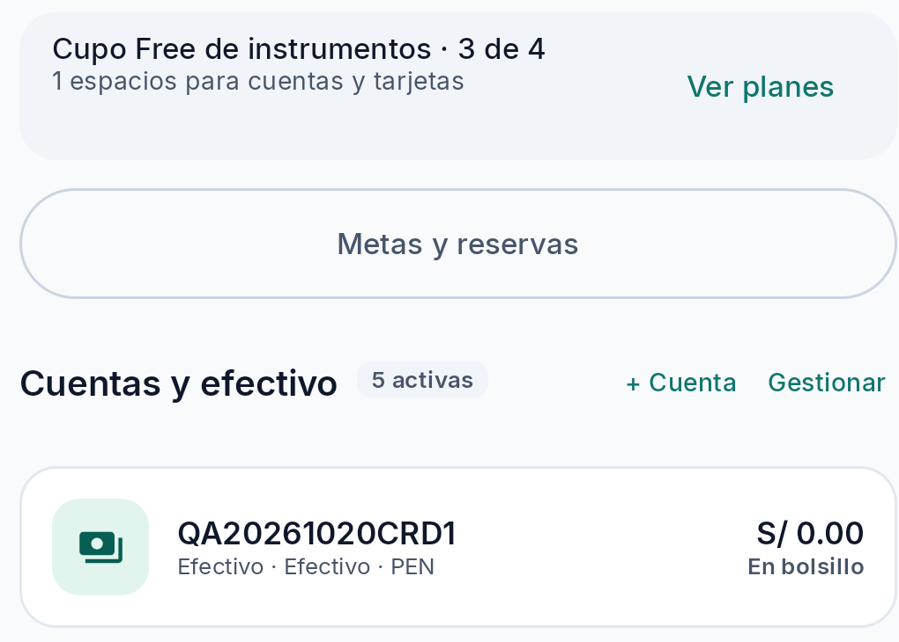 | — | Cuenta propia sin movimientos; sync local/remote no confirmado |
| S2 HU-07: editar alias de cuenta QA | Editar `QA20261020CRD1` a `QA20261020CRD2`; conserva PEN 0.00 y aparece “Presentación actualizada · Pendiente de sincronización” | PASS | 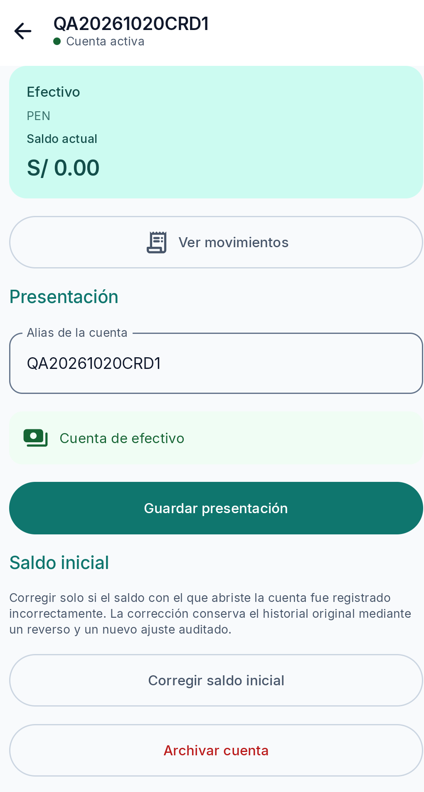 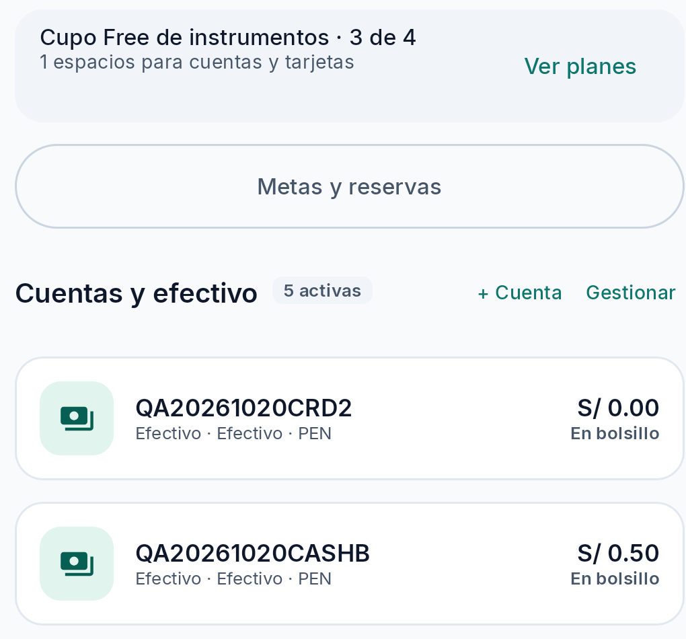 | — | El mensaje indica estado local; no confirma backend |
| S2 HU-07: archivar cuenta QA sin movimientos | Archivar `QA20261020CRD2`; el diálogo dice que no elimina movimientos/historial y permite reactivarla; el listado pasa de 5 a 4 activos y la UI muestra “Instrumento archivado · Pendiente de sincronización” | PASS | 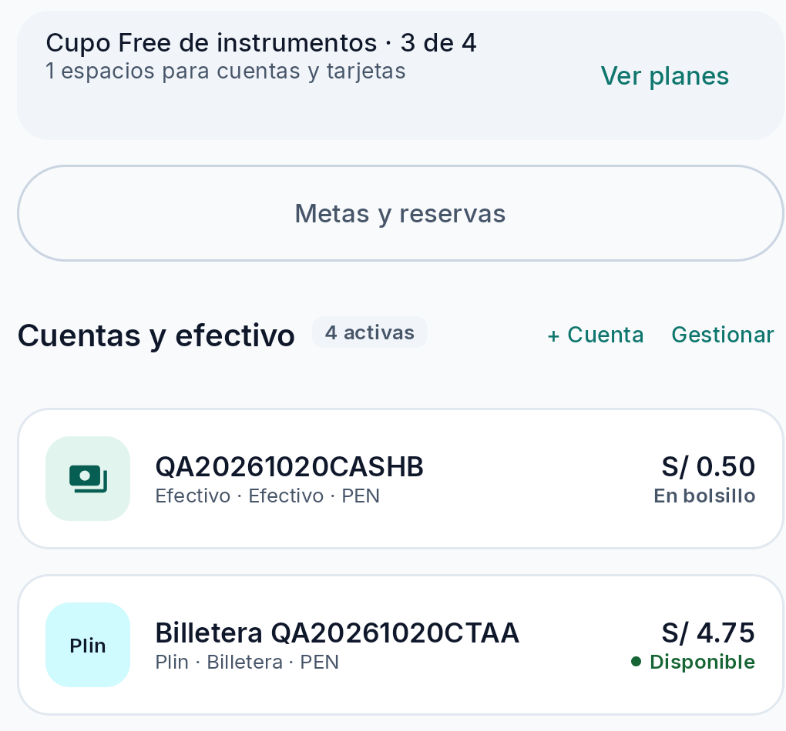  | OBS-004 | Se archivó solo la entidad creada por QA; no se borró historia ni se cambió un instrumento preexistente |
| S2 HU-07: semántica del cupo para efectivo | El contador Free se mantuvo en 3/4 al crear y archivar una cuenta de efectivo; el rótulo de sección mostró 5 y luego 4 activos | NOT TESTED | `capturas/funcional/hu-07-cash-account-crud-created.png`, `capturas/funcional/hu-07-cash-account-crud-after-archive.png` | OBS-004 | No se encontró criterio que indique si efectivo cuenta para “cuentas y tarjetas”; resultado funcional no calificable, observación de claridad |
| S2 HU-18: importe cero | Intentar guardar gasto QA con importe 0.00 en borrador propio; la UI conserva el formulario y muestra `Ingresa un monto válido mayor a 0` | PASS | Observación UI 2026-10-20; sin captura de error conservada | — | El intento no creó una confirmación visible; persistencia remota no confirmada |
| S2 HU-18/19: movimiento positivo y coherencia lista/detalle | Gasto QA PEN 1.25 guardado; listado y detalle muestran `-S/1.25`, categoría Alimentación, cuenta QA y nota `QA20261020MOVCTAA`; saldo local observado al guardar pasó de PEN 5.00 a PEN 3.75 | PASS |  | OBS-003 potencial | Detalle muestra chip `Verificado` y comprobante pendiente; no hay señal de sync en este panel y no se infiere confirmación remota; ver OBS-003 |
| S2 HU-18: categoría obligatoria | Intentar guardar gasto QA de PEN 1.00 sin categoría | PASS | Validación UI; borrador siguió abierto | — | El formulario no confirmó el gasto; no se probó validación de instrumento ausente |
| S2 HU-18: precisión monetaria | Intentar guardar gasto QA de PEN 1.234 con categoría existente; formulario rechaza y permanece abierto | PASS | UI, error `Ingresa un monto válido mayor a 0` | — | Rechazo confirmado; mensaje no identifica específicamente el exceso de decimales |
| S2 HU-18: importe negativo | Intento de escribir `-1.00` en campo de gasto; el signo no quedó en el valor y se mostró PEN 1.00 | NOT TESTED | Inspección UI/ADB; no se guardó | — | La entrada textual/teclado del APK no permitió probar un monto negativo; no inferir validación en persistencia |
| S2 HU-18/19: instrumento requerido | Formulario de gasto preseleccionó una cuenta QA; no se halló una opción para dejar el instrumento vacío | NOT TESTED | Observación UI | — | No se probó rechazo por ausencia de cuenta; no se cambió ninguna cuenta existente |
| S2 HU-18: fecha | Campo fecha/hora llega prellenado con valor válido; no se encontró una entrada para una fecha inválida/vacía en la ruta UI probada | NOT TESTED | Observación UI | — | La especificación revisada no fija una regla de fecha futura/pasada para este caso; no se infiere cumplimiento ni defecto |
| S4 HU-20: editar movimiento | Editar movimiento QA y guardar, 2/2 intentos | FAIL | `capturas/incidencias/bug-002-movimientos-blank-after-edit.png` | BUG-002 | El contenido quedó vacío hasta force-stop/relaunch; el movimiento persistió localmente |
| S4 HU-21: anular movimiento ordinario | Anular gasto QA no vinculado a deuda | PASS | Flujo UI reportado; captura omitida del bundle por `NEEDS_CONTEXT` | — | No se probó anulación de movimientos preexistentes |
| S2 HU-23: deduplicación | No se generaron intencionalmente duplicados de movimientos ordinarios | NOT TESTED | — | — | No verificar duplicados concurrentes/reintentos |
| S2 HU-18/19: transferencias | Transferencias QA previas; en esta continuación, crear cuenta QA Efectivo con PEN 0.00, transferir PEN 1.00 desde wallet QA a cuenta nueva y anular desde UI la transferencia identificada, restaurando ambos saldos | PASS | Ver detalle en continuación dirigida; captura omitida del bundle por `NEEDS_CONTEXT` | — | Saldos UI antes PEN 4.75/0.00, después transferencia 3.75/1.00, tras anulación 4.75/0.00; suma constante PEN 4.75; sync remoto no comprobado |
| S3 HU-10–13/42/53–56: compras, consumos y Play billing | No se ejecutaron consumos, pagos, compras ni suscripciones | NOT TESTED | — | — | Exclusión deliberada de transacciones externas; solo se probó alta/consulta/archivo de tarjeta manual sin compra |
|| S3 HU-11 escenario 1: consultar catálogo/tasa de tarjeta QA | No se pudo abrir detalle ni catálogo; preflight inicial y recuperación acotada reportaron lista ADB vacía | NOT TESTED | `adb start-server` seguido de `devices -l` (SDK ADB 37.0.1), 2026-10-20; véase continuación S3 | — | No se inspeccionó `QA20261020CARD1` ni se consultó un alta en borrador. Fuente aprobada: backlog HU-11 §§810–828 y EP-CTA; se esperaba evidencia de producto, tasa, fuente/fecha y advertencia o fallback, sin inventar tasas. La tasa es referencial, no promesa bancaria. Requiere Android previamente autorizado visible como `device`; no se usaron tarjetas personales ni credenciales. |
|| S3 HU-10 escenario 3: editar umbrales de tarjeta QA y cancelar borrador | No se abrió editor ni se cambió estado porque no había dispositivo ADB conectado | NOT TESTED | `adb start-server` seguido de `devices -l` (SDK ADB 37.0.1), 2026-10-20; véase continuación S3 | — | HU-10 define valores iniciales 50/80/100% editables y porcentajes válidos/ordenados (backlog §§745–766). No se comprobaron valores, edición, cancelación ni conservación de originales. Cruces/notificaciones quedan fuera para no generar compras ni alterar permisos. Requiere Android previamente autorizado visible como `device` y que la tarjeta QA archivada exponga la superficie sin reactivarse. |
| S3 HU-09: crear y consultar tarjeta manual QA | Crear `QA20261020CARD1` como Otra entidad/Visa; línea PEN 1,000.00, corte día 10, pago día 25, alertas 50/80/100%; detalle mostró deuda PEN 0.00, disponible PEN 1,000.00 y uso 0%. No se registraron consumos ni pagos; solo se ingresó un sufijo sintético de cuatro dígitos, nunca PAN/CVV/credenciales | PASS | 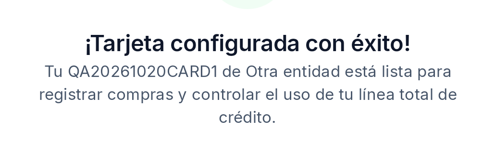 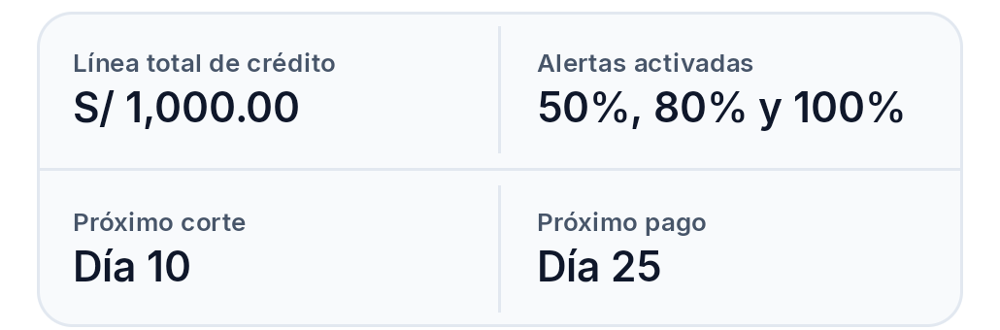 | — | Proyección del artefacto local; no acredita conexión bancaria ni sync remoto; sufijo excluido de capturas |
| S3 HU-09: archivar tarjeta de crédito QA sin consumos | Confirmación explícita indicó que no borra movimientos/historial y permite reactivar; QA card dejó de aparecer en instrumentos activos | PASS | 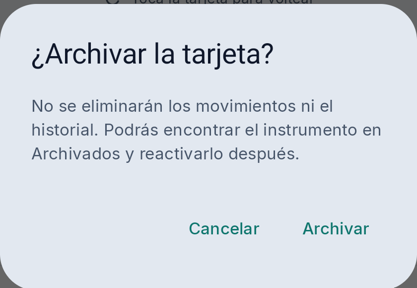; contador global omitido por privacidad | OBS-005 | No se hizo compra, pago, suscripción ni borrado de historial; sync remoto no confirmado |
| S4 HU-22: filtro de movimientos (observación visual únicamente) | Filtro «Gastos» incluye visualmente el pago QA de principal | PASS | Captura omitida del bundle mientras se completa la revisión de privacidad/integridad | OBS-001 | PASS solo de representación visual; no acredita el criterio contable de HU-28 ni que cambie gastos operativos |
| S5 HU-28: clasificación contable de pagos | No se obtuvo before/after fiable de totales operativos en el APK instalado, cuyo hash coincide con el candidato local QA | NOT TESTED | — | OBS-001 | Etiqueta/filtro visual no prueba impacto contable; la coincidencia de artefacto no acredita build reproducible, fecha histórica ni resultados contables |
| S4 HU-22: búsqueda exacta | Buscar `QA20261020MOVCTAA` en historial; aparece el gasto QA correspondiente | PASS | `capturas/funcional/hu-22-search-exact-qa.png` | — | Caso textual acotado; no verifica fechas/tipos/filtros combinados ni sync remoto |
| S4 HU-22: búsqueda parcial | Buscar `20261020MOVCT`; aparece el mismo gasto QA | PASS | `capturas/funcional/hu-22-search-partial-qa.png` | — | Una coincidencia QA visible; no verifica otros campos ni coincidencias múltiples |
| S4 HU-22: sin coincidencias | Buscar `zznoresult987`; se muestra estado vacío y acción para limpiar filtros | PASS | `capturas/funcional/hu-22-search-no-results.png` | — | Solo historial local y filtro Gastos; no verifica filtros combinados ni sync remoto |
| S4 HU-22: filtro combinado de fecha/tipo/cuenta sobre gasto QA conocido | Abrir filtros y localizar la cuenta QA; no se completó el rango incluyente/excluyente ni se aplicó la combinación | NOT TESTED | Continuación UI/ADB 2026-10-20; jerarquía actual filtrada a controles QA | — | Se seleccionó por checkbox `Billetera QA20261020CTAA` y se cerró su selector con Listo. En el panel se observaron filtros de período/fecha y Gastos, pero no se identificó ni operó una selección de rango calendario personalizado; no se aplicó ni verificó ningún resultado combinado. Se canceló el panel sin guardar cambios. No se leyó fecha/tipo/cuenta del movimiento ni se abrió un registro ajeno; detalle en la continuación HU-22 al final |
| S4 HU-22/58/59: modo offline y entitlement | No se cambió conectividad/plan ni se probaron filtros Premium protegidos | NOT TESTED | — | — | No alterar configuración de red ni expiración QA |
| S5 HU-26/27: crear/consultar deuda | Deuda histórica QA de principal PEN 100; detalle reabierto; nueva receivable histórica QA PEN 1.00 creada y consultada | PASS | `capturas/incidencias/bug-001-antes.png`; continuidad UI 2026-10-20 | — | Fixtures propios, estado remoto no confirmado |
| S5 HU-29: cronograma | Guardado único, doble tap, ráfaga de 4 taps, volver a pantalla, reabrir y reiniciar proceso | PASS | `capturas/incidencias/bug-001-multiples-pulsaciones.png`, `capturas/incidencias/bug-001-post-reinicio.png`, log BUG-001 | BUG-001 (potencial) | Múltiples revisiones/canceladas, pero no se demostró duplicación activa, solapamiento ni incumplimiento del contrato; no issue por ahora |
| S5 HU-28 / S6 HU-24 AC1: pago parcial de principal QA | Liquidación parcial previa PEN 1.00 en `QA_AUDIT_20261020_CRON`, principal mostrado de PEN 100.00 a PEN 99.00 | PASS | `logs/BUG-003-local-payment-aggregate.txt`; captura excluida del bundle hasta cerrar revisión | OBS-001 | Proyección local de principal; gastos operativos/consistencia contable agregada no medidos; ver caso NOT TESTED de clasificación |
| S5 HU-28: rechazo de sobrepago | Intento QA de sobrepago rechazado por la UI | PASS | Observación UI previa | — | No confirma respuesta de backend ni clasificación de principal |
| S5 HU-28 AC6 / HU-29 AC6: anulación/corrección de pago | Menú de movimiento advierte vínculo con deuda y remite a gestión especializada; detalle/historial sin acción visible tras inspección/tap | FAIL | `capturas/incidencias/bug-003-void-blocked-linked-debt.png`, `capturas/incidencias/bug-003-debt-detail-no-void-action.png` | BUG-003 | No se intentó corregir vía DB/backend; pago QA queda local y no se pudo revertir desde UI |
| S5 HU-29: cierre controlado de obligación QA | En la receivable QA histórica separada, registrar cobro del principal liquidó la obligación y dejó saldo 0.00; no se probó cierre de la deuda de cronograma ni cuotas/recordatorios | PASS | Continuación UI 2026-10-20, ver fila HU-28 de cobro/liquidación | — | Confirma solo el ciclo de vida de esa receivable histórica, no cierre de deuda amortizada, cuotas ni sincronización |
| S5 HU-29: recordatorios/notificaciones de deuda | No se activaron ni verificaron notificaciones | NOT TESTED | — | — | No se alteraron permisos ni entrega de notificaciones |
| S6 HU-24 escenario 2: cobro parcial de préstamo | Receivable histórica QA `qahu24rcvb1`, principal PEN 1.00 y opción “Ya estaba registrado previamente”; cobro de principal PEN 0.50 a wallet QA, queda Activa con PEN 0.50 pendiente; el detalle se volvió a observar tras relanzar Kipu | PASS | `capturas/funcional/hu-24-receivable-partial-collection.png`, `capturas/funcional/hu-24-receivable-after-relaunch-qa.png` | — | Evidencia local/UI; no confirma que el principal se excluya de ingresos operativos ni sync remoto |
|| S6 HU-24 escenario 3: transferencia explícita ligada a meta | Desde `QA_AUDIT_20261020_GOAL`, se habilitó “Confirmar traslado interno”; origen wallet QA PEN 5.25, respaldo `QA20261020CASHB` PEN 0.00; después wallet PEN 4.75, cashB PEN 0.50 y meta reservada PEN 0.50 | PASS | `capturas/funcional/hu-24-goal-internal-transfer-before-qa.png`, `capturas/funcional/hu-24-goal-internal-transfer-sanitizada.png` | — | Antes/después local de dos cuentas QA y reserva; el formulario expresa que no crea gasto/ingreso. El derivado está dictaminado SAFE en el manifiesto de privacidad; no prueba outbox, atomicidad o backend. |
| S6 HU-24: clasificación en totales operativos | Cobro de principal figura en detalle/listado como `Ingreso`; UI de aporte dice que el traslado no crea gasto/ingreso, pero no se midieron totales operativos antes/después | NOT TESTED | `capturas/funcional/hu-24-receivable-principal-ledger-label.png` | OBS-001 (observación visual ampliada) | Etiqueta del ledger no basta para demostrar clasificación en métricas operativas |
| S6 HU-24: atomicidad/idempotencia/sync de aplicación | No se inyectó fallo ni se inspeccionó recibo/outbox específico de la transferencia de meta o cobro parcial | NOT TESTED | — | — | Requiere prueba focalizada/instrumentación y destino de sync autorizado; no forzar workers/RPC |
| S6 HU-24: detalle de meta archivada impide reservar | Abrir `QA_AUDIT_20261020_META` (Archivada, sin reserva); `Liberar`, `Reasignar` y `Meta archivada` están deshabilitados; tocar el último control no navega, no abre diálogo ni cambia estado | PASS |  | — | Comprueba prevención desde el detalle archivado, no una ruta de imputación a obligación |
| S6 HU-24: mensaje explícito y ausencia de efecto parcial al intentar aplicación | No hay acción de aporte/registro desde la meta archivada; no se alcanzó un formulario de aplicación a meta/obligación para intentar guardar un objeto no elegible | NOT TESTED | Evidencia de ruta sin control: `capturas/funcional/hu-24-archived-goal-no-contribution.png` | — | No declarar BLOCKED: se probó la fixture QA archivada y se confirmó que no ofrece ruta; queda pendiente el oráculo de rechazo en una ruta de aplicación real si la especificación/versión la expone |
| S6 HU-30/32: metas, editar y archivar | Crear meta QA, editar objetivo, archivar meta vacía; no alteró el saldo de la cuenta; además meta nueva QA de PEN 2.00 reservó/liberó PEN 1.00 y se archivó vacía | PASS | `capturas/funcional/hu-31-meta-release-restored.png`; continuación UI 2026-10-20 | — | Estado local visible; sync pendiente; archivar meta vacía no crea movimiento según diálogo de confirmación |
| S6 HU-30: cancelar borrador de edición de meta QA | Abrir edición de `QA_AUDIT_20261020_GOAL`, abandonar sin guardar y verificar que conserva objetivo PEN 10.00, reserva PEN 0.00 y estado Activa | PASS | Observación UI en sesión de continuación 2026-10-20; no se conservó captura porque la lista también mostraba metas preexistentes | — | Verifica solo descarte del borrador y estado visible; no prueba persistencia tras reinicio ni backend |
| S6 HU-31: reservar/liberar | Reservar y liberar monto QA; exceso de liberación deshabilitado; UI mostró fondos restaurados | PASS | `capturas/funcional/hu-31-meta-release-restored.png` | — | No se confirmó agregado global/persistencia remota |
| S6 HU-33: navegación desde detalle a formulario recurrente | Desde el detalle del gasto QA, desplazarse al fondo y abrir `Registrar pago recurrente` | PASS | Observación UI 2026-10-20; captura temporal no conservada por privacidad | — | Solo verifica CTA/ruta y formulario alcanzable; no creación/validación ni persistencia |
| S6 HU-33: formulario y creación de recurrencia | Regla QA `QA20261020RECCTB`, importe esperado PEN 1.25 (fijo, no pago), frecuencia mensual, siguiente fecha 2026-10-31; guardado local verificado | PASS | UI: `Guardado en este dispositivo · pendiente de sincronización`; formulario mostró estado ACTIVE | — | Solo persistencia local/UI; no se confirmó sync. No equivale a registrar pagos/gastos reales |
| S6 HU-35: pausar/reanudar/cancelar recurrencia | Revisión 1 ACTIVE → pausa rev.2 PAUSED → reanudar rev.3 ACTIVE → cancelar rev.4 CANCELLED; diálogo indicó próxima fecha válida 2026-10-31 sin relleno de períodos omitidos | PASS | Gestión de recurrencias UI, fixture `QA20261020RECCTB` | — | Ciclo local probado; no verifica backend |
|| S6 HU-33/35: recurrencia tras cerrar y reabrir Kipu | Tras `am force-stop` y relanzamiento, “Ver mis recurrencias” mostró `QA20261020RECCTB` CANCELLED, rev.4, próxima fecha 2026-10-31, pendiente de sincronización local | PASS | `capturas/funcional/hu-33-recurrence-after-relaunch-qa.png` | — | Confirma lectura local tras relanzar para estado CANCELLED; no prueba persistencia remota ni estado PAUSED. La persistencia local de ACTIVE para la regla distinta `QA20261020RECACT1` ya está verificada como PASS en la fila siguiente; no queda pendiente ese criterio. |
| S6 HU-33/35: persistencia de la misma recurrencia ACTIVE tras cerrar y reabrir | Regla existente `QA20261020RECACT1`; antes y después de cerrar/relanzar Kipu: ACTIVE, próxima 2026-10-31, revisión 1, sync pendiente | PASS |  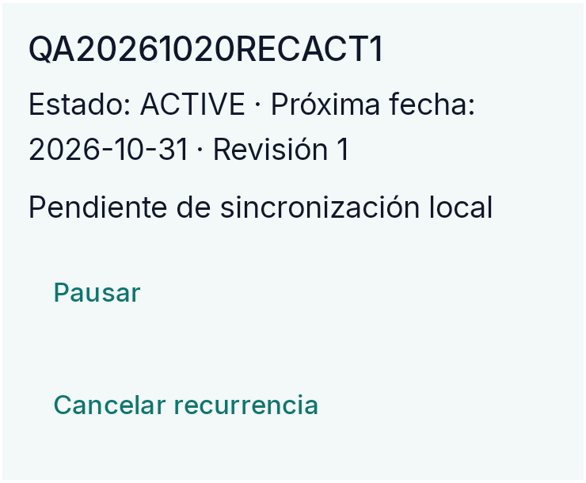 | — | Secuencia verificada SAVED/EXISTS→CLOSE Kipu→OPEN→READ de la misma regla y mismos campos. Confirma persistencia local del estado ACTIVE; sync remoto no confirmado. Regla se dejó activa para no añadir otra mutación y conservar fixture local pendiente. |
| S6 HU-44: recordatorios/deduplicación | No probado | NOT TESTED | — | — | Permisos y entrega de notificación no se alteraron |
| S2/S4: cerrar formulario de movimiento | Tocar X devuelve al historial sin guardar ni mostrar confirmación | PASS | Observación UI, 2026-10-20 | — | Solo verifica cierre de la hoja, no descarte/restablecimiento del estado |
| S2/S4: estado del formulario tras reabrir | Tras cerrar X y cambiar de pantalla en la misma sesión, al volver a abrir formulario reaparecieron importe PEN 1.00, categoría y nota QA previa | NOT TESTED | `capturas/funcional/hu-18-draft-retained-after-dismiss.png` | OBS-002 potencial | Retención observada 1/1; la imagen solo prueba campos presentes, no la secuencia. La especificación consultada no define si X debe descartar o conservar borrador; no abrir issue hasta confirmar el contrato |
| S2/S4: formulario QA con teclado abierto/cerrado y error inline | Abrir formulario QA no guardado con monto cero; comprobar ambos estados del teclado y error del campo | NOT TESTED | Texto y observaciones UI documentados; originales HU-18-form-keyboard-open/closed/zero-error excluidos por privacidad (NEEDS_CONTEXT) | — | Evidencia visual añadida previamente para revisión UI/UX; originales marcados NEEDS_CONTEXT por selector cuenta/saldo no atribuido. No se publican ni embeben aquí. La repetición previa fue solo para capturar teclado/error, no suma un PASS funcional nuevo: importe cero ya estaba PASS. Se conserva el resultado textual “Ingresa un monto válido mayor a 0”, sin éxito visible; el borrador temporal no se guardó. |
| S1–S6 sincronización | Sesión activa, Wi-Fi validada y sin portal cautivo; jobscheduler lista servicios WorkManager/SyncDebtChangesWorker; outbox local de deuda sin intentos | BLOCKED | `logs/BUG-001-local-persistencia.txt`; resumen de diagnóstico en sección 4 | — | No se correlacionó `RUNNING` con el worker de deuda; sin logs de aplicación/errores/respuesta backend suficientes; no forzar retries |

### Base documental usada para el alcance

- `01_Kipu_V4.2_Especificacion_Producto.md`: local-first, reglas financieras RN-07–RN-11, importes en unidades menores y conservación de operaciones relacionadas.
- `02_Kipu_V4.2_Product_Backlog.md`: catálogo de HU y criterios de aceptación.
- `04_Kipu_V4.2_Trazabilidad_y_Dependencias.md`: HU y dependencias por sprint.
- `05_Cronograma_Scrum_Kipu_V4.1.md`: HU-29 en S5; HU-24, HU-30–33, HU-35 y HU-44 en S6; presupuestos/calendario en S7.
- `AGENTS.md` del repositorio: ubicación confirmada del checkout y convenciones de trabajo.

## 3. Hallazgos

### BUG-001 — Guardados repetidos del cronograma: reemplazos e historial cancelado (observación potencial)

- **Estado:** Potencial / observación. Se confirmó que varios guardados locales crean reemplazos y filas históricas `CANCELLED`, pero no se demostró que dos operaciones fueran aceptadas mientras `isSaving` estaba activo ni que el historial incumpla el contrato (que conserva cuotas reemplazadas). No se reprodujo duplicación de cuotas activas, principal, pagos o saldo.
- **Severidad:** INFO hasta demostrar una violación. No se atribuye impacto financiero; la acumulación por sí sola puede ser la historia auditable prevista.
- **Prioridad recomendada:** No crear issue todavía. Haría falta instrumentar tiempos de callbacks/estados y contrastar el requisito de idempotencia de una intención de guardado.
- **Módulo y sprint relacionado:** Deudas, gestión de cuotas/cronograma — HU-29, Sprint 5.
- **Ubicación técnica revisada (código del checkout, no prueba de provenance del APK):** `app/src/main/java/com/kipu/app/feature/debts/presentation/DebtScheduleScreen.kt:679-693`; `DebtScheduleViewModel.kt:96-123`; `data/local/DebtLocalDataSource.kt:459-574`. Referencias del análisis estático en `analisis-cronograma.md`.
- **Entorno y versión:** Samsung SM-A165M, Android 16/API 36; `com.kipu.app` `0.1.0` (`versionCode=1`, `targetSdk=36`). La correspondencia con S6/commit `dd6758a` no está confirmada. Red Wi-Fi conectada; no se alteró conectividad.
- **Precondiciones:** Sesión iniciada; deuda creada por QA `QA_AUDIT_20261020_CRON`, principal PEN 100.00, modo histórico; plan vigente de 3 cuotas mensuales desde 20-nov-2026, importe total PEN 100.00. No se tocaron las deudas preexistentes.
- **Pasos de reproducción observados:** (1) En el fixture QA, guardar un cronograma de 3 cuotas y comprobar pantalla y revisión local. En la secuencia controlada, el estado basal era revisión 5, 3 `PENDING`, 9 `CANCELLED`. (2) Hacer doble tap rápido en “Guardar cronograma” y dejar terminar: se observó una revisión adicional (rev. 6), pero no una segunda copia activa. (3) Desde el estado actualizado, enviar cuatro taps consecutivos al botón sin esperar confirmación entre ellos; dejar terminar y releer la base local filtrada: revisión 8, dos mutaciones nuevas en esa secuencia, +6 cuotas `CANCELLED`, `PENDING` sigue en 3. (4) Salir de la pantalla y volver a entrar: la proyección mostrada siguió siendo de 3 cuotas. (5) Cerrar el proceso con `am force-stop`, relanzar Kipu y reabrir el cronograma; la pantalla mantuvo una sola proyección de 3 cuotas y el estado local persistió. (6) Guardar una vez más después del reinicio produjo revisión 9, 3 `PENDING` y 21 `CANCELLED`. El guardado explícito posterior a la finalización reemplaza el plan conforme al diseño; se registra como control, no como defecto independiente.
- **Resultado esperado / fundamento:** El plan vigente debe sumar el principal pendiente y las cuotas viejas deben distinguirse de obligaciones activas. Las reglas documentadas permiten reemplazar el plan y conservar sus filas históricas canceladas; no encontramos criterio inequívoco para descartar un segundo guardado intencional posterior a la primera confirmación.
- **Resultado observado:** Doble tap dio una revisión adicional; cuatro taps rápidos dieron dos reemplazos aceptados. En el snapshot final: rev. 9, principal PEN 100.00, `ACTIVE`; 3 `PENDING` por PEN 100.00 y 21 `CANCELLED` por PEN 700.00. La UI mostró una única terna. Tras relanzar, el estado local persistió. No cambió principal, pagos ni saldo visible durante los guardados. Backend no verificado.
- **Evidencia:** 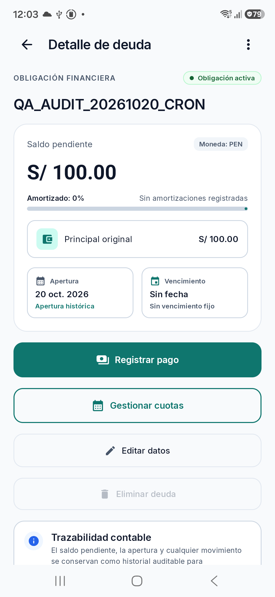 [Detalle del fixture QA](capturas/incidencias/bug-001-antes.png); 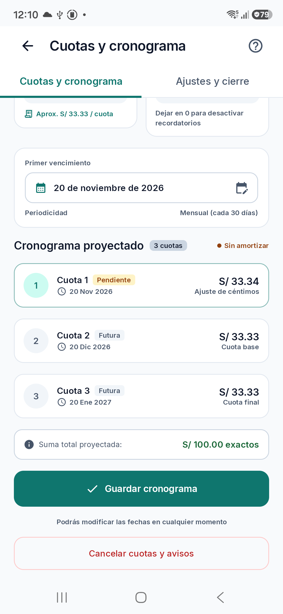 [Vista de cronograma](capturas/incidencias/bug-001-multiples-pulsaciones.png);  [Vista tras reinicio](capturas/incidencias/bug-001-post-reinicio.png); [snapshot local agregado y sanitizado](logs/BUG-001-local-persistencia.txt). Análisis complementario: [analisis-cronograma.md](analisis-cronograma.md) y [diagnostico-sync-nav.md](diagnostico-sync-nav.md). Las capturas son legibles y muestran solo el fixture QA, no registros personales preexistentes. La pantalla no expone el historial de canceladas; su conteo procede de SQLite local copiada del sandbox mediante `run-as`, consultada localmente y filtrada exclusivamente por el nombre QA. El outbox final contiene 8 comandos `SET_DEBT_SCHEDULE` y 1 `OPEN_DEBT`, todos `PENDING`, `attempt_count=0`; tras 20 s no se observó intento ni error. Esto impide afirmar sincronización remota.
- **Causa técnica:** No confirmada. El análisis estático describe un CTA deshabilitado durante `isSaving` y nuevas identidades de operación por invocación; eso no demuestra el timing real del APK ni un incumplimiento.
- **Impacto:** solo se demostró crecimiento de revisiones e historial cancelado. No se encontró duplicación financiera. Tampoco se confirmó efecto remoto.
- **Recomendación:** mantenerlo como investigación; registrar timestamps por callback y el estado `isSaving`, y decidir con Tech Lead si un segundo guardado idéntico después de una confirmación completa constituye una nueva intención o una repetición que debe deduplicarse. No presentar la conservación de filas `CANCELLED` por sí sola como defecto.
- **Prueba de verificación:** en un fixture aislado, instrumentar `connectedDebugAndroidTest` con un test para una pulsación, doble tap y ráfaga de 4 taps durante la transición de guardado; esperar un resultado y asertar exactamente 1 comando/revisión aceptada por ráfaga, una terna `PENDING` que sume el saldo pendiente, historial anterior `CANCELLED` según contrato, principal/eventos/saldo de caja invariantes; repetir tras navegar/relanzar. Añadir caso separado de un nuevo guardado intencional una vez que el anterior terminó. Verificar en tests de repositorio conflicto concurrente/idempotencia y, cuando exista target autorizado, sincronización remota.

### BUG-002 — Pantalla vacía al terminar de editar un movimiento QA

- **Estado:** Confirmado visualmente, 2/2 guardados exploratorios; causa no identificada.
- **Severidad / prioridad:** MEDIUM / P2. El flujo de edición deja el contenido de la app inutilizable hasta relanzar, aunque no se demostró pérdida del movimiento.
- **HU / sprint / módulo:** HU-20, S4; edición de movimientos / navegación. Issue publicado por el Coordinador: [#60](https://github.com/Lume03/Kipu/issues/60) (OPEN; etiqueta `bug` y `UI/UX`; frecuencia 2/2).
- **Entorno y precondiciones:** `com.kipu.app 0.1.0` (`versionCode=1`) en Samsung SM-A165M, Android 16/API 36; sesión QA activa; gasto de prueba creado y editado.
- **Pasos de reproducción:** abrir un movimiento `QA_...` desde Movimientos → Editar → cambiar un campo válido → Guardar. Repetido dos veces en movimientos QA distintos.
- **Resultado esperado:** cerrar el formulario y mostrar detalle/lista actualizada, manteniendo la navegación accesible.
- **Resultado observado:** tras guardar, área de contenido queda vacía; cambiar a otra pestaña no recuperó la pantalla. `am force-stop` y relanzamiento restauraron la app; el movimiento editado volvió a aparecer en la lista. En el fragmento consultado de logcat no hubo `FATAL EXCEPTION` ni excepción atribuible al paquete (0/0 líneas detectadas en el recorte), lo que no identifica la causa.
- **Impacto:** bloqueo temporal de uso; workaround observado: cerrar proceso y reabrir. No se borraron datos ni se reinstaló.
- **Evidencia:** captura tomada antes del relanzamiento: 
- **Causa técnica:** no confirmada; el logcat limitado no contiene evidencia causal suficiente.
- **Recomendación:** @android-core revisar el evento de navegación/estado de pantalla tras actualizar y reproducir con tracing de destino/stack. No asumir crash ni atribuirlo a una excepción no observada.
- **Prueba de verificación:** instrumented UI test para editar/guardar dos movimientos de fixtures, afirmar que la lista/detalle se renderiza tras cada guardado y sobrevive a navegación/Atrás y relanzamiento; confirmar el registro actualizado en persistencia local.

### BUG-003 — La UI bloquea anular un pago vinculado a deuda sin ofrecer acción en gestión de deuda

- **Estado:** Confirmado en la UI probada (un intento de anulación y revisión del detalle/historial correspondiente).
- **Severidad / prioridad:** MEDIUM / P2. La incapacidad de corregir una liquidación puede dejar principal/caja incorrectos si el usuario registró un pago equivocado; no se modificaron datos al intentar anular.
- **HU / sprint / módulo:** HU-28 AC6, FR-012 y HU-29 AC6; S5, deuda/pagos/anulación. Issue publicado por el Coordinador: [#61](https://github.com/Lume03/Kipu/issues/61) (OPEN; etiqueta `bug` y `UI/UX`; frecuencia 1/1).
- **Entorno y precondiciones:** fixture QA `QA_AUDIT_20261020_CRON`; liquidación parcial guardada localmente. No se usó backend ni SQL de escritura.
- **Pasos de reproducción:** (1) Desde Movimientos abrir el menú de la liquidación QA y elegir «Anular». (2) La app muestra «Este movimiento tiene cuotas o una deuda asociada. Revísalo desde su gestión específica.»; el único botón es «Cancelar». (3) Abrir el detalle de la deuda, revisar el menú superior y la sección de historial; ambos son de solo lectura para la liquidación y el menú ofrece editar datos/eliminar deuda deshabilitado, no anular pago. Tocar la fila tampoco abre un panel de acciones.
- **Resultado esperado:** ofrecer la anulación/corrección desde la gestión especializada, recalculando saldo y ciclo de vida desde eventos válidos y conservando historial auditable.
- **Resultado observado:** el propio flujo de anulación rechaza la acción y remite a un lugar donde no hay control de anulación visible; el pago queda registrado. No se forzó corrección por base local/remota. No se comprobó el camino de reapertura de deuda ya cerrada porque no se podía anular el pago existente.
- **Frecuencia:** 1/1 intentos de anular un pago vinculado.
- **Impacto:** no hay vía UI comprobada para corregir un settlement erróneo; workaround y posibilidad de reprocesar principal no se encontraron. En esta auditoría el fixture QA queda con el pago válido registrado y datos preexistentes no se alteraron.
- **Evidencia:** [El menú de gestión de deuda no ofrece anular pago](capturas/incidencias/bug-003-debt-detail-no-void-action.png). La captura del aviso con importe permanece local por la decisión de privacidad documentada en `issues/revision-privacidad.md`.
- **Causa técnica:** no confirmada; el bloqueo está visible en UI, pero no se inspeccionó ni modificó el backend.
- **Recomendación:** @android-core proporcionar un flujo explícito de anulación/corrección para settlements vinculados, con reversión atómica de ledger/caja/principal, cambio de lifecycle y evento idempotente/auditable; evitar remitir a una pantalla sin esa acción.
- **Prueba de verificación:** en fixture QA con deuda activa y otra liquidada, anular liquidación desde el flujo indicado y comprobar efectivo/principal/lifecycle recalculados desde eventos válidos, audit trail conservado, duplicación cero tras retry y estado local sincronizado una vez en backend autorizado.

### OBS-001 — Los movimientos de principal se rotulan como «Gasto»/«Ingreso» (clasificación operativa no confirmada)

- **Estado:** Observación potencial; la clasificación visual está confirmada, pero no se demostró un aumento de gasto operativo.
- **Severidad:** INFO hasta verificar semántica visual/reportes en el APK correcto.
- **HU / sprint / módulo:** HU-28 AC1/FR-009 y HU-24; S5/S6, movimientos y resultados operativos.
- **Observado:** el detalle/filtro de movimientos representa una liquidación de principal como `Gasto`; el cobro parcial de una receivable QA aparece como `Ingreso`. La captura segura disponible muestra el cobro como `Ingreso`: . Las capturas del pago de principal no se incluyen mientras su revisión de privacidad/integridad siga pendiente.
- **Fundamento y límite:** el criterio de HU-28 exige que principal no incremente gastos operativos; el hash del APK instalado coincide con el candidato QA local, cuyo código base excluye `DEBT_PAYMENT` de sus calculadores. La comparación no es atestación reproducible ni atribución histórica a la fecha del síntoma. No se midieron totales operativos antes/después para el pago ni el cobro; las etiquetas visibles no prueban clasificación contable ni cumplimiento del comportamiento runtime.
- **Impacto/recomendación:** riesgo potencial de confusión y posible mala interpretación de los reportes. Validar significado de etiquetas y agregados en build identificada; no crear issue contable hasta demostrar que el principal altera resultados operativos.

### OBS-002 — El formulario de movimiento conserva campos tras cierre y reapertura (observación UX)

- **Categoría:** observación de usabilidad / contrato de producto pendiente; no bug funcional confirmado.
- **Estado/severidad/prioridad:** potencial, INFO/P3. Frecuencia observada 1/1 en la sesión QA; no se define expectativa de descarte o borrador persistente en la especificación consultada.
- **Pantalla y pasos:** formulario de gasto rápido; cargar importe PEN 1.00, categoría y una nota de fixture QA, cerrar con X, navegar a otra pantalla y abrir el formulario de nuevo en la misma sesión.
- **Resultado esperado:** pendiente de definir por producto. Si X significa descartar, debería iniciar limpio o pedir confirmación cuando hay cambios; si conserva borrador, debería comunicarlo explícitamente.
- **Resultado observado:** el formulario volvió con importe, categoría y nota QA anteriores. La captura conservada solo evidencia campos en el formulario reabierto, no la transición completa: 
- **Impacto:** puede inducir a guardar datos anteriores por error si el usuario interpreta X como descarte. No se guardó el borrador ni se observó impacto financiero.
- **Causa:** no confirmada. El comportamiento podría deberse a estado de ViewModel retenido durante navegación; provenance del APK y expectativa de producto no establecidas.
- **Recomendación/criterio de aceptación:** que Tech Lead/UX defina si X conserva o descarta. Criterio sugerido: al reabrir, el comportamiento coincide con el contrato y se presenta una señal comprensible; no debe guardarse información inadvertidamente.
- **Verificación futura:** UI test con fixture QA que compruebe abrir, editar campos, cerrar X, cambiar de pantalla y reabrir; afirmar estado limpio o restaurado según requisito explícito y ausencia de movimiento nuevo.

### OBS-003 — Estado «Verificado» y comprobante pendiente sin señal explícita de sincronización

- **Categoría:** observación UX/estado visual; no bug funcional confirmado.
- **Estado/severidad/prioridad:** potencial, INFO/P3. Observado en un gasto QA; significado de `Verificado` no está documentado en la evidencia leída.
- **Pantalla/flujo:** detalle de movimiento tras guardar y reabrir el gasto QA `QA20261020MOVCTAA`.
- **Resultado esperado:** la interfaz debería permitir distinguir el registro local, la sincronización pendiente/confirmada y el estado del comprobante si esos conceptos son independientes según el contrato de producto.
- **Resultado observado:** el detalle muestra chip verde `Verificado` mientras el comprobante indica `Pendiente de adjuntar`; en esa pantalla no se ve estado de sync. El mensaje de guardado previo en la sesión había indicado guardado local pendiente de sincronización. La captura es solo del fixture QA: 
- **Impacto:** semántica potencialmente ambigua para la persona usuaria; no hay evidencia de que `Verificado` equivalga a sync remoto ni de que se haya producido un error funcional.
- **Causa:** desconocida; no se vinculó la etiqueta a regla de producto ni a estado de backend.
- **Recomendación/criterio de aceptación:** pedir a UX/Product definir el significado de `Verificado` y si debe separarse de comprobante/sync; no presentar como confirmado hasta documentar el contrato. La UI debe exponer estados distintos sin inferir remote success a partir de un chip.
- **Prueba futura:** con una operación QA normal, cotejar mensaje de guardado, detalle y un indicador de sync existente/observable; verificar que cada etiqueta corresponde al contrato y nunca implica un resultado remoto no confirmado.

### OBS-004 — El cupo Free no aclara si el efectivo cuenta como instrumento

- **Categoría:** observación UX de claridad; no defecto de cuota confirmado.
- **Estado/severidad/prioridad:** potencial, INFO/P3; observación única en un ciclo controlado de creación/archivo de cuenta QA.
- **Pantalla/flujo y pasos:** con el contador de instrumentos en 3/4, crear una cuenta de efectivo QA propia de PEN 0.00 y luego archivarla. La sección “Cuentas y efectivo” mostró 5 activos y luego 4; el contador Free permaneció 3/4 y mostró una plaza disponible.
- **Resultado esperado/fundamento:** falta oráculo documental que aclare si cuentas de efectivo deben consumir cuota de “cuentas y tarjetas”. La etiqueta podría explicar explícitamente los tipos que incluye.
- **Resultado observado/evidencia:** `capturas/funcional/hu-07-cash-account-crud-created.png` y `capturas/funcional/hu-07-cash-account-crud-after-archive.png` muestran el resumen y fixtures QA recortados; no incluyen datos financieros ajenos.
- **Impacto:** posible duda de la persona usuaria sobre qué instrumento cuenta y si archivar libera cupo; no se halló bloqueo funcional ni cuota excedida.
- **Causa/recomendación:** no confirmada; solicitar a Product/UX definir y documentar qué tipos consumen cupo y alinear etiqueta/contador a esa regla.
- **Verificación futura:** probar, en QA, alta/archivo de efectivo y tarjeta con conteos inicial y final; comparar contra especificación de entitlement sin borrar ni modificar instrumentos preexistentes.

### OBS-005 — Archivar tarjeta devuelve al wizard de alta/configuración

- **Categoría:** observación de navegación/usabilidad; no se confirma error de archivo.
- **Estado/severidad/prioridad:** potencial, INFO/P3; frecuencia observada 1/1, sin repetición por no crear un segundo instrumento innecesario.
- **Pantalla/flujo:** detalle de la tarjeta propia `QA20261020CARD1` → “Archivar tarjeta” → confirmar.
- **Resultado esperado:** salida clara a Mi dinero/lista y feedback de archivo; no volver a un formulario capaz de volver a guardar la misma tarjeta.
- **Resultado observado:** después de confirmar, la app mostró de nuevo “Configura tu tarjeta · Paso 3 de 3”; al usar Atrás apareció “Qué tarjeta tienes? · Paso 2 de 3” con query vacía y estado “No encontramos «» en Otra entidad”, luego el selector de alta. La tarjeta dejó de figurar entre las activas; el contador global de archivadas se omite por privacidad. No se afirma que el archivo falló. Evidencia:  
- **Impacto:** puede hacer creer que la tarjeta no se archivó o invitar a guardarla otra vez; el paso de búsqueda vacío conserva la acción “Agregar manualmente”, por lo que no se demostró bloqueo total.
- **Causa:** no confirmada; hipótesis de back stack que conserva la ruta de alta posterior al archivo.
- **Recomendación/criterio de aceptación:** cerrar el flujo hacia Mi dinero/archivados con confirmación inequívoca; un nuevo toque de Atrás no debe reabrir pasos del wizard anterior.
- **Verificación futura:** archivar una tarjeta QA vacía; verificar destino, feedback, estado archivado/activo y que no queda una acción de guardado para la tarjeta archivada.

## 4. Evidencia y logs

Capturas y su interpretación aparecen en cada hallazgo y en la matriz. Se conservan agregados sanitizados en `logs/BUG-001-local-persistencia.txt` y `logs/BUG-003-local-payment-aggregate.txt`; no se conservaron filas individuales, IDs, payloads, UUIDs, sesión, dumps de UI ni logcat completo. `BUG-001-antes.png`, `BUG-001-multiples-pulsaciones.png` y `BUG-001-post-reinicio.png` muestran una única terna en detalle/plan/reapertura; no demuestran ausencia de historial cancelado, cuyo conteo procede de consultas locales agregadas y filtradas al fixture.

La conectividad se observó como Wi-Fi con marcador de validación y sin portal cautivo. `dumpsys jobscheduler` enumeró servicios WorkManager y `SyncDebtChangesWorker`; hubo varios registros/contextos con marcadores distintos y no se pudo correlacionar de forma inequívoca un estado de job con la fila outbox, ni establecer el estado real del owner/sesión. No hubo líneas WorkManager atribuibles a `com.kipu.app` en el recorte de 1 000 líneas de logcat. La lectura estática separada de Android Core (`diagnostico-sync-nav.md`) describe un worker con constraint `CONNECTED`, trabajo único `KEEP` y salida `retry` antes del claim cuando el owner no coincide con el owner verificado; son condiciones/hipótesis, no evidencia runtime del APK. El snapshot local posterior al pago mostró `OPEN_DEBT` 1, `SETTLE_DEBT` 1 y `SET_DEBT_SCHEDULE` 8, todos `PENDING`, `attempt_count=0`; sin `last_error_code`/respuesta accesible. Esto es insuficiente para distinguir trabajo no ejecutado, owner/sesión que bloquea antes del claim, constraints o diferencia del APK. No se forzaron workers, reintentos, RPC ni SQL de escritura; resultado remoto: **BLOCKED / no confirmado**, no bug demostrado.

### Continuación dirigida — lectura de sincronización y superficies UI (2026-10-20, 09:23–09:28 UTC−5)

- **Provenance temporal:** preflight de solo lectura observó `com.kipu.app` 0.1.0/versionCode 1 en foreground en SM-A165M/Android 16; el hash APK no se recalculó, siguiendo la instrucción del Coordinador. El contraste previo informado sigue siendo hash instalado igual al candidato QA Premium local; no acredita build reproducible, fecha histórica ni release S6.
- **Sync C:** a las 09:28 UTC−5, logcat filtrado por `DebtSyncScheduler`, `SyncDebtChangesWorker`, `WorkManager` y `SessionCoordinator` no devolvió líneas existentes. `dumpsys jobscheduler` sí mostró un request existente de `SyncDebtChangesWorker` (job de package Kipu), hace aprox. 44m39s relativo al snapshot: `NET`/`CONNECTIVITY` satisfecho, pero `Ready: false` (`job=false`, `pending=true` y otros gates). Es compatible con un request registrado que no estaba listo; no se atribuye a un comando/outbox específico ni explica la causa. Se ven requests recurrentes de recordatorio y otros workers, que no son evidencia del sync de deuda.
- **Observabilidad faltante exacta:** la salida accesible no expone `SessionCoordinator.currentOwner`, booleano de owner cargado/verificado/coincidente, estado `RemoteSession`, ni transición del `DebtOutboxDao.claimPending` del fixture. Tampoco hay logs existentes de guard-owner, enqueue/callback, worker claim o resultado HTTP. Para discriminar se requiere instrumentación futura de esos indicadores booleanos sin identidad, estado/constraints del request identificable y transición agregada PENDING→IN_FLIGHT/attempt/error con timestamps correlacionables; no inferir una causa desde el snapshot. No se consultó otra DB ni se forzó/reintentó trabajo.
- **BUG-001 D:** los logs existentes filtrados no aportan correlación adicional entre gesto/callback, `isSaving`, operación/recibo y revisión. Se reutilizan las pruebas ya registradas, sin nueva ráfaga. Faltan exactamente: (1) timestamp monotónico del gesto/callback por invocación; (2) valor de `isSaving` inmediatamente antes/después de cada callback; (3) identidad correlacionable de operación/recibo (equality/count, no UUID expuesto); (4) revisión aceptada y timestamp monotónico de completion/recibo. Prueba futura debe separar gestos solapados antes del primer completion de un segundo guardado posterior a completion, con la misma fixture y una terna activa/suma principal invariante. Las 2 revisiones reportadas no prueban solapamiento; CANCELLED es historial.
- **HU-22 filtros:** se intentó entrada UI exacta sobre un alias QA, pero los caracteres observados no coincidieron exactamente con el texto previsto; por seguridad no se aplicaron filtros ni se interpretaron resultados. Se conserva como NOT TESTED, no como fallo de búsqueda. Los PASS previos exacto/parcial/sin coincidencias no se repitieron.
- **Formulario QA teclado/error:** se abrió un borrador propio sin guardar. Con el teclado numérico abierto se observó `0.00`; con teclado cerrado el mismo formulario seguía abierto. Un único intento de Guardar produjo error inline `Ingresa un monto válido mayor a 0`, contador `1 error` y CTA “Corregir datos para guardar”; no hubo confirmación ni registro visible. Repetición únicamente para evidencia de teclado/error; no se suma PASS porque el rechazo de cero ya estaba aprobado. Capturas QA específicas: `HU-18-form-keyboard-open-qa.png`, `HU-18-form-keyboard-closed-qa.png`, `HU-18-form-zero-error-qa.png`. Luego se cerró el borrador sin guardarlo.
- **Recurrencia ACTIVE:** localizada desde el detalle QA de `QA20261020MOVCTAA` → “Registrar pago recurrente” → “Ver mis recurrencias”. Estado inicial: alias `QA20261020RECACT1`, ACTIVE, próxima 2026-10-31, revisión 1, pendiente de sincronización local. Cerré únicamente Kipu (`am force-stop`), relancé su `MainActivity` y repetí la navegación sin guardar ni modificar la regla. Lectura posterior: exactamente el mismo alias, ACTIVE, próxima 2026-10-31, revisión 1 y pendiente local. Persistencia local ACTIVE confirmada; no se infiere sync remoto. Capturas recortadas a la fila QA antes/después en `HU-33-recurrence-active-before-relaunch-qa.png` / `HU-33-recurrence-active-after-relaunch-qa.png`. Regla queda activa, sin limpieza/cancelación adicional.
- **Integridad documental al relevo previo:** matriz de 53 casos (33 PASS, 2 FAIL, 1 BLOCKED, 17 NOT TESTED), verificada antes de este bloque. Informe en ese snapshot: 48 ocurrencias de imágenes embebidas y 36 archivos PNG únicos; todas las referencias relativas existentes resolvían. Después se documentaron dos filas nuevas NOT TESTED por falta de dispositivo; las 45 ocurrencias/33 PNG distintos corresponden a un snapshot posterior y no a ese baseline. La revisión visual del nuevo par ACTIVE QA continúa pendiente.
- **Limpieza/privacidad:** se eliminaron de Temp únicamente capturas temporales creadas por esta corrida, incluidas las vistas de búsqueda/nav con superficie no exclusiva QA; se copiaron al directorio de capturas solo las tres imágenes del formulario QA sin datos ajenos identificables. El formulario quedó cerrado. Sin cambios a código, datos guardados, permisos, build, reloj o red.

**Copias temporales DB/WAL:** la única ubicación usada fue `C:/Users/Alume/AppData/Local/hermes/profiles/qa-auditor/cache/scratch/`. Se generaron `kipu.db`/`kipu.db-wal` en la lectura anterior y `qa-audit-final.db`/`qa-audit-final.db-wal` para obtener agregados mínimos del pago/outbox. Contenían datos locales del usuario, por lo que se consultaron localmente solo con filtro del fixture QA; no se subieron ni añadieron al repo. Las copias `qa-audit-final.*` se eliminaron y se comprobó que ambos archivos estaban ausentes. Las copias anteriores `kipu.db*` ya habían sido retiradas y su ausencia se verificó antes de esta sesión; no se borró la base del dispositivo ni artefactos preexistentes.

### Continuación acotada — 2026-10-20, nueva sesión QA

- **Preflight/runtime (resultado de la primera continuación; provenance actualizada después):** `adb devices -l` mostró el dispositivo autorizado como `device`; paquete en foreground `com.kipu.app/.MainActivity`, Samsung SM-A165M, Android 16/API 36, `versionName=0.1.0`, `versionCode=1`, `targetSdk=36`. En la continuación P1, el hash de `base.apk` instalado coincidió con el candidato QA Premium descrito en §1; la atribución a un release Sprint 6/fecha histórica sigue sin demostrarse. HEAD base inspeccionado: `dd6758a01a236aa61053ebf8ab24f25e0c835ba5` (`main`). QA no ejecutó Gradle/build/test, instalación, cambio de permisos/red ni llamadas de sync.
- **Prueba UI de HU-30:** abrí edición del fixture `QA_AUDIT_20261020_GOAL` (Activa, reserva PEN 0.00, objetivo PEN 10.00), abandoné el formulario sin guardar y verifiqué al volver que esos valores/estado seguían visibles; no hubo mutación financiera ni captura retenida por coincidir en la lista otras metas ajenas a fixtures. Solo es un control de descarte de borrador, no prueba backend/reinicio.
- **Fixtures QA identificables en UI:** `QA_AUDIT_20261020_CRON` (deuda activa, pago parcial previamente registrado; saldo mostrado PEN 99.00, no se intentó pagar/anular de nuevo); `QA_AUDIT_20261020_GOAL` (meta activa sin reserva, objetivo PEN 10.00, la UI marcó pendiente de sincronización); `QA_AUDIT_20261020_META` (meta archivada sin reserva, objetivo PEN 150.00, UI pendiente de sincronización); `QA_AUDIT_20261020_TRANS` (billetera/transferencias, balance previo en el informe; estado remoto actual no verificado). Permanecen además movimientos QA usados en BUG-002/BUG-003/anulación ordinaria, sin replicar sus mutaciones. La UI mostró también registros no QA: no se capturaron ni transcribieron sus nombres o saldos al informe.
- **Recurrencias (resultado final de la primera continuación dirigida; histórico):** tras corregir el foco de entrada se creó `QA20261020RECCTB`, importe fijo esperado PEN 1.25, mensual, próxima fecha 2026-10-31. La UI mostró guardado local pendiente, estado ACTIVE/rev.1; se pausó/rev.2, reanudó/rev.3 y canceló/rev.4. En esa corrida no se comprobó relanzamiento. Una continuación posterior sí verificó estado CANCELLED/rev.4 tras force-stop/relanzamiento (ver sección “Continuación P1”). El sync remoto sigue sin confirmarse.
- **Privacidad / temporales:** no se guardó en el repositorio ninguna captura de esta sesión; se usaron capturas temporales para inspección visual porque algunas pantallas mezclaban fixtures QA con registros no QA. No se creó copia DB/WAL nueva. Los cinco nombres DB/WAL previamente indicados se verificaron ausentes en el directorio scratch del perfil; las capturas temporales de inspección se eliminaron y se verificó que el subdirectorio temporal quedó ausente. El volcado XML de UI creado en el dispositivo se truncó a cero bytes; no se copió al host ni al repositorio.

## Continuación autorizada en UI — 2026-10-20

- Dispositivo verificado por ADB (serial omitido): Samsung SM-A165M, Android 16; `com.kipu.app` 0.1.0 / versionCode 1 / targetSdk 36 en foreground. El `base.apk` actual coincide por SHA-256 con el candidato local QA Premium debug APK; la atribución a Sprint 6 y la fecha de build exacta siguen no probadas. Captura solo se inspeccionó temporalmente en scratch, sin conservarla en el repo.
- A (PASS, limitada): la UI mostró cupo Free 2/4 y permitió crear wallet Plin con saldo propio, alias `Billetera QA20261020CTAA`, saldo inicial PEN 5.00. Primer intento con wallet Yape fue rechazado por mensaje visible `An active YAPE wallet already exists`; cambié Plin desde el formulario, sin alterar la billetera existente. La nueva billetera quedó visible como disponible; no se verificó sincronización remota.
- B (PASS parcial): creado desde UI gasto PEN 1.25, nota `QA20261020MOVCTAA`, cuenta `Billetera QA20261020CTAA`, categoría existente Alimentación (solo referencia, no editada). Baseline PEN 5.00 y saldo visible posterior PEN 3.75; cálculo reproducido con Decimal. UI indicó guardado local y pendiente de sincronización. Esto prueba el saldo proyectado localmente, no persistencia remota.
- B (NOT TESTED parcial): los controles de monto cero/negativo, decimales adicionales, borrador cancelado y búsqueda exacta/sin coincidencias no se ejecutaron. Los listados de gasto y las acciones de filtrado no fueron inspeccionados después de guardar.
- C (resultado previo, corregido por continuación dirigida): en el primer run no se creó segunda cuenta y la cuota 3/4 se interpretó prematuramente como bloqueo. En esta sesión se abrió `+ Cuenta` → `Efectivo`, se creó `QA20261020CASHB` con saldo inicial PEN 0.00 (el alias quedó visible correctamente en el alta) usando el cuarto espacio libre; no se modificó la cuenta Efectivo preexistente. La transferencia QA PEN 1.00 desde `Billetera QA20261020CTAA` fue registrada y sus saldos pasaron de PEN 4.75/0.00 a PEN 3.75/1.00. Anulación desde UI mostró explícitamente ambas cuentas QA, efectos compensatorios y saldo esperado; al confirmar, la UI verificó saldos restaurados PEN 4.75/0.00. PASS acotado a proyección UI local; no se confirmó sync remoto. Los registros de transferencia/anulación quedan en historial, sin borrado físico.
- D (CORRECCIÓN Y RESULTADO FINAL): la sesión previa solo inspeccionó el menú contextual; esta continuación completó alta local, pausa, reanudación y cancelación de la regla propia `QA20261020RECCTB`, según sección de recurrencias. Búsqueda exacta/sin resultados y validaciones 0/negativo no se comprobaron.
- E (PASS parcial): creé desde UI `QA20261020METAA`, meta PEN 2.00, vinculada a la wallet QA propia. Reservé PEN 1.00, confirmé reserva visible 50% (wallet balance siguió PEN 3.75, reserva virtual PEN 1.00, libre PEN 2.75); liberé PEN 1.00 y verifiqué reserva 0.00 y balance PEN 3.75. Archivé la meta vacía; la confirmación indicó que no libera fondos ni crea movimiento, y después la UI mostró estado Archivada, reserva 0.00 y wallet PEN 3.75. Sync sigue pendiente, así que persistencia remota NOT TESTED. No se probó el límite máximo ni un importe fuera de rango.
- F (PASS parcial): creé `QA20261020RCVA`, receivable histórica de principal PEN 1.00 con opción «Ya estaba registrado previamente» (no debía hacer un nuevo desembolso). Desde UI registré cobro de principal PEN 1.00 a `Billetera QA20261020CTAA`; la pantalla confirmó obligación liquidada, total pagado PEN 1.00, saldo final PEN 0.00 y wallet aumentó de PEN 3.75 a PEN 4.75. Es un registro en Kipu, no pago bancario; no se comprobó sync remoto. No se probó aplicar gasto a meta/obligación (HU-24) ni anular este cobro.
- Inventario de fixtures creados en la continuación previa: `Billetera QA20261020CTAA`, wallet Plin activa, saldo PEN 4.75 tras gasto/cobro; gasto `QA20261020MOVCTAA`, PEN 1.25; `QA20261020METAA`, meta archivada, objetivo PEN 2.00, reserva 0.00; `QA20261020RCVA`, receivable histórica PEN 1.00, liquidada/saldo 0.00. En la continuación dirigida actual se creó `QA20261020CASHB`, efectivo PEN, saldo inicial 0.00; transferencia QA de PEN 1.00 y anulación por UI dejaron saldo final visible wallet PEN 4.75/cash QA PEN 0.00. Regla `QA20261020RECCTB` PEN 1.25 fijo mensual, próxima fecha 2026-10-31, lifecycle final CANCELLED (revisión 4). La transferencia y su asiento compensatorio permanecen en historial; recurrencia cancelada con historial conservado. Sync remoto no comprobado. No se eliminaron fixtures.
- Fuera de autorización: no se probaron auth enviando mensajes, biometría/permisos globales, compras/pagos externos, cambios de red, rebuild/reinstall, workers/retries ni SQL. Ninguna alteración de los datos ajenos, fuera del rechazo del alta Yape observado. Esto no excluye el resto de S1/S3: sus capacidades no ejecutadas permanecen como cobertura residual; la exclusión de compras/permisos solo limita esos caminos. HU-24 se probó parcialmente después, mediante cobro parcial a obligación y transferencia explícita a meta; no se considera cubierta por las pruebas anteriores de reserva/liberación, ni queda completa.

### Fuera de alcance S1–S6 (excluido del conteo)

| Sprint | Funcionalidad | Estado | Límite |
|---|---|---|---|
| S7+ | Presupuestos, reembolsos vinculados, calendario | NOT TESTED | Funcionalidad posterior; su ausencia no es bug S1–S6 |

### Continuación autorizada — 2026-10-20, búsqueda y validaciones UI

- **Búsqueda exacta:** en Movimientos con filtro Gastos, `QA20261020MOVCTAA` mostró el gasto QA de PEN 1.25.
  
- **Búsqueda parcial:** `20261020MOVCT` mostró el mismo gasto QA.
  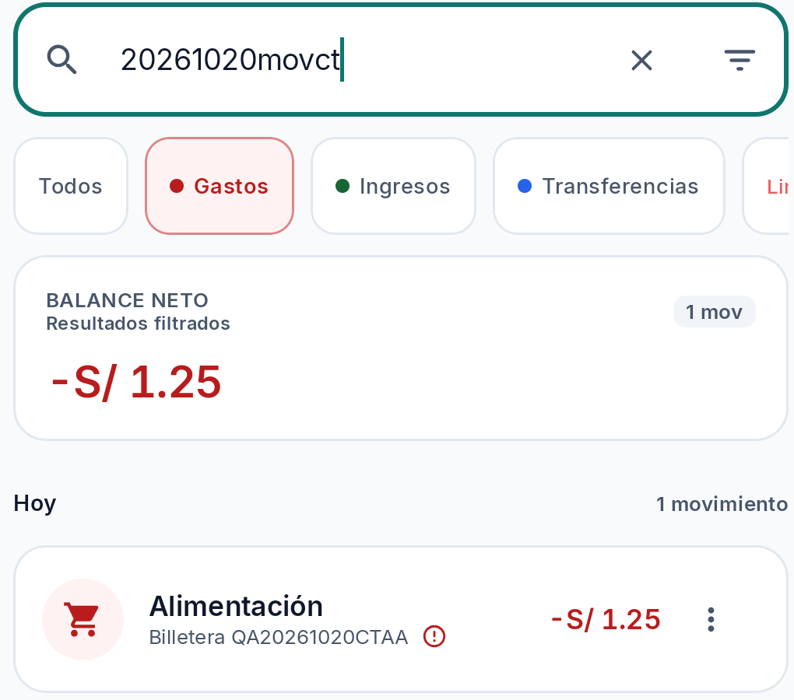
- **Sin coincidencias:** `zznoresult987` mostró estado vacío y opción de limpiar filtros. No se alteró conectividad ni entitlement. Son búsquedas locales acotadas, no cobertura completa de HU-22.
  
- **Importe cero y categoría obligatoria:** en un borrador de gasto sobre cuenta QA, Guardar con importe 0.00 dejó el formulario abierto con `Ingresa un monto válido mayor a 0`; al ingresar PEN 1.00 sin categoría, siguió abierto con validación. Ningún intento alcanzó confirmación.
- **Decimales:** con categoría existente, PEN 1.234 fue rechazado por la misma validación y el borrador permaneció abierto. El mensaje es genérico, pero el rechazo se observó. No se guardó el borrador.
- **Negativo/fecha/instrumento:** no verificados. El campo de importe normalizó/ignoró el signo cuando se intentó `-1.00` por la UI/ADB, así que no se concluye validación de valores negativos. El formulario preselecciona una cuenta QA y no presentó ruta para dejarla vacía. La fecha/hora viene prellenada y el flujo probado no ofreció fecha inválida/vacía; la especificación consultada no define aquí una regla de fecha futura/pasada.
- **Cierre y re-apertura de borrador:** X devolvió al historial; tras navegar a otra pantalla y volver a abrir el formulario en la misma sesión reaparecieron importe PEN 1.00, categoría y nota QA. Resultado observado 1/1, pero la especificación consultada no determina si X descarta o conserva borrador, por lo que no se clasifica como fallo. La imagen conservada documenta campos QA visibles, no toda la secuencia.
  
- **Límites:** casos observados en la UI instalada; no acreditan sincronización remota, cobertura de búsqueda por fecha/tipo ni provenance del APK. Las validaciones visuales se registraron en la sesión pero no se retuvo una captura sanitaria específica del rechazo; no se publicó issue nuevo ni se tocaron registros existentes.

### Continuación P1 — HU-24 y persistencia local tras relanzar

- **Cobro parcial de receivable:** creé `QAHU24RCVB1` (mostrado en la app como `qahu24rcvb1`), principal PEN 1.00, marcando “Ya estaba registrado previamente” para no generar desembolso. Desde el detalle registré cobro de principal PEN 0.50 hacia la billetera QA; la UI mostró pendiente PEN 0.50 y estado Activa. Después de force-stop y relanzamiento, el listado local seguía mostrando esa obligación activa con PEN 0.50 pendiente. Esta secuencia confirma estado local en el APK instalado; no confirma backend/sync ni que el principal se excluya de totales de ingreso operativo.
  
  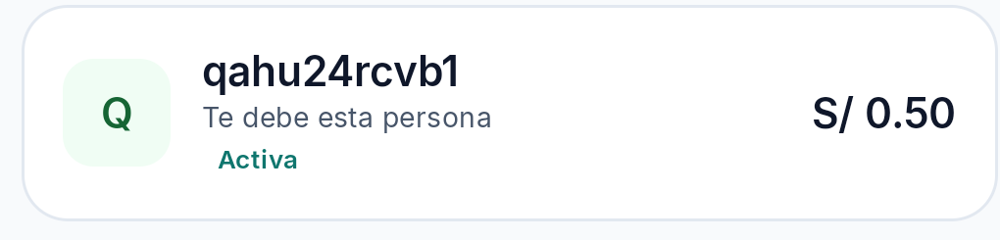
- **Etiqueta de ledger:** el movimiento de cobro se muestra bajo `Ingreso`; no se midieron los agregados de ingreso operativo. La clasificación contable permanece NOT TESTED.
  
- **Transferencia interna explícita a una meta:** en `QA_AUDIT_20261020_GOAL` (meta activa, objetivo PEN 10.00, reserva inicial PEN 0.00), seleccioné “Confirmar traslado interno”, origen `Billetera QA20261020CTAA`, destino de respaldo `QA20261020CASHB` y PEN 0.50. Antes: saldos QA wallet/cashB PEN 5.25/0.00; después: PEN 4.75/0.50 y reserva de meta PEN 0.50. La suma de los dos saldos QA se mantuvo PEN 5.25; la reserva es virtual y no se suma como activo. El formulario indica que el traslado no crea gasto/ingreso, pero no se verificaron ledger/outbox/atomicidad ni agregados operativos. Las capturas derivadas se limitaron a las filas QA relevantes; el Coordinador debe revalidar privacidad y hash antes de publicación externa.
  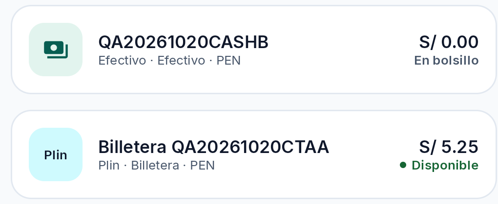
  
- **Recurrencia post-relanzamiento:** tras `am force-stop com.kipu.app` y relanzamiento, “Ver mis recurrencias” mostró `QA20261020RECCTB` CANCELLED, rev.4, próxima fecha 2026-10-31, con indicación de sincronización pendiente. Esto confirma lectura/persistencia local del estado CANCELLED; no se probó persistencia remota ni estado PAUSED. ACTIVE se verificó por separado en `QA20261020RECACT1` (fila de matriz posterior).
  
- **Cobertura restante de HU-24:** la meta QA archivada no ofrece controles de aporte/reserva/reasignación; `Meta archivada` no abre ruta ni altera estado al tocarla. No se alcanzó una forma de aplicación para probar mensaje explícito de rechazo/ausencia de efecto parcial. Sigue sin comprobarse exclusión del principal de totales operativos, atomicidad/idempotencia y aplicación a una obligación desde una ruta elegible. La reserva/liberación de HU-31 es un flujo distinto y no se usa como sustituto de transferencia explícita ni de imputación a obligación.
- **Inventario local tras pruebas:** `qahu24rcvb1` permanece Activa con PEN 0.50 pendiente; `QA_AUDIT_20261020_GOAL` tiene reserva PEN 0.50; `QA_AUDIT_20261020_META` continúa Archivada sin reserva; `QA20261020CASHB` saldo PEN 0.50 y `Billetera QA20261020CTAA` PEN 4.75; la regla QA permanece CANCELLED. No se eliminaron estos fixtures ni se forzó sincronización.

### Continuación P2 — CRUD de instrumento y crédito manual QA (sin pagos externos)

- **Cuenta de efectivo QA:** con contador Free `3/4`, creé `QA20261020CRD1` con PEN 0.00. La ficha propia permitió editar el alias a `QA20261020CRD2`, manteniendo saldo PEN 0.00; la UI indicó “Presentación actualizada · Pendiente de sincronización”. La archivé desde su detalle, sin movimientos; el diálogo declaró que no elimina historial y permite reactivación. La lista mostró activo-count 5→4 y el toast “Instrumento archivado · Pendiente de sincronización”. Fixture propio archivado, no se eliminó ningún instrumento ajeno.
  
  
  
  
- **Tarjeta de crédito QA:** elegí “Otra entidad” y carga manual; la pantalla dijo que nunca solicita número completo ni CVV. Registré tarjeta ficticia `QA20261020CARD1`, Visa, línea PEN 1,000.00, día de corte 10, día de pago 25 y alertas 50/80/100%; se usó un sufijo numérico sintético, excluido de capturas, sin PAN completo/CVV ni credenciales externas. El detalle mostró deuda actual PEN 0.00, crédito disponible PEN 1,000.00 y uso 0%; no se pulsó “Registrar consumo” ni se hizo compra/pago. Luego se archivó la tarjeta propia; la confirmación ofrecía conservar historial y reactivarla, dejó de aparecer en la lista de activas y el contador de archivados quedó en 2. Estado remoto no confirmado.
  
  
  
  La captura de la sección archivados se omite porque incluye un contador global no atribuible al fixture QA.
- **Límite de evidencia:** la tarjeta no realizó consumos; la pantalla de detalle y la lista activa se inspeccionaron, pero no se guardó imagen de detalle que mostrara el sufijo. No se verificó sync/outbox. La acción de archivar devolvió momentáneamente a un paso previo del wizard; ver OBS-005.

### Consolidación P1 — revisión UI/UX y recurrencia ACTIVE (2026-10-20)

- **Recurrencia ACTIVE:** el handoff histórico era ambiguo sobre el orden de creación y relanzamiento, así que no se tomó como prueba. En esta continuación se localizó la misma regla existente `QA20261020RECACT1` (ACTIVE, próxima `2026-10-31`, rev.1, pendiente local); se cerró Kipu con `am force-stop`, se relanzó `com.kipu.app/.MainActivity` y se volvió por la ruta de UI al detalle/lista de recurrencias. La lectura volvió a mostrar los mismos alias, estado, fecha, revisión y pendiente local. PASS limitado a persistencia local ACTIVE, no a sincronización remota. Sin crear/cancelar/editar regla.
- **Revisión UI:** [revision-ui.md](revision-ui.md). UI-001 confirma una discrepancia entre canon/tokens y fuente/tema asociado al artefacto candidato; manifestación renderizada, contraste e impacto permanecen pendientes de medir. No es un defecto visual confirmado. No afirmar que el APK carece de vínculo con el checkout: su hash coincide con el candidato local QA, aunque la fecha/build reproducible y atribución histórica a Sprint 6 siguen sin probarse. El informe UI conservaba un embed al original `HU-24-goal-internal-transfer.png`, que permanece excluido por `NEEDS_CONTEXT`; el autor UI debe sustituirlo por el derivado seguro. No editar el informe UI desde esta tarjeta.
- **Revisión UX:** [revision-ux.md](revision-ux.md). Observaciones heurísticas separadas de cobertura funcional; no agregan PASS. Mapeo: UX-001 → estado de meta archivada / criterio HU-24 pendiente; UX-002 → OBS-003 (semántica de “Verificado”/sync; comparte preocupación de etiquetas con OBS-001, pero no confirma clasificación contable); UX-003 → OBS-002; UX-004 → OBS-005. BUG-002/#60 y BUG-003/#61 permanecen abiertos y sin duplicación. Según actualización del Coordinador, el autor UX ya embebió y verificó nueve capturas; no edité ese archivo.
- **Seguimiento de artefacto/issues:** el Coordinador añadió y verificó por readback comentarios de artefacto actual en [#60](https://github.com/Lume03/Kipu/issues/60#issuecomment-6293231782) y [#61](https://github.com/Lume03/Kipu/issues/61#issuecomment-6293232904). El hash instalado coincide con el candidato local; no hay atestación de build ni prueba retrospectiva para cada síntoma. UI-001 se registró como investigación de canon/fuente, no como bug renderizado, en [#62](https://github.com/Lume03/Kipu/issues/62). No se duplicaron BUG-002/#60 ni BUG-003/#61. No crear/editar issues desde esta corrida.
- **Privacidad:** la matriz de hashes y dictámenes está en `issues/revision-privacidad.md`. Se versiona evidencia SAFE y evidencia NEEDS_CONTEXT solo cuando el relato documenta el contexto permitido; se excluyen imágenes `NEEDS_REDACTION`, sin dictamen o con procedencia no resuelta. Las fuentes excluidas permanecen bajo `capturas/_local-only/` o `capturas/Capturas/`, ignoradas por Git. El derivado de meta y la captura previa QA se usan con alcance de estado, nunca para publicar el original con saldo no atribuido. Las dos capturas del wizard muestran pasos 3/3 y 2/3 dentro del relato QA; no prueban causa financiera ni fallo de archivo.

### Continuación HU-22 — recorrido de filtros sin entrada textual (2026-10-20)

- **Dispositivo y estado de partida:** el cliente ADB predeterminado (`C:\Windows\adb.exe`, 1.0.40) no pudo conectar: informó `ADB server version (41) doesn't match this client (40)` y `could not read ok from ADB Server`. Se localizó el ADB 1.0.41 incluido con scrcpy y se comprobó el dispositivo autorizado como `device`; no se cambió instalación, servidor manualmente ni permisos. La app se lanzó y se verificó la vista Movimientos antes de cada toque. No se usó consulta textual ni se repitieron métodos de entrada fallidos.
- **Secuencia/observaciones runtime:** en Movimientos, la jerarquía UI mostró `Abrir filtros`; al abrir, el panel mostró `Periodo y Fecha`, `Cualquier fecha (Historial completo)`, `Gastos`, `Filtros avanzados`, `Cuenta` y `Todas las cuentas`. Desde Cuenta se abrió el selector; sin usar su buscador, la lista mostró el fixture exacto `Billetera QA20261020CTAA`. El nodo accesible del renglón era seleccionable (`checkable=true`, inicialmente `checked=false`); tras un único toque pasó a `checked=true`. Se tocó `Listo` y el panel reflejó la cuenta QA seleccionada.
- **Resultado y cobertura:** al inspeccionar `Periodo y Fecha`/`Cualquier fecha`, la UI actual expuso los presets `Hoy`, `7 días` y `Este mes`, y el control `Gastos`. No se localizó/confirmó una acción de calendario o un rango personalizado que permitiera configurar fechas incluyentes y excluyentes sin escribir; por tanto, no se eligieron fechas, no se leyó desde UI la fecha del gasto `QA20261020MOVCTAA`, no se combinó ni aplicó tipo+cuenta+fecha y no se interpretó ningún movimiento. La fila HU-22 sigue NOT TESTED; esta observación de superficie no demuestra fallo funcional ni ausencia definitiva de la función.
- **Estado final y seguridad:** se usó el control visible `Cancelar` del panel; la UI regresó a Movimientos con `Abrir filtros` visible y la búsqueda sin texto. No se abrió ni editó ningún movimiento, no se guardaron filtros ni hubo mutaciones financieras. No se capturó screenshot/log con datos personales. No se afirma PASS ni limpieza de una combinación aplicada, pues nunca se aplicó una.
- **Privacidad HU-18:** continúan excluidos del informe los embeds `HU-18-form-keyboard-open-qa.png`, `HU-18-form-keyboard-closed-qa.png` y `HU-18-form-zero-error-qa.png`; los originales no se alteraron. No se repitió formulario ni rechazo de cero.
### Continuación S3 HU-10/HU-11 — preflight inicial (2026-10-20)

- **Alcance/oráculos revisados:** backlog `02_Kipu_V4.2_Product_Backlog.md` §§745–766 (HU-10: umbrales iniciales 50/80/100% editables; guardar porcentajes válidos y ordenados) y §§794–828 (HU-11: consulta de producto con fuente/fecha o fallback genérico; tasas referenciales, no promesa bancaria; no inventar tasas; tasa inválida rechazada sin alterar la previa). Se revisó también `specs/002-ep-cta-cuentas-tarjetas/spec.md` HU-10/HU-11 y su plan; no se usaron valores económicos fabricados. Compras/cruces de umbral, notificaciones y permisos quedan fuera del bloque.
- **Secuencia real:** comprobé el ADB de SDK en `C:/Users/Alume/AppData/Local/Android/Sdk/platform-tools/adb.exe` (1.0.41, Android Debug Bridge 37.0.1), evitando el cliente antiguo de `C:/Windows/adb` que antes daba mismatch. La orden `adb devices -l` devolvió `List of devices attached` sin ningún dispositivo; comandos de lectura posteriores respondieron `adb.exe: no devices/emulators found`. No hubo pantalla/dispositivo disponible que inspeccionar y no se ejecutaron taps, consultas, ediciones ni capturas. No atribuyo la ausencia a una causa no observada.
- **HU-11 — NOT TESTED:** no se abrió `QA20261020CARD1` archivada ni se recurrió a un alta en borrador. Por tanto no se observó catálogo, tasa, producto, fuente, fecha, advertencia/fallback ni validación. No se reactivó/creó tarjeta, no se abrieron instrumentos ajenos ni se introdujeron datos financieros o credenciales.
- **HU-10 — NOT TESTED:** no se accedió a editor de umbrales, no se modificó borrador ni se probó cancelar/reabrir. No se comprobaron 50/80/100 ni valores editados. Cruces/alertas no se intentaron.
- **Bloqueo concreto:** para verificar esos comportamientos se requiere que vuelva a estar conectado el dispositivo Android autorizado (estado esperado `device`) en una corrida posterior; además la ruta debe exponer la tarjeta QA archivada sin reactivarla. Esta limitación solo afecta estos casos; no cambia cobertura previa ni repite HU-22, búsquedas o filtros.
- **Privacidad y estado:** sin capturas, notas de valores ni mutaciones; sesión y datos de la aplicación no se tocaron. Ningún defecto quedó confirmado ni se creó/publicó issue en este bloque.

### Continuación S3 HU-10/HU-11 — recuperación acotada y gate físico (2026-10-20)

- **Ruta/endpoint comprobados:** se resolvió explícitamente el cliente previamente funcional `C:/Users/Alume/AppData/Local/Android/Sdk/platform-tools/adb.exe`, versión 1.0.41 / Android Debug Bridge 37.0.1. El cliente alternativo `C:/Windows/adb.exe` y el scrcpy ADB no se usaron para reconectar. La ayuda de la CLI confirma `reconnect offline`, pero no se usó porque la lista no mostró ningún target `offline`.
- **USB del host, solo lectura:** la enumeración de dispositivos USB presentes mostró dispositivos genéricos de almacenamiento, hubs y controladores, sin identificación verificable del teléfono Android autorizado. No se publican seriales ni identificadores del host. No se cambiaron controladores, permisos, modo USB, red, pairing, IME ni estado de otras apps/dispositivos.
- **Recuperación ejecutada:** `adb start-server` se ejecutó una vez sobre el endpoint local existente; `netstat` confirmó listener local en `127.0.0.1:5037`. La única comprobación posterior `adb devices -l` devolvió `List of devices attached` sin entradas. No había dispositivo `offline` para reconectar; no se hizo `reconnect`, `kill-server` ni espera/polling adicional.
- **Gate concreto y efecto en alcance:** falta que el Android previamente autorizado esté físicamente conectado y enumerado como `device` por el endpoint ADB existente. No se observó pantalla ni se ejecutaron casos UI; HU-10 y HU-11 permanecen NOT TESTED, no son defectos atribuibles a Kipu. No continuar con reintentos hasta que cambie ese requisito físico/autorización. Al reanudar, limitarse a los dos casos S3 aprobados, sin repetir HU-22 ni búsquedas/filtros.
- **Sin cambios a resultados:** la matriz conserva 55 casos: 33 PASS, 2 FAIL, 1 BLOCKED y 19 NOT TESTED. No se añadió evidencia visual nueva ni se creó/publicó issue. La auditoría global permanece ABIERTA / CHANGES REQUESTED.

## 5. Recomendaciones priorizadas

1. Reproducir BUG-002 con tracing de navegación/stack y verificar que edición válida no deje contenido vacío; no atribuir causa antes de correlacionar los eventos.
2. Corregir BUG-003 y re-testear anulación/corrección del settlement con recalculo idempotente del ledger, principal y lifecycle; proteger historia auditable.
3. Diagnosticar el estado de `debt-sync_<owner>` mediante observabilidad autorizada y solo lectura; correlacionar estado del job/constraints/sesión con el agregado outbox, sin forzar reintentos ni mutar servidor.
4. Mantener BUG-001 como potencial hasta capturar timeline de taps, `isSaving`, callbacks y revisiones; no presentar historial `CANCELLED` como obligación activa ni como corrupción.
5. Continuar cobertura residual autorizada S1–S6: S1 acceso/privacidad; S2 CRUD/dedupe; caminos de S3 compatibles con exclusión de compras/permisos externos; filtros HU-22 restantes/offline/entitlement; S5 cierre/recordatorios/fechas; S6: clasificación operativa y atomicidad/idempotencia/sync de HU-24, objeto/meta sin cupo activo, límites/fechas de recurrencia, recordatorios y dedupe. Búsquedas exacta/parcial/sin resultados y rechazos UI de cero, categoría ausente y 3 decimales se verificaron en alcance acotado; siguen NOT TESTED ingreso negativo, instrumento ausente, fecha inválida y sync remoto de recurrencias. Continuar solo con fixtures QA, sin alterar datos ajenos.
6. Verificar etiquetas `Gasto`/`Ingreso` y totales operativos de OBS-001 en un APK identificado antes de elevarlo a issue contable; revisar UI-001 después de conciliar provenance y tema.
7. Registrar que el APK actual coincide por hash con el candidato QA Premium; obtener attestation/build metadata para fijar el commit/build date antes de atribuir resultados runtime a un release Sprint 6 o a la fecha histórica del síntoma.

## 6. Issues y coordinación de publicación

- **Publicados y verificados por el Coordinador (único publicador):** BUG-002 → [GitHub #60](https://github.com/Lume03/Kipu/issues/60), OPEN, `bug` + `UI/UX`, Media/P2 en cuerpo, frecuencia 2/2; adjunto publicado verificado: [captura anonimizada](https://github.com/user-attachments/assets/5a3f3759-d49b-44e0-b576-60b5876da256). BUG-003 → [GitHub #61](https://github.com/Lume03/Kipu/issues/61), OPEN, `bug` + `UI/UX`, Media/P2 en cuerpo, frecuencia 1/1; adjunto publicado verificado: [detalle sin acción](https://github.com/user-attachments/assets/435a3f89-ea02-41f3-a5d9-c2d4d11ab678). UX-004/OBS-005 ya está deduplicado en [GitHub #63](https://github.com/Lume03/Kipu/issues/63), OPEN, `enhancement` + `UI/UX`, no es bug ni defecto financiero; Coordinador verificó readback del cuerpo/adjuntos y SHA-256 públicos `3d6eef2076e0503f2be56b2fd2ad6e834bd63d02a24cb09aac225902c5cbbb06` (wizard 3/3) y `5930b7bf819b40202e5f63f97adc3fd5274cc24e3f5244269b328f3354d31208` (wizard 2/3). No duplicar ni elevarlo a bug. Los issues #60/#61 se releyeron; no se creó/publicó issue desde esta corrida QA.
- **No publicar como bugs confirmados:** BUG-001 (potencial, no se demostró incumplimiento) y OBS-001 (etiqueta visual, sin impacto contable comprobado). El aviso de anulación con importe no se publicó.
- La disposición conservadora del Coordinador está documentada en `issues-publicacion.md`; el original recibido estaba truncado y el tramo ausente no se reconstruyó ni se afirmó haberlo recibido.

---

**Conclusión:** Auditoría real en dispositivo, parcial respecto de S1–S6. La matriz contiene 55 casos: 33 PASS, 2 FAIL, 1 BLOCKED y 19 NOT TESTED; PASS refleja solo observaciones acotadas, no HU completas. Se verificaron búsquedas exacta/parcial/sin coincidencias; rechazos de importe cero, categoría ausente y 3 decimales; cobro parcial QA de PEN 0.50 sobre principal PEN 1.00, con PEN 0.50 pendiente incluso tras relanzar; y transferencia explícita PEN 0.50 a meta con saldos QA wallet/cashB 5.25/0.00 → 4.75/0.50 y reserva virtual 0.50. La suma de las dos cuentas QA se mantuvo PEN 5.25. Se confirmó persistencia local tras relanzar de la recurrencia CANCELLED/rev.4 y de la regla `QA20261020RECACT1` ACTIVE/rev.1, próxima 2026-10-31. Clasificación operativa, atomicidad/idempotencia/sync y objeto sin cupo de HU-24 siguen NOT TESTED; no se confirmó persistencia remota. HU-10 (edición/cancelación de umbrales) y HU-11 (catálogo/tasa) tampoco se ejecutaron en esta corrida porque no había dispositivo Android conectado; ambos permanecen NOT TESTED. BUG-002 (pantalla vacía tras editar, 2/2) y BUG-003 (sin acción UI visible para anular pago vinculado, 1/1) siguen confirmados MEDIUM/P2; se mantiene **CHANGES REQUESTED**, issues abiertos #60 y #61. BUG-001, OBS-001–OBS-005 y UI-001 permanecen como observaciones/potenciales según sus secciones; no hay daño contable demostrado ni defecto visual renderizado confirmado. Las cuatro observaciones UX se mapean a las observaciones funcionales/documentales indicadas arriba y no se cuentan como PASS. UX-004/OBS-005 se mantiene deduplicado como mejora en #63, no defecto financiero. Importe negativo, instrumento ausente y fecha inválida siguen sin probarse. En HU-22 se abrió el selector y se seleccionó la cuenta QA, y se observaron presets de período; no se fijó un rango incluyente/excluyente ni se aplicó la combinación, por lo que el caso permanece NOT TESTED. Las tres capturas del formulario con selector no atribuido se excluyeron de los embeds. Caminos S1/S3 no ejecutados constituyen cobertura residual. El hash vincula el APK actual al candidato local QA Premium; la atestación reproducible/fecha y atribución histórica a release Sprint 6 siguen pendientes. No se modificó código, backend, build ni datos preexistentes.
