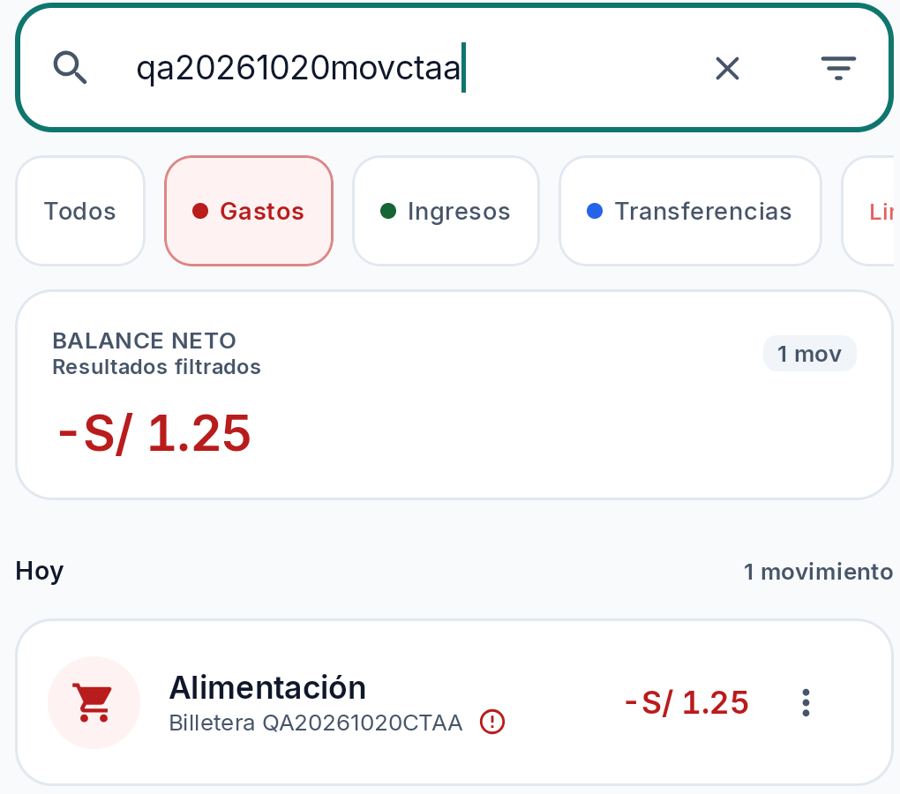
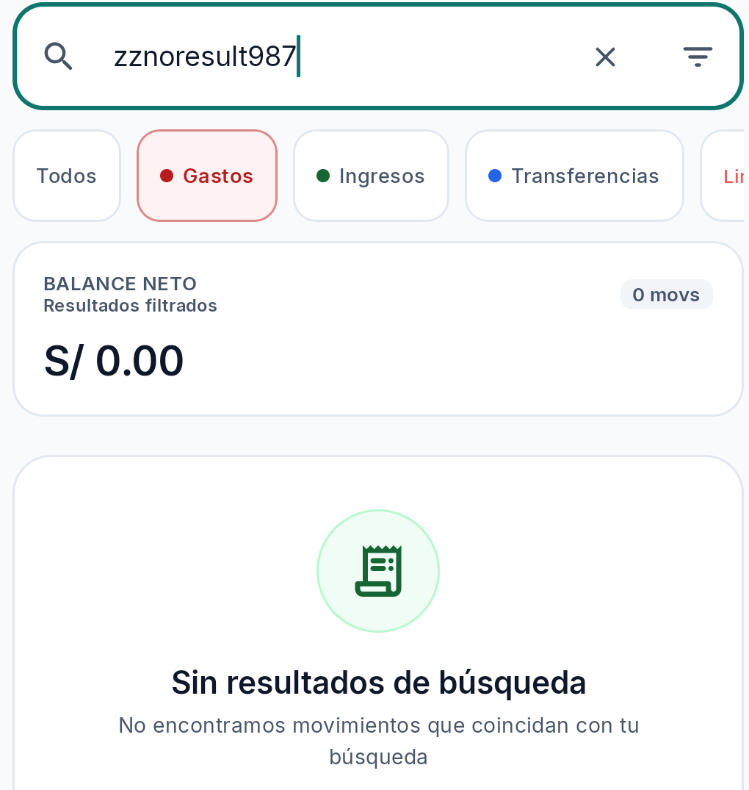
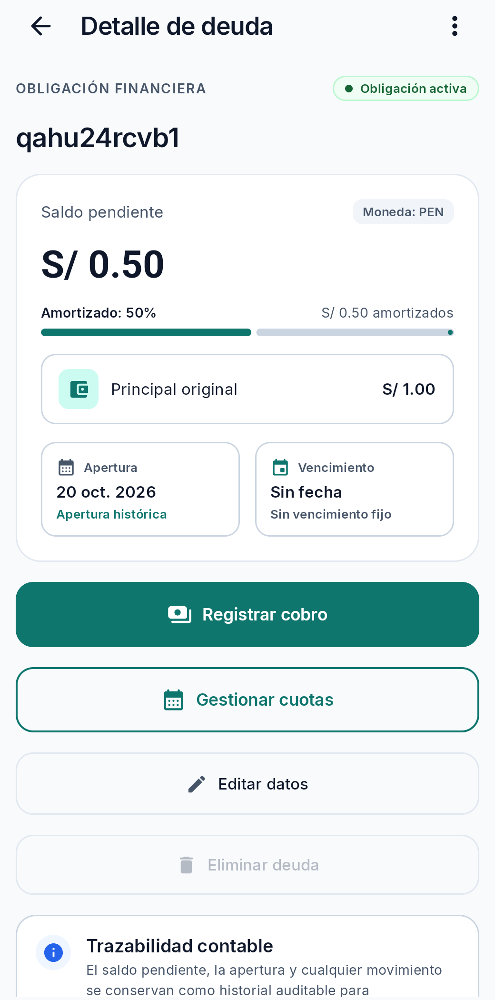
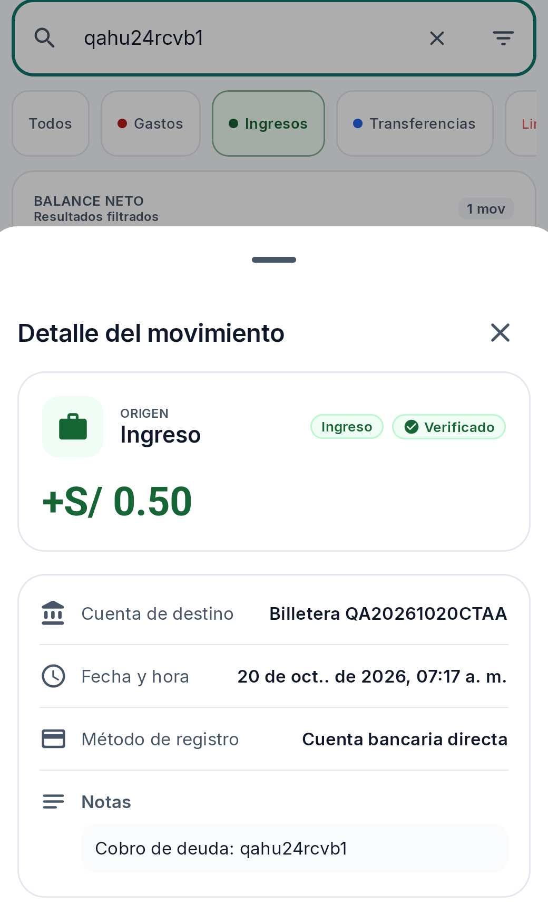
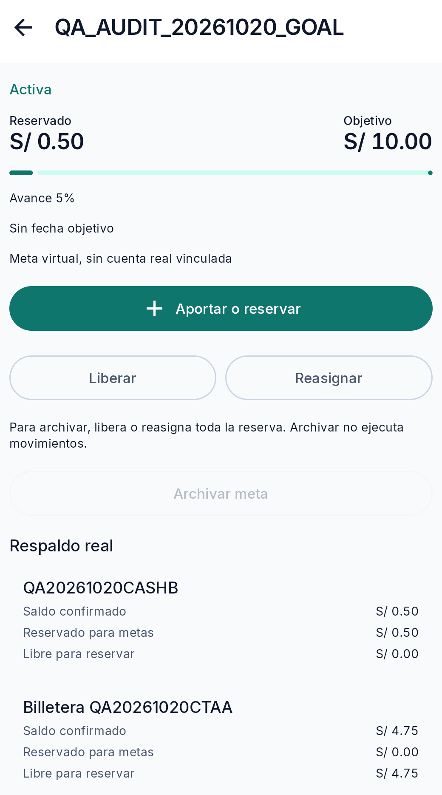
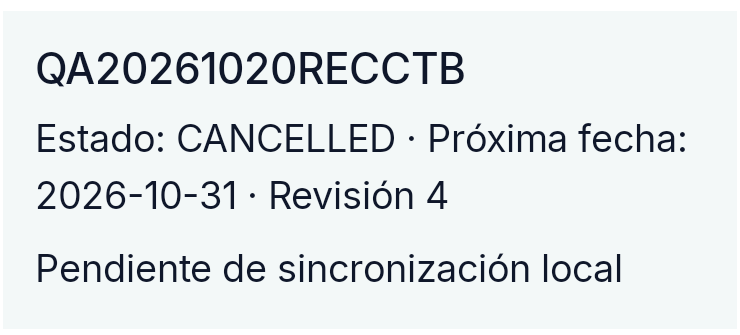

# Revisión visual de Kipu — Sprint 6

**Estado:** revisión documental y visual de evidencia disponible; no es una validación exhaustiva de todas las pantallas ni de la build identificada.
**Revisor:** Diseño visual / UI.
**Entorno reportado por QA:** aplicación instalada `com.kipu.app` 0.1.0, Samsung SM-A165M, Android 16/API 36. Según la actualización de `informe.md` por QA, el SHA-256 del `base.apk` instalado coincide con el candidato local QA Premium debug APK (`e218941857b805335e932ac78b6412ef31e316607a0775ca2824db4eda8c2864`), construido desde el worktree QA con base `dd6758a01a236aa61053ebf8ab24f25e0c835ba5`; el delta QA inspeccionado es de provisioning/documentación, no de pantallas. Esto mejora la trazabilidad del artefacto actual, pero no es atestación reproducible del build ni vincula automáticamente síntomas históricos a esa misma instalación.

## 1. Alcance y método

Se revisaron el canon visual `docs/stitch-design-system.md`, el catálogo Stitch `docs/ux-ui/references/stitch-redesign-catalog.md`, `Color.kt`, `Type.kt` y `Theme.kt`, el informe QA, y capturas conservadas de búsqueda, borrador, deuda/cobro, meta, recurrencia y el estado vacío posterior a editar. La revisión se limita a evidencia visual disponible y comparación estática de tokens. No se operó el dispositivo ni se midieron contraste, dp/sp, áreas táctiles, accesibilidad asistida o rendimiento.

El catálogo Stitch indica alcance funcional congelado hasta S3; se usa solo como referencia de composición y no como requisito funcional para S4–S6. El design system `Kipu Andean Modernist` es la fuente normativa de tokens. QA reporta que el hash del APK instalado coincide con el candidato QA Premium cuyo worktree base y delta están documentados; esta relación no equivale a una atestación reproducible de build ni identifica necesariamente la instalación de cada síntoma histórico. Las capturas por sí solas no prueban animación, navegación, interacción con lector de pantalla ni persistencia remota.

## 2. Resumen visual

- **Defectos visuales confirmados nuevos:** ninguno con la evidencia disponible.
- **Defectos visual/funcionales ya registrados:** el estado vacío de contenido tras editar corresponde al flujo de **BUG-002 / GitHub #60**; se referencia para no duplicar el hallazgo. Su causa no se atribuye a diseño y la captura no demuestra por sí sola qué evento produjo el estado.
- **Hallazgo de consistencia:** diferencia confirmada entre los tokens normativos y los valores de tema declarados en el código base de la rama QA asociada al APK candidato. La visualización exacta/impacto por pantalla sigue sin medirse; no se presenta como defecto visual renderizado confirmado.
- **Mediciones pendientes:** contraste efectivo por estado y tema, tamaños de texto y objetivos táctiles en dp, adaptación con teclado, navegación/scroll, modo oscuro capturado y reflujo con escalado de fuente.

## 3. Hallazgos

### UI-001 — Discrepancia entre tokens visuales normativos y valores del tema del checkout

- **Categoría:** discrepancia de sistema visual documentada; no se clasifica como defecto renderizado confirmado hasta medir su manifestación e impacto. Investigación publicada por Coordinación en [GitHub #62](https://github.com/Lume03/Kipu/issues/62), sin issue visual duplicado.
- **Pantalla/estado:** tema claro, superficies, texto primario, contenedores primarios y anillo de selección, potencialmente transversales.
- **Estado:** discrepancia fuente–canon confirmada para el código base QA asociado al candidato instalado, según el hash contrastado por QA; efecto visual/funcional en pantallas concretas pendiente de verificar.
- **Severidad / prioridad:** INFO / P3. La incoherencia dificulta saber cuál paleta debe preservarse y puede afectar consistencia/contraste si esos roles se usan; no hay evidencia de perjuicio concreto para la persona usuaria.
- **Frecuencia:** no aplica a una interacción reproducida; la discrepancia aparece en las definiciones consultadas.
- **Esperado:** los roles de color del tema Compose deben corresponder a los tokens normativos, o la diferencia debe quedar documentada como una decisión deliberada/override aprobado.
- **Observado en fuentes:** ejemplos de diferencias entre `stitch-design-system.md` y `app/src/main/java/com/kipu/app/ui/theme/Color.kt`:
  - `background`: norma `#F7F9FB`; fuente `KipuBackground = #F8FAFC`.
  - `on_surface`: norma `#191C1E`; fuente `KipuOnSurface = #0F172A`.
  - `surface_variant`: norma `#E0E3E5`; fuente `KipuSurfaceVariant = #F1F5F9`.
  - `on_surface_variant`: norma `#3E4947`; fuente `KipuOnSurfaceVariant = #475569`.
  - `primary_container`: norma `#0F766E` para CTA base; fuente `KipuPrimaryContainer = #CCFBF1`.
  - `on_primary_container`: norma `#A3FAEF`; fuente `KipuOnPrimaryContainer = #134E4A`.
  - `surface_tint`/anillo de selección: norma `#006A63`; fuente `KipuSelectionRing = #0F766E`.
- **Evidencia visual:** las capturas disponibles muestran fondos claros y acentos teal, pero no permiten muestrear fielmente el color del render (compresión/captura, perfil, densidad y estado de tema desconocidos). No se usa la apariencia de una captura como prueba de igualdad o desigualdad exacta de hex.
- **Fundamento:** `docs/stitch-design-system.md` declara el canon como fuente única de verdad visual normativa y prioriza los tokens del tema; `Color.kt` contiene valores distintos en varios roles. `Theme.kt` asigna esos valores al `lightColorScheme` y `darkColorScheme`. Según la correlación de hash registrada por QA, el APK candidato instalado se asocia a este código base, con cambios exclusivos QA de provisioning/documentación; no se afirma que cada síntoma histórico provenga de la misma instalación.
- **Impacto:** el código base asociado al artefacto difiere de la paleta normativa en roles de tema; la diferencia puede afectar consistencia y decisiones de contraste. Contraste real y efecto para la persona usuaria no medidos.
- **Causa:** diferencia observable en los archivos, motivo/autoría no confirmados. Podrían ser una actualización intencional no reflejada en el documento, valores históricos o una discrepancia efectiva.
- **Propuesta (no aplicada):** que el responsable del sistema visual concilie documentación y tokens Compose, preserve el canon aprobado o registre el override autorizado, y luego valide contraste por combinación/estado en la build correcta.
- **Responsable sugerido:** Android UI / responsable del sistema de diseño, con coordinación del equipo visual.
- **Criterios de aceptación propuestos:** (1) tabla normativa y fuentes Compose coinciden por rol o cada diferencia tiene aprobación y alcance documentados; (2) estados normal/seleccionado/deshabilitado/error se verifican en claro y oscuro; (3) combinaciones de texto aplicables alcanzan el mínimo de contraste definido por el sistema/WCAG; (4) prueba visual se ejecuta sobre APK cuyo provenance esté identificado.
- **Prueba futura:** comparar roles semánticos y capturas del APK identificado en claro/oscuro; medir contraste de texto y componentes por estado con herramienta adecuada. No medir ni modificar la app en esta tarea.

## 4. Evidencia visual revisada

### Búsqueda y estado vacío

La captura de búsqueda exacta presenta el campo con consulta, filtros por tipo, resumen «BALANCE NETO / Resultados filtrados», una cuenta de movimientos y la fila QA correspondiente. La consulta queda activa con cursor; la captura no permite determinar si esto es el comportamiento esperado tras finalizar la búsqueda. En el extremo derecho se ve parcialmente el siguiente chip de filtro («Li…»); no se declara defecto porque la fila puede ser desplazable horizontalmente y no hay evidencia de su gesto/alcance.

El estado sin coincidencias muestra la consulta, los filtros, un resumen con `0 movs`, un icono y el encabezado «Sin resultados de búsqueda», junto con texto explicativo. En el borde inferior de la captura el texto continúa fuera del encuadre; con una sola imagen no puede distinguirse si es scroll normal del contenido o recorte de captura. No se marca como texto cortado confirmado ni se afirma que la acción «limpiar» sea visible en este encuadre.

### Formulario y borrador

La captura disponible del formulario de gasto QA presenta selector segmentado de tipo, importe, cuenta, categoría requerida, sección de detalles/notas y acción primaria fija visualmente en la parte baja. La nota QA se ve dentro del campo. No se dispone de par teclado abierto/cerrado ni de captura de error de validación con el teclado presente; adaptación al IME, oclusión, desplazamiento y mensaje de error quedan **pendientes de medir/observar**. La imagen demuestra una composición del formulario, no el resultado de guardar o descartar.

### Deuda, cobro y coherencia visual financiera

La pantalla de detalle de deuda capturada presenta estado «Obligación activa», saldo pendiente PEN 0.50, principal original PEN 1.00, amortizado 50%, importe amortizado PEN 0.50, fecha de apertura y vencimiento sin fecha. Se ven acciones separadas para registrar cobro, gestionar cuotas y editar; eliminar deuda aparece deshabilitado. El balance entre saldo pendiente y amortizado es legible en esta captura. No demuestra que todos los importes/listados se mantengan coherentes en otros estados ni en el backend.

En otra captura, el movimiento asociado se representa como origen «Ingreso», lleva chips «Ingreso» y «Verificado», importe `+S/ 0.50` y nota «Cobro de deuda: …». Esta evidencia describe la etiqueta y el valor visibles del cobro; no demuestra contabilización agregada, origen bancario real ni confirmación remota. El nombre corto de la obligación visible es un identificador QA, no evidencia de un defecto de formato por sí solo.

### Meta y respaldo

La captura sanitizada muestra la meta QA en estado Activa, reservado PEN 0.50, objetivo PEN 10.00 y avance 5%, junto con el CTA «Aportar o reservar», las acciones «Liberar»/«Reasignar» y la explicación de archivo. En «Respaldo real» aparecen únicamente los alias QA `QA20261020CASHB` y `Billetera QA20261020CTAA`, con sus importes visibles; la imagen no muestra personas ni cuentas ajenas. La lista termina en el borde inferior del encuadre, sin que pueda concluirse si el contenido continúa con scroll. La captura acredita esos valores visuales en ese estado; no demuestra por sí sola la secuencia de transferencia, atomicidad, persistencia posterior ni sincronización remota.

### Recurrencia después de relanzar

La evidencia conservada es un recorte de texto: `QA20261020RECCTB`, estado `CANCELLED`, próxima fecha `2026-10-31`, revisión 4 y «Pendiente de sincronización local». El texto demuestra que ese estado local se volvió a observar después de relanzar según el reporte de QA; no permite evaluar layout completo, contraste, navegación, truncamiento en la pantalla original ni sincronización remota.

### Estado vacío posterior a editar — referencia a BUG-002/#60

La captura de BUG-002 muestra la barra de estado del dispositivo y la navegación inferior de la app; el área central de contenido está vacía, sin lista, formulario ni mensaje visible. No se atribuye causa desde la imagen. La reproducción funcional reportada y publicada ya pertenece a BUG-002/#60; no se crea un hallazgo UI duplicado.

## 5. Revisión por criterios visuales

| Criterio | Resultado basado en evidencia | Límite |
|---|---|---|
| Cortes, desbordes y solapamientos | No se confirma un defecto visual nuevo. Hay contenido que llega al borde inferior en capturas de búsqueda y meta; requiere comprobar scroll/encuadre en runtime. | No se recorrieron pantallas completas ni se cambió tamaño de fuente. |
| Alineación y jerarquía | En las capturas de resumen de deuda, formulario y meta se distinguen encabezados, importes principales, etiquetas y acciones. | Evaluación de las pantallas capturadas, no de todo S1–S6. |
| Tipografía | El fuente `Type.kt` define Inter y una escala Compose; coincide parcialmente con la intención normativa Inter. | No se midieron tamaños renderizados ni legibilidad con escalado. |
| Importes, fechas y estados | Casos capturados usan formato monetario con dos decimales y muestran explícitamente saldo/estado en los ejemplos descritos. | No se verificó exhaustivamente coherencia entre detalle/listados ni formato para otras monedas/fechas. |
| Color y contraste | Tokens normativos y valores del código base asociado al APK candidato difieren (UI-001). | Contraste efectivo y manifestación por pantalla pendientes de medir; hash de artefacto reportado por QA, sin atestación reproducible de build. |
| Iconografía y áreas táctiles | Iconos visibles en capturas, sin anomalía inequívoca confirmada. | Tamaño del glifo no revela hit target; medición dp pendiente. |
| Estados seleccionado/deshabilitado/error/carga | Se observan chip seleccionado de gastos, CTA deshabilitado de archivo y estado vacío de búsqueda; formulario de la captura no incluye el error que QA reportó en otro intento. | No se compararon todos los estados ni transiciones. |
| Teclado y barras del sistema | Captura de BUG-002 conserva barras del sistema y navegación inferior; la superficie de contenido permanece vacía. | No hay evidencia de teclado abierto/cerrado para evaluar oclusión. |
| Modo oscuro | El checkout declara esquemas claro y oscuro en `Theme.kt`. | No se revisó captura de modo oscuro del APK probado. |

## 6. Limitaciones y siguientes pasos visuales

1. Solicitar a QA, durante los recorridos funcionales ya autorizados (sin repetir casos PASS), evidencia del formulario con teclado abierto/cerrado y validación visible, y del scroll completo del estado vacío/meta solo si esas pantallas vuelven a estar abiertas por una prueba independiente.
2. Para filtros, comprobar desplazamiento horizontal y acceso completo al último chip antes de elevar el borde recortado observado a defecto.
3. Usar la correlación de hash ya registrada por QA como base de trazabilidad disponible; si se requiere mayor certeza, obtener atestación reproducible y contrastar capturas del APK candidato con tokens aprobados. No recompilar ni reinstalar.
4. Medir contraste, áreas táctiles y escalado de texto con herramientas y condiciones autorizadas. Hasta entonces, mantenerlos como pendientes de medir, no como incumplimientos.
5. Coordinar cualquier repro de contenido vacío con QA y referenciar #60; no operar el dispositivo desde UI ni abrir una incidencia duplicada.

## 7. Conclusión

La evidencia disponible permite documentar varios estados y una discrepancia fuente–canon asociada, según QA, al APK candidato instalado. No sustenta un nuevo defecto visual renderizado confirmado ni una evaluación completa de las superficies S1–S6. **UI-001 confirma la discrepancia de sistema visual; su manifestación/impacto en pantallas permanece pendiente de medir** hasta conciliar tokens o documentar un override. El estado vacío posterior a editar se mantiene ligado a BUG-002/#60. La revisión no modifica el producto, no reemplaza la cobertura funcional y no constituye investigación con usuarios.
