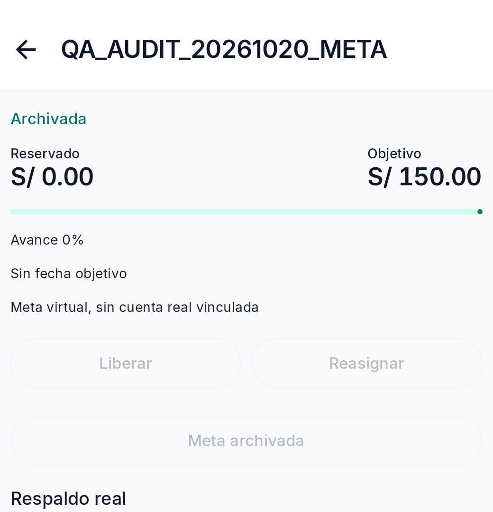
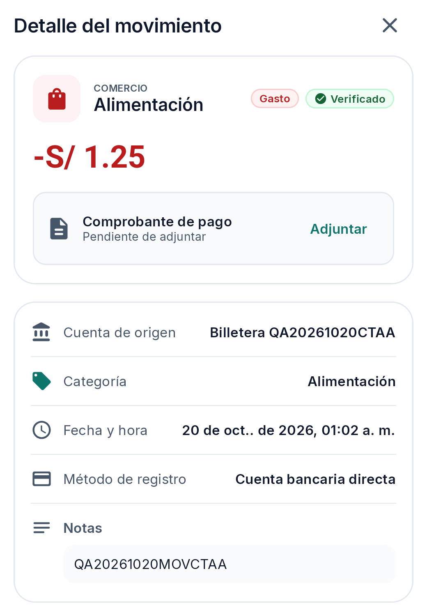
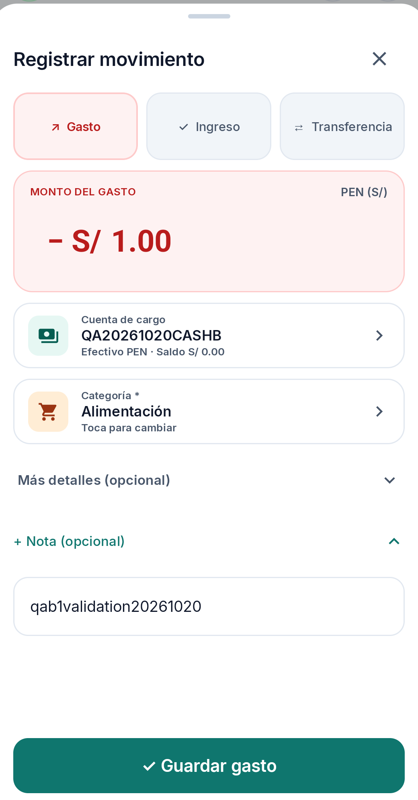
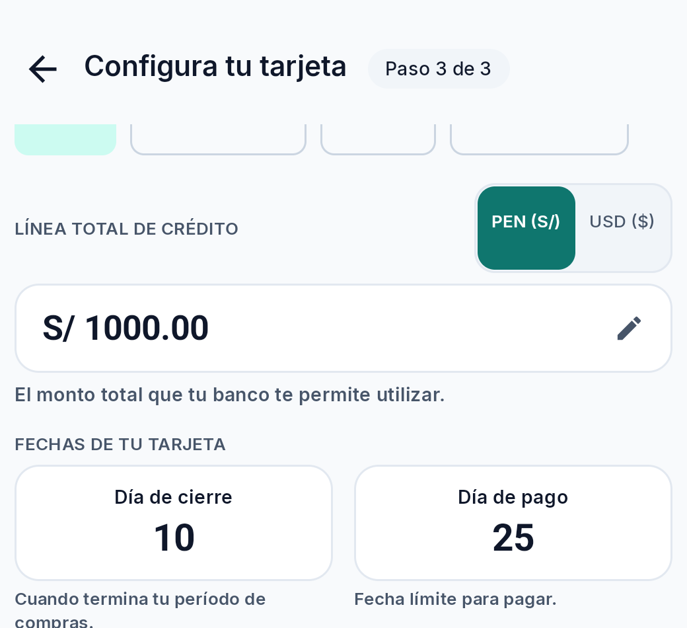
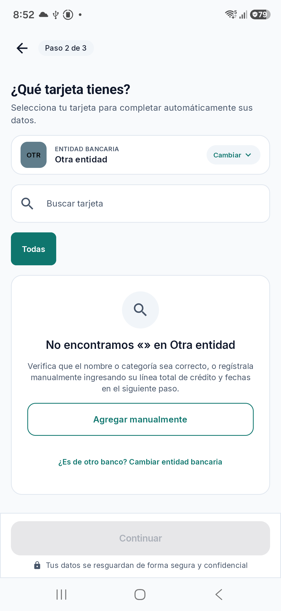
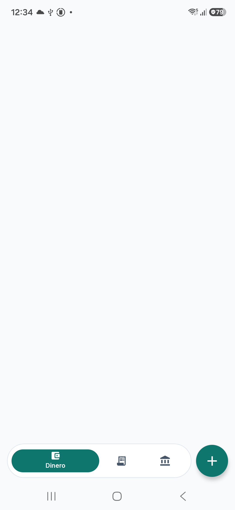
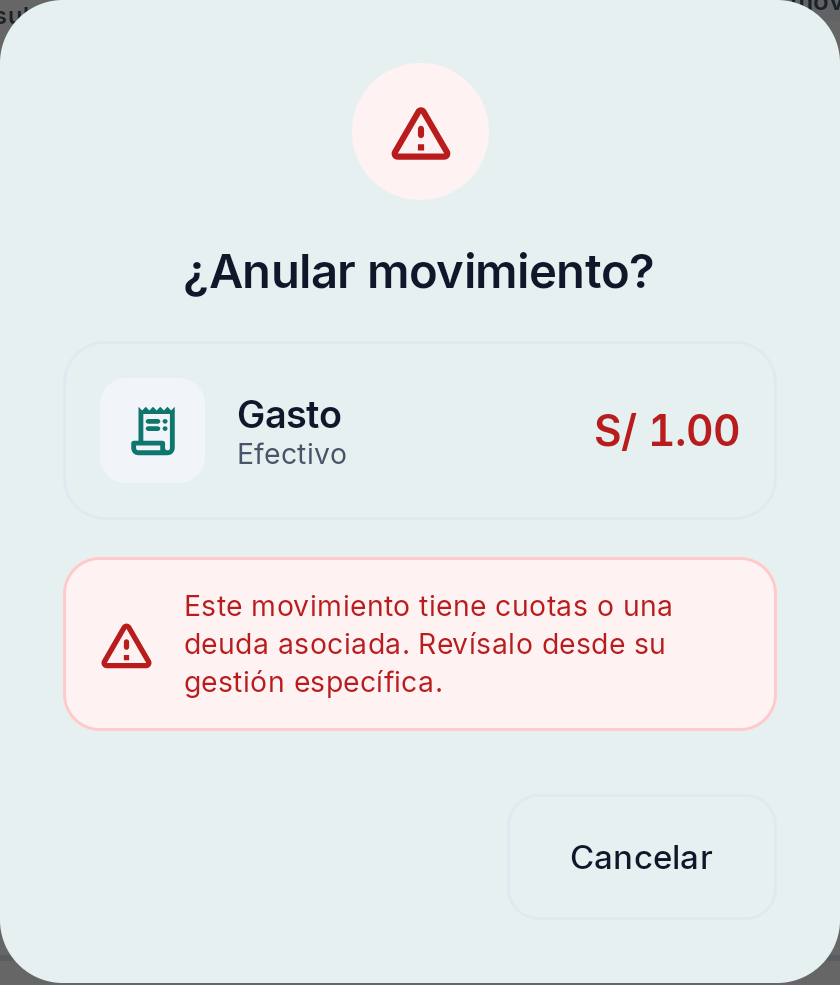
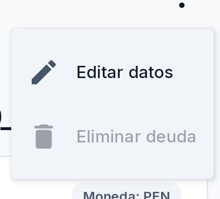

# Revisión de experiencia de usuario de Kipu — Sprint 6

**Estado:** revisión heurística y de flujos basada en documentación, capturas y observaciones QA disponibles; no es una evaluación exhaustiva ni investigación con usuarios.
**Revisor:** Diseño de experiencia · UX.
**Entorno reportado por QA:** aplicación instalada `com.kipu.app` 0.1.0, Samsung SM-A165M, Android 16/API 36. El hash del APK instalado coincide con el candidato local QA Premium, pero no hay atestación que lo vincule a un release Sprint 6 ni a la fecha histórica de síntomas.
**Dictamen UX:** sin nueva falla funcional demostrada por esta revisión. Se registran observaciones de usabilidad que requieren definición o confirmación; BUG-002/#60 y BUG-003/#61 se referencian sin duplicarlos.

## 1. Alcance y método

Se revisaron el informe funcional `informe.md`, el checkpoint de coordinación, las capturas QA disponibles, el sistema de diseño `docs/DESIGN.md`, el catálogo `docs/ux-ui/references/stitch-redesign-catalog.md` y los criterios de HU-18, HU-20–24 y HU-31–35 del backlog.

La evaluación considera claridad de navegación y acciones, prevención/recuperación de errores, formularios y conservación de estado, feedback de operaciones, significado de estados locales/remotos y estados vacíos o deshabilitados. Las capturas documentan pantallas concretas; no prueban por sí solas transiciones, persistencia o significado de etiquetas. Las observaciones del comportamiento se atribuyen a QA y no se presentan como sesiones realizadas por UX.

El catálogo Stitch declara su alcance funcional congelado hasta S3. Se utiliza solo como referencia de patrones cuando aplica, no como requisito para S4–S6. El design system documenta personalidad de claridad, precisión y honestidad estructural; la evaluación no sustituye un contraste de requisitos con Product/Tech Lead cuando el contrato está incompleto.

**Limitaciones:** no se operó el dispositivo ni se usó ADB; no hubo entrevistas ni pruebas moderadas con usuarios. No se midieron contraste, tamaño de toque, orden de foco, TalkBack, escalado de texto, adaptación al teclado ni rendimiento. No se infiere comportamiento remoto a partir de texto local. Las observaciones no son defectos confirmados salvo que se indique expresamente.

## 2. Resumen ejecutivo

- **Problemas de usabilidad confirmados nuevos:** ninguno elevado como bug UX confirmado en esta revisión.
- **Observaciones de usabilidad pendientes de definir o confirmar:** UX-001 estado deshabilitado sin explicación visible en detalle de meta archivada; UX-002 significado de “Verificado” frente a sincronización/comprobante; UX-003 semántica de cerrar y reabrir el borrador; UX-004 destino confuso tras archivar tarjeta.
- **Hallazgos compartidos existentes:** el área de contenido vacía tras editar es BUG-002/#60 (2/2 según QA); la falta de acción visible para anular un pago vinculado es BUG-003/#61. No se crean hallazgos duplicados ni se reevalúa su causa.
- **Flujos con resultado positivo acotado:** búsqueda exacta/parcial y estado vacío de búsqueda; rechazos UI para importe cero, categoría ausente y tres decimales; cobro parcial de receivable y persistencia local tras relanzar; ciclo local de recurrencia. Estos PASS funcionales no equivalen a una aprobación UX del flujo completo.
- **HU-24:** el cobro parcial a obligación y la transferencia explícita asociada a meta son flujos distintos. No se observó una aplicación de un movimiento existente a una obligación ni está confirmado el impacto en totales operativos, por lo que no se declara cubierto ese objetivo completo.

## 3. Hallazgos UX

### UX-001 — Acciones deshabilitadas en meta archivada sin explicación contextual visible

- **Categoría:** problema de usabilidad potencial; posible brecha de criterio, no defecto funcional confirmado.
- **Pantalla / flujo / estado:** detalle de `QA_AUDIT_20261020_META`, meta QA archivada, sin reserva; controles relacionados con aporte/reserva, liberación y reasignación.
- **Estado:** observación confirmada en la sesión QA descrita; cumplimiento del escenario de HU-24 AC4 pendiente de confirmar.
- **Severidad / prioridad:** baja / P3. En el estado observado, la persona no recibe una explicación de por qué el control no está disponible ni qué debe hacer. No se demostró pérdida de datos ni efecto financiero.
- **Pasos y frecuencia:** QA abrió el detalle de la meta archivada, encontró `Liberar`, `Reasignar` y `Meta archivada` deshabilitados y tocó el último control; no hubo navegación, diálogo ni cambio. Observado 1 vez; no repetido para evitar interacción innecesaria.
- **Esperado:** el estado no disponible debe ser comprensible y ofrecer una salida o explicación apropiada. HU-24, Escenario 4, establece que si la meta no tiene cupo activo y se intenta aportar, se explique cómo seleccionar cupo antes de guardar.
- **Observado:** el detalle archivado no ofreció una acción ni explicación al tocar el control. No se llegó a un formulario de aporte ni se intentó guardar; por tanto, no se afirma que el escenario de rechazo de HU-24 se haya ejecutado ni que la app permita aplicar a una meta archivada.
- **Evidencia:** la captura acredita el estado visual; el resultado del toque procede del registro de QA. No demuestra el estado de una ruta de aporte elegible.

- **Impacto:** incertidumbre sobre si se debe reactivar la meta, elegir otra o salir del detalle; el control deshabilitado puede parecer un fallo si no comunica el motivo.
- **Causa:** no confirmada. Puede ser el comportamiento intencional de una entidad archivada, sin tratamiento contextual.
- **Propuesta (no aplicada):** añadir texto contextual que indique que la meta archivada no admite nuevas operaciones y la acción segura disponible (por ejemplo, volver a metas activas o reactivar si el producto lo permite). Mantener acciones realmente no disponibles como controles semánticamente deshabilitados.
- **Responsable sugerido:** Product/UX para decidir el contrato de reactivación; Android UI para reflejarlo.
- **Criterios de aceptación propuestos:** (1) el estado archivado se identifica con texto y no solo color; (2) cualquier acción no disponible tiene razón comprensible y alternativa segura; (3) no se crea reserva ni movimiento al interactuar con controles deshabilitados; (4) la ruta de HU-24 AC4 muestra la explicación antes de guardar cuando el escenario especificado sea alcanzable.
- **Prueba futura:** QA, con una meta creada por QA, comprobará detalle activo/archivado, estado accesible de acciones, mensaje y ausencia de mutación al intentar aportar sin cupo activo. No repetir reserva/liberación ya aprobada.

### UX-002 — “Verificado” puede confundirse con sincronización o comprobante

- **Categoría:** observación de contenido/estado; semántica de producto pendiente, no bug confirmado.
- **Pantalla / flujo / estado:** detalle de movimiento QA después de guardar.
- **Estado:** observación potencial; significado contractual de `Verificado` no identificado.
- **Severidad / prioridad:** baja / P3. La etiqueta puede comunicar una validación más amplia que la realmente conocida; no hay evidencia de que cause una decisión errónea.
- **Pasos y frecuencia:** QA abrió el gasto ordinario `QA20261020MOVCTAA`. Se observó el chip `Verificado` y el comprobante pendiente de adjuntar; el mensaje de guardado de la sesión indicaba que el registro estaba guardado en el dispositivo y pendiente de sincronización. Observación de un movimiento.
- **Esperado:** estados diferentes —validación del registro, comprobante adjunto y sincronización— deberían ser distinguibles si representan conceptos independientes. El estado de sincronización remota no debe inferirse de `Verificado`.
- **Observado:** la captura muestra el chip `Verificado` y el comprobante pendiente; no presenta estado de sync en ese panel. El informe indica que la operación estaba pendiente de sincronización local. No se confirmó backend ni que `Verificado` signifique sincronizado.
- **Evidencia:** la imagen sustenta únicamente las etiquetas visibles.

- **Impacto:** posible falsa certeza o confusión sobre qué comprobó el sistema y si los datos llegaron al servidor.
- **Causa:** desconocida; falta definición de la semántica de `Verificado`.
- **Propuesta (no aplicada):** Product debe definir el significado; si la sincronización es relevante en el detalle, mostrarla con etiqueta independiente y lenguaje local/remoto inequívoco.
- **Responsable sugerido:** Product/UX para contrato y microcopy; Android UI/Sync para exponer el estado observado.
- **Criterios de aceptación propuestos:** (1) cada etiqueta tiene definición documentada; (2) `Verificado` no implica sincronización remota salvo confirmación real; (3) comprobante y sincronización se muestran separados cuando sean estados distintos; (4) lector de pantalla anuncia el estado textual sin depender del color.
- **Prueba futura:** contrastar mensaje de guardado, listado y detalle con una operación QA en estados local pendiente y confirmado únicamente cuando exista una señal observable autorizada. No forzar sync ni repetir esperas sin observación nueva.

### UX-003 — Cierre del formulario no aclara si descarta o conserva el borrador

- **Categoría:** observación de flujo y contrato; no bug funcional demostrado.
- **Pantalla / flujo / estado:** formulario de gasto; cierre con X y reapertura en la misma sesión.
- **Estado:** potencial; expectativa del producto no definida en la especificación consultada.
- **Severidad / prioridad:** baja / P3. Puede hacer que se registre accidentalmente información anterior; no se guardó el borrador ni se observó efecto financiero.
- **Pasos y frecuencia:** QA introdujo importe PEN 1.00, categoría y nota QA; cerró con X, navegó a otra pantalla y volvió a abrir el formulario. La reapertura mostró esos campos; observado 1/1.
- **Esperado:** la interfaz debe indicar si X descarta, conserva como borrador o solicita confirmación cuando hay cambios. HU-18 determina campos requeridos, pero la evidencia documental consultada no precisa la semántica de cierre.
- **Observado:** los campos reaparecieron. La captura disponible muestra el formulario reabierto, pero no prueba por sí sola la transición previa.
- **Evidencia:** la secuencia proviene de la observación QA; la imagen no demuestra que X haya descartado o conservado deliberadamente el borrador.

- **Impacto:** riesgo de guardar un importe/categoría/nota anterior creyendo que se inició un registro nuevo.
- **Causa:** no confirmada; podría tratarse de estado de pantalla retenido o de una función de borrador intencional.
- **Propuesta (no aplicada):** decidir y documentar el contrato. Si conserva, comunicar “Borrador guardado” al salir y al reabrir; si descarta, confirmar ante cambios o reiniciar el formulario al volver. Evitar el término “descartar” si los datos se conservan.
- **Responsable sugerido:** Product/UX; Android UI para el ciclo de estado.
- **Criterios de aceptación propuestos:** (1) la acción X tiene resultado predecible y comunicado; (2) la reapertura coincide con el contrato; (3) no se crea movimiento al salir; (4) cuando exista riesgo de pérdida o de guardar valores antiguos, se explica antes de la acción irreversible.
- **Prueba futura:** un caso QA con valores identificables que registre abrir → editar → cerrar → navegar → reabrir, compare contra el contrato explícito y confirme que no se creó movimiento. La frecuencia sigue siendo 1/1 y no se presenta como repro robusto.

### UX-004 — Archivar tarjeta devuelve al asistente de alta

- **Categoría:** observación de navegación/usabilidad; el archivo de la tarjeta sí se observó efectivo.
- **Pantalla / flujo / estado:** detalle de `QA20261020CARD1` → Archivar tarjeta → confirmación → retorno.
- **Estado:** potencial, observado 1/1; no repetido para evitar crear otra tarjeta innecesaria.
- **Severidad / prioridad:** baja / P3. El destino inesperado puede hacer dudar del resultado y ofrecer volver a guardar la misma tarjeta; no se observó duplicación ni fallo de archivo.
- **Pasos:** QA archivó la tarjeta QA sin consumos. Tras confirmar, la app volvió al paso 3/3 de configuración; al usar Atrás mostró paso 2/3 con búsqueda vacía y “No encontramos «» en Otra entidad”. La tarjeta dejó de aparecer entre activas; se omite el contador global de archivadas por privacidad.
- **Esperado:** después de archivar, salir hacia una lista/detalle coherente con el cambio y confirmar claramente el estado; Atrás no debería reabrir pasos del asistente ya abandonado.
- **Observado:** el archivo fue efectivo, pero el back stack llevó a pasos previos del wizard y mostró un estado de búsqueda vacía. La UI podría interpretarse como si el archivo no hubiera terminado.
- **Evidencia:** el conjunto demuestra contexto de navegación y estado archivado; no demuestra la causa del retorno.

La captura de la sección archivados no se incluye: muestra un contador global que no puede atribuirse al fixture QA.
- **Impacto:** desorientación y riesgo de iniciar una tarjeta duplicada; no se confirmó que esto haya ocurrido.
- **Causa:** no confirmada; el back stack conservando el wizard es una hipótesis.
- **Propuesta (no aplicada):** al completar el archivo, navegar a la lista de instrumentos con feedback inequívoco y retirar el wizard previo de la pila de navegación.
- **Responsable sugerido:** Android UI / navegación.
- **Criterios de aceptación propuestos:** (1) tarjeta QA deja de figurar como activa y aparece en archivadas; (2) mensaje confirma archivo y conservación de historial; (3) Atrás no reabre la configuración de esa tarjeta; (4) no hay CTA de guardado que pueda recrearla inadvertidamente.
- **Prueba futura:** con un fixture propio sin consumos, archivar una vez, verificar destino, feedback y pila Atrás; no usar tarjeta personal ni ejecutar pago/consumo.

### Referencia compartida — BUG-002/#60: área vacía tras editar

- **Categoría:** defecto funcional/de navegación ya confirmado por QA; no duplicado UX.
- **Estado:** BUG-002/#60, abierto; informe funcional registra dos reproducciones de dos intentos de guardar ediciones QA.
- **Impacto UX:** la persona pierde temporalmente el contexto y las rutas de navegación hasta relanzar la aplicación; la edición persistió localmente según el informe.
- **Evidencia y detalle:** pasos, límites y estado de issue están en `informe.md`, sección de BUG-002, y GitHub [#60](https://github.com/Lume03/Kipu/issues/60).

- **Criterio de verificación:** tras guardar una edición válida, devolver a detalle/listado actualizado, conservar navegación y permitir continuar sin cerrar la app. UX no atribuye causa ni propone issue adicional.

### Referencia compartida — BUG-003/#61: acción de anular pago vinculado no disponible

- **Categoría:** defecto de flujo/recuperación ya confirmado por QA; no duplicado UX.
- **Estado:** BUG-003/#61, abierto; informe registra un intento observado y revisión del detalle/historial sin acción visible.
- **Impacto UX:** el usuario recibe una instrucción de revisar la deuda, pero no encuentra allí la acción para corregir el pago; se interrumpe la recuperación de un posible error financiero.
- **Evidencia y detalle:** reproducción y límites en `informe.md`, sección BUG-003, y GitHub [#61](https://github.com/Lume03/Kipu/issues/61).

- **Criterio de verificación:** el flujo de anulación debe llevar a una ruta disponible de corrección o evitar remitir a una pantalla sin acción; la reversión debe preservar historial y estado financiero conforme al contrato. La corrección y consistencia contable pertenecen a Product/Tech Lead, no a esta revisión.

## 4. Evaluación heurística de flujos observados

| Flujo/estado | Evidencia y lectura UX | Estado de revisión |
|---|---|---|
| Búsqueda exacta, parcial y sin resultados | QA observó que exacta y parcial encuentran el gasto QA; sin coincidencias muestra estado vacío y opción de limpiar. El feedback básico y salida de recuperación están presentes. No se revisaron todos los filtros combinados ni el comportamiento de teclado. | Cobertura funcional acotada; sin hallazgo UX confirmado. Capturas: `HU-22-search-exact-qa.png`, `HU-22-search-partial-qa.png`, `HU-22-search-no-results.png`. |
| Validación de formulario de movimiento | Cero, categoría ausente y tres decimales fueron rechazados y el formulario permaneció abierto. Para importe cero y exceso decimal se reporta el mismo mensaje genérico “Ingresa un monto válido mayor a 0”; no se conservó captura sanitaria del error. Es prevención observada, pero el mensaje no parece explicar el problema específico de precisión. | Mejora potencial de microcopy, sin registro aparte: determinar si el campo puede identificar “máximo dos decimales” sin inventar regla. Negativo, instrumento ausente y fecha inválida permanecen sin verificar. |
| Cobro parcial de receivable QA | La obligación se mostró activa con PEN 0.50 pendiente luego de cobrar PEN 0.50 de PEN 1.00 y continuó así tras relanzar. El usuario puede ver saldo restante; la etiqueta `Ingreso` requiere la distinción independiente de UX-002/OBS-001 y no prueba clasificación operativa. | Persistencia local observada; sin confirmación remota ni de totales. Capturas `HU-24-receivable-partial-collection.png` y `HU-24-receivable-after-relaunch-qa.png`. |
| Transferencia explícita vinculada a meta | El formulario de la transferencia indicó que no crea gasto/ingreso; QA observó un traslado entre dos cuentas QA y reserva virtual. El nombre de una captura original fue marcado por Coordinación como NEEDS_CONTEXT por posible dato ajeno; no se reproduce aquí ni se interpreta como prueba de defecto. | Resultado funcional acotado en `informe.md`; el original no debe publicarse. Requiere revisión del derivado sanitizado antes de uso externo. No se equipara a imputación de movimiento a obligación. |
| Recurrencia después de relanzar | La regla QA reapareció como CANCELLED, revisión 4, con próxima fecha y sincronización pendiente local. El texto diferencia estado local pendiente, pero no demuestra sync remoto. | Persistencia local observada para estado cancelado solamente; no se probó ACTIVE/PAUSED tras relanzar. Captura `HU-33-recurrence-after-relaunch-qa.png`. |
| Cuenta y tarjeta archivadas | Los diálogos mencionan conservación del historial/reactivación; cuenta de efectivo mostró feedback de operación pendiente de sincronización. El wizard inesperado tras archivar tarjeta se registra en UX-004. | Evidencia de flujos propios QA; no evidencia de sync remoto. |

## 5. Criterios de aceptación UX transversales

1. **Lenguaje y errores:** errores junto al campo afectado, explicación específica y orientada a acción; conservar valores válidos del formulario y no presentar una validación local como resultado remoto.
2. **Acciones destructivas o reversibles:** identificar claramente qué entidad y efecto se confirma; diferenciar archivar, anular y eliminar; dar feedback posterior y destino de navegación predecible.
3. **Estado y sincronización:** distinguir guardado local, pendiente de sincronización y confirmado por servidor, sin que “Verificado” o un estado del ledger se interprete como confirmación remota salvo contrato explícito.
4. **Estados no disponibles:** explicar por qué una acción no puede ejecutarse y cuál es el siguiente paso; no depender únicamente de color o de un control que parece accionable pero no responde.
5. **Navegación y borradores:** Atrás/X debe respetar una semántica consistente, evitar reabrir asistentes concluidos y dejar claro si el borrador se conserva o descarta.
6. **Accesibilidad pendiente de comprobación:** etiquetas y estados semánticos para lector de pantalla, foco visible/orden lógico, mensajes de error anunciables, áreas táctiles de al menos 48×48 dp según el sistema documentado y contraste de texto mínimo 4.5:1. Ninguno de estos valores se midió en esta revisión.

## 6. Recomendaciones priorizadas

1. Resolver y revalidar BUG-002/#60 y BUG-003/#61 con QA; no abrir duplicados.
2. Acordar con Product el contrato de cierre/reapertura de borrador y el significado de `Verificado`; conservar UX-002/UX-003 como observaciones, no bugs.
3. Definir el feedback para metas archivadas/no elegibles y completar el escenario HU-24 AC4 solo si la ruta requerida está disponible en el APK identificado.
4. Corregir la salida/back stack de archivar tarjeta si QA confirma en una continuación que no fue un comportamiento transitorio; no repetir solo por confirmación estética si no agrega evidencia.
5. Coordinar con QA, durante recorridos funcionales independientes y sin repetir casos aprobados, capturas del formulario con teclado abierto/error inline y del flujo de meta elegible/no elegible si se alcanza. Mantener fuera de entregables la captura original marcada NEEDS_CONTEXT hasta contar con derivado y revisión de privacidad.
6. Medir contraste, tamaño efectivo de toque, escalado de texto, foco/lector de pantalla y comportamiento con teclado en condiciones autorizadas. Hasta entonces, reportarlos como **pendiente de medir**, no como incumplimientos.

## 7. Conclusión

La revisión heurística, basada en el material existente, no confirma un nuevo bug de UX. Identifica cuatro observaciones que pueden afectar comprensión o navegación, pero que requieren decisión de producto o confirmación adicional. Los dos fallos ya publicados (#60/#61) son problemas UX/flujo relevantes y se mantienen en sus issues existentes. La matriz funcional y sus PASS/FAIL no deben alterarse por esta revisión: las observaciones heurísticas, los criterios pendientes y las mejoras opcionales se contabilizan aparte. Esta evaluación no es investigación validada con usuarios, no acredita cumplimiento WCAG ni mediciones, y no cierra la auditoría S1–S6.
