# Verificación visual antes y después

18 de noviembre de 2026 · Pixel_10 (emulator-5554) · Android en inglés (en-US) · Debug instalado.

Correcciones en main: `b255fd0c`, `bbed0944` y `2bbbf903` (ronda 1), y `d7526766`, `37cdf739` y `39bb2273` (ronda 2). Referencia visual y pasos originales en [hallazgos.md](hallazgos.md).

Cuenta usada: QA Premium (`luquealonso151+uxreview@gmail.com`). La cuenta QA Free no fue necesaria para reproducir estas capturas.

El emulador quedó con la fuente y las tres escalas de animación en 1.0, el modo nocturno en su valor original y el idioma en inglés.

## Resumen

| ID | Módulo y pantalla | Severidad | Estado |
| --- | --- | --- | --- |
| [VIS-01](#vis-01) | Movimientos, Metas, Análisis y Recurrencias · selectores de fechas | Baja | Resuelto |
| [VIS-02](#vis-02) | Metas · selector de icono | Baja | Resuelto |
| [VIS-03](#vis-03) | Datos y privacidad · confirmación de eliminación de cuenta | Media | Resuelto |
| [VIS-04](#vis-04) | Categorías · pestaña Gastos seleccionada | Media | Resuelto |
| [VIS-05](#vis-05) | Categorías · modal Color personalizado | Media | Resuelto |
| [VIS-06](#vis-06) | Movimientos · hojas Filtros y Detalle, componente compartido | Media | Resuelto |
| [VIS-07](#vis-07) | Movimientos · hoja Filtros, fila Cuenta | Baja | Resuelto |
| [VIS-08](#vis-08) | Movimientos · hoja Registrar movimiento | Baja | Resuelto |
| [VIS-09](#vis-09) | Movimientos · confirmar anulación | Media | Resuelto |
| [VIS-10](#vis-10) | Estados de cuenta · resumen de cargos y abonos | Baja | Resuelto |
| [VIS-11](#vis-11) | Estados de cuenta · barra de selección masiva | Media | Resuelto |
| [VIS-12](#vis-12) | Comprobantes Yape · fecha y hora | Media | Parcial |
| [VIS-13](#vis-13) | Presupuestos · diálogo Finalizar presupuesto | Media | Resuelto |
| [VIS-14](#vis-14) | Deudas · Cuotas y cronograma | Baja | Resuelto |
| [VIS-15](#vis-15) | Widgets · Libre para gastar, tamaño inicial 4 × 2 | Media | Resuelto |

## VIS-01

Claro · fuente 1.3.

Movimientos, Metas, Análisis y Recurrencias · selectores de fechas. El registro rápido muestra “Select date” y “November” junto a “Cancelar” y “Listo”.

**Corrección aplicada.** El contexto de los selectores Material usa es-PE. `app/src/main/java/com/kipu/app/feature/movements/presentation/QuickMovementScreen.kt:268`, `app/src/main/java/com/kipu/app/ui/component/KipuOptionalDateField.kt:154`, `app/src/main/java/com/kipu/app/feature/analytics/presentation/AnalyticsScreen.kt:723`, `app/src/main/java/com/kipu/app/feature/recurrences/presentation/RecurrenceRegistrationScreen.kt:109`, `app/src/main/java/com/kipu/app/ui/component/KipuPickerLocale.kt`.

| Antes | Después |
| --- | --- |
| 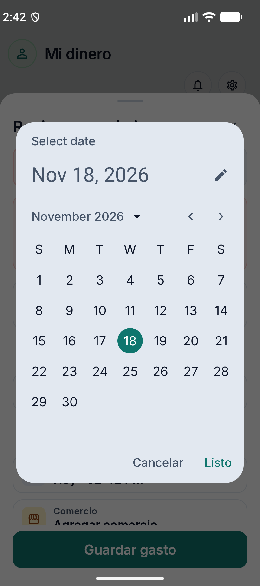 | 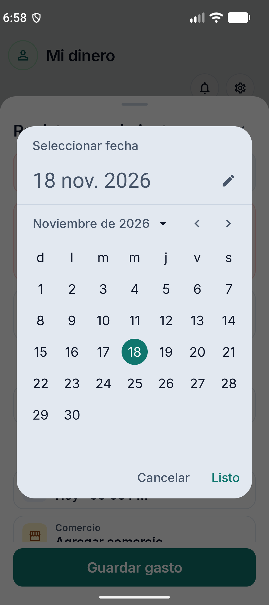 |

**Resuelto.** El selector del registro rápido muestra título, fecha, mes y días en español con Android en inglés. También comprobé los selectores de Metas, Análisis y Recurrencias en oscuro y con fuente 1.3.

## VIS-02

Oscuro · fuente 1.3.

Metas · selector de icono. La grilla de cuatro columnas fuerza un salto dentro de “Emergencias” y deja la s sola en el renglón siguiente.

**Corrección aplicada.** Reorganiza la hoja de iconos en tres columnas con letra grande. `app/src/main/java/com/kipu/app/feature/goals/presentation/GoalFormScreen.kt:399`.

| Antes | Después |
| --- | --- |
| 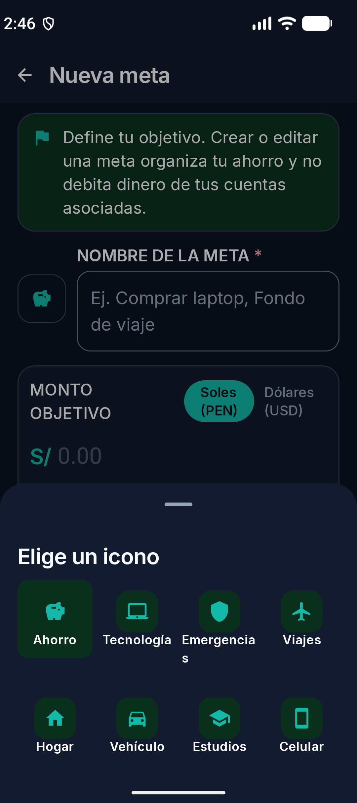 | 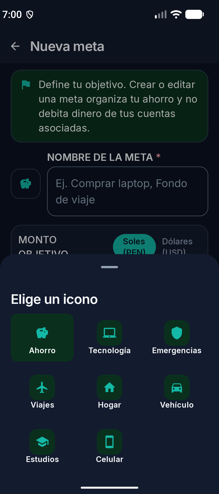 |

**Resuelto.** “Emergencias” se lee en una sola línea y los ocho iconos siguen visibles.

## VIS-03

Oscuro · fuente 1.3.

Datos y privacidad · confirmación de eliminación de cuenta. “Eliminar definitivamente” conserva el rojo de acción habilitada con la casilla de consentimiento vacía.

**Corrección aplicada.** Aplica el color de error como color habilitado del botón de texto. `app/src/main/java/com/kipu/app/feature/portability/AccountDeletionSection.kt:76`.

| Antes | Después |
| --- | --- |
| 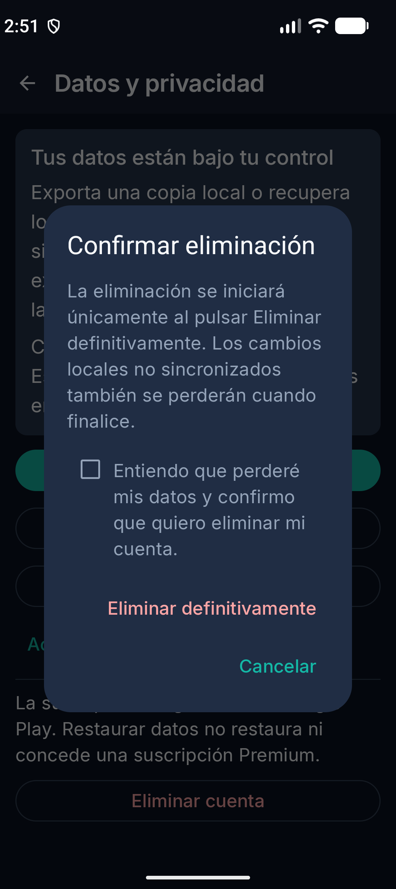 | 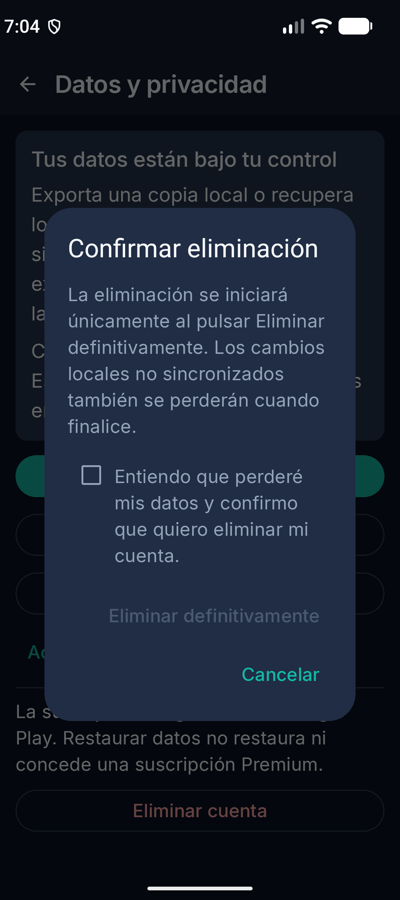 |

**Resuelto.** La acción se distingue visualmente como deshabilitada con la casilla vacía.

## VIS-04

Claro · fuente 1.0.

Categorías · pestaña Gastos seleccionada. El texto blanco “Gastos” sobre `expenseCoral` presenta 3.41:1.

**Corrección aplicada.** Aplica los colores semánticos de gasto a la pestaña seleccionada y su contador. `app/src/main/java/com/kipu/app/feature/categories/presentation/categories/CategoriesScreen.kt:1060`.

| Antes | Después |
| --- | --- |
| 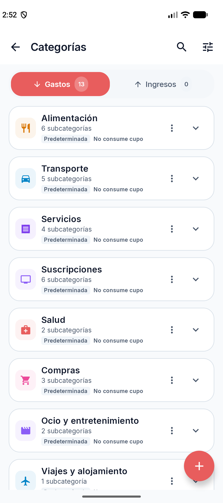 | 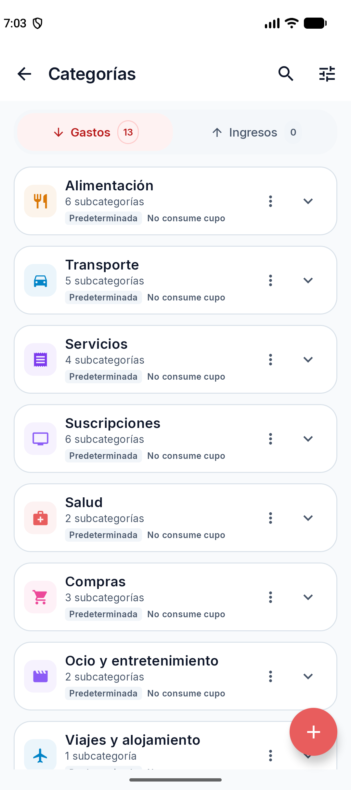 |

**Resuelto.** El texto #B91C1C sobre #FEF2F2 da 5.91:1 en la captura, frente a 3.41:1 para la etiqueta original.

## VIS-05

Oscuro · fuente 1.3.

Categorías · modal Color personalizado. El campo HEX oculta el final de un valor normal de siete caracteres.

**Corrección aplicada.** Da al campo HEX su propia fila cuando falta espacio para HEX y RGB. `app/src/main/java/com/kipu/app/feature/movements/presentation/PastelCategoryPickerFlow.kt:2197`.

| Antes | Después |
| --- | --- |
| 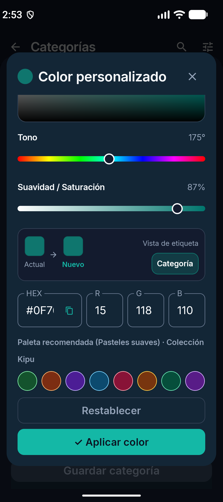 | 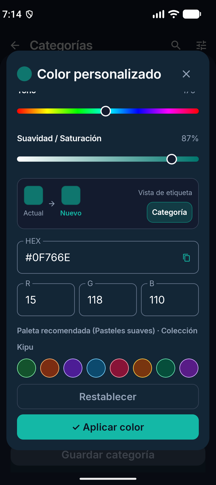 |

**Resuelto.** Se ve #0F766E completo junto al botón de copia.

## VIS-06

Oscuro · fuente 1.3.

Movimientos · hojas Filtros y Detalle, componente compartido. Al quedar expandida a pantalla completa, la hoja dibuja el tirador a la misma altura que el reloj y los indicadores del sistema.

**Corrección aplicada.** Aplica el inset superior de la barra de estado a la hoja compartida. `app/src/main/java/com/kipu/app/ui/component/KipuBottomSheet.kt:40`.

| Antes | Después |
| --- | --- |
| 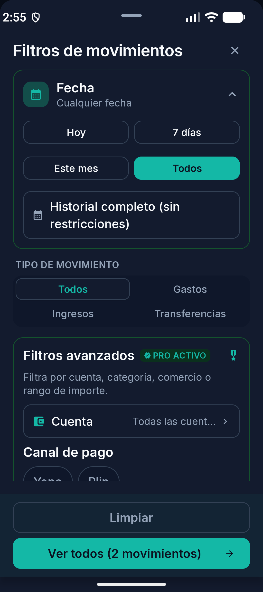 | 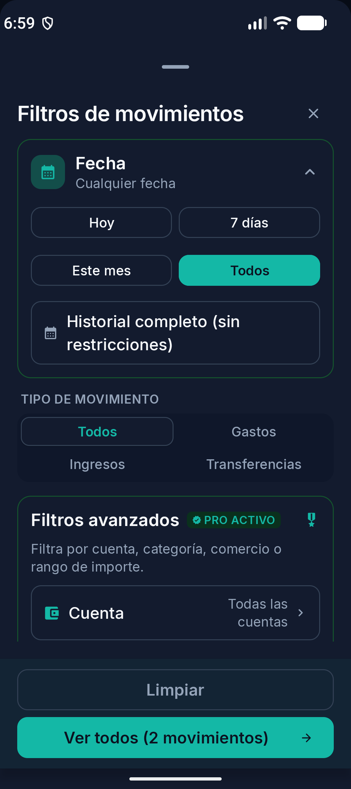 |

**Resuelto.** El tirador aparece debajo del reloj y de los iconos de Android.

## VIS-07

Oscuro · fuente 1.3.

Movimientos · hoja Filtros, fila Cuenta. La opción por defecto “Todas las cuentas” se muestra como “Todas las cuent…”.

**Corrección aplicada.** Permite que el resumen del selector de referencias use una segunda línea a escala grande. `app/src/main/java/com/kipu/app/feature/movements/presentation/MovementReferenceSelector.kt:117`.

| Antes | Después |
| --- | --- |
|  |  |

**Resuelto.** “Todas las cuentas” aparece completo en dos líneas y conserva la flecha.

## VIS-08

Claro · fuente 1.0.

Movimientos · hoja Registrar movimiento. La pestaña con icono horizontal parte “Transferencia” en “Transferenc” e “ia”, mientras Gasto e Ingreso caben.

**Corrección aplicada.** Adapta la disposición de los tipos de movimiento al ancho disponible. `app/src/main/java/com/kipu/app/feature/movements/presentation/QuickMovementScreen.kt:1311`.

| Antes | Después |
| --- | --- |
| 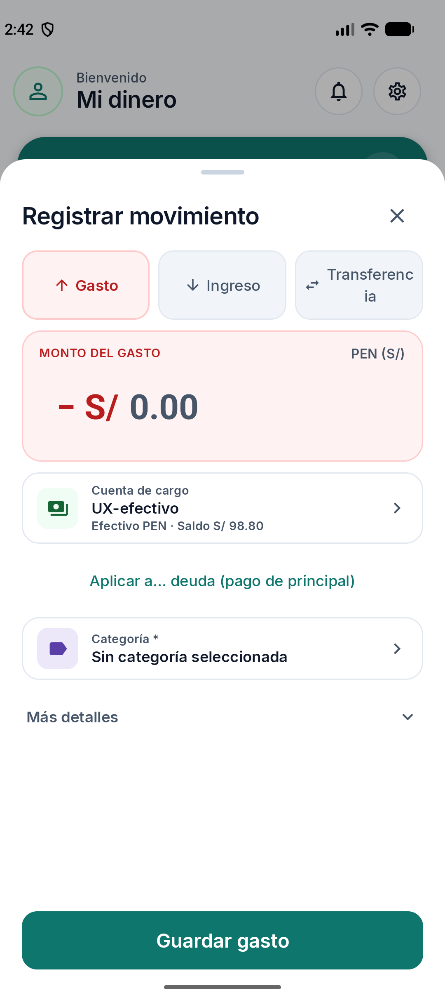 | 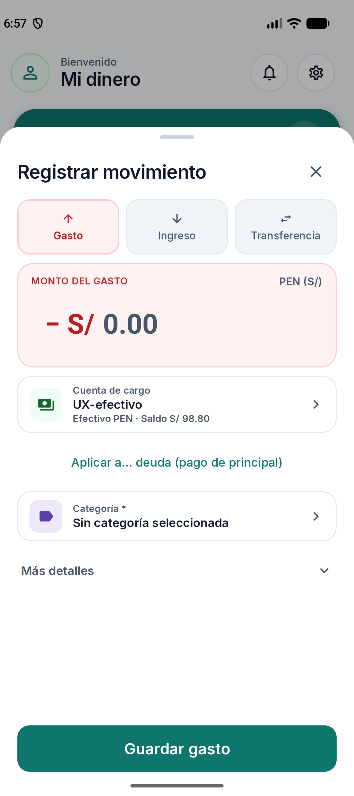 |

**Resuelto.** “Transferencia” aparece en una sola línea debajo del icono.

## VIS-09

Oscuro · fuente 1.3.

Movimientos · confirmar anulación. El resumen de la operación corta “Alimentación” como “Alimenta…”.

**Corrección aplicada.** Permite dos líneas en el título de la operación. `app/src/main/java/com/kipu/app/feature/movements/presentation/VoidMovementDialog.kt:182`.

| Antes | Después |
| --- | --- |
| 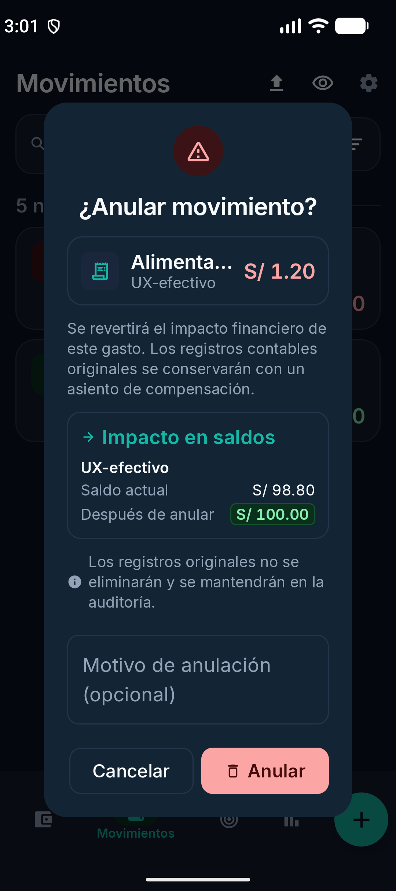 | 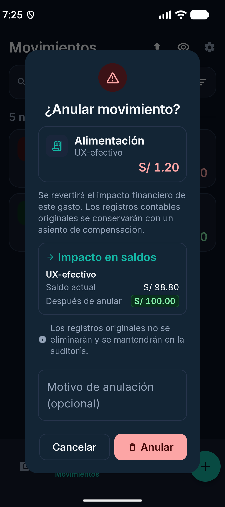 |

**Ronda 2 · Resuelto.** En oscuro con fuente 1.3, “Alimentación” se lee completa y S/ 1.20 queda debajo. En oscuro con fuente 1.0, la categoría y el importe siguen lado a lado. Cerré el diálogo sin anular el gasto.

## VIS-10

Oscuro · fuente 1.3.

Estados de cuenta · resumen de cargos y abonos. El ancho fijo de 56 dp divide “Abonos” en “Abono” y “s”.

**Corrección aplicada.** Mide el ancho de Cargos y Abonos con la tipografía efectiva. `app/src/main/java/com/kipu/app/feature/statements/presentation/StatementReviewScreen.kt:317`.

| Antes | Después |
| --- | --- |
| 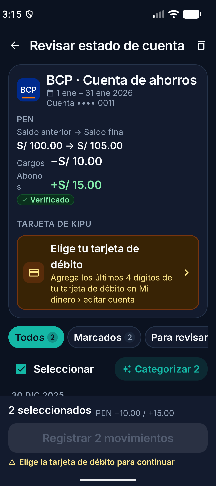 | 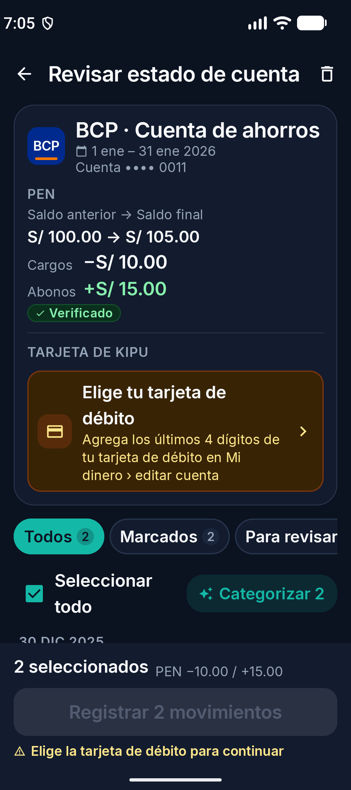 |

**Resuelto.** “Abonos” se lee completo y los dos importes permanecen alineados.

## VIS-11

Oscuro · fuente 1.3.

Estados de cuenta · barra de selección masiva. La acción “Seleccionar todo” pierde “todo” junto a “Categorizar 2”.

**Corrección aplicada.** Permite dos líneas para la etiqueta de selección masiva. `app/src/main/java/com/kipu/app/feature/statements/presentation/StatementReviewScreen.kt:395`.

| Antes | Después |
| --- | --- |
| 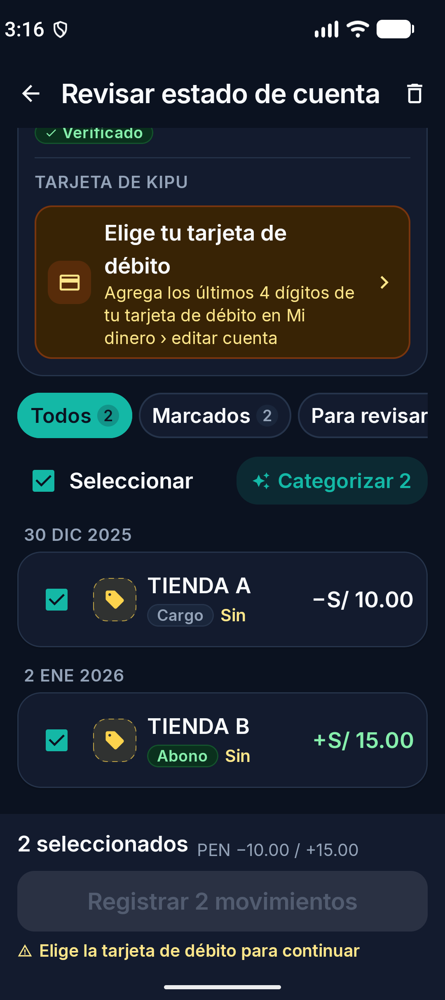 | 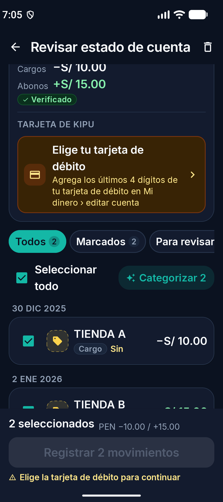 |

**Resuelto.** “Seleccionar todo” aparece completo junto a “Categorizar 2”.

## VIS-12

Oscuro · fuente 1.3.

Comprobantes Yape · fecha y hora. Los dos selectores nativos muestran fondo blanco y acento de plataforma encima del editor oscuro.

**Corrección aplicada.** Sustituye los diálogos de plataforma por selectores con el tema de Kipu y recursos en español. `app/src/main/java/com/kipu/app/navigation/ReceiptsNavigation.kt:500` y `:514`.

| Antes | Después |
| --- | --- |
| 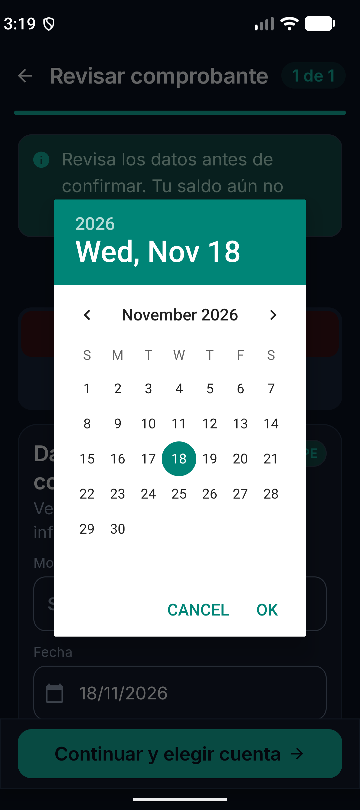 | 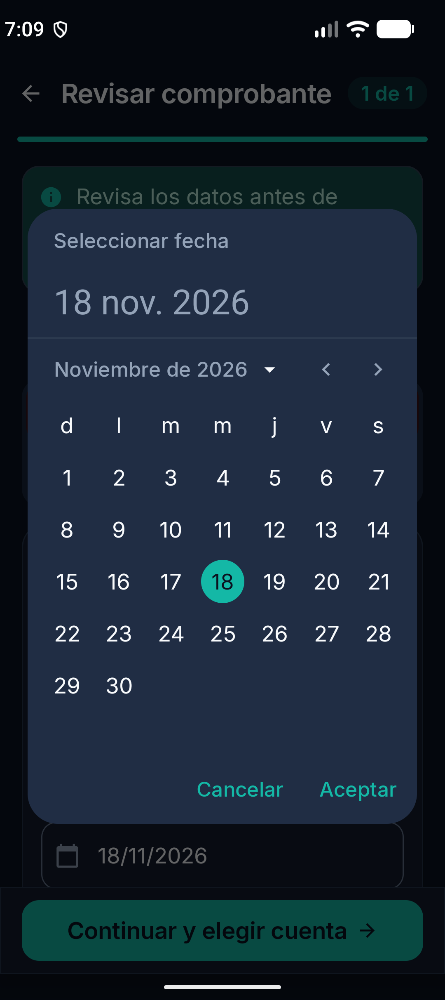 |

**Ronda 2 · Parcial.** Con fuente 1.3 el selector abrió en modo teclado. Alterné al dial y volví al teclado, cambié 10:35 a 14:35 y confirmé que la hora se actualizó en el comprobante. Con fuente 1.0 abrió en el dial. En el dial a 1.3, el indicador de las 10 todavía invade el primer dígito de 22. [Dial antes](antes/VIS-12-hora.png) · [Dial después](despues/VIS-12-hora.png) · [Teclado después](despues/VIS-12-hora-teclado.png).

**Nota del coordinador.** La superposición restante es el trazado estándar del dial de Material 3 con fuente grande (el indicador seleccionado cubre parte del anillo interior). Kipu lo mitiga abriendo en modo teclado desde 1.3; corregir el dial exigiría un selector propio, fuera del alcance de esta ronda.

## VIS-13

Oscuro · fuente 1.3.

Presupuestos · diálogo Finalizar presupuesto. En el resumen, el límite “S/ 75.00” se parte en tres líneas a 1.0 y cinco a 1.3.

**Corrección aplicada.** Reorganiza los importes con FlowRow y mantiene cada monto junto. `app/src/main/java/com/kipu/app/feature/budgets/presentation/BudgetComponents.kt:214`.

| Antes | Después |
| --- | --- |
| 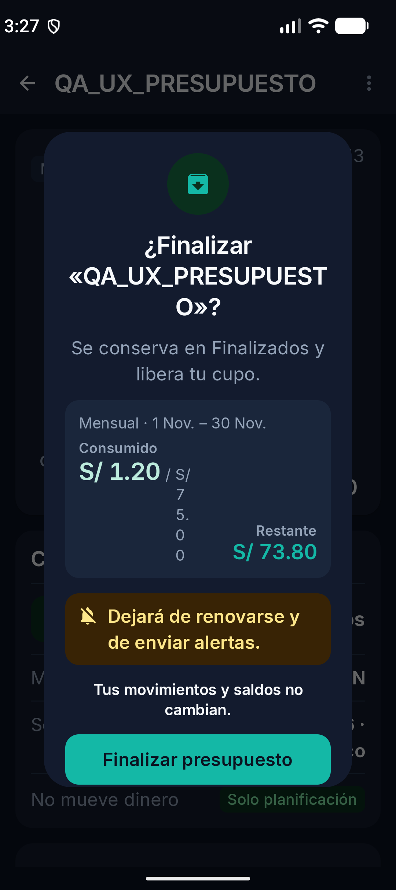 | 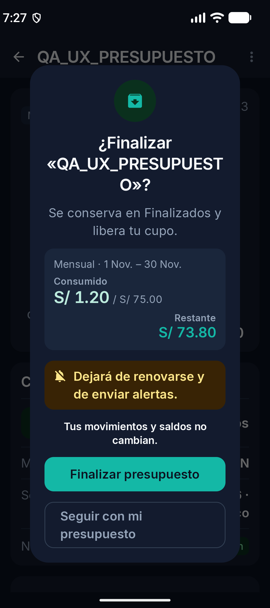 |

**Ronda 2 · Resuelto.** En oscuro con fuente 1.3, el límite de S/ 75.00 y las dos líneas de “Seguir con mi presupuesto” quedan completos. El botón ya cabía al abrir y siguió visible tras el gesto de desplazamiento. En fuente 1.0 se ven completos el límite, el saldo restante y los dos botones.

## VIS-14

Oscuro · fuente 1.3.

Deudas · Cuotas y cronograma. El título, el contador y el estado comparten una fila.

**Corrección aplicada.** Reubica el contador y estado debajo del título cuando no caben en una fila. `app/src/main/java/com/kipu/app/feature/debts/presentation/DebtScheduleScreen.kt:705` y `:720`.

| Antes | Después |
| --- | --- |
| 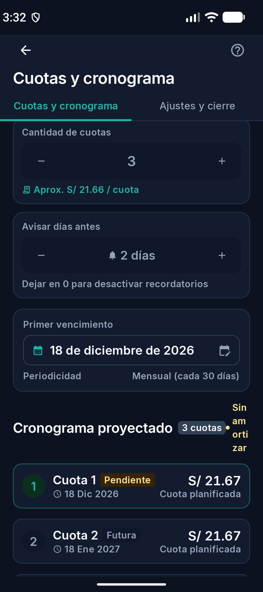 | 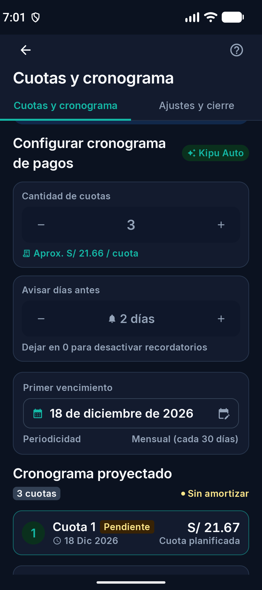 |

**Resuelto.** “3 cuotas” y “Sin amortizar” aparecen completos en la segunda fila.

## VIS-15

Oscuro · fuente 1.3.

Widgets · Libre para gastar, tamaño inicial 4 × 2. El widget inicial dibuja “Gastado” y “Próximo pago” fuera de la altura útil.

**Corrección aplicada.** Aumenta la altura a partir de la cual el widget usa el diseño con tarjetas de resumen. `app/src/main/java/com/kipu/app/feature/widgets/ui/FreeToSpendWidget.kt:94`.

| Antes | Después |
| --- | --- |
| 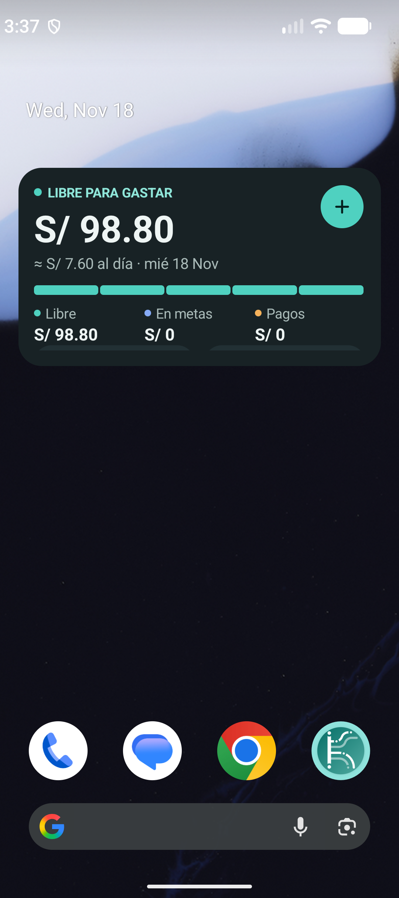 |  |

**Resuelto.** En 4 × 2 se ve la variante ancha sin bordes de tarjetas cortadas.

## Pendientes de cobertura

Se mantienen los estados pendientes de la auditoría inicial. Las comparaciones reproducen el estado de cada captura original. Los desplazamientos se ajustaron donde el cambio de layout movió el elemento revisado.

- **Accounts**. Detalle de tarjeta con compras, cuotas antiguas y salvaguardas de pérdida de datos.
- **Analytics**. Datos de comparación, series con varias cuentas y errores de carga.
- **Auth**. Sesión sin autenticar en oscuro. La pantalla usa claro de forma explícita cuando no existe perfil. También quedó pendiente el diálogo de cuenta existente y el flujo de recuperación.
- **Budgets**. Validación exhaustiva de límites, periodos y alertas.
- **Calendar y Home**. Eventos proyectados y vencimientos de tarjetas. `feature/home` contiene lógica de patrimonio y presenta su UI en Mi dinero.
- **Capture**. Revisión, fusión y conflictos de capturas bancarias. La cuenta Premium no tenía propuestas pendientes de una fuente bancaria.
- **Categories**. Confirmaciones de inactivación, cambios de padres y cupo de categorías. La cuenta Free estaba por debajo del límite.
- **Debts**. Confirmaciones de reprogramación, liquidación y anulación de un pago ya registrado. La deuda de prueba quedó protegida por historial y no se registraron pagos.
- **Goals**. Conflictos de sincronización y flujo con aportes registrados.
- **Movements**. Anulación masiva, devolución, enlace y algunos estados de error.
- **Notifications**. Confirmación de eliminación de avisos leídos. No había avisos en la cuenta Premium.
- **Plans**. Cupos de metas, deudas, categorías y presupuestos con listas saturadas.
- **Portability**. Operaciones reales de exportación, restauración y borrado de cuenta.
- **Receipts**. Registro final, vista posterior al guardado y confirmación por gesto desde la bandeja.
- **Recurrences**. Pausa, reanudación, cancelación y confirmación de una regla con ocurrencias.
- **Settings**. Autenticación biométrica en un dispositivo con credencial.
- **Setup**. Primer inicio y OTP. Las cuentas QA ya estaban activadas.
- **Statements**. PDF cifrado, asociación con tarjeta y estado posterior al registro.
- **Widgets**. Render y acciones de los otros nueve widgets y tamaños alternativos.
- **Componentes compartidos**. Variantes que solo aparecen en los estados pendientes.
