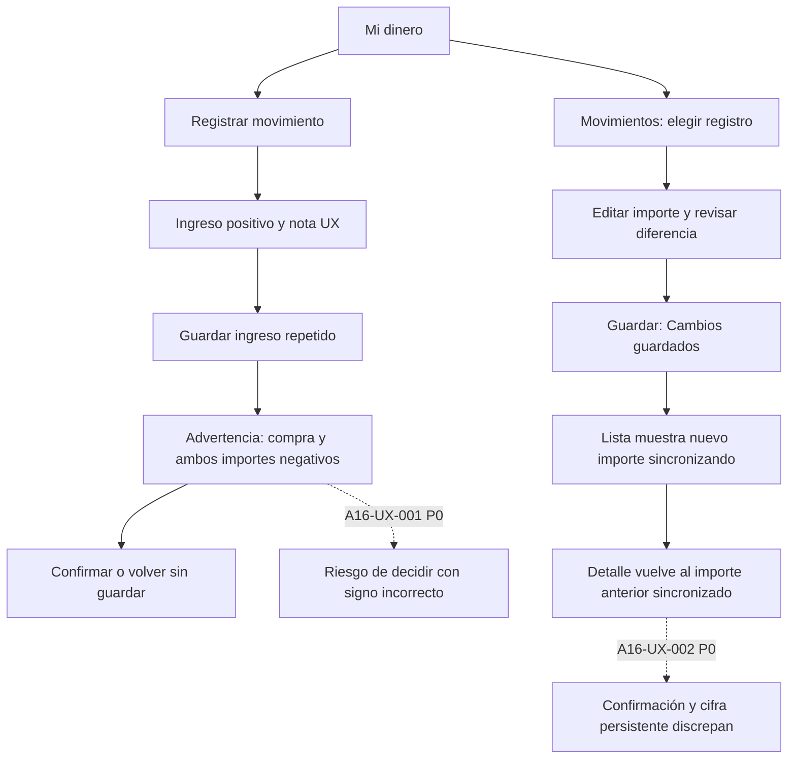
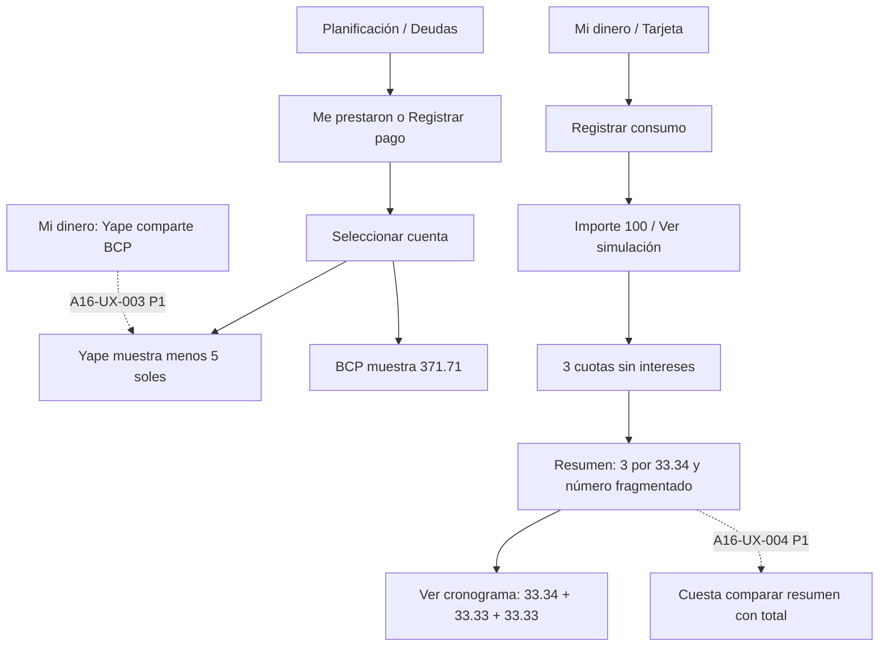

Method: design review only (detector not applicable, native platform)

# A16 — uso diario, fase 1 · 2026-11-05

Revisión individual en Samsung A16 USB `RFGL70J9E2T`, cuenta iniciada Premium con datos existentes. Modo **Operate**, perspectiva de uso diario. Se interactuó con la app instalada mediante ADB; cada captura citada fue inspeccionada visualmente. No es una prueba con participantes ni una auditoría del backend desplegado. **Resultado de fase 1: 2 P0, 2 P1 y 3 P2. Actualizado con segunda pasada: 2 P0, 3 P1 y 6 P2; ningún P3.**

La presentación del dinero propio, el respaldo de las metas y los presupuestos es comprensible. La confianza se rompe al confirmar un ingreso como gasto y al revertirse una corrección después de anunciar que se guardó. Estas dos situaciones deben resolverse antes de usar las cifras como evidencia de que la experiencia cotidiana es fiable.

## Método y límites

- Fuentes: `docs/README.md`, `docs/DESIGN.md`, `docs/control-documental.md`, índice de mockups; referencias Impeccable `critique`, `audit.native`, `android`, `operate`, `clarify`, `harden`, `adapt.native`. `context` se ejecutó una sola vez sobre DashboardScreen. `NO_PRODUCT_MD` registrado, sin crear documentos de producto.
- Sigue abierta DOC-03: Andean Modernist y Calm Emerald declaran autoridad visual diferente. Se juzga la app observada; no se propone sustituir su identidad.
- No se usaron subagentes (prohibidos por el encargo), detector web, navegador ni overlays: plataforma Android nativa. La referencia de auditoría orienta la inspección; no se presenta como auditoría completa de rendimiento, TalkBack o tablets.
- Resolución física 1080 × 2340, densidad 420: 48 dp = 126 px. Se consultaron dumps de UI para textos y límites; el tamaño de un glifo no se considera el área táctil.
- **Toque** = pulsación sobre control o Back; escritura se cuenta aparte, un gesto de desplazamiento no es un toque. Los tiempos de repetición son de automatización e incluyen comandos ADB, espera de 0.4 s y dumps de UI para localizar controles: **no son tiempos humanos ni latencia de la app**. Los errores del conductor no se atribuyen al producto.
- Los datos creados usan nombre o nota `UX-`. Se conservan para reproducir; se creó y liquidó UX-deuda, se creó y canceló UX-recurrencia, UX-meta quedó con reserva de S/ 1 y UX-presupuesto con límite S/ 400. Se anularon/ocultaron movimientos UX durante la prueba. No se restauraron los datos financieros, conforme a la autorización.
- No se tocó el S24, la sesión, la cuenta de usuario, compras reales, código, recursos, tests ni administración de Supabase. No hubo compilación, stage, commits ni cambio de rama.

## Cobertura

Los números enlazan capturas locales sensibles, ignoradas por Git; no adjuntarlas al PR ni al informe público. «Revisada» significa los estados indicados, no todos sus casos posibles.

| Pantalla / superficie | Estado y alcance | Evidencia |
|---|---|---|
| Dashboard / Mi dinero | Revisada: dinero propio, cuentas, billetera afiliada, tarjeta y actualización tras guardado | [01](capturas/_local-only/a16/01-inicio-actual.png), [06](capturas/_local-only/a16/06-gasto-guardado.png), [12](capturas/_local-only/a16/12-transferencia-guardada.png), [50](capturas/_local-only/a16/50-dashboard-tarjetas.png), [81](capturas/_local-only/a16/81-final-restaurado.png) |
| QuickMovementScreen: gasto | Revisada: cero inválido, teclado, categoría, nota, guardado | [02](capturas/_local-only/a16/02-movimiento-inicial.png), [03](capturas/_local-only/a16/03-movimiento-validacion.png), [05](capturas/_local-only/a16/05-movimiento-monto.png), [06](capturas/_local-only/a16/06-gasto-guardado.png), [70](capturas/_local-only/a16/70-gasto-medicion.png) |
| QuickMovementScreen: ingreso | Revisada: categoría opcional, creación contextual, guardado y duplicado | [07](capturas/_local-only/a16/07-ingreso-categorias.png), [08](capturas/_local-only/a16/08-ingreso-crear-categoria.png), [68](capturas/_local-only/a16/68-ingreso-guardado.png), [71](capturas/_local-only/a16/71-ingreso-medicion.png) |
| QuickMovementScreen: transferencia | Revisada: origen/destino, nota, guardado y conservación del total | [12](capturas/_local-only/a16/12-transferencia-guardada.png), [73](capturas/_local-only/a16/73-transfer-confirm.png) |
| Historial, detalle y editor | Revisada: buscar nota UX, filtro Fuente Manual, deslizar a izquierda, anular, eliminar localmente y corregir | [13](capturas/_local-only/a16/13-historial.png), [14](capturas/_local-only/a16/14-movimiento-detalle.png), [19](capturas/_local-only/a16/19-gasto-editar.png), [20](capturas/_local-only/a16/20-anular-confirmacion.png), [21](capturas/_local-only/a16/21-anulado.png), [22](capturas/_local-only/a16/22-historial-deslizar.png), [25](capturas/_local-only/a16/25-busqueda-ux.png), [74](capturas/_local-only/a16/74-editar-respuesta.png), [75](capturas/_local-only/a16/75-editar-persistencia.png), [76](capturas/_local-only/a16/76-revisiones.png), [77](capturas/_local-only/a16/77-eliminacion-deshacer.png), [78](capturas/_local-only/a16/78-editar-propuesta.png), [79](capturas/_local-only/a16/79-editar-guardado.png), [80](capturas/_local-only/a16/80-editar-detalle.png) |
| Deshacer | No alcanzada: ninguna acción Deshacer apareció tras anulación ni eliminación; no se declara probado un mecanismo de recuperación | [21](capturas/_local-only/a16/21-anulado.png), [77](capturas/_local-only/a16/77-eliminacion-deshacer.png) |
| Filtros de movimientos | Revisada: periodo/tipo, avanzados y Fuente Manual; no se verificó el resultado de cada combinación | [23](capturas/_local-only/a16/23-filtros.png), [24](capturas/_local-only/a16/24-filtros-origen.png), [25](capturas/_local-only/a16/25-busqueda-ux.png) |
| Cuenta y edición | Revisada: detalle de Efectivo y formulario de edición; no se guardó alias ni se creó una cuenta nueva | [11](capturas/_local-only/a16/11-cuenta-detalle.png), [60](capturas/_local-only/a16/60-cuenta-form.png) |
| Tarjeta de crédito y edición | Revisada: deuda, disponible, fechas, formulario de línea/ciclo; sin modificar contrato | [50](capturas/_local-only/a16/50-dashboard-tarjetas.png), [51](capturas/_local-only/a16/51-tarjeta-detalle.png), [59](capturas/_local-only/a16/59-tarjeta-form.png) |
| RateCatalogScreen | Revisada: TEA personal, equivalencia TEM y ficha referencial permaneciendo en carga en las dos capturas; no se cambió TEA | [52](capturas/_local-only/a16/52-tasas.png), [53](capturas/_local-only/a16/53-tasas-referencia.png) |
| InstallmentSimulatorScreen | Revisada: S/ 100 en 3 cuotas sin intereses, total y cronograma; confirmación no probada al faltar categoría | [54](capturas/_local-only/a16/54-simulador.png), [55](capturas/_local-only/a16/55-simulador-condiciones.png), [56](capturas/_local-only/a16/56-simulador-costos.png), [57](capturas/_local-only/a16/57-simulador-cronograma.png), [58](capturas/_local-only/a16/58-simulador-resumen-final.png) |
| Presupuestos: lista, alta, detalle | Revisada: alta real, exceso y edición a 84 % consumido; entrega de notificación no probada | [31](capturas/_local-only/a16/31-presupuestos-lista.png), [32](capturas/_local-only/a16/32-presupuesto-crear.png), [33](capturas/_local-only/a16/33-presupuesto-creado.png), [34](capturas/_local-only/a16/34-presupuesto-detalle.png), [35](capturas/_local-only/a16/35-presupuesto-84.png) |
| Metas: lista, alta, aporte, logro, retiro y detalle | Revisada: objetivo S/ 2, aporte S/ 2, logro, retiro S/ 1, respaldo; no archivo | [36](capturas/_local-only/a16/36-metas-lista.png), [37](capturas/_local-only/a16/37-meta-crear.png), [38](capturas/_local-only/a16/38-meta-lista-creada.png), [39](capturas/_local-only/a16/39-meta-aportar.png), [40](capturas/_local-only/a16/40-meta-lograda.png), [41](capturas/_local-only/a16/41-meta-retirar.png), [42](capturas/_local-only/a16/42-meta-detalle.png) |
| Deudas: lista, alta y detalle | Revisada: alta UX-deuda por S/ 2 recibido en Efectivo | [09](capturas/_local-only/a16/09-deudas-lista-datos.png), [43](capturas/_local-only/a16/43-deuda-crear.png), [44](capturas/_local-only/a16/44-deuda-cuentas.png), [45](capturas/_local-only/a16/45-deuda-detalle.png) |
| Deudas: cronograma y pago | Revisada: guardar 3 cuotas, pago total S/ 2, liquidación | [46](capturas/_local-only/a16/46-deuda-cronograma.png), [47](capturas/_local-only/a16/47-deuda-pagar.png), [48](capturas/_local-only/a16/48-deuda-pagada.png) |
| UpcomingDuesScreen | Revisada: saldo, orígenes, estados y cuotas futuras; no impago vencido | [49](capturas/_local-only/a16/49-vencimientos.png) |
| Recurrencias | Revisada: registrar desde gasto, lista, pausar, confirmar reanudación y cancelar; no ejecución al próximo mes | [15](capturas/_local-only/a16/15-recurrencia-crear.png), [16](capturas/_local-only/a16/16-recurrencia-guardada.png), [17](capturas/_local-only/a16/17-recurrencias-lista.png), [18](capturas/_local-only/a16/18-recurrencia-cancelada.png) |
| Calendario financiero | Revisada: hoy con movimientos y día 20 previsto de tarjeta | [66](capturas/_local-only/a16/66-calendario.png), [67](capturas/_local-only/a16/67-calendario-proximo.png) |
| AnalyticsScreen | Revisada: patrimonio por cuenta, ingresos/gastos/neto, distribución, fuente al 130 % y oscuro; no todos los filtros/comparación | [61](capturas/_local-only/a16/61-analiticas.png), [62](capturas/_local-only/a16/62-analiticas-resultados.png), [64](capturas/_local-only/a16/64-analiticas-texto130-estable.png), [65](capturas/_local-only/a16/65-analiticas-oscuro130.png) |
| ImportMovementsScreen | Revisada hasta consentimiento y selector de PDF | [26](capturas/_local-only/a16/26-importar.png), [27](capturas/_local-only/a16/27-selector-pdf.png) |
| StatementReviewScreen | No alcanzada: en Descargas se listaron PDF de cierres de deuda/comprobante, sin extracto BCP de prueba identificable; no se fabricó un extracto | — |
| Comprobantes / ReceiptReviewScreen | Entrada y selector revisados; revisión OCR no alcanzada: miniaturas visibles eran capturas de Kipu, sin comprobante de prueba identificado | [29](capturas/_local-only/a16/29-comprobante-entrada.png), [30](capturas/_local-only/a16/30-selector-imagenes.png) |
| Navegación, Back, escalado, temas | Revisada en los recorridos; claro y oscuro con 1.3, restaurado a claro/0.9; TalkBack, contraste instrumental, landscape y tablets no probados | [64](capturas/_local-only/a16/64-analiticas-texto130-estable.png), [65](capturas/_local-only/a16/65-analiticas-oscuro130.png), [81](capturas/_local-only/a16/81-final-restaurado.png) |

## Recorridos y coste observado

Las cifras siguientes describen recorridos concretos, no mínimos universales. En formularios con un contador parcial, se indica el punto de partida y hasta dónde se llegó; no se extrapolan tiempos de los módulos no cronometrados.

| Flujo / objetivo | Pasos reales y coste de la muestra | Fricción y acierto |
|---|---|---|
| Dashboard: cuánto tengo | Abrir app ya iniciada: 0 toques para leer total; 1 desplazamiento para tarjeta | S/ 579.31 inicial se separa de crédito. Yape aparece subordinado a BCP. Avisos dan cantidad, no resumen de urgencia en el primer viewport. |
| Gasto: registrar S/ 1.20 con nota UX | Repetición: + → Gasto → monto → Back → categoría → Alimentación → Más detalles → desplazar → nota → Back → Guardar: **10 toques + 1 desplazamiento**, escritura aparte; **25.01 s de automatización** hasta guardado. Incluye tocar Gasto aunque era el valor por defecto | Categoría obligatoria queda fuera de vista con teclado; hay que cerrarlo. Cuenta predeterminada y Guardar fijo ayudan. Validación cero describe la corrección. |
| Ingreso: recibir S/ 2.40 | + → Ingreso → monto → Back → Más detalles → nota → Back → Guardar: **8 toques**, sin necesidad de categoría; guardado confirmado en 68. Repetición del mismo importe: **8 toques / 18.11 s automatizados hasta advertencia**, no hasta guardar | El alta funciona sin categoría. El aviso de duplicado cambia el sentido del dinero (001); la creación contextual dice Gastos (005). |
| Transferencia: mover entre cuentas | Primera: + → Transferencia → monto → Back → destino → BCP → Listo → Más detalles → desplazar → nota → Back → Confirmar: **11 toques + 1 desplazamiento**. Repetición con destino retenido: **8 toques + 1 desplazamiento / 19.14 s automatizados**, S/ 1.13 guardado | Se explica «No cambia tu patrimonio»; origen y destino son legibles. Los intentos abortados del conductor están excluidos de la medición válida. |
| Historial: localizar y corregir | Desde historial: filtro → desplazar → Fuente Manual → aplicar = **3 toques + 1 desplazamiento**; buscar UX → Back = **2 toques** más escritura. Editar desde lista: fila → Editar → monto → Back → Guardar = **5 toques**; abrir otra vez = 1 | La búsqueda por nota funciona aunque el placeholder nombra comercio/categoría. Se conservan filtros visibles. Guardado de corrección se revierte silenciosamente (002). |
| Anular / eliminar / deshacer | Desde lista: fila → Anular → confirmar = **3 toques**; saldo posterior se explica antes. Deslizar izquierda → Eliminar = **1 gesto + 1 toque** tras diálogo. No apareció Deshacer | Se distingue anulación contable de ocultación local en los textos; la ocultación no se sincroniza. No se califica la falta de Deshacer como incumplimiento de requisito aprobado. |
| Cuentas y tarjetas: consultar condiciones | Dashboard desplazado → tarjeta → tasas = **2 toques**; Back → Registrar consumo → importe → Back → Ver simulación = **5 toques**. Simulador: 2 desplazamientos y Ver cronograma para ver las tres filas | Detalle presenta deuda y disponible separados. La tarjeta visual ocupa buena parte de la pantalla; resumen de cuotas tiene problemas de lectura (004). Formulario de cuenta abierto y cancelado con Back; alta nueva no completada. |
| Presupuesto: controlar tope | Desde tab Presupuestos: + → límite → Back → nombre → Back → Crear → Ver = **7 toques**, escritura aparte. Desde detalle: acciones → Editar → límite → Back → Guardar = **5** | S/ 10 mostró exceso por gastos previos; S/ 400 mostró 84 %, restante S/ 63.60 y orientación S/ 2.54/día. Deja claro que planificar no mueve dinero. No se esperó a un disparo futuro de alerta. |
| Meta: separar y recuperar ahorro | Desde tab Metas: + → nombre → Back → objetivo → Back → Guardar = **6 toques**. Desde lista: Aportar → importe → Back → Aportar = **4** hasta logro. Desde logro: Liberar → importe → Back → Retirar → Volver a meta = **5** | El logro confirma reserva y permite dejarla o liberarla. Retiro parcial confirmó reserva restante S/ 1. «Total en metas» al crear muestra S/ 2 con reservado S/ 0: se conserva como observación, sin duplicar pendientes conocidos ni inferir saldo duplicado. |
| Deuda: recibir y devolver préstamo | Desde Deudas: + → Me prestaron → acreedor → Back → monto → Back → desplazar → Guardar → fila = **8 toques + 1 desplazamiento**; cuenta Efectivo predeterminada. Desde detalle: Cuotas → desplazar → Guardar → Back → Registrar pago → Todo → Registrar = **6 toques + 1 desplazamiento** | Principal/interés y planificación/pago están separados. Se liquidó UX-deuda. Yape ofrece una cifra inconsistente con cuenta afiliada (003). |
| Recurrencia: no olvidar pago | Desde detalle de gasto: Registrar recurrente → concepto → Back → Guardar → Ver mis recurrencias = **5 toques**; Pausar = **1**; Reanudar → Confirmar = **2**; Cancelar → Confirmar cancelación = **2** | La reanudación avisa fecha válida y que no creará gastos de periodos omitidos. La cancelación conserva historial. Se conserva Spotify existente. |
| Calendario: qué debo atender | Dashboard → Calendario → día 20 = **2 toques** | Identifica vencimiento previsto y «Sin cargo automático». El importe se muestra como raya, sin prometer un débito. Útil para fechas; no permite concluir cuánto reservar para esa tarjeta desde esa fila. |
| Analíticas: dónde está y cómo voy | Tab Análisis = **1 toque**; 1 desplazamiento revela ingresos/gastos/neto y categoría dominante | Da preguntas concretas y explica exclusión de transferencias; resumen mensual aparece después del gráfico de patrimonio. |
| Importar / comprobantes | Desde historial: Importar → Elegir PDF → Entendido = **3 toques** hasta selector. Entrada Comprobante Yape → Subir imagen = **2** hasta selector | Lenguaje de privacidad distingue archivo de movimientos confirmados. No se midió OCR ni revisión de extracto sin material de prueba. |

## Puntuación heurística por flujo

Escala `critique.md`: **0** ausencia/fallo fundamental, **1** problemas mayores, **2** parcial, **3** bueno con brechas, **4** excelente. Juicio experto sobre los estados recorridos, no resultado estadístico. H1 estado; H2 lenguaje/mundo real; H3 control; H4 consistencia; H5 prevención; H6 reconocimiento; H7 eficiencia; H8 minimalismo; H9 recuperación; H10 ayuda. En Operate se evalúan las diez; para importación solo se puntúa la entrada, no pantallas inaccesibles.

| Flujo | H1 | H2 | H3 | H4 | H5 | H6 | H7 | H8 | H9 | H10 | Total |
|---|---|---|---|---|---|---|---|---|---|---|---|
| Dashboard | 3 | 4 | 3 | 3 | 3 | 4 | 3 | 3 | 3 | 3 | 32/40 |
| Registro rápido | 2 | 2 | 3 | 2 | 2 | 3 | 2 | 3 | 2 | 3 | 24/40 |
| Historial y edición | 1 | 3 | 2 | 2 | 3 | 3 | 2 | 3 | 1 | 2 | 22/40 |
| Cuentas y tarjetas | 3 | 3 | 3 | 2 | 3 | 3 | 2 | 2 | 2 | 3 | 26/40 |
| Presupuestos | 3 | 4 | 3 | 3 | 3 | 3 | 3 | 3 | 3 | 3 | 31/40 |
| Metas | 3 | 3 | 3 | 3 | 3 | 3 | 3 | 3 | 3 | 4 | 31/40 |
| Deudas | 3 | 2 | 3 | 2 | 2 | 3 | 3 | 3 | 3 | 3 | 27/40 |
| Recurrencias | 3 | 4 | 3 | 3 | 3 | 3 | 2 | 3 | 3 | 4 | 31/40 |
| Calendario | 3 | 3 | 3 | 3 | 3 | 3 | 3 | 3 | 3 | 3 | 30/40 |
| Analíticas | 3 | 4 | 3 | 3 | 3 | 3 | 2 | 2 | 3 | 3 | 29/40 |
| Importación: solo entrada | 3 | 4 | 3 | 3 | 3 | 3 | 3 | 3 | 3 | 4 | 32/40 |
| Transversal | 3 | 3 | 3 | 2 | 3 | 3 | 2 | 2 | 2 | 3 | 26/40 |

Carga cognitiva moderada en filtros (periodo, tipo, cuenta/canal, categoría, importe, comercio, tarjeta, estado, fuente y sincronización); fuerte acumulación en el simulador por diálogo estrecho y contenido largo. El viaje emocional empieza con una cifra clara y termina bien en logro/pago; los valles críticos están en guardar una corrección y confirmar un duplicado. Para usuario habitual importa la fiabilidad de estas confirmaciones; para persona con texto ampliado, la separación de destinos; para quien teme equivocarse, el signo y el saldo seleccionable.

## Hallazgos

Las rutas de código son relativas al repositorio y las líneas se verificaron durante la revisión. Identifican puntos afectados, no prueban la versión del APK ni la causa remota. Impacto/esfuerzo son estimaciones. Toda modificación funcional deberá recorrer el proceso Spec Kit de su épica; esta fase no aprueba requisitos.

### A16-UX-001 · P0 · Registro de ingresos / DuplicateWarningDialog

- **Clasificación:** Observado.
- **Qué pasa hoy:** El ingreso positivo S/ 2.40 repetido abre «¿Es una compra distinta?», dice que ya se registró un gasto y muestra −S/ 2.40 tanto en registrado como propuesto. El formulario detrás sigue en Ingreso. Evidencia: [71](capturas/_local-only/a16/71-ingreso-medicion.png).
- **Qué cambiar:** Derivar encabezado, explicación, CTA, color y signo del tipo del movimiento. Para ingreso: «¿Es otro ingreso?», «Ya registraste un ingreso parecido hace poco. Confirma si recibiste este dinero otra vez.», «Sí, es otro ingreso · guardar», +S/ 2.40.
- **Por qué:** El usuario que está por confirmar dinero recibido necesita saber si suma o resta; correspondencia con mundo real y prevención de errores.
- **Impacto:** Alto: puede hacer confirmar o cancelar por una consecuencia financiera falsa. **Esfuerzo:** Bajo–medio. **Prioridad:** P0.
- **Código afectado:** `app/src/main/java/com/kipu/app/feature/movements/presentation/QuickMovementScreen.kt:1522`, `:1528`, `:1563`, `:1635`.
- **Cómo comprobar:** Repetir un ingreso y un gasto del mismo importe: el aviso conserva tipo, signo y consecuencia correctos; cancelar no registra un movimiento.
- **Autoridad / decisión:** Corrección de comunicación del tipo existente; no se propone cambiar la política de detección de duplicados.

### A16-UX-002 · P0 · Historial / MovementEditorSheet y sincronización

- **Dato de servidor aportado por el coordinador (Observado, SQL de solo lectura, cuenta S24, instrucción de segunda pasada del 2026-11-05):** `public.transactions` conservaba `revision=1`, `amount_minor=120` y `updated_at=created_at`; `public.transaction_revisions` no tenía filas para esa cuenta, mientras S24/43 mostraba dos revisiones y Sincronizado. La corrección no había quedado en el servidor al momento de esa consulta; este worker no ejecutó esa consulta ni dispone de su hora exacta. Pudo no enviarse, ser rechazada o revertirse localmente: no se determinó causa.
- **Contraste de feedback en código:** `app/src/main/java/com/kipu/app/feature/movements/presentation/MovementHistoryScreen.kt:656` usa «Cambios guardados» si no está offline, mientras `app/src/main/java/com/kipu/app/feature/movements/presentation/MovementEditorViewModel.kt:409` emite «Movimiento corregido (Pendiente de sincronizar)». Son mensajes discrepantes pertinentes a investigar; no prueban la causa del resultado ni convierten estar online en aceptación del servidor.

- **Clasificación:** Observado.
- **Qué pasa hoy:** Cambiar UX-gasto-tiempo de 1.20 a 1.41 muestra antes/diferencia; guardar confirma «Cambios guardados» y lista 1.41 con «Sincronizando», pero al abrir el detalle vuelve a 1.20 «Sincronizado». También ocurrió al cambiar UX-ingreso 2.40 a 2.45; el historial de revisiones muestra Corrección y Anulación sin que se hubiera pedido anular ese ingreso. Evidencia: [78](capturas/_local-only/a16/78-editar-propuesta.png), [79](capturas/_local-only/a16/79-editar-guardado.png), [80](capturas/_local-only/a16/80-editar-detalle.png), [74](capturas/_local-only/a16/74-editar-respuesta.png), [75](capturas/_local-only/a16/75-editar-persistencia.png), [76](capturas/_local-only/a16/76-revisiones.png).
- **Qué cambiar:** Conservar la corrección pendiente visible hasta resolución; si se rechaza o revierte, mostrar «No se pudo aplicar la corrección. Se mantiene S/ 1.20.» y ofrecer «Revisar cambios» / «Reintentar» con el borrador retenido. Investigar primero la conciliación y el estado efectivo; no ocultar un rechazo detrás de «Sincronizado».
- **Por qué:** Quien corrige su contabilidad confía en Guardar y en la cifra posterior; visibilidad de estado y recuperación de errores.
- **Impacto:** Alto: la cifra confirmada no coincide con la que permanece. No se afirma pérdida de datos ni causa de servidor sin investigación. **Esfuerzo:** Medio–alto. **Prioridad:** P0.
- **Código afectado:** `app/src/main/java/com/kipu/app/feature/movements/presentation/MovementEditorViewModel.kt:409`; `MovementHistoryScreen.kt:656` y `:933`; `MovementDetailSheet.kt:275` (estos últimos en el mismo directorio de presentación).
- **Cómo comprobar:** Corregir importe online, abrir detalle, esperar sincronización y volver a entrar: lista/detalle/saldo conservan el valor aceptado o muestran rechazo explícito con borrador recuperable. Verificar también offline y conflicto con pruebas focalizadas posteriores.
- **Autoridad / decisión:** Reintentar/retener propuesta como nueva acción **requiere decisión del dueño de producto**; la investigación del rechazo y la coherencia del feedback son necesarias antes de elegir el comportamiento.

### A16-UX-003 · P1 · Deudas / formulario y pago, saldo de Yape afiliado

- **Clasificación:** Observado.
- **Qué pasa hoy:** En alta y pago aparece Yape con S/ −5.00; en Mi dinero es «Saldo de BCP» y el selector de transferencia lo describe como saldo compartido de la afiliada. BCP muestra S/ 371.71 en ese momento. Evidencia: [44](capturas/_local-only/a16/44-deuda-cuentas.png), [47](capturas/_local-only/a16/47-deuda-pagar.png), [50](capturas/_local-only/a16/50-dashboard-tarjetas.png).
- **Qué cambiar:** Usar la misma resolución de cuenta efectiva del selector unificado. En Yape afiliado mostrar «Comparte saldo con BCP» y el saldo efectivo de BCP, sin presentar la proyección aislada como dinero disponible; comprobar que la operación afecte a la cuenta correcta antes de habilitarla.
- **Por qué:** La persona elige desde dónde recibe o paga: cifras distintas para el mismo instrumento obligan a desconfiar y a cambiar de módulo; consistencia y reconocimiento.
- **Impacto:** Alto en selección; no se probó pagar desde Yape ni se afirma error de asiento. **Esfuerzo:** Medio. **Prioridad:** P1.
- **Código afectado:** `app/src/main/java/com/kipu/app/feature/debts/presentation/DebtOpeningViewModel.kt:159`, `PayableDebtFormScreen.kt:277`, `DebtSettlementSheet.kt:234`.
- **Cómo comprobar:** Con billetera afiliada, comparar dashboard, transferencia, deuda y pago: mismo saldo efectivo y etiqueta de afiliación; validar cuenta afectada con un movimiento UX pequeño.
- **Autoridad / decisión:** Si se decide excluir la billetera del selector en vez de admitir el canal, **requiere decisión del dueño de producto**.

### A16-UX-004 · P1 · Cuentas y tarjetas / CreditPurchasePreview

- **Clasificación:** Observado y medido.
- **Qué pasa hoy:** Para S/ 100 sin intereses, el resumen dice «3 × S/ 33.34», mientras cronograma da 33.34 + 33.33 + 33.33 = 100.00. «Última cuota ajustada» parte S/ 33.33 en tres líneas incluso con font_scale 0.9; dump: importe ocupa x767–828, solo 61 px (23.2 dp). No hay error de suma en el cronograma observado. Evidencia: [56](capturas/_local-only/a16/56-simulador-costos.png), [58](capturas/_local-only/a16/58-simulador-resumen-final.png).
- **Qué cambiar:** Cambiar el resumen a «3 cuotas desde S/ 33.33» y «Primera: S/ 33.34 · siguientes: S/ 33.33» para este caso, derivado de las cuotas reales. Poner etiqueta e importe en filas separadas o dar peso flexible a la etiqueta y ancho intrínseco al importe; nunca partir el número.
- **Por qué:** Quien compara cuotas necesita un importe inequívoco antes de registrar la compra; exactitud y prevención de error, adaptación a ancho y texto.
- **Impacto:** Medio–alto: lectura y comparación financiera equivocadas aunque total/cronograma sean correctos. **Esfuerzo:** Bajo–medio. **Prioridad:** P1.
- **Código afectado:** `app/src/main/java/com/kipu/app/feature/accounts/presentation/components/CreditPurchaseTermsSection.kt:165`, `:180`, `:185`; `app/src/main/java/com/kipu/app/feature/accounts/presentation/instruments/InstallmentSimulatorScreen.kt:172`.
- **Cómo comprobar:** Repetir S/ 100 / 3 sin intereses a escalas 0.9 y 1.3: resumen representa la distribución real, importes completos y total 100.00; repetir con intereses y montos largos.
- **Autoridad / decisión:** No se cambia la fórmula ni el cronograma aprobado; se corrige su representación.

### A16-UX-005 · P2 · Registro de ingreso / creación contextual de categoría

- **Clasificación:** Observado.
- **Qué pasa hoy:** Desde categorías de ingreso (0 categorías), «Crear nueva categoría» muestra tipo «Gastos» sin una elección evidente en ese bloque. El ingreso sí puede guardarse sin categoría; no es un bloqueo del alta. Evidencia: [07](capturas/_local-only/a16/07-ingreso-categorias.png), [08](capturas/_local-only/a16/08-ingreso-crear-categoria.png), [68](capturas/_local-only/a16/68-ingreso-guardado.png).
- **Qué cambiar:** Pasar explícitamente INCOME al formulario contextual y rotularlo «Ingresos». Conservar el tipo del movimiento aunque no haya padre ni categorías disponibles.
- **Por qué:** La persona que clasifica un abono no debe interpretar si se cambió de flujo; consistencia y reconocimiento.
- **Impacto:** Medio: duda y posible abandono de clasificación. No se creó la categoría para probar qué tipo terminaría persistido. **Esfuerzo:** Bajo. **Prioridad:** P2.
- **Código afectado:** `app/src/main/java/com/kipu/app/feature/movements/presentation/PastelCategoryPickerFlow.kt:603` y `:1454`; `app/src/main/java/com/kipu/app/feature/categories/presentation/categories/CategoryFormScreen.kt:379`.
- **Cómo comprobar:** Abrir creación desde ingreso sin categorías y desde gasto: encabezado y tipo correctos; al crear UX-categoría, permanece seleccionable en su tipo.
- **Autoridad / decisión:** No cambia el requisito de categoría opcional del ingreso.

### A16-UX-006 · P2 · Historial / detalle de efectivo

- **Clasificación:** Observado.
- **Qué pasa hoy:** Un movimiento en Efectivo se rotula «Método de registro: Cuenta bancaria directa» y un gasto sin comercio utiliza la categoría como titular debajo de COMERCIO. Evidencia: [14](capturas/_local-only/a16/14-movimiento-detalle.png), [75](capturas/_local-only/a16/75-editar-persistencia.png), [80](capturas/_local-only/a16/80-editar-detalle.png).
- **Qué cambiar:** Para el movimiento manual usar «Origen del registro: Manual» y una fila independiente «Cuenta: Efectivo». Si falta comercio, titular «Gasto en Alimentación» y quitar el rótulo COMERCIO de ese encabezado.
- **Por qué:** Quien audita su día necesita distinguir canal de captura, cuenta y comercio; correspondencia con mundo real y consistencia.
- **Impacto:** Medio: los datos se ven, pero su significado se confunde. **Esfuerzo:** Bajo. **Prioridad:** P2.
- **Código afectado:** `app/src/main/java/com/kipu/app/feature/movements/presentation/MovementDetailSheet.kt:198`, `:455`, `:459`.
- **Cómo comprobar:** Abrir gasto manual en efectivo, ingreso y movimiento importado: origen/cuenta se distinguen y no se atribuye un banco o comercio inexistente.
- **Autoridad / decisión:** Cambio de terminología; validar vocabulario del producto antes de propagarlo.

### A16-UX-007 · P2 · Transversal / navegación al 130 %

- **Clasificación:** Observado y heurístico.
- **Qué pasa hoy:** Con font_scale 1.3, «Movimientos» y «Planificación» quedan pegados visualmente, tanto en claro como oscuro. Los destinos siguen siendo pulsables; no se afirma que incumplan 48 dp. En escala original, un destino medido tiene 206 × 147 px ≈ 78.5 × 56 dp. Evidencia: [64](capturas/_local-only/a16/64-analiticas-texto130-estable.png), [65](capturas/_local-only/a16/65-analiticas-oscuro130.png).
- **Qué cambiar:** Reservar separación visual mínima de 8 dp entre etiquetas y permitir una disposición adaptada de dos líneas con altura suficiente al aumentar texto; mantener destinos, iconos y áreas táctiles de 48 dp. Revisar la versión instalada frente al autoajuste que ya aparece en código local.
- **Por qué:** La persona que usa texto ampliado necesita reconocer cuatro destinos como acciones separadas; adaptación y reconocimiento.
- **Impacto:** Medio en texto ampliado; no bloquea navegación. **Esfuerzo:** Medio. **Prioridad:** P2.
- **Código afectado:** `app/src/main/java/com/kipu/app/navigation/KipuNavigationBar.kt:238`–`249` (BasicText, una línea y autoSize local).
- **Cómo comprobar:** En el APK resultante probar 0.9 y 1.3 en ambos temas: etiquetas legibles y separadas, sin reducir el área táctil ni superposición; pulsar cada destino.
- **Autoridad / decisión:** Permitir dos líneas cambia el patrón visual: **requiere decisión del dueño de producto**; el código local no demuestra que esa variante esté desplegada.

## Flujos actuales con P0 / P1

## Qué preservar y qué no se concluye

Preservar la distinción dinero propio/crédito y saldo compartido del dashboard; la cuenta predeterminada y CTA fijo del registro; la explicación del impacto antes de anular; búsqueda por nota y chips activos; «solo planificación» en presupuesto/cronograma; desglose de respaldo de metas, logro con opciones de reserva, y advertencia de que retirar no crea ingreso; separación de principal/interés; las confirmaciones de ciclo de recurrencia; leyenda previsto/realizado/vencido y privacidad de importación.

Los dos pendientes de metas HU-32 en `GoalLifecycleFlowTest.kt:84` y `:236` siguen siendo antecedentes conocidos, no se cuentan como nuevos: no se probó archivo ni sus transiciones específicas. UI-F5-01 se mantiene como conocido, sin nuevo ID. Play Billing está fuera de esta prueba; no se clasifica su bloqueo externo como defecto. El texto interno «FLUJO R10 · EDICIÓN» fue visto en 59; se deja como observación de copy y no se infla la lista prioritaria.

No se midió contraste con colorímetro/píxeles ni se certifica una relación 4.5:1; el tema oscuro se inspeccionó visualmente en analíticas. No se probaron TalkBack, reducción de movimiento, teclado físico, multiwindow, modo horizontal ni rendimiento de frames. No se califican los indicadores transitorios de carga como averías definitivas de red. La ficha de tasas no llegó a mostrar la referencia durante las dos observaciones; consulta completa del tarifario queda pendiente, sin afirmar causa.

## Cierre y trazabilidad de ejecución

81 PNG conservados en `capturas/_local-only/a16/`; los números 04, 10, 28, 63, 69 y 72 incluyen estados intermedios, carga o intentos del conductor, y no fundamentan un defecto. Los nombres 09 y 38 se corrigieron para identificar su contenido real: lista de deudas y lista con meta creada. Se conserva la secuencia sin manipular las imágenes. Dumps y conductor están en la misma carpeta ignorada. No se generó informe integrado S24/A16.

Ajustes iniciales **y finales verificados**: `animator_duration_scale=1.0`, `transition_animation_scale=1.0`, `window_animation_scale=1.0`, `font_scale=0.9`, sistema `Night mode: no`, tema de Kipu **Claro**. Para la prueba se usó temporalmente font_scale 1.3 y Oscuro de la app; ambos se restauraron. Captura 81 inspeccionada confirma presentación clara final. Se borraron `/sdcard/ux-a16.png` y `/sdcard/ux-a16.xml`; no se usaron temporales con nombre compartido con S24.

Questions skipped: esta fase pide evidencias y recomendaciones; las decisiones de producto señaladas quedan para la integración solicitada por el coordinador, sin bloquear esta entrega.

## Continuación autorizada tras fase 1

El dueño dejó el S24 fuera de uso y autorizó completar la revisión en A16. Esta sección es posterior al cierre de fase 1: no altera sus mediciones ni presenta la cuenta con datos como primer uso. Se añadieron 8 PNG (82–89); total actual **89**.

Se contrastó el formulario de alias ([A16 82](capturas/_local-only/a16/82-alias-contraste.png)) y se creó **UX-tarjeta** adicional manual de BCP: línea S/ 1,000, cierre 26, pago 20 y últimos cuatro 1234. Formulario, confirmación y detalle vistos: [A16 83](capturas/_local-only/a16/83-tarjeta-alta-manual.png), [A16 84](capturas/_local-only/a16/84-tarjeta-configurada.png), [A16 85](capturas/_local-only/a16/85-tarjeta-creada.png), [A16 86](capturas/_local-only/a16/86-tarjeta-detalle-ux.png). Ruta útil reconstruida de 15 toques hasta éxito, sin tiempo ni medición continua válida por errores del conductor al localizar campos; tramo final corregido 5 toques. Dinero propio quedó S/ 580.51, sin incluir el crédito.

Los recorridos ya completos de **UX-presupuesto** y **UX-meta** sirven como sustitución de las altas pendientes en S24, con la limitación de cuenta A16 poblada. Consulta final: [A16 87](capturas/_local-only/a16/87-meta-contraste-final.png), [A16 88](capturas/_local-only/a16/88-presupuesto-contraste-final.png); presupuesto al 84 % con gasto posterior S/ 337.60/restante S/ 62.40, meta con reserva 1 de objetivo 2. No se repitió el ciclo para fabricar un primer uso. El S24 sí reprodujo A16-UX-002 antes de detenerse; se conserva el ID y evidencia en el informe integrado.

A16 nuevamente verificado al terminar continuación: animaciones 1.0/1.0/1.0, fuente 0.9, sistema noche no, Kipu Claro; temporales ux-a16 eliminados. [A16 89](capturas/_local-only/a16/89-cierre-continuacion.png). Las restricciones operativas y limpieza pendiente del S24 se declaran en [informe-ux.md](informe-ux.md); no se enviaron comandos al S24 después de la orden final.

## Segunda pasada visual — evidencia existente, sin usar teléfonos

La valoración actualizada del registro rápido es 23/40 al incluir la categoría fuera de vista con IME, y Análisis 28/40 al revisar prioridad del periodo; los vectores H1–H10 y el global actualizado 22/40 están en el informe integrado. La tabla anterior conserva el juicio de fase 1.

Se conservaron los siete IDs originales y se añadieron A16-UX-008 (P1), 009/010/011 (P2). Total A16: **2 P0, 3 P1, 6 P2**, once IDs; los hallazgos S24 corroborados en este teléfono conservan el ID S24. El resultado de fase 1 arriba es histórico, no el conteo actualizado. A16 es la cuenta personal del dueño con autorización para crear/editar/eliminar datos de prueba, no la cuenta de prueba S24.

| Pantalla / estado capturado | Nota visual | Mantener | Cambiar o límite | Captura |
|---|---|---|---|---|
| Dashboard con datos | Saldo, cuentas y afiliación claros; gran hero corresponde a consulta. | Dinero propio separado de crédito. | S24-UX-004 para MC; sin reemplazar identidad visual. | [A16 01](capturas/_local-only/a16/01-inicio-actual.png) |
| Registro inicial | Monto y tipo pesan más que campos siguientes. | Signo y categoría obligatoria visibles sin IME. | A16-UX-008: compactar para teclado. | [A16 02](capturas/_local-only/a16/02-movimiento-inicial.png) |
| Registro, error cero | Banner, contador y error local explican el mismo problema. | Mensaje específico y vínculo con campo. | A16-UX-008: mantener categoría en lectura; no eliminar error local. | [A16 03](capturas/_local-only/a16/03-movimiento-validacion.png) |
| Registro, fotograma intermedio | Tooltip de tirador y estado anterior; no es medición estable de teclado. | No atribuir accidente del conductor al producto. | No nuevo hallazgo de este fotograma. | [A16 04](capturas/_local-only/a16/04-movimiento-teclado.png) |
| Registro con teclado | Categoría queda fuera; asociación opcional y bloque grande siguen arriba. | Monto legible y Guardar sobre IME. | A16-UX-008: siguiente dato obligatorio visible. | [A16 05](capturas/_local-only/a16/05-movimiento-monto.png) |
| Gasto guardado | Saldo y snackbar diferencian persistencia local. | Importe actualizado. | S24-UX-004 para avatar; sin otro cambio. | [A16 06](capturas/_local-only/a16/06-gasto-guardado.png) |
| Selector ingreso sin categorías | Crear nueva categoría se descubre fácilmente en vacío. | Búsqueda, cierre y CTA inline. | A16-UX-005 conserva contexto de tipo. | [A16 07](capturas/_local-only/a16/07-ingreso-categorias.png) |
| Categoría contextual desde ingreso | Tipo Gastos contradice origen; selección visual de icono/color clara. | Formularios de nombre y personalización agrupados. | A16-UX-005; sin atribuir tipo finalmente guardado. | [A16 08](capturas/_local-only/a16/08-ingreso-crear-categoria.png) |
| Deudas lista poblada | Resumen y progreso por deuda tienen jerarquía clara. | Debes/Te deben y rótulos de estado. | Sin nuevo cambio visual; UI-F5-01 sigue conocido. | [A16 09](capturas/_local-only/a16/09-deudas-lista-datos.png) |
| Transferencia, intento del conductor | Origen/destino y flecha se distinguen; monto heredado no prueba defecto. | Mensaje no cambia patrimonio. | A16-UX-008 solo adaptación IME; excluir importe del intento como hallazgo. | [A16 10](capturas/_local-only/a16/10-transferencia-form.png) |
| Cuenta efectivo detalle | Saldo domina, historial y archivo distinguidos. | Sin imagen decorativa grande; referencia para tarjeta. | Mantener composición; no equiparar saldo inicial con actual. | [A16 11](capturas/_local-only/a16/11-cuenta-detalle.png) |
| Transferencia guardada | Total permanece y distribución cambia; feedback visible. | No sumar transferencia como ingreso. | S24-UX-004 para identidad, sin otro cambio. | [A16 12](capturas/_local-only/a16/12-transferencia-guardada.png) |
| Historial poblado | Filas separadas por tarjeta, importe al extremo y anulado tachado. | Color más signo y chip de anulación. | Sin nueva recomendación de densidad sin problema probado. | [A16 13](capturas/_local-only/a16/13-historial.png) |
| Detalle gasto | Monto claro; datos secundarios alineados. | Acciones Editar/Anular diferenciadas. | A16-UX-006: origen y comercio correctos. | [A16 14](capturas/_local-only/a16/14-movimiento-detalle.png) |
| Alta recurrencia | Formularios outlined y botones de frecuencia legibles. | Fijo/aproximado y explicación de pago. | Mantener; el estilo de formulario no exige rediseño global. | [A16 15](capturas/_local-only/a16/15-recurrencia-crear.png) |
| Recurrencia guardada | Estado y fecha se ven sin desplazar; Guardar deshabilitado. | Confirmación local explícita. | Sin cambio visual adicional. | [A16 16](capturas/_local-only/a16/16-recurrencia-guardada.png) |
| Recurrencias activas | Lista modal con acciones de texto bien separadas. | Nombre y estado antes de acciones. | Sin cambio; no confundir cancelación con eliminación de historial. | [A16 17](capturas/_local-only/a16/17-recurrencias-lista.png) |
| Recurrencia cancelada | Estado cambia y acciones desaparecen en cancelada. | Ciclo visible junto a Spotify intacta. | Mantener; no diagnosticar copia del fondo como estado activo nuevo. | [A16 18](capturas/_local-only/a16/18-recurrencia-cancelada.png) |
| Editor sin cambios | Monto y campos con chevrons estructurados. | Guardar deshabilitado y estado Sin cambios. | Mantener marco; A16-UX-002 al guardar cambio. | [A16 19](capturas/_local-only/a16/19-gasto-editar.png) |
| Confirmación anular | Impacto en saldo y acción roja inequívocos. | Monto y efecto antes de confirmar. | Mantener, sin añadir decoración. | [A16 20](capturas/_local-only/a16/20-anular-confirmacion.png) |
| Anulado en lista | Tachado, chip y feedback se refuerzan. | No depende solo del gris. | No inventar Deshacer ni requisito. | [A16 21](capturas/_local-only/a16/21-anulado.png) |
| Confirmación eliminar local | Texto explica anulación y ocultación; CTA rojo con Cancelar. | Consecuencia y distinción de sincronización. | Sin nuevo cambio visual sustentado. | [A16 22](capturas/_local-only/a16/22-historial-deslizar.png) |
| Filtros, inicio | Densidad alta, pero fecha/tipo/avanzados agrupados. | Aplicar y limpiar estables. | Sin nuevo cambio: conservar agrupación; no ocultar filtros útiles por gusto. | [A16 23](capturas/_local-only/a16/23-filtros.png) |
| Filtros, origen | Chips reconocibles, fuentes diferenciadas de estado. | Etiquetas textuales y rango explícito. | Mantener; combinaciones completas no probadas. | [A16 24](capturas/_local-only/a16/24-filtros-origen.png) |
| Búsqueda y filtro activo | Query y chip visible explican por qué hay pocas filas. | Quitar filtro individual y limpiar búsqueda. | Sin cambio visual adicional. | [A16 25](capturas/_local-only/a16/25-busqueda-ux.png) |
| Importación, entrada | Tipos de archivo y disponibilidad jerarquizados; CTA del PDF clara. | Privacidad contextual. | Mantener; flujo sin fixture no se da por completo. | [A16 26](capturas/_local-only/a16/26-importar.png) |
| Aviso privacidad PDF | Hoja con una explicación y una acción. | Confirmación antes de selector. | Sin cambio visual; este archivo no es todavía el selector del sistema. | [A16 27](capturas/_local-only/a16/27-selector-pdf.png) |
| Selector Android / Descargas | Superficie de sistema, no UI de Kipu. | Registro de límite de archivo disponible. | Fuera de evaluación visual de Kipu; no nuevo hallazgo. | [A16 28](capturas/_local-only/a16/28-pdf-disponibles.png) |
| Comprobantes entrada | Ilustración de Yape, tres garantías y opción subir imagen. | Confirma cada comprobante y saldo no cambia solo. | Mantener; promesa de 3 toques no verificada sin comprobante. | [A16 29](capturas/_local-only/a16/29-comprobante-entrada.png) |
| Selector Android / fotos | Superficie de sistema sobre Kipu. | Selección limitada a fotos elegidas. | Fuera de evaluación visual del picker; OCR no probado. | [A16 30](capturas/_local-only/a16/30-selector-imagenes.png) |
| Presupuestos vacío A16 | Igual patrón que vacío S24 pese a cuenta poblada. | Ideas y regla no mueve dinero. | S24-UX-005, mismo ID deduplicado. | [A16 31](capturas/_local-only/a16/31-presupuestos-lista.png) |
| Formulario presupuesto | Límite primero y opciones agrupadas; CTA fijo. | Monto/moneda/periodo reconocibles. | Mantener; no crear más tarjetas internas. | [A16 32](capturas/_local-only/a16/32-presupuesto-crear.png) |
| Presupuesto creado excedido | El éxito del alta convive con estado excedido explicado. | Consumo, exceso y no movió dinero. | Sin nuevo cambio: no maquillar alerta por ser pantalla de éxito. | [A16 33](capturas/_local-only/a16/33-presupuesto-creado.png) |
| Presupuesto excedido | Rojo con porcentaje y exceso, detalle contable separado. | Estado no depende solo de color. | Mantener; no recortar porcentaje mayor de 100. | [A16 34](capturas/_local-only/a16/34-presupuesto-detalle.png) |
| Presupuesto cerca del límite | Ámbar, 84 %, restante y guía diaria coherentes. | Importe restante destacado. | Sin cambio visual adicional. | [A16 35](capturas/_local-only/a16/35-presupuesto-84.png) |
| Metas vacío A16 | Mismo patrón de ideas y FAB que S24. | Ejemplos útiles. | S24-UX-005, no duplicar hallazgo. | [A16 36](capturas/_local-only/a16/36-metas-lista.png) |
| Formulario meta | Nombre, objetivo y fecha siguen una secuencia clara. | Opcionalidad y cuenta vinculada explicadas. | Mantener; no se evalúan transiciones conocidas de archivo. | [A16 37](capturas/_local-only/a16/37-meta-crear.png) |
| Meta recién creada | Reservado y objetivo separados; Aportar es CTA. | Progreso y cuánto falta. | Mantener jerarquía; antecedentes HU-32 no son nuevos. | [A16 38](capturas/_local-only/a16/38-meta-lista-creada.png) |
| Aportar meta | Monto, cuenta y confirmación traslado separados. | Cuenta seleccionada usa borde y radio. | Mantener, sin inferir traslado automático. | [A16 39](capturas/_local-only/a16/39-meta-aportar.png) |
| Meta lograda | Celebración y reserva conservada; dos opciones jerarquizadas. | Libre elección entre liberar o mantener. | Mantener; animación no certificada por foto. | [A16 40](capturas/_local-only/a16/40-meta-lograda.png) |
| Retirar meta | Operación diferenciada y cuenta con importe reservado. | Explica no crea ingreso ni transferencia. | Sin cambio visual adicional. | [A16 41](capturas/_local-only/a16/41-meta-retirar.png) |
| Meta detalle al 50 % | Anillo, importe y respaldo explican reserva. | Respaldos en tabla y CTA fijo. | Mantener; no obligar a abrir más tarjetas. | [A16 42](capturas/_local-only/a16/42-meta-detalle.png) |
| Crear deuda | Tipo primero, principal y origen legibles. | Explica interés aparte. | Mantener estructura. | [A16 43](capturas/_local-only/a16/43-deuda-crear.png) |
| Deuda, cuenta receptora | Radio y saldo visibles, pero Yape usa saldo aislado. | Origen del dinero explícito. | A16-UX-003; no ocultar discrepancia con color. | [A16 44](capturas/_local-only/a16/44-deuda-cuentas.png) |
| Deuda detalle | Saldo principal protagonista y acciones al pie. | Pagar primario, cuotas/editar secundarios. | Mantener; etiqueta conocida no nuevo ID. | [A16 45](capturas/_local-only/a16/45-deuda-detalle.png) |
| Cronograma deuda | Tarjetas funcionales para configuración y cuotas. | Planificar no paga; ajuste de céntimos visible. | Mantener; no llamar todo contenedor decorativo. | [A16 46](capturas/_local-only/a16/46-deuda-cronograma.png) |
| Pagar deuda | Importe y cuenta priorizados; disponible fácil de comparar. | Acción Todo y límite máximo. | A16-UX-003 en afiliada. | [A16 47](capturas/_local-only/a16/47-deuda-pagar.png) |
| Deuda liquidada | Éxito, saldo liquidado y retorno claros. | Historial accesible. | Mantener, sin más CTA compitiendo. | [A16 48](capturas/_local-only/a16/48-deuda-pagada.png) |
| Vencimientos | Saldo/resumen arriba, filtros y fechas alineadas. | Fecha en bloque y estado textual. | Sin nuevo cambio visual; nombres truncados no impidieron distinguir muestra. | [A16 49](capturas/_local-only/a16/49-vencimientos.png) |
| Dashboard tarjetas | Identificación compacta y datos claros en fila de tarjeta. | Crédito separado y cuenta afiliada agrupada. | S24-UX-004 para identidad. | [A16 50](capturas/_local-only/a16/50-dashboard-tarjetas.png) |
| Tarjeta con deuda | Arte ocupa primer bloque antes de obligación. | Deuda/disponible y pago diferenciados. | A16-UX-009: identificación compacta primero. | [A16 51](capturas/_local-only/a16/51-tarjeta-detalle.png) |
| Tasas y TEA | TEA numérica y TEM se relacionan; ficha en carga. | Distingue pactada de referencia. | Sin nuevo cambio visual; carga no prueba caída. | [A16 52](capturas/_local-only/a16/52-tasas.png) |
| Referencia de tasas en carga | Misma composición y carga persistente en segunda observación. | Ayuda de origen referencial. | No evaluación completa de ficha ni causa de red. | [A16 53](capturas/_local-only/a16/53-tasas-referencia.png) |
| Nueva compra, importe | Hoja breve con tarea única; CTA deshabilitada. | Campo y validación de monto. | Mantener patrón ancho como referencia para A16-UX-011. | [A16 54](capturas/_local-only/a16/54-simulador.png) |
| Simulador, condiciones | Diálogo estrecho y contenedores anidados fuerzan cortes. | Agrupa selección de cuotas y tipo de interés. | A16-UX-011; mantener contenido financiero. | [A16 55](capturas/_local-only/a16/55-simulador-condiciones.png) |
| Simulador, costes | Resumen importante, pero número de cuota fragmentado. | Total e interés separados. | A16-UX-004 y 011. | [A16 56](capturas/_local-only/a16/56-simulador-costos.png) |
| Simulador, cronograma | Cronograma existe bajo resumen y scroll. | Filas por cuota con fechas. | A16-UX-004 para representación; 011 para marco. | [A16 57](capturas/_local-only/a16/57-simulador-cronograma.png) |
| Simulador, cierre | CTA al final de ventana larga; no categoría, confirmación deshabilitada. | Total y cronograma consistentes en suma. | A16-UX-004/011; no afirmar compra ejecutada. | [A16 58](capturas/_local-only/a16/58-simulador-resumen-final.png) |
| Editar tarjeta | Dialog estrecho con tirador y etiqueta interna R10. | Resumen de instrumento y campos de ciclo. | A16-UX-011: hoja, título único y grupos. | [A16 59](capturas/_local-only/a16/59-tarjeta-form.png) |
| Editar efectivo | Hoja ancha y nombre editable con acción inequívoca. | Resumen de contexto y cierre. | Referencia positiva para A16-UX-011. | [A16 60](capturas/_local-only/a16/60-cuenta-form.png) |
| Analíticas, inicio | Dona y cuentas consumen viewport antes de balance mensual. | Reparto patrimonial bien rotulado. | A16-UX-010: KPIs del periodo primero. | [A16 61](capturas/_local-only/a16/61-analiticas.png) |
| Analíticas, resultados | KPIs y gráfico semanal responden al periodo tras desplazar. | Transferencias excluidas, categorías rotuladas. | A16-UX-010: reordenar sin quitar estos datos. | [A16 62](capturas/_local-only/a16/62-analiticas-resultados.png) |
| Analíticas, transición de fuente/tema | Captura intermedia aún clara; no es evidencia final de oscuro. | Contenido mensual visible. | Usar 64/65 estables para conclusiones. | [A16 63](capturas/_local-only/a16/63-analiticas-texto130-oscuro.png) |
| Analíticas, 1.3 claro | Dona desplaza KPIs y etiquetas de navegación se pegan. | Texto de gráfico legible sin corte. | A16-UX-007/010. | [A16 64](capturas/_local-only/a16/64-analiticas-texto130-estable.png) |
| Analíticas, 1.3 oscuro | Superficies y montos se distinguen; persiste navegación pegada. | Color se adapta sin invertir todos los textos. | A16-UX-007/010; no certificado global de contraste oscuro. | [A16 65](capturas/_local-only/a16/65-analiticas-oscuro130.png) |
| Calendario, hoy | Grilla, leyenda y eventos con tipo legibles. | Previsto/realizado/vencido no dependen solo de color. | Mantener, sin añadir ruido al mes. | [A16 66](capturas/_local-only/a16/66-calendario.png) |
| Calendario, evento futuro | Evento de tarjeta previsto, importe en raya. | Sin cargo automático explícito. | Sin propuesta de importe sin decisión funcional respaldada. | [A16 67](capturas/_local-only/a16/67-calendario-proximo.png) |
| Ingreso guardado | Saldo cambia y feedback local pendiente visible. | No confundir guardado local con servidor. | S24-UX-004; no otra recomendación visual. | [A16 68](capturas/_local-only/a16/68-ingreso-guardado.png) |
| Selector de aplicación | Modal de opción de deuda sobre registro; intento excluido del tiempo. | Posibilidad Sin aplicar. | A16-UX-008 reubica entrada, no elimina asociación. | [A16 69](capturas/_local-only/a16/69-gasto-tiempo.png) |
| Gasto cronometrado | Resultado del recorrido, saldo claro. | Confirmación local. | S24-UX-004; coste del flujo queda medido. | [A16 70](capturas/_local-only/a16/70-gasto-medicion.png) |
| Duplicado de ingreso | Formulario positivo y aviso negativo compiten. | Comparación registrado/propuesto tiene estructura útil. | A16-UX-001; conservar comparación con signo correcto. | [A16 71](capturas/_local-only/a16/71-ingreso-medicion.png) |
| Transferencia preparada | Origen/destino y flecha claros; intento no válido de cronómetro. | No cambia patrimonio. | No medir duración de este intento. | [A16 72](capturas/_local-only/a16/72-transferencia-medicion.png) |
| Transferencia repetida guardada | Total se conserva y saldos distribuidos se actualizan. | Feedback pendiente. | S24-UX-004; sin otro cambio visual. | [A16 73](capturas/_local-only/a16/73-transfer-confirm.png) |
| Edición ingreso, feedback | Guardado anunciado con valor original en lista. | Snackbar visible y lista legible. | A16-UX-002. | [A16 74](capturas/_local-only/a16/74-editar-respuesta.png) |
| Ingreso reabierto | Importe y sincronización legibles pero no corresponden a propuesta. | Jerarquía de datos. | A16-UX-002/006. | [A16 75](capturas/_local-only/a16/75-editar-persistencia.png) |
| Revisiones abiertas | Corrección/anulación textuales debajo del detalle. | No se oculta la cronología. | A16-UX-002: coherencia real de revisiones y estado. | [A16 76](capturas/_local-only/a16/76-revisiones.png) |
| Eliminación y ausencia Deshacer | Snackbar y anulado visibles; no botón de recuperación. | Aclara eliminación del historial. | Sin nuevo requisito de Deshacer. | [A16 77](capturas/_local-only/a16/77-eliminacion-deshacer.png) |
| Editor importe propuesto | 1 cambio, antes/diferencia y CTA claros. | Ayuda a anticipar efecto. | A16-UX-002 afecta resultado, no esta buena anticipación. | [A16 78](capturas/_local-only/a16/78-editar-propuesta.png) |
| Nuevo valor transitorio | Lista nueva con Sincronizando y snackbar de éxito. | Estado textual. | A16-UX-002: no prometer aceptación antes de resolución. | [A16 79](capturas/_local-only/a16/79-editar-guardado.png) |
| Valor original sincronizado | Detalle vuelve al anterior; estructura visual no es causa. | Monto en lugar prominente. | A16-UX-002/006. | [A16 80](capturas/_local-only/a16/80-editar-detalle.png) |
| Cierre fase 1, Claro | Presentación original restaurada. | Dinero y cuentas. | S24-UX-004 para MC; no nueva captura de esta pasada. | [A16 81](capturas/_local-only/a16/81-final-restaurado.png) |
| Alias A16 | Mismo vocabulario y grupos que S24. | Alcance futuro. | S24-UX-001, corroboración sin nuevo ID. | [A16 82](capturas/_local-only/a16/82-alias-contraste.png) |
| Alta manual tarjeta, inicio | Fila identificadora compacta y campos secuenciales. | Progreso 3/3 y cuatro dígitos. | Mantener; buena referencia de compactación. | [A16 83](capturas/_local-only/a16/83-tarjeta-alta-manual.png) |
| Alta manual tarjeta, datos | Línea y fechas claramente separadas, TEA colapsada. | Privacidad de últimos cuatro y ayuda. | Sin cambio visual adicional. | [A16 84](capturas/_local-only/a16/84-tarjeta-configurada.png) |
| Tarjeta creada | Resumen de línea/ciclo y CTA al detalle claros. | Éxito con datos verificables. | Mantener; no registró compra. | [A16 85](capturas/_local-only/a16/85-tarjeta-creada.png) |
| Tarjeta UX sin deuda | Arte grande antes de deuda cero/fecha/acción. | Crédito y deuda separados. | A16-UX-009. | [A16 86](capturas/_local-only/a16/86-tarjeta-detalle-ux.png) |
| Meta consultada final | Reserva, faltante y avance con CTA único por item. | Acción Aportar destaca. | Mantener; reserva sigue 1. | [A16 87](capturas/_local-only/a16/87-meta-contraste-final.png) |
| Presupuesto consultado final | 84 % con ámbar, restante y estado textual. | Consumo y límite juntos. | Mantener, sin inventar notificación recibida. | [A16 88](capturas/_local-only/a16/88-presupuesto-contraste-final.png) |
| Dashboard final continuación | Dinero real con cuenta afiliada legible; MC persiste. | Separación de instrumentos. | S24-UX-004. | [A16 89](capturas/_local-only/a16/89-cierre-continuacion.png) |

Las comparaciones con mockups, el detalle de composición de cada vacío y todos los flujos actuales/propuestos están incluidos en [informe-ux.md](informe-ux.md), que sigue siendo autocontenido. Estas fichas documentan propuestas, no cambios realizados o verificados en APK.

### A16-UX-008 · P1 · Registro frecuente / QuickMovementScreen con teclado

- **Clasificación:** Observado y heurístico; coste del recorrido medido en fase 1.
- **Qué pasa hoy:** Con S/ 1.20 escrito y teclado visible, se ven el selector de tipo, un bloque de importe alto, la cuenta y «Aplicar a… deuda»; la categoría obligatoria del gasto queda fuera del área visible. Guardar sigue en el borde del teclado. Se cerró el teclado para elegir categoría; no se afirma que Guardar permita saltar esa validación. Evidencia: [A16 02](capturas/_local-only/a16/02-movimiento-inicial.png), [A16 05](capturas/_local-only/a16/05-movimiento-monto.png).
- **Qué cambiar, en concreto:** En el estado con IME, compactar el bloque de monto a mínimo 72 dp, conservar dígitos de 28 sp y selector de tipo de 48 dp; situar Categoría inmediatamente después de monto/cuenta y antes de «Aplicar a…». Llevar «Aplicar a deuda/préstamo/meta» a Más detalles, manteniendo la selección activa visible cuando exista. Margen lateral 16 dp y separaciones internas 8 dp. Mantener Guardar sobre el IME y todos los targets ≥48 dp; no eliminar campos ni validaciones.
- **Por qué:** La persona que registra varios gastos necesita ver el siguiente dato obligatorio mientras escribe. Jerarquía según tarea, reconocimiento y eficiencia; el espacio del importe y de una asociación opcional no debe desplazar la categoría.
- **Impacto:** Alto por repetición diaria; se observó un Back adicional, no abandono de usuarios. **Esfuerzo:** Medio. **Prioridad:** P1.
- **Código afectado:** `app/src/main/java/com/kipu/app/feature/movements/presentation/QuickMovementScreen.kt:399`; `app/src/main/java/com/kipu/app/feature/movements/presentation/QuickMovementScreen.kt:899`; `app/src/main/java/com/kipu/app/feature/movements/presentation/QuickMovementScreen.kt:919`.
- **Cómo comprobar:** En A16, fuente 0.9 y 1.3, escribir importe y comprobar que Categoría pueda verse/alcanzarse sobre el IME sin cerrar antes el teclado; repetir ingreso y transferencia, asociación activa y error. Guardar no tapa el dato requerido y respeta el tipo.
- **Autoridad / decisión:** **Requiere decisión del dueño de producto** mover la asociación a Más detalles; compactar no debe reducir targets ni suprimir información obligatoria.

### A16-UX-009 · P2 · Consulta de tarjeta / AccountDetailScreen

- **Clasificación:** Heurístico sobre composición observada.
- **Qué pasa hoy:** La imagen completa de la tarjeta y «Toca la tarjeta para voltear» preceden deuda, disponible y fecha de pago. En las dos tarjetas observadas, el objeto de marca domina la parte superior; el resumen y las acciones quedan debajo. Identifica bien el instrumento, pero retrasa la lectura de la obligación. Evidencia: [A16 51](capturas/_local-only/a16/51-tarjeta-detalle.png), [A16 86](capturas/_local-only/a16/86-tarjeta-detalle-ux.png).
- **Qué cambiar, en concreto:** Abrir el detalle con una fila de identificación de 64 dp (miniatura 48 dp, alias, emisor y últimos cuatro), después deuda/disponible, fecha de pago y acciones Pagar/Registrar consumo. Dejar «Ver tarjeta» como acción secundaria de 48 dp que expanda la imagen actual y su reverso. Conservar arte y datos; usar 16 dp de margen y 24 dp entre resumen y movimientos.
- **Por qué:** Quien entra a diario quiere saber cuánto debe y cuándo paga. Jerarquía y economía visual: identificación compacta, obligación antes que apariencia, sin perder reconocimiento de marca.
- **Impacto:** Medio en consulta frecuente; no se midió velocidad de comprensión. **Esfuerzo:** Medio. **Prioridad:** P2.
- **Código afectado:** `app/src/main/java/com/kipu/app/feature/accounts/presentation/detail/AccountDetailScreen.kt:684`; `app/src/main/java/com/kipu/app/feature/accounts/presentation/detail/AccountDetailScreen.kt:713`; `app/src/main/java/com/kipu/app/feature/accounts/presentation/detail/AccountDetailScreen.kt:1066`.
- **Cómo comprobar:** En tarjetas con/sin deuda, alias largo, ambos temas y fuente 1.3, deuda/fecha/acción deben verse en el primer viewport; expandir Ver tarjeta mantiene imagen y reverso accesibles. Medir tareas de consultar y pagar antes/después.
- **Autoridad / decisión:** **Requiere decisión del dueño de producto** cambiar la posición inicial y expansión de la tarjeta; el mockup canónico también prioriza arte, por lo que no se presenta como incumplimiento del diseño aprobado.

### A16-UX-010 · P2 · Cómo va el mes / AnalyticsScreen

- **Clasificación:** Heurístico sobre estados claro, oscuro y texto ampliado observados.
- **Qué pasa hoy:** El periodo mensual queda arriba, pero el bloque de patrimonio, selector y dona por cuentas ocupa casi todo el primer viewport. Ingresos/gastos/neto aparece cortado abajo a 0.9 y queda fuera a 1.3; hay que desplazar para responder cómo va el mes. El reparto patrimonial es útil y está bien rotulado. Evidencia: [A16 61](capturas/_local-only/a16/61-analiticas.png), [A16 62](capturas/_local-only/a16/62-analiticas-resultados.png), [A16 64](capturas/_local-only/a16/64-analiticas-texto130-estable.png), [A16 65](capturas/_local-only/a16/65-analiticas-oscuro130.png).
- **Qué cambiar, en concreto:** Con movimientos del periodo, situar una fila de Ingresos, Gastos y Neto inmediatamente tras periodo/filtros, antes de Dónde está tu dinero. Rótulos 12–14 sp y montos 20 sp; permitir filas verticales al 130 % sin truncar. Mantener la dona y su lista de cuentas como siguiente sección, con 24 dp entre secciones y sin añadir una tarjeta envolvente a ambas.
- **Por qué:** Una persona que revisa su control mensual debe recibir primero el balance del periodo que seleccionó; jerarquía y correspondencia entre filtro y respuesta. Conserva la pregunta complementaria de dónde está el patrimonio.
- **Impacto:** Medio en lectura diaria; no afecta cálculos. **Esfuerzo:** Bajo–medio. **Prioridad:** P2.
- **Código afectado:** `app/src/main/java/com/kipu/app/feature/analytics/presentation/AnalyticsScreen.kt:499`; `app/src/main/java/com/kipu/app/feature/analytics/presentation/AnalyticsScreen.kt:521`.
- **Cómo comprobar:** Con y sin movimientos, una/dos cuentas y monedas, validar que no se inventen KPIs de periodos vacíos; en contenido real el balance mensual debe verse antes del patrimonio en claro/oscuro y 0.9/1.3, con etiquetas y signos completos.
- **Autoridad / decisión:** **Requiere decisión del dueño de producto** priorizar la pregunta mensual frente a patrimonio en la entrada de Análisis; no se propone cambiar agregados ni exclusión de transferencias.

### A16-UX-011 · P2 · Editar y simular tarjeta / diálogos frente a hojas

- **Clasificación:** Heurístico sobre componentes observados.
- **Qué pasa hoy:** Editar tarjeta y simular son ventanas estrechas con tirador de hoja, campos largos y scroll; editar efectivo usa hoja ancha. La edición de tarjeta agrega «FLUJO R10 · EDICIÓN». El simulador anida condiciones y resumen dentro de superficies y parte textos. El problema numérico particular conserva A16-UX-004; aquí se evalúa el marco del formulario. Evidencia: [A16 55](capturas/_local-only/a16/55-simulador-condiciones.png), [A16 58](capturas/_local-only/a16/58-simulador-resumen-final.png), [A16 59](capturas/_local-only/a16/59-tarjeta-form.png), [A16 60](capturas/_local-only/a16/60-cuenta-form.png).
- **Qué cambiar, en concreto:** En ancho compacto usar el mismo patrón ModalBottomSheet para editar tarjeta y la simulación larga: ancho disponible, margen interior 16 dp, título titleLarge sin rótulo interno R10, campos de 56 dp y 16 dp entre grupos. Mantener cabecera/Guardar o Confirmar en regiones estables, cuerpo con scroll y padding de IME. Sustituir la tarjeta interior de condiciones por un encabezado y separadores; reservar una sola superficie tonal al resultado. En ancho expandido decidir variante sin extrapolar esta prueba de teléfono.
- **Por qué:** La persona que edita cuenta o tarjeta reconoce el mismo patrón y obtiene espacio para leer números. Consistencia, adaptación y menor anidación; el tirador deja de sugerir una hoja en un diálogo estrecho.
- **Impacto:** Medio en formularios financieros densos; no bloqueó alta manual. **Esfuerzo:** Medio. **Prioridad:** P2.
- **Código afectado:** `app/src/main/java/com/kipu/app/feature/accounts/presentation/instruments/CreditCardTermsDialog.kt:86`; `app/src/main/java/com/kipu/app/feature/accounts/presentation/instruments/CreditCardTermsDialog.kt:100`; `app/src/main/java/com/kipu/app/feature/accounts/presentation/instruments/CreditCardTermsDialog.kt:124`; `app/src/main/java/com/kipu/app/feature/accounts/presentation/detail/AccountDetailScreen.kt:399`; `app/src/main/java/com/kipu/app/feature/accounts/presentation/instruments/InstallmentSimulatorScreen.kt:172`.
- **Cómo comprobar:** Probar edición/simulación con teclado, Back, cambios sin guardar, 0.9/1.3 y temas: mismo patrón de cierre, sin recortes de importes ni CTA tapado; A16-UX-004 debe seguir teniendo validación independiente de redondeo.
- **Autoridad / decisión:** **Requiere decisión del dueño de producto** sustituir diálogo por hoja y simplificar contenedores; conservar contenido y comportamiento financiero. No adoptar el resto de un mockup como contrato nuevo.

**Cierre de segunda pasada:** 134 capturas originales conservadas, sin nuevos PNG de teléfono, sin nuevas interacciones ni cambios de ajustes. Limpieza/ajustes S24 siguen pendientes del coordinador; las dos interrupciones mantienen causa no determinada. Questions skipped: propuestas y decisiones están documentadas para el dueño, sin implementar ni ampliar permisos.
