Method: design review only (detector not applicable, native platform)

# Kipu — informe integrado de revisión UX · 2026-11-05

## Resumen ejecutivo

Kipu permite entender el dinero propio, registrar movimientos, planificar límites y separar ahorro con explicaciones concretas. La base visual es coherente con una herramienta cotidiana: importes destacados, acciones reconocibles y separación entre dinero disponible y crédito. **La fiabilidad de las confirmaciones requiere atención antes de dar por resuelto el uso diario:** un ingreso repetido se presenta como gasto negativo y una corrección anuncia éxito aunque después vuelve al importe anterior. Este segundo defecto se reprodujo en dos teléfonos y cuentas diferentes.

**17 hallazgos únicos: 2 P0, 3 P1, 12 P2, 0 P3.** Seis son defectos funcionales/de comunicación de datos (A16-UX-001/002/003/005/006 y S24-UX-004 de iniciales fijas); once son mejoras de UI/UX, incluido registro con teclado, jerarquía de tarjeta/analíticas, marco de formularios, onboarding, vacíos y contraste. No son diecisiete fallos contables ni una lista solo de copy. Los pendientes conocidos de metas/deuda no se vuelven a contar.

Primero resolver los P0 del tipo/signo y la corrección que no permanece, corroborada en S24 y con dato SQL aportado por el coordinador. Después P1 de saldo afiliado, lectura de cuotas y categoría oculta por teclado (A16-UX-003/004/008). En paralelo diseñar y aprobar los P2 de primer uso (S24-UX-002/003/005), identidad (004), color/contraste (006) y jerarquía/consistencia visual cotidiana (A16-UX-009/010/011), preservando lo que ya funciona.

La experiencia no necesita una nueva identidad visual para resolver estos problemas. Necesita que el tipo, signo, saldo y estado de guardado signifiquen lo mismo en cada paso. No se propone reducir controles de confirmación para ahorrar toques sin evidencia.

Escala de `critique.md`: 0 fallo fundamental, 1 problemas mayores, 2 parcial, 3 bueno con brechas, 4 excelente. Juicio experto sobre lo observado, no test con participantes. H1 estado; H2 mundo real; H3 control; H4 consistencia; H5 prevención; H6 reconocimiento; H7 eficiencia; H8 minimalismo; H9 recuperación; H10 ayuda. En modo Operate se consideran las diez heurísticas. No se puntúan pantallas no alcanzadas.

| Flujo | H1 | H2 | H3 | H4 | H5 | H6 | H7 | H8 | H9 | H10 | Total |
|---|---|---|---|---|---|---|---|---|---|---|---|
| Global de los estados recorridos | 2 | 2 | 3 | 2 | 2 | 3 | 2 | 2 | 1 | 3 | 22/40 |

**22/40 global tras segunda pasada visual** (23/40 en el primer informe), síntesis experta ponderada por la importancia de registrar y corregir dinero; no promedio estadístico de pantallas ni certificación de calidad. H1 y H9 caen por la corrección silenciosamente revertida; H2/H4 por signo, saldo y etiquetas inconsistentes; H7 por trabajo de registro y lectura; H8 se ajusta de 3 a 2 al valorar jerarquía de vacíos, arte/analíticas y marcos anidados. Los vacíos, privacidad y planificación funcionan mejor que esas confirmaciones críticas.

La carga cognitiva aumenta en los filtros avanzados, el catálogo de tarjetas y el simulador. La emoción favorable llega al ver saldo real, presupuesto restante o meta lograda; el valle ocurre al volver sobre una corrección que se creyó guardada. Para quien amplía texto aparece otra dificultad: distinguir destinos en la barra inferior.

## Alcance, método y límites

| Dispositivo / cuenta | Qué se recorrió | Condiciones |
|---|---|---|
| Samsung A16 USB `RFGL70J9E2T`, Premium con datos existentes | Dashboard; gasto, ingreso, transferencia; buscar/filtrar/deslizar/editar/anular/eliminar; cuentas y tarjeta; simulador y tasas; presupuesto completo con exceso y 84 %; meta creada/aportada/lograda/retirada; deuda con cronograma y pago; recurrencia con pausa/reanudación/cancelación; calendario, analíticas, entradas de importación/OCR; alta adicional de UX-tarjeta y contraste de alias | App `0.1.0`, code `1`; 1080 × 2340, densidad 420; fuente original 0.9; prueba temporal 1.3 y oscuro, restaurados |
| Samsung S24 inalámbrico, Premium inicialmente sin cuentas/movimientos | Onboarding y vacíos por capturas heredadas; ajustes/captura/permisos/privacidad/planes informativos; categorías y reglas; primera cuenta y gasto en vivo; vacío de recurrencias; reproducción de corrección; catálogo de primera tarjeta parcial | App `0.1.0`, code `1`; densidad 420; Kipu Claro; interrupción por uso personal impidió completar módulos |

Los metadatos de versión coinciden, pero no prueban mismo commit/APK ni despliegue de la implementación local. Los puntos de código se verificaron contra el repositorio como lugares a investigar, sin afirmar una causa remota.

El S24 se interrumpió **dos veces con WhatsApp en primer plano**, durante Antigravity y durante esta continuación. **No se determinó la causa de ninguna de las dos.** Se dejó de interactuar al detectar otro foco; no se capturó la conversación en la segunda interrupción. Una captura anterior mostraba un aviso emergente arriba; no es posible saber si hubo uno en el último toque ni si se pulsó. Después de la orden final no se envió ningún comando al S24, ni para leer ajustes o borrar temporales.

Por decisión del dueño se completó la tarjeta en A16, donde ya existía otra tarjeta; se reutilizaron los recorridos completos de UX-presupuesto y UX-meta de fase 1, con consulta final de existencia. **Son pruebas en A16 con cuenta con datos; no primer uso S24.** Los vacíos S24 de metas/presupuestos se inspeccionaron como capturas, pero las altas y transiciones de primera vez no se evaluaron allí en vivo. La tarjeta S24 quedó sin crear.

Las capturas se vieron directamente y se guardaron solo en carpetas locales ignoradas por Git. Se excluyó y retiró la heredada 29 porque no mostraba Kipu. El onboarding se juzga por imágenes heredadas más `OnboardingScreen.kt`, no por una repetición presencial. Acceso, registro y recuperación están fuera del alcance.

Se aplicó Impeccable en modo Operate: critique, audit.native, Android, onboard, clarify, harden y adapt.native. El detector y overlay web no aplican a Android nativo; no se usaron subagentes ni se persistió fuera de esta carpeta. Fuentes de contexto: `docs/README.md`, `docs/DESIGN.md`, `docs/control-documental.md`, índice de mockups. Falta `PRODUCT.md` (`NO_PRODUCT_MD`); DOC-03 mantiene discrepancia Andean Modernist / Calm Emerald. Se documenta la diferencia sin resolverla por criterio propio.

| No probado / incompleto | Motivo y alcance exacto |
|---|---|
| StatementReviewScreen y ReceiptReviewScreen | A16 llegó a selectores de archivo: PDF de cierres/comprobante y capturas de Kipu, sin extracto BCP o comprobante de prueba identificado. No se fabricó evidencia ni se confirmó importación/OCR. |
| CaptureReviewScreen | Bandeja S24 vacía, sin captura notificacional de prueba; demostración informativa revisada, no revisión real. No se activó lectura de notificaciones reales. |
| CategoryConflictScreen / preferencia / alias guardados | Sin conflicto real alcanzable. Preferencia llegó a elegir comercio y alias al formulario; no se guardaron reglas. |
| Widgets | No se colocaron: requería salir a launcher/otra app; no se ensayó una vía autorizada dentro de Kipu. |
| Primer uso de tarjeta, presupuesto y meta en S24 | Interrupción y orden del dueño de no usar el teléfono. Sustitución A16 con datos no equivale a esa prueba. |
| Deshacer | No apareció tras anular/eliminar; no se presume que exista ni que sea requisito aprobado. Textos distinguen anulación contable de ocultación local. |
| Tarifario completo y consumo confirmado del simulador | Ficha referencial permaneció cargando en dos observaciones; no diagnóstico de red. Simulación y cronograma revisados; no se confirmó compra sin categoría. |
| Futuras ejecuciones | No se esperaron alertas de presupuesto, generación del siguiente mes de recurrencias, impago vencido ni sincronización entre dispositivos de una misma cuenta. |
| Accesibilidad/rendimiento completos | Sin TalkBack, evaluación completa de contraste (salvo muestra RGB S24-UX-006), teclado físico, horizontal, multiwindow, tablet o frames. Se observó texto 1.3 y oscuro en A16; no se certifican WCAG ni tamaños táctiles globales. |
| Compras, exportación, restauración, borrado de cuenta | Prohibidos por el encargo; superficies informativas revisadas sin ejecutar. Play Billing bloqueado externamente no se reporta como defecto. |

Los fallos conocidos HU-32 de metas y UI-F5-01 de deuda no se cuentan ni se presentan como hallazgos nuevos. No hubo código, tests, compilaciones, commits, stage, cambio de rama, administración Supabase, cierre de sesión ni reinstalación.

## Segunda pasada visual, onboarding y vacíos

Se volvieron a mirar las **134 capturas originales** (89 A16 + 45 S24), agrupadas para comparar jerarquía y abiertas a tamaño completo cuando el texto o color era determinante. Se registran **131 capturas de estados de Kipu**, incluidas repeticiones/transiciones, y **3 excluidas de juicio de UI de Kipu**: transición de acceso S24/05, selector Android A16/28 y A16/30. Son estados capturados, no 131 pantallas distintas. No se usó ninguno de los teléfonos en esta pasada, ni siquiera A16; las imágenes alcanzaron. No hay nuevo cronómetro, ajuste, permiso, dato creado ni verificación final de dispositivo posterior a la ya registrada.

Se aplicaron layout, typeset, colorize, quieter, distill, polish, android, craft-floor y onboard como criterios de evaluación. En Android nativo no se ejecutó un detector web, no se añadieron overlays ni se aplicaron reglas web como 65–75 caracteres a una pantalla compacta. Se preserva la identidad vigente y se proponen cambios condicionados al dueño cuando alteran composición o patrón. Los títulos visuales se evaluaron según función, sin convertir la prohibición de un patrón genérico del playbook en autoridad sobre el diseño aprobado de Kipu.

**Tesis espacial:** en una app de dinero, la acción o cifra necesaria para decidir encabeza; identificación y marca apoyan; configuración opcional viene después. Margen de referencia 16 dp, grupos internos 8–16 dp y secciones 24 dp, conservando targets de 48 dp y escalado. Estas son propuestas de composición que deben verificarse en APK, no mediciones fingidas del diseño actual.

### Comparación visual con referencias locales

Las referencias se inspeccionaron visualmente, pero no se asume mismo viewport, escala ni fecha de APK. No se hizo un diff de píxeles entre hardware y mockup. DOC-03 continúa abierta: DESIGN declara Andean Modernist y el índice Calm Emerald; esta revisión no elige una autoridad nueva.

| Superficie | Referencia inspeccionada | Comparación y consecuencia |
|---|---|---|
| Onboarding 1–3 | [P1](../../ux-ui/mockups/Sesion/Omboarding%201.png), [P2](../../ux-ui/mockups/Sesion/Omboarding%202.png), [P3](../../ux-ui/mockups/Sesion/Omboarding%203%20-%20Corregido.png) | Las capturas heredan los motivos de cuentas/tarjeta, detección y candado, con otras proporciones. La promesa En tiempo real y ejemplos sin rótulo visual también vienen de la referencia; reproducirla no prueba que la promesa sea apropiada. S24-UX-002 propone copy y composición sin exigir otra estética. |
| Dashboard vacío | [Después claro](../../ux-ui/mockups/states/dashboard-empty-first-step/dashboard-empty-after-light.png), [procedencia y límites](../../ux-ui/mockups/states/dashboard-empty-first-step/README.md) | El fixture de referencia ya concentra primer paso y cambia a Saldo registrado, mientras S24/06 muestra hero completo y dos ceros secundarios. Es divergencia de evidencia instalada/referencia, no prueba de regresión de una versión concreta. S24-UX-003 va más allá al anteponer CTA y requiere decisión. |
| Registro | [Registro canónico](../../ux-ui/mockups/canonical/quick-movement/register-movement.png) | Conserva campos en secuencia, categoría próxima al monto y acción al pie; la captura A16 con IME expone una adaptación que el mockup sin teclado no cubre. A16-UX-008 mantiene roles y propone compactar ese estado. |
| Tarjeta detalle | [Canónico](../../ux-ui/mockups/canonical/cards/card-detail-active.png) | El arte arriba también está en referencia. A16-UX-009 es una propuesta de prioridad para consulta diaria, no acusación de desviación del mockup. Se conserva el arte bajo expansión. |
| Simulación | [Resultado canónico](../../ux-ui/mockups/canonical/purchases/purchase-simulation-result.png) | La referencia presenta un resultado con mayor ancho relativo y CTA al pie; el diálogo real estrecho dificulta bloques y números. A16-UX-011 recomienda unificar marco, sin adoptar campos/funciones del mockup como requisito. A16-UX-004 conserva el defecto numérico específico. |
| Movimientos | [Ledger canónico](../../ux-ui/mockups/canonical/movements/movements.png) | La app usa tarjetas por fila frente al agrupado diario de la referencia. Se reconoce diferencia de densidad, pero la muestra mantiene lectura de comercio, importe y anulado; no se propone rehacerla sin demostrar fricción. |
| Tokens y componentes | [DESIGN](../../DESIGN.md), §3–6 | Referencia de Inter, escala de roles, base 8/4 dp, margen 16 dp, separaciones 24 dp, controles 48 dp y jerarquía tonal. Se observa base coherente; edición/simulación de tarjeta presenta marcos distintos de edición de efectivo. No se recomienda sustituir familia tipográfica ni cambiar todos los radios por preferencia estética. |
| Analíticas, metas y presupuestos | No se localizó mockup específico en el índice consultado | Se evalúan por captura, roles Material y contexto de tarea. No se inventa un canon ausente. Anillos de progreso en meta/presupuesto sí expresan avance; su existencia no basta para calificarlos como decoración. |

### Jerarquía, tipografía, color y componentes

La tipografía permite distinguir importe, título, cuerpo y metadato en la mayoría de estados. No hay evidencia para reemplazar Inter ni para unificar todo al mismo peso. En tarjetas y analíticas, el problema principal es el orden de bloques (A16-UX-009/010), no que falte un título grande. Con IME el bloque de importe consume espacio requerido por Categoría (008). En simulación el marco estrecho fuerza cortes (004/011); ajustar solo la fuente ocultaría el problema de ancho.

El uso de verde/rojo financieros se apoya con signo, tipo o estado; debe conservarse. Gasto con monto rojo, ingreso verde y transferencia azul se leen bien cuando no aparece el aviso erróneo 001. En presupuesto, rojo/ámbar se acompañan de Excedido/Casi al límite; metas acompaña progreso con porcentaje y reserva. Las tarjetas anidadas no se eliminan indiscriminadamente: en confirmación de anulación agrupan impacto; en simulador la repetición de marcos dentro de una ventana estrecha compite con el resultado. Se acota el cambio a 011.

**Medición nueva de contraste:** en S24/35 se verificaron píxeles blancos `#FFFFFF` y fondo `#E85D5D` de Gastos seleccionado; se calculó luminancia relativa sRGB lineal y `(Lclaro+0.05)/(Loscuro+0.05) = 3.41:1`. El código usa 14 sp para esa etiqueta. Las mezclas de antialias no se usan como color de fuente. Es una muestra puntual de captura, no una auditoría de todas las superficies, estados ni dispositivos. S24-UX-006 propone pares; el resto de contraste sigue sin evaluación exhaustiva. Oscuro solo cuenta con la evidencia estable A16/65: superficies legibles visualmente y navegación con problema 007; no se certifica toda la paleta oscura.

### Revisión explícita de cada vacío capturado

| Vacío | Decisión de composición | Evidencia / hallazgo |
|---|---|---|
| Dashboard sin instrumentos | Primer paso con CTA antes de cifras; sin subceros ni dos tarjetas vacías. Crédito y calendario secundarios; volver a saldos tras alta. | S24 06–08; S24-UX-003. |
| Movimientos sin registros | Mantener icono, explicación y botón Registrar movimiento; búsqueda y navegación conservan contexto. No hay fundamento para forzar importación o permiso. | S24 09, matriz visual. |
| Metas sin metas | CTA Crear mi primera meta antes de ideas; conservar ejemplos como alternativa. | S24 10, A16 36; S24-UX-005. |
| Presupuestos sin activos | CTA Crear mi primer presupuesto antes de sugerencias; regla no mueve dinero visible. | S24 11, A16 31; S24-UX-005. |
| Deudas sin obligaciones | Mantener CTA explícita, Debes/Te deben y ejemplos; el cero es de ese módulo y no se presenta como patrimonio total. | S24 12, matriz visual. |
| Análisis sin cuentas | Mantener CTA primera cuenta y explicación de los datos futuros; no dibujar gráficos de ejemplo como reales. | S24 13, matriz visual. |
| Calendario sin eventos del mes | Mantener mes y leyenda; mensaje contextual no obliga a crear compromisos. No hay fundamento para agregar un evento manual independiente. | S24 14, matriz visual. |
| Notificaciones sin avisos | Mantener Todo al día y espacio sobrio; no añadir CTA de permisos por rellenar. | S24 15, matriz visual. |
| Bandeja captura desactivada y sin propuestas | Mantener aviso de desactivación con Configurar separado del estado Todo al día y Cómo funciona. | S24 18, matriz visual. |
| Alias sin reglas | El formulario ya permite iniciar; mantenerlo antes del vacío. Cambiar el vocabulario, no añadir otro tutorial. | S24 31, A16 82; S24-UX-001. |
| Preferencia sin comercio | Mantener paso elegir comercio, búsqueda y alcance futuro; no inventar preferencia ni categoría elegida. | S24 32, matriz visual. |
| Ingresos sin categorías | Mantener Crear nueva categoría; conservar tipo Ingresos al abrir alta. | A16 07/08; A16-UX-005. |
| Mis recurrencias sin elementos | Mantener diálogo breve y Volver: retorna al formulario Registrar pago recurrente que ya está abierto. No hace falta otro CTA que duplique ese formulario. | S24 40, matriz visual. |
| Selector de archivos sin material apropiado | No es vacío diseñado por Kipu y no se prescribe rediseñar Android. La revisión de extracto/comprobante continúa No probado. | A16 28/30, excluidos del juicio de UI. |

### Matriz visual por pantalla y estado: S24

Cada fila incluye nota, mantener, cambio/límite y captura original. Los estados transitorios no fundamentan fallos de animación o contraste. No se evalúa el aviso de otra app que cubre parcialmente S24/33.

| Pantalla / estado capturado | Nota visual | Mantener | Cambiar o límite | Captura |
|---|---|---|---|---|
| Onboarding 1 | Saldo y tarjeta dominan; hueco largo después del cuerpo. | Omitir y ejemplo de dinero propio/crédito. | S24-UX-002: ejemplo visible, promesa y primer paso. | [S24 01](capturas/_local-only/s24/01-onboarding-p1-inicial.png) |
| Onboarding 2 estable | Flujo vertical comprensible; detección tiene más peso que registro manual. | Tres etapas y texto breve. | S24-UX-002: manual primero y detección opcional. | [S24 02](capturas/_local-only/s24/02-onboarding-p2-presupuestos-settled.png) |
| Onboarding 2, revelado intermedio | Faltan etapas aún animándose; no se interpreta como contenido final. | Secuencia conserva su posición. | Conclusión sobre contenido solo con 02 estable; S24-UX-002. | [S24 02](capturas/_local-only/s24/02-onboarding-p2-presupuestos.png) |
| Onboarding 3 | Candado y etiquetas ocupan más que la explicación del límite. | No mueve dinero y sin contraseñas. | S24-UX-002: límites y captura opcional; conservar salida. | [S24 03](capturas/_local-only/s24/03-onboarding-p3-metas.png) |
| Onboarding Back, transición | Página 2 a mitad de revelado; indicador aún en transición. | Back y contenido no evaluado como estado final. | Sin defecto de animación inferido de un fotograma. | [S24 04](capturas/_local-only/s24/04-onboarding-back-to-p2.png) |
| Transición de acceso | Fuera del alcance de acceso/autenticación. | Sin juicio visual de esta superficie. | No evaluada por exclusión expresa. | [S24 05](capturas/_local-only/s24/05-post-login.png) |
| Dashboard vacío, inicio | Cero gigante y desglose en cero antes de CTA; MC fijo. | Separación crédito/dinero y controles legibles. | S24-UX-003 y 004: primer paso antes de cifras e identidad correcta. | [S24 06](capturas/_local-only/s24/06-dashboard-empty.png) |
| Dashboard vacío, cuentas | Tarjeta vacía con CTA y Agregar duplicado; tarjeta de crédito vacía debajo. | CTA con verbo y explicación de cuenta. | S24-UX-003: una composición de inicio y secundario de crédito. | [S24 07](capturas/_local-only/s24/07-dashboard-empty-scrolled.png) |
| Dashboard vacío, final | Repite dos vacíos; buena distancia de navegación. | Acceso a crédito sin tratarlo como saldo. | S24-UX-003: quitar contenedores vacíos redundantes. | [S24 08](capturas/_local-only/s24/08-dashboard-empty-bottom.png) |
| Movimientos vacío | Icono, explicación y CTA centrados; búsqueda queda arriba. | Registrar movimiento explícito y aire útil. | Sin cambio visual adicional; no ocultar navegación. | [S24 09](capturas/_local-only/s24/09-movimientos-empty.png) |
| Metas vacío | Tarjetas de ideas protagonizan la entrada sin botón libre rotulado. | Ejemplos y texto de objetivo/fecha. | S24-UX-005: CTA explícita antes de ideas. | [S24 10](capturas/_local-only/s24/10-planificacion-empty.png) |
| Presupuestos vacío | Bloque inicial alto y tres Añadir de igual nivel. | Planificación no mueve dinero; ideas sugeridas. | S24-UX-005: crear libremente primero, ideas secundarias. | [S24 11](capturas/_local-only/s24/11-presupuestos-empty.png) |
| Deudas vacío | Resumen doble en cero, filtro y CTA libre; dos ideas inferiores. | CTA explícita y separación Debes/Te deben. | Sin nuevo defecto visual; usar CTA como referencia para metas/presupuestos. | [S24 12](capturas/_local-only/s24/12-deudas-empty.png) |
| Análisis sin cuentas | Vacío específico evita dona ficticia y dirige a primera cuenta. | Un CTA, explicación de lo que aparecerá. | Sin cambio visual adicional; mantener filtro de periodo contextual. | [S24 13](capturas/_local-only/s24/13-analisis-empty.png) |
| Calendario sin eventos | Mes, leyenda y mensaje de ausencia legibles. | Vacío contextual a mes; no exige crear una deuda. | Sin cambio: no introducir CTA de evento sin decidir el origen. | [S24 14](capturas/_local-only/s24/14-calendario-empty.png) |
| Notificaciones vacío | Composición sobria con campana y Todo al día. | No inventa urgencia ni exige activación. | Sin cambio; no llenar el espacio con promoción. | [S24 15](capturas/_local-only/s24/15-notificaciones-empty.png) |
| Ajustes, parte alta | Filas agrupadas en tarjetas; tema y selectores reconocibles. | Acciones ordenadas por configuración. | Sin cambio visual sustentado en esta vista. | [S24 16](capturas/_local-only/s24/16-ajustes-perfil.png) |
| Ajustes, parte baja | Tarjetas repetidas facilitan escaneo; cerrar sesión separado en rojo. | Iconos, verbos y separación destructiva. | Mantener; copy técnico de alias va en S24-UX-001. | [S24 17](capturas/_local-only/s24/17-ajustes-perfil-scrolled.png) |
| Captura desactivada / bandeja vacía | Aviso amarillo y configurar son foco correcto; explicación debajo. | Distinguir desactivado de ausencia de propuestas. | Sin cambio visual; no convertir aviso en error rojo. | [S24 18](capturas/_local-only/s24/18-captura-inbox-empty.png) |
| Cómo funciona captura, transición | Primera etapa atenuada en demostración. | Secuencia numerada y salida visible. | No evaluar opacidad transitoria como contraste final. | [S24 19](capturas/_local-only/s24/19-captura-como-funciona.png) |
| Cómo funciona captura, final | Tres pasos y resultado con ejemplo ficticio explícito. | Datos ficticios y confirmación de crédito explicados. | Sin cambio visual adicional; referencia para rotular onboarding. | [S24 20](capturas/_local-only/s24/20-captura-como-funciona-scrolled.png) |
| Permisos, inicio | Mucho texto por fuente, pero cada tarjeta tiene acción identificable. | Uso manual sin permisos destacado. | Mantener grupos; no se prueba comprensión ni target en captura. | [S24 21](capturas/_local-only/s24/21-permisos-captura.png) |
| Permisos, OCR y lectura | Estado Inactivo, explicación y Habilitar se repiten coherentemente. | Separación permiso del dispositivo/consentimiento. | Sin cambio visual demostrado; no afirmar permisos concedidos. | [S24 22](capturas/_local-only/s24/22-permisos-captura-scrolled.png) |
| Consentimiento explicado | Título largo con buen agrupado de fuentes y límites. | Acciones Dar consentimiento / Ahora no distintas. | Sin cambio de esta captura; contenido inferior no visible se cubre con límites. | [S24 23](capturas/_local-only/s24/23-permisos-explicacion.png) |
| Bloqueo local | Una explicación y un switch; espacio libre con propósito. | Estado desactivado textual. | Sin cambio; no añadir información por ocupar espacio. | [S24 24](capturas/_local-only/s24/24-bloqueo-biometria.png) |
| Datos y privacidad | Bloque explicativo denso y acciones con jerarquía clara. | Borrado separado, exportación y restauración distinguidas. | Sin nueva recomendación sin probar las acciones prohibidas. | [S24 25](capturas/_local-only/s24/25-datos-privacidad.png) |
| Resumen Premium, hoja | Una CTA y beneficios resumidos; cierre por hoja reconocible. | Vigencia y aviso sin cobro. | Mantener estructura; no diagnosticar Billing por imagen. | [S24 26](capturas/_local-only/s24/26-planes-seleccion.png) |
| Planes, oferta | Segmentos y oferta anual se reconocen; CTA deshabilitada explícita. | Precio y periodicidad juntos. | Sin nuevo cambio: referencia local posterior compacta; no compra. | [S24 27](capturas/_local-only/s24/27-planes-pantalla-completa.png) |
| Planes, modo desarrollador | Estado informativo diferente al anterior, acción y aviso visibles. | Aviso sin cobro. | No se infiere fallo de compra ni correspondencia del nombre del archivo. | [S24 28](capturas/_local-only/s24/28-planes-free.png) |
| Ajustes continuación | Lista alineada, iconos y descripciones regulares. | Ritmo entre filas y acción al extremo. | Mantener; alias S24-UX-001. | [S24 30](capturas/_local-only/s24/30-continuacion-inicio.png) |
| Alias vacío y formulario | Formulario tiene prioridad y el vacío queda debajo; ayuda técnica. | Guardar deshabilitado y aplicación futura. | S24-UX-001: vocabulario concreto; no hace falta otra tarjeta de tutorial. | [S24 31](capturas/_local-only/s24/31-alias-vacio.png) |
| Preferencia sin comercio | Paso 1 y búsqueda claros, espacio libre sin ruido. | Alcance futuro y disponibilidad Free. | Sin cambio visual adicional; alta completa no evaluada. | [S24 32](capturas/_local-only/s24/32-preferencia-comercio.png) |
| Categorías con aviso superpuesto | Lista distinguible; cabecera parcialmente cubierta por aviso externo. | Iconos de categorías y subcuentas rotuladas. | S24-UX-006 usando 35 estable; overlay externo no es defecto Kipu. | [S24 33](capturas/_local-only/s24/33-categorias-lista.png) |
| Nueva categoría | Nombre, iconos y colores bien agrupados; control de guardar separado. | Selección con contorno y marca, no solo color. | Sin nuevo cambio; no certificar contraste de todos los swatches. | [S24 34](capturas/_local-only/s24/34-categoria-form.png) |
| Categoría creada / selección Gastos | Tab y FAB coral concentran acento; etiqueta blanca 3.41:1. | Éxito por snackbar y nombre de tipo. | S24-UX-006: par accesible y FAB de acción consistente. | [S24 35](capturas/_local-only/s24/35-categoria-creada.png) |
| Tipo de instrumento | Cuatro filas con icono, título y explicación de función. | Crédito no es dinero propio; salida Cancelar. | Mantener, sin nueva capa de tarjetas. | [S24 36](capturas/_local-only/s24/36-primera-cuenta-opciones.png) |
| Primera cuenta de efectivo | Alias y saldo con obligatoriedad claros; Guardar fijo. | Ayuda de saldo de hoy y moneda explícita. | Sin cambio visual adicional. | [S24 37](capturas/_local-only/s24/37-efectivo-primera-form.png) |
| Primer saldo real | Saldo 100 domina con cuenta y efectivo coincidentes; MC fijo. | Resultado inmediatamente legible. | S24-UX-004; usar composición poblada después de primera cuenta. | [S24 38](capturas/_local-only/s24/38-primer-valor-real.png) |
| Primer gasto guardado | 98.80 y snackbar de pendiente coherentes con gasto. | Estado local frente a sincronización explícito. | S24-UX-004 de identidad; no quitar crédito separado. | [S24 39](capturas/_local-only/s24/39-primer-gasto.png) |
| Recurrencias vacío en diálogo | Mensaje corto sobre formulario existente, Volver visible. | No abre otro alta ni registra por accidente. | Mantener: Volver retorna al formulario de creación que ya estaba abierto. | [S24 40](capturas/_local-only/s24/40-recurrencias-vacio.png) |
| Editor, propuesta | Importe, cambio y consecuencia diferenciados con verde de estado. | Antes/diferencia y campos agrupados. | A16-UX-002: resolver feedback efectivo; sin rediseño del editor. | [S24 41](capturas/_local-only/s24/41-edicion-propuesta.png) |
| Guardado anunciado | Snackbar claro pero contradice cifra retenida. | Feedback visible y ledger ordenado. | A16-UX-002; no tratar el mensaje como prueba de persistencia. | [S24 42](capturas/_local-only/s24/42-edicion-feedback.png) |
| Detalle reabierto | Importe, estado y revisiones claros visualmente, semántica errónea. | Jerarquía de monto y acciones. | A16-UX-002/006; dato SQL aportado queda atribuido. | [S24 43](capturas/_local-only/s24/43-edicion-reapertura.png) |
| Emisor de tarjeta | Grilla de bancos y selección explícita; continuar nombra BCP. | Salida, progreso y alternativa Otra entidad. | Sin nuevo cambio visual; marcas no sustituyen títulos. | [S24 44](capturas/_local-only/s24/44-tarjeta-catalogo.png) |
| Producto de tarjeta | Redes agrupadas, búsqueda y manual visibles. | Selección progresiva y acción manual. | Sin cambio probado: recorrido interrumpido antes de completar. | [S24 45](capturas/_local-only/s24/45-tarjeta-productos.png) |

### Matriz visual por pantalla y estado: A16

| Pantalla / estado capturado | Nota visual | Mantener | Cambiar o límite | Captura |
|---|---|---|---|---|
| Dashboard con datos | Saldo, cuentas y afiliación claros; gran hero corresponde a consulta. | Dinero propio separado de crédito. | S24-UX-004 para MC; sin reemplazar identidad visual. | [A16 01](capturas/_local-only/a16/01-inicio-actual.png) |
| Registro inicial | Monto y tipo pesan más que campos siguientes. | Signo y categoría obligatoria visibles sin IME. | A16-UX-008: compactar para teclado. | [A16 02](capturas/_local-only/a16/02-movimiento-inicial.png) |
| Registro, error cero | Banner, contador y error local explican el mismo problema. | Mensaje específico y vínculo con campo. | A16-UX-008: mantener categoría en lectura; no eliminar error local. | [A16 03](capturas/_local-only/a16/03-movimiento-validacion.png) |
| Registro, fotograma intermedio | Tooltip de tirador y estado anterior; no es medición estable de teclado. | No atribuir accidente del conductor al producto. | No nuevo hallazgo de este fotograma. | [A16 04](capturas/_local-only/a16/04-movimiento-teclado.png) |
| Registro con teclado | Categoría queda fuera; asociación opcional y bloque grande siguen arriba. | Monto legible y Guardar sobre IME. | A16-UX-008: siguiente dato obligatorio visible. | [A16 05](capturas/_local-only/a16/05-movimiento-monto.png) |
| Gasto guardado | Saldo y snackbar diferencian persistencia local. | Importe actualizado. | S24-UX-004 para avatar; sin otro cambio. | [A16 06](capturas/_local-only/a16/06-gasto-guardado.png) |
| Selector ingreso sin categorías | Crear nueva categoría se descubre fácilmente en vacío. | Búsqueda, cierre y CTA inline. | A16-UX-005 conserva contexto de tipo. | [A16 07](capturas/_local-only/a16/07-ingreso-categorias.png) |
| Categoría contextual desde ingreso | Tipo Gastos contradice origen; selección visual de icono/color clara. | Formularios de nombre y personalización agrupados. | A16-UX-005; sin atribuir tipo finalmente guardado. | [A16 08](capturas/_local-only/a16/08-ingreso-crear-categoria.png) |
| Deudas lista poblada | Resumen y progreso por deuda tienen jerarquía clara. | Debes/Te deben y rótulos de estado. | Sin nuevo cambio visual; UI-F5-01 sigue conocido. | [A16 09](capturas/_local-only/a16/09-deudas-lista-datos.png) |
| Transferencia, intento del conductor | Origen/destino y flecha se distinguen; monto heredado no prueba defecto. | Mensaje no cambia patrimonio. | A16-UX-008 solo adaptación IME; excluir importe del intento como hallazgo. | [A16 10](capturas/_local-only/a16/10-transferencia-form.png) |
| Cuenta efectivo detalle | Saldo domina, historial y archivo distinguidos. | Sin imagen decorativa grande; referencia para tarjeta. | Mantener composición; no equiparar saldo inicial con actual. | [A16 11](capturas/_local-only/a16/11-cuenta-detalle.png) |
| Transferencia guardada | Total permanece y distribución cambia; feedback visible. | No sumar transferencia como ingreso. | S24-UX-004 para identidad, sin otro cambio. | [A16 12](capturas/_local-only/a16/12-transferencia-guardada.png) |
| Historial poblado | Filas separadas por tarjeta, importe al extremo y anulado tachado. | Color más signo y chip de anulación. | Sin nueva recomendación de densidad sin problema probado. | [A16 13](capturas/_local-only/a16/13-historial.png) |
| Detalle gasto | Monto claro; datos secundarios alineados. | Acciones Editar/Anular diferenciadas. | A16-UX-006: origen y comercio correctos. | [A16 14](capturas/_local-only/a16/14-movimiento-detalle.png) |
| Alta recurrencia | Formularios outlined y botones de frecuencia legibles. | Fijo/aproximado y explicación de pago. | Mantener; el estilo de formulario no exige rediseño global. | [A16 15](capturas/_local-only/a16/15-recurrencia-crear.png) |
| Recurrencia guardada | Estado y fecha se ven sin desplazar; Guardar deshabilitado. | Confirmación local explícita. | Sin cambio visual adicional. | [A16 16](capturas/_local-only/a16/16-recurrencia-guardada.png) |
| Recurrencias activas | Lista modal con acciones de texto bien separadas. | Nombre y estado antes de acciones. | Sin cambio; no confundir cancelación con eliminación de historial. | [A16 17](capturas/_local-only/a16/17-recurrencias-lista.png) |
| Recurrencia cancelada | Estado cambia y acciones desaparecen en cancelada. | Ciclo visible junto a Spotify intacta. | Mantener; no diagnosticar copia del fondo como estado activo nuevo. | [A16 18](capturas/_local-only/a16/18-recurrencia-cancelada.png) |
| Editor sin cambios | Monto y campos con chevrons estructurados. | Guardar deshabilitado y estado Sin cambios. | Mantener marco; A16-UX-002 al guardar cambio. | [A16 19](capturas/_local-only/a16/19-gasto-editar.png) |
| Confirmación anular | Impacto en saldo y acción roja inequívocos. | Monto y efecto antes de confirmar. | Mantener, sin añadir decoración. | [A16 20](capturas/_local-only/a16/20-anular-confirmacion.png) |
| Anulado en lista | Tachado, chip y feedback se refuerzan. | No depende solo del gris. | No inventar Deshacer ni requisito. | [A16 21](capturas/_local-only/a16/21-anulado.png) |
| Confirmación eliminar local | Texto explica anulación y ocultación; CTA rojo con Cancelar. | Consecuencia y distinción de sincronización. | Sin nuevo cambio visual sustentado. | [A16 22](capturas/_local-only/a16/22-historial-deslizar.png) |
| Filtros, inicio | Densidad alta, pero fecha/tipo/avanzados agrupados. | Aplicar y limpiar estables. | Sin nuevo cambio: conservar agrupación; no ocultar filtros útiles por gusto. | [A16 23](capturas/_local-only/a16/23-filtros.png) |
| Filtros, origen | Chips reconocibles, fuentes diferenciadas de estado. | Etiquetas textuales y rango explícito. | Mantener; combinaciones completas no probadas. | [A16 24](capturas/_local-only/a16/24-filtros-origen.png) |
| Búsqueda y filtro activo | Query y chip visible explican por qué hay pocas filas. | Quitar filtro individual y limpiar búsqueda. | Sin cambio visual adicional. | [A16 25](capturas/_local-only/a16/25-busqueda-ux.png) |
| Importación, entrada | Tipos de archivo y disponibilidad jerarquizados; CTA del PDF clara. | Privacidad contextual. | Mantener; flujo sin fixture no se da por completo. | [A16 26](capturas/_local-only/a16/26-importar.png) |
| Aviso privacidad PDF | Hoja con una explicación y una acción. | Confirmación antes de selector. | Sin cambio visual; este archivo no es todavía el selector del sistema. | [A16 27](capturas/_local-only/a16/27-selector-pdf.png) |
| Selector Android / Descargas | Superficie de sistema, no UI de Kipu. | Registro de límite de archivo disponible. | Fuera de evaluación visual de Kipu; no nuevo hallazgo. | [A16 28](capturas/_local-only/a16/28-pdf-disponibles.png) |
| Comprobantes entrada | Ilustración de Yape, tres garantías y opción subir imagen. | Confirma cada comprobante y saldo no cambia solo. | Mantener; promesa de 3 toques no verificada sin comprobante. | [A16 29](capturas/_local-only/a16/29-comprobante-entrada.png) |
| Selector Android / fotos | Superficie de sistema sobre Kipu. | Selección limitada a fotos elegidas. | Fuera de evaluación visual del picker; OCR no probado. | [A16 30](capturas/_local-only/a16/30-selector-imagenes.png) |
| Presupuestos vacío A16 | Igual patrón que vacío S24 pese a cuenta poblada. | Ideas y regla no mueve dinero. | S24-UX-005, mismo ID deduplicado. | [A16 31](capturas/_local-only/a16/31-presupuestos-lista.png) |
| Formulario presupuesto | Límite primero y opciones agrupadas; CTA fijo. | Monto/moneda/periodo reconocibles. | Mantener; no crear más tarjetas internas. | [A16 32](capturas/_local-only/a16/32-presupuesto-crear.png) |
| Presupuesto creado excedido | El éxito del alta convive con estado excedido explicado. | Consumo, exceso y no movió dinero. | Sin nuevo cambio: no maquillar alerta por ser pantalla de éxito. | [A16 33](capturas/_local-only/a16/33-presupuesto-creado.png) |
| Presupuesto excedido | Rojo con porcentaje y exceso, detalle contable separado. | Estado no depende solo de color. | Mantener; no recortar porcentaje mayor de 100. | [A16 34](capturas/_local-only/a16/34-presupuesto-detalle.png) |
| Presupuesto cerca del límite | Ámbar, 84 %, restante y guía diaria coherentes. | Importe restante destacado. | Sin cambio visual adicional. | [A16 35](capturas/_local-only/a16/35-presupuesto-84.png) |
| Metas vacío A16 | Mismo patrón de ideas y FAB que S24. | Ejemplos útiles. | S24-UX-005, no duplicar hallazgo. | [A16 36](capturas/_local-only/a16/36-metas-lista.png) |
| Formulario meta | Nombre, objetivo y fecha siguen una secuencia clara. | Opcionalidad y cuenta vinculada explicadas. | Mantener; no se evalúan transiciones conocidas de archivo. | [A16 37](capturas/_local-only/a16/37-meta-crear.png) |
| Meta recién creada | Reservado y objetivo separados; Aportar es CTA. | Progreso y cuánto falta. | Mantener jerarquía; antecedentes HU-32 no son nuevos. | [A16 38](capturas/_local-only/a16/38-meta-lista-creada.png) |
| Aportar meta | Monto, cuenta y confirmación traslado separados. | Cuenta seleccionada usa borde y radio. | Mantener, sin inferir traslado automático. | [A16 39](capturas/_local-only/a16/39-meta-aportar.png) |
| Meta lograda | Celebración y reserva conservada; dos opciones jerarquizadas. | Libre elección entre liberar o mantener. | Mantener; animación no certificada por foto. | [A16 40](capturas/_local-only/a16/40-meta-lograda.png) |
| Retirar meta | Operación diferenciada y cuenta con importe reservado. | Explica no crea ingreso ni transferencia. | Sin cambio visual adicional. | [A16 41](capturas/_local-only/a16/41-meta-retirar.png) |
| Meta detalle al 50 % | Anillo, importe y respaldo explican reserva. | Respaldos en tabla y CTA fijo. | Mantener; no obligar a abrir más tarjetas. | [A16 42](capturas/_local-only/a16/42-meta-detalle.png) |
| Crear deuda | Tipo primero, principal y origen legibles. | Explica interés aparte. | Mantener estructura. | [A16 43](capturas/_local-only/a16/43-deuda-crear.png) |
| Deuda, cuenta receptora | Radio y saldo visibles, pero Yape usa saldo aislado. | Origen del dinero explícito. | A16-UX-003; no ocultar discrepancia con color. | [A16 44](capturas/_local-only/a16/44-deuda-cuentas.png) |
| Deuda detalle | Saldo principal protagonista y acciones al pie. | Pagar primario, cuotas/editar secundarios. | Mantener; etiqueta conocida no nuevo ID. | [A16 45](capturas/_local-only/a16/45-deuda-detalle.png) |
| Cronograma deuda | Tarjetas funcionales para configuración y cuotas. | Planificar no paga; ajuste de céntimos visible. | Mantener; no llamar todo contenedor decorativo. | [A16 46](capturas/_local-only/a16/46-deuda-cronograma.png) |
| Pagar deuda | Importe y cuenta priorizados; disponible fácil de comparar. | Acción Todo y límite máximo. | A16-UX-003 en afiliada. | [A16 47](capturas/_local-only/a16/47-deuda-pagar.png) |
| Deuda liquidada | Éxito, saldo liquidado y retorno claros. | Historial accesible. | Mantener, sin más CTA compitiendo. | [A16 48](capturas/_local-only/a16/48-deuda-pagada.png) |
| Vencimientos | Saldo/resumen arriba, filtros y fechas alineadas. | Fecha en bloque y estado textual. | Sin nuevo cambio visual; nombres truncados no impidieron distinguir muestra. | [A16 49](capturas/_local-only/a16/49-vencimientos.png) |
| Dashboard tarjetas | Identificación compacta y datos claros en fila de tarjeta. | Crédito separado y cuenta afiliada agrupada. | S24-UX-004 para identidad. | [A16 50](capturas/_local-only/a16/50-dashboard-tarjetas.png) |
| Tarjeta con deuda | Arte ocupa primer bloque antes de obligación. | Deuda/disponible y pago diferenciados. | A16-UX-009: identificación compacta primero. | [A16 51](capturas/_local-only/a16/51-tarjeta-detalle.png) |
| Tasas y TEA | TEA numérica y TEM se relacionan; ficha en carga. | Distingue pactada de referencia. | Sin nuevo cambio visual; carga no prueba caída. | [A16 52](capturas/_local-only/a16/52-tasas.png) |
| Referencia de tasas en carga | Misma composición y carga persistente en segunda observación. | Ayuda de origen referencial. | No evaluación completa de ficha ni causa de red. | [A16 53](capturas/_local-only/a16/53-tasas-referencia.png) |
| Nueva compra, importe | Hoja breve con tarea única; CTA deshabilitada. | Campo y validación de monto. | Mantener patrón ancho como referencia para A16-UX-011. | [A16 54](capturas/_local-only/a16/54-simulador.png) |
| Simulador, condiciones | Diálogo estrecho y contenedores anidados fuerzan cortes. | Agrupa selección de cuotas y tipo de interés. | A16-UX-011; mantener contenido financiero. | [A16 55](capturas/_local-only/a16/55-simulador-condiciones.png) |
| Simulador, costes | Resumen importante, pero número de cuota fragmentado. | Total e interés separados. | A16-UX-004 y 011. | [A16 56](capturas/_local-only/a16/56-simulador-costos.png) |
| Simulador, cronograma | Cronograma existe bajo resumen y scroll. | Filas por cuota con fechas. | A16-UX-004 para representación; 011 para marco. | [A16 57](capturas/_local-only/a16/57-simulador-cronograma.png) |
| Simulador, cierre | CTA al final de ventana larga; no categoría, confirmación deshabilitada. | Total y cronograma consistentes en suma. | A16-UX-004/011; no afirmar compra ejecutada. | [A16 58](capturas/_local-only/a16/58-simulador-resumen-final.png) |
| Editar tarjeta | Dialog estrecho con tirador y etiqueta interna R10. | Resumen de instrumento y campos de ciclo. | A16-UX-011: hoja, título único y grupos. | [A16 59](capturas/_local-only/a16/59-tarjeta-form.png) |
| Editar efectivo | Hoja ancha y nombre editable con acción inequívoca. | Resumen de contexto y cierre. | Referencia positiva para A16-UX-011. | [A16 60](capturas/_local-only/a16/60-cuenta-form.png) |
| Analíticas, inicio | Dona y cuentas consumen viewport antes de balance mensual. | Reparto patrimonial bien rotulado. | A16-UX-010: KPIs del periodo primero. | [A16 61](capturas/_local-only/a16/61-analiticas.png) |
| Analíticas, resultados | KPIs y gráfico semanal responden al periodo tras desplazar. | Transferencias excluidas, categorías rotuladas. | A16-UX-010: reordenar sin quitar estos datos. | [A16 62](capturas/_local-only/a16/62-analiticas-resultados.png) |
| Analíticas, transición de fuente/tema | Captura intermedia aún clara; no es evidencia final de oscuro. | Contenido mensual visible. | Usar 64/65 estables para conclusiones. | [A16 63](capturas/_local-only/a16/63-analiticas-texto130-oscuro.png) |
| Analíticas, 1.3 claro | Dona desplaza KPIs y etiquetas de navegación se pegan. | Texto de gráfico legible sin corte. | A16-UX-007/010. | [A16 64](capturas/_local-only/a16/64-analiticas-texto130-estable.png) |
| Analíticas, 1.3 oscuro | Superficies y montos se distinguen; persiste navegación pegada. | Color se adapta sin invertir todos los textos. | A16-UX-007/010; no certificado global de contraste oscuro. | [A16 65](capturas/_local-only/a16/65-analiticas-oscuro130.png) |
| Calendario, hoy | Grilla, leyenda y eventos con tipo legibles. | Previsto/realizado/vencido no dependen solo de color. | Mantener, sin añadir ruido al mes. | [A16 66](capturas/_local-only/a16/66-calendario.png) |
| Calendario, evento futuro | Evento de tarjeta previsto, importe en raya. | Sin cargo automático explícito. | Sin propuesta de importe sin decisión funcional respaldada. | [A16 67](capturas/_local-only/a16/67-calendario-proximo.png) |
| Ingreso guardado | Saldo cambia y feedback local pendiente visible. | No confundir guardado local con servidor. | S24-UX-004; no otra recomendación visual. | [A16 68](capturas/_local-only/a16/68-ingreso-guardado.png) |
| Selector de aplicación | Modal de opción de deuda sobre registro; intento excluido del tiempo. | Posibilidad Sin aplicar. | A16-UX-008 reubica entrada, no elimina asociación. | [A16 69](capturas/_local-only/a16/69-gasto-tiempo.png) |
| Gasto cronometrado | Resultado del recorrido, saldo claro. | Confirmación local. | S24-UX-004; coste del flujo queda medido. | [A16 70](capturas/_local-only/a16/70-gasto-medicion.png) |
| Duplicado de ingreso | Formulario positivo y aviso negativo compiten. | Comparación registrado/propuesto tiene estructura útil. | A16-UX-001; conservar comparación con signo correcto. | [A16 71](capturas/_local-only/a16/71-ingreso-medicion.png) |
| Transferencia preparada | Origen/destino y flecha claros; intento no válido de cronómetro. | No cambia patrimonio. | No medir duración de este intento. | [A16 72](capturas/_local-only/a16/72-transferencia-medicion.png) |
| Transferencia repetida guardada | Total se conserva y saldos distribuidos se actualizan. | Feedback pendiente. | S24-UX-004; sin otro cambio visual. | [A16 73](capturas/_local-only/a16/73-transfer-confirm.png) |
| Edición ingreso, feedback | Guardado anunciado con valor original en lista. | Snackbar visible y lista legible. | A16-UX-002. | [A16 74](capturas/_local-only/a16/74-editar-respuesta.png) |
| Ingreso reabierto | Importe y sincronización legibles pero no corresponden a propuesta. | Jerarquía de datos. | A16-UX-002/006. | [A16 75](capturas/_local-only/a16/75-editar-persistencia.png) |
| Revisiones abiertas | Corrección/anulación textuales debajo del detalle. | No se oculta la cronología. | A16-UX-002: coherencia real de revisiones y estado. | [A16 76](capturas/_local-only/a16/76-revisiones.png) |
| Eliminación y ausencia Deshacer | Snackbar y anulado visibles; no botón de recuperación. | Aclara eliminación del historial. | Sin nuevo requisito de Deshacer. | [A16 77](capturas/_local-only/a16/77-eliminacion-deshacer.png) |
| Editor importe propuesto | 1 cambio, antes/diferencia y CTA claros. | Ayuda a anticipar efecto. | A16-UX-002 afecta resultado, no esta buena anticipación. | [A16 78](capturas/_local-only/a16/78-editar-propuesta.png) |
| Nuevo valor transitorio | Lista nueva con Sincronizando y snackbar de éxito. | Estado textual. | A16-UX-002: no prometer aceptación antes de resolución. | [A16 79](capturas/_local-only/a16/79-editar-guardado.png) |
| Valor original sincronizado | Detalle vuelve al anterior; estructura visual no es causa. | Monto en lugar prominente. | A16-UX-002/006. | [A16 80](capturas/_local-only/a16/80-editar-detalle.png) |
| Cierre fase 1, Claro | Presentación original restaurada. | Dinero y cuentas. | S24-UX-004 para MC; no nueva captura de esta pasada. | [A16 81](capturas/_local-only/a16/81-final-restaurado.png) |
| Alias A16 | Mismo vocabulario y grupos que S24. | Alcance futuro. | S24-UX-001, corroboración sin nuevo ID. | [A16 82](capturas/_local-only/a16/82-alias-contraste.png) |
| Alta manual tarjeta, inicio | Fila identificadora compacta y campos secuenciales. | Progreso 3/3 y cuatro dígitos. | Mantener; buena referencia de compactación. | [A16 83](capturas/_local-only/a16/83-tarjeta-alta-manual.png) |
| Alta manual tarjeta, datos | Línea y fechas claramente separadas, TEA colapsada. | Privacidad de últimos cuatro y ayuda. | Sin cambio visual adicional. | [A16 84](capturas/_local-only/a16/84-tarjeta-configurada.png) |
| Tarjeta creada | Resumen de línea/ciclo y CTA al detalle claros. | Éxito con datos verificables. | Mantener; no registró compra. | [A16 85](capturas/_local-only/a16/85-tarjeta-creada.png) |
| Tarjeta UX sin deuda | Arte grande antes de deuda cero/fecha/acción. | Crédito y deuda separados. | A16-UX-009. | [A16 86](capturas/_local-only/a16/86-tarjeta-detalle-ux.png) |
| Meta consultada final | Reserva, faltante y avance con CTA único por item. | Acción Aportar destaca. | Mantener; reserva sigue 1. | [A16 87](capturas/_local-only/a16/87-meta-contraste-final.png) |
| Presupuesto consultado final | 84 % con ámbar, restante y estado textual. | Consumo y límite juntos. | Mantener, sin inventar notificación recibida. | [A16 88](capturas/_local-only/a16/88-presupuesto-contraste-final.png) |
| Dashboard final continuación | Dinero real con cuenta afiliada legible; MC persiste. | Separación de instrumentos. | S24-UX-004. | [A16 89](capturas/_local-only/a16/89-cierre-continuacion.png) |

## Mapa actual de la aplicación

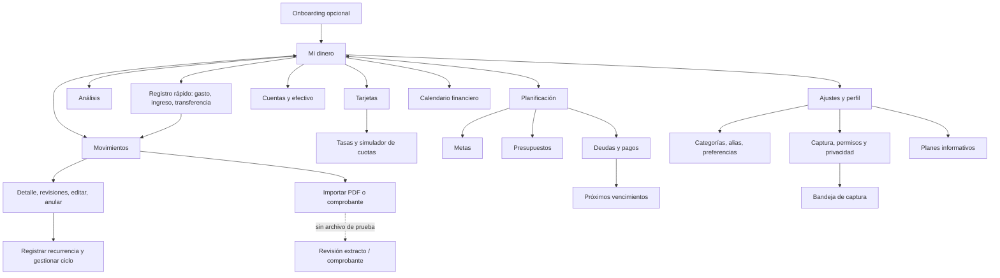

## Coste de los recorridos completos y parciales

Toque = pulsación sobre control o Back; escritura se cuenta aparte y un desplazamiento no es un toque. Los tiempos válidos incluyen ADB, dumps para localizar controles y esperas: **no tiempos humanos ni latencia de Kipu**. No se estima duración desde primer arranque porque no se midió.

| Objetivo y punto de partida | Pasos realmente recorridos / coste | Resultado, fricción y acierto |
|---|---|---|
| Ver cuánto tengo, dashboard A16 | Abrir app iniciada: **0 toques**, desplazar para tarjetas | Total propio separado de crédito; afiliada Yape subordinada a BCP. El número de avisos no equivale a un resumen de urgencia. |
| Primer saldo, S24 vacío | Primera cuenta → Efectivo → alias → Back → saldo → Back → Guardar: **7** | UX-efectivo S/ 100 aparece en dashboard; sin pedir contraseña bancaria. |
| Gasto A16, con nota | + → Gasto → monto → Back → categoría → Alimentación → Más detalles → desplazar → nota → Back → Guardar: **10 + 1 desplazamiento**, **25.01 s automatizados** | S/ 1.20 guardado; se tocó Gasto aunque era predeterminado. Cuenta por defecto y acción fija ayudan. En S24, sin ese toque redundante: **9 + 1 desplazamiento**. |
| Ingreso A16 | + → Ingreso → monto → Back → Más detalles → nota → Back → Guardar: **8** | Ingreso S/ 2.40 guardado sin categoría. Repetición: **18.11 s automatizados hasta aviso**, no hasta nuevo guardado. Aviso erróneo P0. |
| Transferencia A16 | + → Transferencia → monto → Back → destino → BCP → Listo → Más detalles → desplazar → nota → Back → Confirmar: **11 + 1 desplazamiento** | Con destino retenido: **8 + 1 desplazamiento / 19.14 s automatizados**, S/ 1.13. Explica que no cambia patrimonio. |
| Buscar y filtrar A16 | Desde historial: filtro → desplazar → Fuente Manual → aplicar: **3 + 1 desplazamiento**; búsqueda UX → Back: **2** más escritura | Buscar por nota funciona; chips conservan filtros. No se verificó cada combinación avanzada. |
| Corregir importe, ambos teléfonos | Desde historial: fila → Editar → monto → Back → Guardar: **5**; reabrir: **1** | Anticipa diferencia pero termina con valor anterior sincronizado después de éxito. |
| Anular / eliminar A16 | Desde lista: fila → Anular → confirmar: **3**. Deslizar izquierda → confirmar Eliminar: **1 gesto + 1 toque** | Explica saldo posterior y distinción con ocultación local. Deshacer no apareció. |
| Consultar cuenta / tarjeta A16 | Cuenta y formulario abiertos y cancelados con Back; tarjeta → tasas desde dashboard desplazado: **2** | Crédito disponible, deuda y fechas diferenciados; no se cambió contrato existente. |
| Simular A16 | Desde tasas: Back → Registrar consumo → importe → Back → Ver simulación: **5**; dentro, 2 desplazamientos y Ver cronograma | Total 100 correcto, pero «3 × 33.34» y monto fragmentado fuerzan a contrastar cuotas. |
| Alta tarjeta adicional A16 | Agregar → BCP → Continuar → Manual → cinco campos con Back → Guardar | UX-tarjeta confirmada, línea 1,000/deuda 0. **15 toques de ruta reconstruida**, no medición continua por errores del conductor; tramo final corregido **5**. Sin tiempo válido. No primera tarjeta de la cuenta. |
| Presupuesto A16 | Desde tab: + → límite → Back → nombre → Back → Crear → Ver: **7**; editar desde detalle: acciones → Editar → límite → Back → Guardar: **5** | UX-presupuesto pasa de exceso a 84 % con tope 400. Aporta restante y guía diaria; no mueve dinero. |
| Meta A16 | Desde tab: + → nombre → Back → objetivo → Back → Guardar: **6**; aporte: **4**; retiro desde logro: **5** | UX-meta objetivo 2, aporte 2, lograda, retiro 1 y reserva 1; respaldo explícito. |
| Deuda A16 | Desde Deudas: + → Me prestaron → acreedor → Back → monto → Back → desplazar → Guardar → fila: **8 + 1 desplazamiento** | UX-deuda de 2 recibida. Cronograma/pago desde detalle: Cuotas → desplazar → Guardar → Back → Registrar pago → Todo → Registrar: **6 + 1 desplazamiento**; liquidada. Saldo afiliado inconsistente. |
| Recurrencia A16 | Desde gasto: Registrar recurrente → concepto → Back → Guardar → Ver mis recurrencias: **5**; Pausar **1**; Reanudar/confirmar **2**; Cancelar/confirmar **2** | UX-recurrencia creada y cancelada; reanudar explica fecha y que no repone periodos omitidos; preserva historial. |
| Calendario A16 | Dashboard → Calendario → día 20: **2** | Responde qué fecha atender y «Sin cargo automático». Importe de evento previsto de tarjeta queda en raya: no basta para saber cuánto reservar. |
| Analíticas A16 | Tab Análisis **1**, desplazar **1 gesto** | Patrimonio responde dónde está el dinero; ingresos/gastos/neto y categoría responden cómo va el mes. Resumen mensual queda tras gráfico patrimonial. |
| Importar / comprobante A16 | Desde historial Importar → PDF → Entendido: **3** hasta selector; entrada comprobante → imagen: **2** hasta selector | Privacidad y confirmación explicadas; revisión de archivos no alcanzada sin fixture identificado. |
| Categoría S24 / regla | Desde lista categoría: + → nombre → Back → Guardar: **4**. Regla: **1** desde ajuste visible hasta formulario | UX-categoria creada; alias/preferencia solo inspeccionados, sin coste de alta total. Vocabulario técnico añade interpretación. |

El primer valor real S24 costó 7 toques; el primer gasto 9 + 1 gesto, **16 + 1 gesto acumulados desde dashboard vacío**. No incluye onboarding, login ni lectura. Ese conteo no se mezcla con A16.

## Puntuaciones por flujo: primera pasada y actualización visual

La tabla siguiente conserva la valoración de la primera pasada para trazabilidad; las filas actualizadas después de la inspección visual están debajo. Escala `critique.md`: **0** ausencia/fallo fundamental, **1** problemas mayores, **2** parcial, **3** bueno con brechas, **4** excelente. Juicio experto sobre los estados recorridos, no resultado estadístico. H1 estado; H2 lenguaje/mundo real; H3 control; H4 consistencia; H5 prevención; H6 reconocimiento; H7 eficiencia; H8 minimalismo; H9 recuperación; H10 ayuda. En Operate se evalúan las diez; para importación solo se puntúa la entrada, no pantallas inaccesibles.

| Flujo | H1 | H2 | H3 | H4 | H5 | H6 | H7 | H8 | H9 | H10 | Total |
|---|---|---|---|---|---|---|---|---|---|---|---|
| Dashboard | 3 | 4 | 3 | 3 | 3 | 4 | 3 | 3 | 3 | 3 | 32/40 |
| Registro rápido | 2 | 2 | 3 | 2 | 2 | 3 | 2 | 3 | 2 | 3 | 24/40 |
| Historial y edición | 1 | 3 | 2 | 2 | 3 | 3 | 2 | 3 | 1 | 2 | 22/40 |
| Cuentas y tarjetas | 3 | 3 | 3 | 2 | 3 | 3 | 2 | 2 | 2 | 3 | 26/40 |
| Presupuestos | 3 | 4 | 3 | 3 | 3 | 3 | 3 | 3 | 3 | 3 | 31/40 |
| Metas | 3 | 3 | 3 | 3 | 3 | 3 | 3 | 3 | 3 | 4 | 31/40 |
| Deudas | 3 | 2 | 3 | 2 | 2 | 3 | 3 | 3 | 3 | 3 | 27/40 |
| Recurrencias | 3 | 4 | 3 | 3 | 3 | 3 | 2 | 3 | 3 | 4 | 31/40 |
| Calendario | 3 | 3 | 3 | 3 | 3 | 3 | 3 | 3 | 3 | 3 | 30/40 |
| Analíticas | 3 | 4 | 3 | 3 | 3 | 3 | 2 | 2 | 3 | 3 | 29/40 |
| Importación: solo entrada | 3 | 4 | 3 | 3 | 3 | 3 | 3 | 3 | 3 | 4 | 32/40 |
| Transversal | 3 | 3 | 3 | 2 | 3 | 3 | 2 | 2 | 2 | 3 | 26/40 |

Carga cognitiva moderada en filtros (periodo, tipo, cuenta/canal, categoría, importe, comercio, tarjeta, estado, fuente y sincronización); fuerte acumulación en el simulador por diálogo estrecho y contenido largo. El viaje emocional empieza con una cifra clara y termina bien en logro/pago; los valles críticos están en guardar una corrección y confirmar un duplicado. Para usuario habitual importa la fiabilidad de estas confirmaciones; para persona con texto ampliado, la separación de destinos; para quien teme equivocarse, el signo y el saldo seleccionable.

En la primera pasada S24, presentación de onboarding heredado 32/40, primera cuenta/gasto 30/40, entrada de categorías/reglas 27/40 y corrección 22/40. Son valoraciones de esos estados; alta de primera tarjeta/presupuesto/meta S24 y revisión real de captura no reciben una puntuación de completitud. La valoración de cuentas/tarjetas de A16 se complementa con alta manual satisfactoria, sin ocultar el P1 del simulador.

### Actualización tras segunda pasada

Se mantiene la escala y se revisan las valoraciones cuyo alcance visual cambió. Son juicios expertos: onboarding baja por expectativa/ejemplos, vacío por prioridad de inicio, registro por categoría fuera de vista, Análisis por jerarquía del periodo y categorías por selección/contraste. Las demás valoraciones se mantienen; no se puntúan estados inaccesibles.

| Flujo / alcance actualizado | H1 | H2 | H3 | H4 | H5 | H6 | H7 | H8 | H9 | H10 | Total |
|---|---|---|---|---|---|---|---|---|---|---|---|
| Onboarding heredado, con evaluación visual | 2 | 2 | 3 | 3 | 2 | 3 | 3 | 2 | 2 | 3 | 25/40 |
| Dashboard vacío, composición inicial | 2 | 2 | 3 | 3 | 3 | 2 | 2 | 2 | 3 | 3 | 25/40 |
| Registro rápido, incluido IME | 2 | 2 | 3 | 2 | 2 | 2 | 2 | 3 | 2 | 3 | 23/40 |
| Análisis, incluida prioridad del periodo | 3 | 4 | 3 | 3 | 3 | 3 | 2 | 1 | 3 | 3 | 28/40 |
| Categorías y reglas, incluido contraste | 3 | 2 | 3 | 2 | 3 | 2 | 2 | 3 | 3 | 3 | 26/40 |

## Flujos que cambiarían: actual y propuesto

Las propuestas siguientes conservan el trayecto útil y corrigen significado, persistencia o adaptación. **Todos los costes propuestos son estimaciones**, no pruebas de un prototipo ni promesas de ahorro de segundos. Las verificaciones de los hallazgos son futuras, no tests ejecutados. Los cambios de comportamiento señalados requieren decisión del dueño.

### Registro de ingreso, duplicado y categoría — A16-UX-001/005

Actual: 8 toques con nota hasta Guardar; si repite, llega al aviso con signo de gasto. La rama de categoría termina en formulario «Gastos», aunque el ingreso puede guardarse sin categoría. Propuesto: **estimación de los mismos 8 toques** hasta aviso; conservar +importe/tipo y contexto INCOME evita decidir bajo información falsa. No se cambia la política de duplicados ni la opcionalidad de categoría. El alta contextual completa no se midió, por lo que no se estima ahorro en ella.

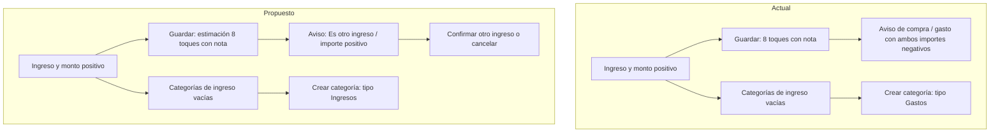

### Corrección y lectura de detalle — A16-UX-002/006

Actual: 5 toques desde historial hasta guardar y 1 para reabrir; feedback y valor final discrepan en A16 y S24. El detalle mezcla origen manual, banco y comercio. Propuesto: **estimación de los mismos 5 + 1**, con estado pendiente/aceptado/rechazado fiable y filas de origen/cuenta correctas. Si ocurre rechazo, «Revisar cambios» añade **1 toque estimado** para recuperar borrador; no es ahorro, es recuperación explícita por aprobar. La solución de conciliación debe investigarse antes de atribuir responsabilidades a la UI o servidor.

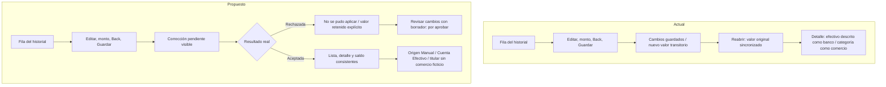

### Elegir cuenta en deuda y pago — A16-UX-003

Actual: alta y pago se completaron usando Efectivo, pero al elegir cuenta Yape mostraba −5 frente al saldo compartido BCP de 371.71. El **tramo abrir selector = 1 toque observado** desde el formulario; elegir Yape y pagar no se probó. Propuesto: **estimación 1 toque para abrir**, mostrando «Comparte saldo con BCP» y saldo efectivo. No se afirma ahorro ni corrección del asiento hasta probar una operación afiliada; excluir canales sería decisión distinta de producto.

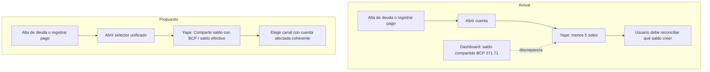

### Comparar cuotas — A16-UX-004

Actual: desde tasas 5 toques hasta simulación; después 2 desplazamientos y abrir cronograma para contrastar «3 × 33.34» con tres importes distintos. Propuesto: **estimación de los mismos 5 toques hasta simulación**, mismo cronograma accesible, resumen derivado de cuotas reales e importes sin fragmentar. Puede evitar la necesidad de abrir el cronograma solo para entender el redondeo; ese ahorro de inspección no se ha medido y no se promete quitar el acceso.

```mermaid
flowchart TD
    subgraph Actual
        A[Tarjeta: consumo 100 soles] --> B[Ver simulación / 3 sin intereses]
        B --> C[Resumen: 3 por 33.34 / última cuota partida]
        C --> D[Desplazar y abrir cronograma]
        D --> E[33.34, 33.33, 33.33 / total 100]
    end
    subgraph Propuesto
        F[Tarjeta: consumo 100 soles] --> G[Ver simulación / 3 sin intereses]
        G --> H[3 cuotas desde 33.33]
        H --> I[Primera 33.34 / siguientes 33.33 / total 100 legible]
        I --> J[Cronograma disponible para detalle]
    end
```

### Navegar con texto ampliado — A16-UX-007

Actual: cuatro destinos y un botón de registro; al 130 % etiquetas contiguas. Cambiar de destino cuesta **1 toque**. Propuesto: **estimación 1 toque**, etiquetas con al menos 8 dp de separación y variante de dos líneas con altura suficiente por aprobar; se preserva área táctil mínima de 48 dp. La medida real de un destino fue 78.5 × 56 dp, por lo que no se atribuye el problema a un área táctil insuficiente.

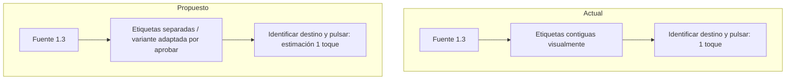

### Reconocer un comercio — S24-UX-001

Actual: desde ajuste visible **1 toque hasta formulario**, con «fuente exacta», «normalizar» y «canónico». Propuesto: **estimación 1 toque**, campos en vocabulario de la operación y un ejemplo del texto completo. No se midió guardar regla ni se promete reducir sus pulsaciones; el beneficio es entender la tarea sin aprender terminología del sistema.

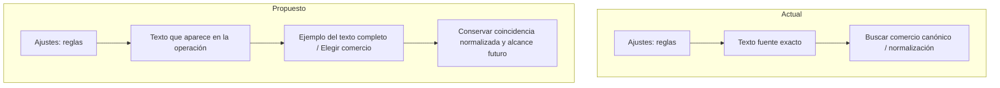

### A16-UX-008 — Registro frecuente / QuickMovementScreen con teclado

Actual: 10 toques + 1 gesto con nota en la repetición A16, incluido Back antes de categoría. Propuesto: estimación 9 + 1 gesto si el picker gestiona el IME al tocar Categoría; debe validarse. El eventual ahorro es un Back, no un tiempo humano demostrado.

```mermaid
flowchart TD
    subgraph Actual
        A0["Abrir gasto"]
        A1["Escribir importe con IME"]
        A0 --> A1
        A2["Categoría fuera de vista / asociación opcional visible"]
        A1 --> A2
        A3["Back para ver categoría"]
        A2 --> A3
        A4["Elegir categoría y guardar"]
        A3 --> A4
    end
    subgraph Propuesto
        P0["Abrir gasto"]
        P1["Importe compacto con IME"]
        P0 --> P1
        P2["Categoría visible antes de opciones"]
        P1 --> P2
        P3["Elegir categoría"]
        P2 --> P3
        P4["Guardar; asociación disponible en Más detalles"]
        P3 --> P4
    end
```

### A16-UX-009 — Consulta de tarjeta / AccountDetailScreen

Actual y propuesto: estimación de conservar 1 toque desde dashboard para consultar; la captura no exige afirmar un gesto obligatorio para el resumen. Expandir arte añadiría 1 toque estimado, solo si se busca apariencia. Beneficio esperado: orden de lectura, no reducción probada de pulsaciones.

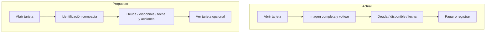

### A16-UX-010 — Cómo va el mes / AnalyticsScreen

Actual: 1 toque para Análisis + 1 gesto en la muestra para el resumen mensual. Propuesto: estimación 1 toque sin ese gesto para leer los KPIs a 0.9; no se promete ausencia de scroll a cualquier escala.

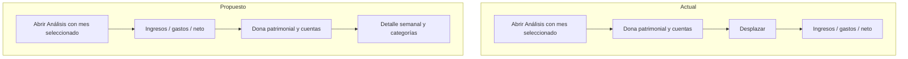

### A16-UX-011 — Editar y simular tarjeta / diálogos frente a hojas

No se midió un recorrido completo de edición de tarjeta guardada. Se estima conservar el número de acciones; el ancho y scroll deben verificarse en prototipo. La simulación actual mantiene sus 5 toques de entrada ya medidos, no se promete ahorro.

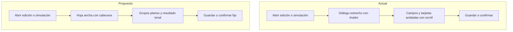

### S24-UX-002 — Onboarding / las tres páginas

Onboarding no recorrido en vivo: coste actual no medido. Actual y propuesto tienen 2 Siguiente + Empezar = 3 acciones estructurales, no medición; se conserva Omitir. No se cambia el trayecto de acceso ni se evalúa autenticación.

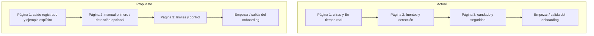

### S24-UX-003 — Primer minuto / Dashboard vacío

S24 actual: 7 toques desde vacío hasta saldo inicial. Propuesto: estimación de los mismos 7, con CTA más alto y menos lectura previa; no se promete reducción de tiempo ni se confunde con la cuenta A16 poblada.

```mermaid
flowchart TD
    subgraph Actual
        A0["Dashboard sin cuentas"]
        A1["Cero grande y dos ceros secundarios"]
        A0 --> A1
        A2["Calendario y sección cuentas"]
        A1 --> A2
        A3["Agregar mi primera cuenta"]
        A2 --> A3
        A4["Primer saldo real"]
        A3 --> A4
    end
    subgraph Propuesto
        P0["Dashboard sin instrumentos confirmado"]
        P1["Primer paso y CTA principal"]
        P0 --> P1
        P2["Agregar primera cuenta"]
        P1 --> P2
        P3["Primer saldo real"]
        P2 --> P3
        P4["Tarjeta / calendario como opciones secundarias"]
        P3 --> P4
    end
```

### S24-UX-004 — Identidad de cuenta / DashboardTopBar

Actual y propuesto: 0 toques para leer encabezado; no se añaden pasos de configuración ni se propone cambiar el acceso a perfil.

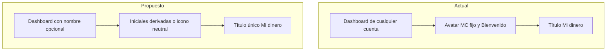

### S24-UX-005 — Vacíos de Planificación / Metas y Presupuestos

Actual: desde tab vacío, 1 toque en FAB hasta formulario; propuesto: estimación 1 toque en botón explícito, mismas altas de 6 toques meta y 7 presupuesto hasta detalle. Beneficio esperado de reconocimiento, no ahorro demostrado.

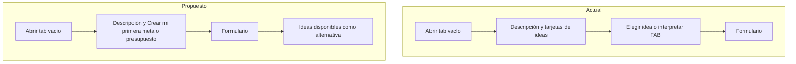

### S24-UX-006 — Color y contraste / Categorías seleccionada y FAB

Actual y propuesto: 1 toque para cambiar pestaña o abrir alta. Sin cambio de recorrido; contraste esperado debe confirmarse en APK.

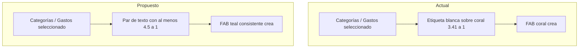

## Recomendaciones deduplicadas

Cada recomendación incluye evidencia directa, cambio concreto y verificación futura. Observado es lo visto en teléfono; Medido son pulsaciones o límites de UI; Heurístico es juicio sobre esa observación. No probado se lista como límite, no como defecto. Impacto y esfuerzo son estimaciones. Las rutas y líneas son del repositorio actual, no prueba de versión desplegada ni diagnóstico definitivo.

### Defectos funcionales y de comunicación de datos

#### A16-UX-001 · P0 · Registro de ingresos / DuplicateWarningDialog

- **Clasificación:** Observado.
- **Qué pasa hoy:** El ingreso positivo S/ 2.40 repetido abre «¿Es una compra distinta?», dice que ya se registró un gasto y muestra −S/ 2.40 tanto en registrado como propuesto. El formulario detrás sigue en Ingreso. Evidencia: [A16 71](capturas/_local-only/a16/71-ingreso-medicion.png).
- **Qué cambiar:** Derivar encabezado, explicación, CTA, color y signo del tipo del movimiento. Para ingreso: «¿Es otro ingreso?», «Ya registraste un ingreso parecido hace poco. Confirma si recibiste este dinero otra vez.», «Sí, es otro ingreso · guardar», +S/ 2.40.
- **Por qué:** El usuario que está por confirmar dinero recibido necesita saber si suma o resta; correspondencia con mundo real y prevención de errores.
- **Impacto:** Alto: puede hacer confirmar o cancelar por una consecuencia financiera falsa. **Esfuerzo:** Bajo–medio. **Prioridad:** P0.
- **Código afectado:** `app/src/main/java/com/kipu/app/feature/movements/presentation/QuickMovementScreen.kt:1522`; `app/src/main/java/com/kipu/app/feature/movements/presentation/QuickMovementScreen.kt:1528`; `app/src/main/java/com/kipu/app/feature/movements/presentation/QuickMovementScreen.kt:1563`; `app/src/main/java/com/kipu/app/feature/movements/presentation/QuickMovementScreen.kt:1635`.
- **Cómo comprobar:** Repetir un ingreso y un gasto del mismo importe: el aviso conserva tipo, signo y consecuencia correctos; cancelar no registra un movimiento.
- **Autoridad / decisión:** Corrección de comunicación del tipo existente; no se propone cambiar la política de detección de duplicados.

#### A16-UX-002 · P0 · Historial / MovementEditorSheet y sincronización

- **Dato de servidor aportado por el coordinador (Observado, SQL de solo lectura, cuenta S24, instrucción de segunda pasada del 2026-11-05):** `public.transactions` conservaba `revision=1`, `amount_minor=120` y `updated_at=created_at`; `public.transaction_revisions` no tenía filas para esa cuenta, mientras S24/43 mostraba dos revisiones y Sincronizado. La corrección no había quedado en el servidor al momento de esa consulta; este worker no ejecutó esa consulta ni dispone de su hora exacta. Pudo no enviarse, ser rechazada o revertirse localmente: no se determinó causa.
- **Contraste de feedback en código:** `app/src/main/java/com/kipu/app/feature/movements/presentation/MovementHistoryScreen.kt:656` usa «Cambios guardados» si no está offline, mientras `app/src/main/java/com/kipu/app/feature/movements/presentation/MovementEditorViewModel.kt:409` emite «Movimiento corregido (Pendiente de sincronizar)». Son mensajes discrepantes pertinentes a investigar; no prueban la causa del resultado ni convierten estar online en aceptación del servidor.

- **Clasificación:** Observado.
- **Qué pasa hoy:** Cambiar UX-gasto-tiempo de 1.20 a 1.41 muestra antes/diferencia; guardar confirma «Cambios guardados» y lista 1.41 con «Sincronizando», pero al abrir el detalle vuelve a 1.20 «Sincronizado». También ocurrió al cambiar UX-ingreso 2.40 a 2.45; el historial de revisiones muestra Corrección y Anulación sin que se hubiera pedido anular ese ingreso. Evidencia: [A16 78](capturas/_local-only/a16/78-editar-propuesta.png), [A16 79](capturas/_local-only/a16/79-editar-guardado.png), [A16 80](capturas/_local-only/a16/80-editar-detalle.png), [A16 74](capturas/_local-only/a16/74-editar-respuesta.png), [A16 75](capturas/_local-only/a16/75-editar-persistencia.png), [A16 76](capturas/_local-only/a16/76-revisiones.png).
- **Contraste S24 observado:** primer gasto 1.20 → propuesta 1.35, «Cambios guardados», reabrir 1.20 «Sincronizado». [S24 41](capturas/_local-only/s24/41-edicion-propuesta.png), [S24 42](capturas/_local-only/s24/42-edicion-feedback.png), [S24 43](capturas/_local-only/s24/43-edicion-reapertura.png). Se conserva ID, no se atribuye causa remota.
- **Qué cambiar:** Conservar la corrección pendiente visible hasta resolución; si se rechaza o revierte, mostrar «No se pudo aplicar la corrección. Se mantiene S/ 1.20.» y ofrecer «Revisar cambios» / «Reintentar» con el borrador retenido. Investigar primero la conciliación y el estado efectivo; no ocultar un rechazo detrás de «Sincronizado».
- **Por qué:** Quien corrige su contabilidad confía en Guardar y en la cifra posterior; visibilidad de estado y recuperación de errores.
- **Impacto:** Alto: la cifra confirmada no coincide con la que permanece. No se afirma pérdida de datos ni causa de servidor sin investigación. **Esfuerzo:** Medio–alto. **Prioridad:** P0.
- **Código afectado:** `app/src/main/java/com/kipu/app/feature/movements/presentation/MovementEditorViewModel.kt:409`; `app/src/main/java/com/kipu/app/feature/movements/presentation/MovementHistoryScreen.kt:656`; `app/src/main/java/com/kipu/app/feature/movements/presentation/MovementHistoryScreen.kt:933`; `app/src/main/java/com/kipu/app/feature/movements/presentation/MovementDetailSheet.kt:275`.
- **Cómo comprobar:** Corregir importe online, abrir detalle, esperar sincronización y volver a entrar: lista/detalle/saldo conservan el valor aceptado o muestran rechazo explícito con borrador recuperable. Verificar también offline y conflicto con pruebas focalizadas posteriores.
- **Autoridad / decisión:** Reintentar/retener propuesta como nueva acción **requiere decisión del dueño de producto**; la investigación del rechazo y la coherencia del feedback son necesarias antes de elegir el comportamiento.

#### A16-UX-003 · P1 · Deudas / formulario y pago, saldo de Yape afiliado

- **Clasificación:** Observado.
- **Qué pasa hoy:** En alta y pago aparece Yape con S/ −5.00; en Mi dinero es «Saldo de BCP» y el selector de transferencia lo describe como saldo compartido de la afiliada. BCP muestra S/ 371.71 en ese momento. Evidencia: [A16 44](capturas/_local-only/a16/44-deuda-cuentas.png), [A16 47](capturas/_local-only/a16/47-deuda-pagar.png), [A16 50](capturas/_local-only/a16/50-dashboard-tarjetas.png).
- **Qué cambiar:** Usar la misma resolución de cuenta efectiva del selector unificado. En Yape afiliado mostrar «Comparte saldo con BCP» y el saldo efectivo de BCP, sin presentar la proyección aislada como dinero disponible; comprobar que la operación afecte a la cuenta correcta antes de habilitarla.
- **Por qué:** La persona elige desde dónde recibe o paga: cifras distintas para el mismo instrumento obligan a desconfiar y a cambiar de módulo; consistencia y reconocimiento.
- **Impacto:** Alto en selección; no se probó pagar desde Yape ni se afirma error de asiento. **Esfuerzo:** Medio. **Prioridad:** P1.
- **Código afectado:** `app/src/main/java/com/kipu/app/feature/debts/presentation/DebtOpeningViewModel.kt:159`; `app/src/main/java/com/kipu/app/feature/debts/presentation/PayableDebtFormScreen.kt:277`; `app/src/main/java/com/kipu/app/feature/debts/presentation/DebtSettlementSheet.kt:234`.
- **Cómo comprobar:** Con billetera afiliada, comparar dashboard, transferencia, deuda y pago: mismo saldo efectivo y etiqueta de afiliación; validar cuenta afectada con un movimiento UX pequeño.
- **Autoridad / decisión:** Si se decide excluir la billetera del selector en vez de admitir el canal, **requiere decisión del dueño de producto**.

#### A16-UX-005 · P2 · Registro de ingreso / creación contextual de categoría

- **Clasificación:** Observado.
- **Qué pasa hoy:** Desde categorías de ingreso (0 categorías), «Crear nueva categoría» muestra tipo «Gastos» sin una elección evidente en ese bloque. El ingreso sí puede guardarse sin categoría; no es un bloqueo del alta. Evidencia: [A16 07](capturas/_local-only/a16/07-ingreso-categorias.png), [A16 08](capturas/_local-only/a16/08-ingreso-crear-categoria.png), [A16 68](capturas/_local-only/a16/68-ingreso-guardado.png).
- **Qué cambiar:** Pasar explícitamente INCOME al formulario contextual y rotularlo «Ingresos». Conservar el tipo del movimiento aunque no haya padre ni categorías disponibles.
- **Por qué:** La persona que clasifica un abono no debe interpretar si se cambió de flujo; consistencia y reconocimiento.
- **Impacto:** Medio: duda y posible abandono de clasificación. No se creó la categoría para probar qué tipo terminaría persistido. **Esfuerzo:** Bajo. **Prioridad:** P2.
- **Código afectado:** `app/src/main/java/com/kipu/app/feature/movements/presentation/PastelCategoryPickerFlow.kt:603`; `app/src/main/java/com/kipu/app/feature/movements/presentation/PastelCategoryPickerFlow.kt:1454`; `app/src/main/java/com/kipu/app/feature/categories/presentation/categories/CategoryFormScreen.kt:379`.
- **Cómo comprobar:** Abrir creación desde ingreso sin categorías y desde gasto: encabezado y tipo correctos; al crear UX-categoría, permanece seleccionable en su tipo.
- **Autoridad / decisión:** No cambia el requisito de categoría opcional del ingreso.

#### A16-UX-006 · P2 · Historial / detalle de efectivo

- **Clasificación:** Observado.
- **Qué pasa hoy:** Un movimiento en Efectivo se rotula «Método de registro: Cuenta bancaria directa» y un gasto sin comercio utiliza la categoría como titular debajo de COMERCIO. Evidencia: [A16 14](capturas/_local-only/a16/14-movimiento-detalle.png), [A16 75](capturas/_local-only/a16/75-editar-persistencia.png), [A16 80](capturas/_local-only/a16/80-editar-detalle.png).
- **Qué cambiar:** Para el movimiento manual usar «Origen del registro: Manual» y una fila independiente «Cuenta: Efectivo». Si falta comercio, titular «Gasto en Alimentación» y quitar el rótulo COMERCIO de ese encabezado.
- **Por qué:** Quien audita su día necesita distinguir canal de captura, cuenta y comercio; correspondencia con mundo real y consistencia.
- **Impacto:** Medio: los datos se ven, pero su significado se confunde. **Esfuerzo:** Bajo. **Prioridad:** P2.
- **Código afectado:** `app/src/main/java/com/kipu/app/feature/movements/presentation/MovementDetailSheet.kt:198`; `app/src/main/java/com/kipu/app/feature/movements/presentation/MovementDetailSheet.kt:455`; `app/src/main/java/com/kipu/app/feature/movements/presentation/MovementDetailSheet.kt:459`.
- **Cómo comprobar:** Abrir gasto manual en efectivo, ingreso y movimiento importado: origen/cuenta se distinguen y no se atribuye un banco o comercio inexistente.
- **Autoridad / decisión:** Cambio de terminología; validar vocabulario del producto antes de propagarlo.

#### S24-UX-004 · P2 · Identidad de cuenta / DashboardTopBar

- **Clasificación:** Observado en captura y código; dato de nombre nulo aportado por coordinador.
- **Qué pasa hoy:** El avatar muestra MC junto a «Bienvenido» y «Mi dinero». El literal MC está fijo en DashboardScreen, sin depender de identidad; también aparece en la cuenta S24 de otro nombre y profiles.display_name nulo, según contraste del coordinador. No se consultó la base desde esta segunda pasada. Puede parecer que está abierta otra cuenta. Evidencia: [S24 06](capturas/_local-only/s24/06-dashboard-empty.png), [S24 38](capturas/_local-only/s24/38-primer-valor-real.png), [A16 89](capturas/_local-only/a16/89-cierre-continuacion.png).
- **Qué cambiar, en concreto:** Con nombre disponible, derivar hasta dos iniciales de palabras no vacías (por ejemplo Ana Pérez → AP); con un solo nombre usar una inicial, y sin nombre mostrar icono PersonOutline de 24 dp dentro del mismo contenedor de 46 dp, sin MC ni iniciales extraídas del correo. Mantener «Mi dinero» como único título visible y quitar el saludo genérico Bienvenido; el nombre, si se muestra, pertenece al perfil y no requiere inventarse en el encabezado. Conservar accesos de ajustes y avisos.
- **Por qué:** Quien comprueba su dinero debe reconocer que la cuenta es suya. Correspondencia con mundo real y confianza; avatar neutral comunica ausencia de nombre sin atribuir una identidad falsa. El título ya explica la pantalla y el saludo genérico no agrega contexto.
- **Impacto:** Medio en confianza; no se observó cambio real de cuenta. **Esfuerzo:** Bajo–medio. **Prioridad:** P2.
- **Código afectado:** `app/src/main/java/com/kipu/app/feature/accounts/presentation/dashboard/DashboardScreen.kt:248`; `app/src/main/java/com/kipu/app/feature/accounts/presentation/dashboard/DashboardScreen.kt:268`; `app/src/main/java/com/kipu/app/feature/accounts/presentation/dashboard/DashboardScreen.kt:276`.
- **Cómo comprobar:** Probar nombres Ana Pérez, Ana, espacios y nulo: AP, A y avatar neutral según corresponda, nunca MC fijo; no mostrar correo ni reducir targets. Con fuente 1.3 conservar título y acciones sin duplicar saludo.
- **Autoridad / decisión:** **Requiere decisión del dueño de producto** la derivación y exposición de identidad; el literal fijo se registra como defecto, y no obliga a pedir un nombre para usar la app.

### Mejoras de UI/UX: composición, adaptación, lenguaje y color

#### A16-UX-004 · P1 · Cuentas y tarjetas / CreditPurchasePreview

- **Clasificación:** Observado y medido.
- **Qué pasa hoy:** Para S/ 100 sin intereses, el resumen dice «3 × S/ 33.34», mientras cronograma da 33.34 + 33.33 + 33.33 = 100.00. «Última cuota ajustada» parte S/ 33.33 en tres líneas incluso con font_scale 0.9; dump: importe ocupa x767–828, solo 61 px (23.2 dp). No hay error de suma en el cronograma observado. Evidencia: [A16 56](capturas/_local-only/a16/56-simulador-costos.png), [A16 58](capturas/_local-only/a16/58-simulador-resumen-final.png).
- **Qué cambiar:** Cambiar el resumen a «3 cuotas desde S/ 33.33» y «Primera: S/ 33.34 · siguientes: S/ 33.33» para este caso, derivado de las cuotas reales. Poner etiqueta e importe en filas separadas o dar peso flexible a la etiqueta y ancho intrínseco al importe; nunca partir el número.
- **Por qué:** Quien compara cuotas necesita un importe inequívoco antes de registrar la compra; exactitud y prevención de error, adaptación a ancho y texto.
- **Impacto:** Medio–alto: lectura y comparación financiera equivocadas aunque total/cronograma sean correctos. **Esfuerzo:** Bajo–medio. **Prioridad:** P1.
- **Código afectado:** `app/src/main/java/com/kipu/app/feature/accounts/presentation/components/CreditPurchaseTermsSection.kt:165`; `app/src/main/java/com/kipu/app/feature/accounts/presentation/components/CreditPurchaseTermsSection.kt:180`; `app/src/main/java/com/kipu/app/feature/accounts/presentation/components/CreditPurchaseTermsSection.kt:185`; `app/src/main/java/com/kipu/app/feature/accounts/presentation/instruments/InstallmentSimulatorScreen.kt:172`.
- **Cómo comprobar:** Repetir S/ 100 / 3 sin intereses a escalas 0.9 y 1.3: resumen representa la distribución real, importes completos y total 100.00; repetir con intereses y montos largos.
- **Autoridad / decisión:** No se cambia la fórmula ni el cronograma aprobado; se corrige su representación.

#### A16-UX-007 · P2 · Transversal / navegación al 130 %

- **Clasificación:** Observado y heurístico.
- **Qué pasa hoy:** Con font_scale 1.3, «Movimientos» y «Planificación» quedan pegados visualmente, tanto en claro como oscuro. Los destinos siguen siendo pulsables; no se afirma que incumplan 48 dp. En escala original, un destino medido tiene 206 × 147 px ≈ 78.5 × 56 dp. Evidencia: [A16 64](capturas/_local-only/a16/64-analiticas-texto130-estable.png), [A16 65](capturas/_local-only/a16/65-analiticas-oscuro130.png).
- **Qué cambiar:** Reservar separación visual mínima de 8 dp entre etiquetas y permitir una disposición adaptada de dos líneas con altura suficiente al aumentar texto; mantener destinos, iconos y áreas táctiles de 48 dp. Revisar la versión instalada frente al autoajuste que ya aparece en código local.
- **Por qué:** La persona que usa texto ampliado necesita reconocer cuatro destinos como acciones separadas; adaptación y reconocimiento.
- **Impacto:** Medio en texto ampliado; no bloquea navegación. **Esfuerzo:** Medio. **Prioridad:** P2.
- **Código afectado:** `app/src/main/java/com/kipu/app/navigation/KipuNavigationBar.kt:238`; `app/src/main/java/com/kipu/app/navigation/KipuNavigationBar.kt:249`.
- **Cómo comprobar:** En el APK resultante probar 0.9 y 1.3 en ambos temas: etiquetas legibles y separadas, sin reducir el área táctil ni superposición; pulsar cada destino.
- **Autoridad / decisión:** Permitir dos líneas cambia el patrón visual: **requiere decisión del dueño de producto**; el código local no demuestra que esa variante esté desplegada.

#### S24-UX-001 · P2 · Reglas de comercio / MerchantAliasRulesScreen

- **Clasificación:** Heurístico sobre textos observados; contraste entre dispositivos observado.
- **Qué pasa hoy:** El formulario pide «Texto fuente exacto» y «Buscar comercio canónico»; la ayuda explica que «Se normalizarán mayúsculas, tildes y espacios». Obliga a aprender vocabulario de implementación al intentar reconocer un comercio. Evidencia: [S24 31](capturas/_local-only/s24/31-alias-vacio.png); mismos términos en [A16 82](capturas/_local-only/a16/82-alias-contraste.png).
- **Qué cambiar, en concreto:** Campo «Texto que aparece en la operación»; selector «Elegir comercio»; ayuda «Por ejemplo: “TAMBO 123”. Elige Tambo para reconocer ese texto en tus próximos movimientos. Se ignoran mayúsculas, tildes y espacios». Mantener explícito que se pega el texto completo: no prometer coincidencias parciales ni cambios retroactivos.
- **Por qué:** Quien configura su primera regla conoce lo que ve en su operación, no un modelo canónico. Correspondencia con mundo real y reconocimiento; reduce la explicación que debe interpretar antes de empezar.
- **Impacto:** Medio en descubrimiento/configuración. No se afirma fracaso de una persona ni error de normalización. **Esfuerzo:** Bajo. **Prioridad:** P2.
- **Código afectado:** `app/src/main/java/com/kipu/app/feature/categories/presentation/merchantrules/MerchantAliasRulesScreen.kt:189`, `:190`, `:199`, `:251`, `:383`.
- **Cómo comprobar:** Una persona nueva puede explicar qué texto pegar y qué comercio elegir antes de guardar; comprobar con UX- que la coincidencia exacta normalizada y la aplicación a movimientos futuros conservan su funcionamiento.
- **Autoridad / decisión:** Cambio de vocabulario; no altera la política de coincidencia ni el alcance futuro. Cualquier cambio a esa política **requiere decisión del dueño de producto**.

#### A16-UX-008 · P1 · Registro frecuente / QuickMovementScreen con teclado

- **Clasificación:** Observado y heurístico; coste del recorrido medido en fase 1.
- **Qué pasa hoy:** Con S/ 1.20 escrito y teclado visible, se ven el selector de tipo, un bloque de importe alto, la cuenta y «Aplicar a… deuda»; la categoría obligatoria del gasto queda fuera del área visible. Guardar sigue en el borde del teclado. Se cerró el teclado para elegir categoría; no se afirma que Guardar permita saltar esa validación. Evidencia: [A16 02](capturas/_local-only/a16/02-movimiento-inicial.png), [A16 05](capturas/_local-only/a16/05-movimiento-monto.png).
- **Qué cambiar, en concreto:** En el estado con IME, compactar el bloque de monto a mínimo 72 dp, conservar dígitos de 28 sp y selector de tipo de 48 dp; situar Categoría inmediatamente después de monto/cuenta y antes de «Aplicar a…». Llevar «Aplicar a deuda/préstamo/meta» a Más detalles, manteniendo la selección activa visible cuando exista. Margen lateral 16 dp y separaciones internas 8 dp. Mantener Guardar sobre el IME y todos los targets ≥48 dp; no eliminar campos ni validaciones.
- **Por qué:** La persona que registra varios gastos necesita ver el siguiente dato obligatorio mientras escribe. Jerarquía según tarea, reconocimiento y eficiencia; el espacio del importe y de una asociación opcional no debe desplazar la categoría.
- **Impacto:** Alto por repetición diaria; se observó un Back adicional, no abandono de usuarios. **Esfuerzo:** Medio. **Prioridad:** P1.
- **Código afectado:** `app/src/main/java/com/kipu/app/feature/movements/presentation/QuickMovementScreen.kt:399`; `app/src/main/java/com/kipu/app/feature/movements/presentation/QuickMovementScreen.kt:899`; `app/src/main/java/com/kipu/app/feature/movements/presentation/QuickMovementScreen.kt:919`.
- **Cómo comprobar:** En A16, fuente 0.9 y 1.3, escribir importe y comprobar que Categoría pueda verse/alcanzarse sobre el IME sin cerrar antes el teclado; repetir ingreso y transferencia, asociación activa y error. Guardar no tapa el dato requerido y respeta el tipo.
- **Autoridad / decisión:** **Requiere decisión del dueño de producto** mover la asociación a Más detalles; compactar no debe reducir targets ni suprimir información obligatoria.

#### A16-UX-009 · P2 · Consulta de tarjeta / AccountDetailScreen

- **Clasificación:** Heurístico sobre composición observada.
- **Qué pasa hoy:** La imagen completa de la tarjeta y «Toca la tarjeta para voltear» preceden deuda, disponible y fecha de pago. En las dos tarjetas observadas, el objeto de marca domina la parte superior; el resumen y las acciones quedan debajo. Identifica bien el instrumento, pero retrasa la lectura de la obligación. Evidencia: [A16 51](capturas/_local-only/a16/51-tarjeta-detalle.png), [A16 86](capturas/_local-only/a16/86-tarjeta-detalle-ux.png).
- **Qué cambiar, en concreto:** Abrir el detalle con una fila de identificación de 64 dp (miniatura 48 dp, alias, emisor y últimos cuatro), después deuda/disponible, fecha de pago y acciones Pagar/Registrar consumo. Dejar «Ver tarjeta» como acción secundaria de 48 dp que expanda la imagen actual y su reverso. Conservar arte y datos; usar 16 dp de margen y 24 dp entre resumen y movimientos.
- **Por qué:** Quien entra a diario quiere saber cuánto debe y cuándo paga. Jerarquía y economía visual: identificación compacta, obligación antes que apariencia, sin perder reconocimiento de marca.
- **Impacto:** Medio en consulta frecuente; no se midió velocidad de comprensión. **Esfuerzo:** Medio. **Prioridad:** P2.
- **Código afectado:** `app/src/main/java/com/kipu/app/feature/accounts/presentation/detail/AccountDetailScreen.kt:684`; `app/src/main/java/com/kipu/app/feature/accounts/presentation/detail/AccountDetailScreen.kt:713`; `app/src/main/java/com/kipu/app/feature/accounts/presentation/detail/AccountDetailScreen.kt:1066`.
- **Cómo comprobar:** En tarjetas con/sin deuda, alias largo, ambos temas y fuente 1.3, deuda/fecha/acción deben verse en el primer viewport; expandir Ver tarjeta mantiene imagen y reverso accesibles. Medir tareas de consultar y pagar antes/después.
- **Autoridad / decisión:** **Requiere decisión del dueño de producto** cambiar la posición inicial y expansión de la tarjeta; el mockup canónico también prioriza arte, por lo que no se presenta como incumplimiento del diseño aprobado.

#### A16-UX-010 · P2 · Cómo va el mes / AnalyticsScreen

- **Clasificación:** Heurístico sobre estados claro, oscuro y texto ampliado observados.
- **Qué pasa hoy:** El periodo mensual queda arriba, pero el bloque de patrimonio, selector y dona por cuentas ocupa casi todo el primer viewport. Ingresos/gastos/neto aparece cortado abajo a 0.9 y queda fuera a 1.3; hay que desplazar para responder cómo va el mes. El reparto patrimonial es útil y está bien rotulado. Evidencia: [A16 61](capturas/_local-only/a16/61-analiticas.png), [A16 62](capturas/_local-only/a16/62-analiticas-resultados.png), [A16 64](capturas/_local-only/a16/64-analiticas-texto130-estable.png), [A16 65](capturas/_local-only/a16/65-analiticas-oscuro130.png).
- **Qué cambiar, en concreto:** Con movimientos del periodo, situar una fila de Ingresos, Gastos y Neto inmediatamente tras periodo/filtros, antes de Dónde está tu dinero. Rótulos 12–14 sp y montos 20 sp; permitir filas verticales al 130 % sin truncar. Mantener la dona y su lista de cuentas como siguiente sección, con 24 dp entre secciones y sin añadir una tarjeta envolvente a ambas.
- **Por qué:** Una persona que revisa su control mensual debe recibir primero el balance del periodo que seleccionó; jerarquía y correspondencia entre filtro y respuesta. Conserva la pregunta complementaria de dónde está el patrimonio.
- **Impacto:** Medio en lectura diaria; no afecta cálculos. **Esfuerzo:** Bajo–medio. **Prioridad:** P2.
- **Código afectado:** `app/src/main/java/com/kipu/app/feature/analytics/presentation/AnalyticsScreen.kt:499`; `app/src/main/java/com/kipu/app/feature/analytics/presentation/AnalyticsScreen.kt:521`.
- **Cómo comprobar:** Con y sin movimientos, una/dos cuentas y monedas, validar que no se inventen KPIs de periodos vacíos; en contenido real el balance mensual debe verse antes del patrimonio en claro/oscuro y 0.9/1.3, con etiquetas y signos completos.
- **Autoridad / decisión:** **Requiere decisión del dueño de producto** priorizar la pregunta mensual frente a patrimonio en la entrada de Análisis; no se propone cambiar agregados ni exclusión de transferencias.

#### A16-UX-011 · P2 · Editar y simular tarjeta / diálogos frente a hojas

- **Clasificación:** Heurístico sobre componentes observados.
- **Qué pasa hoy:** Editar tarjeta y simular son ventanas estrechas con tirador de hoja, campos largos y scroll; editar efectivo usa hoja ancha. La edición de tarjeta agrega «FLUJO R10 · EDICIÓN». El simulador anida condiciones y resumen dentro de superficies y parte textos. El problema numérico particular conserva A16-UX-004; aquí se evalúa el marco del formulario. Evidencia: [A16 55](capturas/_local-only/a16/55-simulador-condiciones.png), [A16 58](capturas/_local-only/a16/58-simulador-resumen-final.png), [A16 59](capturas/_local-only/a16/59-tarjeta-form.png), [A16 60](capturas/_local-only/a16/60-cuenta-form.png).
- **Qué cambiar, en concreto:** En ancho compacto usar el mismo patrón ModalBottomSheet para editar tarjeta y la simulación larga: ancho disponible, margen interior 16 dp, título titleLarge sin rótulo interno R10, campos de 56 dp y 16 dp entre grupos. Mantener cabecera/Guardar o Confirmar en regiones estables, cuerpo con scroll y padding de IME. Sustituir la tarjeta interior de condiciones por un encabezado y separadores; reservar una sola superficie tonal al resultado. En ancho expandido decidir variante sin extrapolar esta prueba de teléfono.
- **Por qué:** La persona que edita cuenta o tarjeta reconoce el mismo patrón y obtiene espacio para leer números. Consistencia, adaptación y menor anidación; el tirador deja de sugerir una hoja en un diálogo estrecho.
- **Impacto:** Medio en formularios financieros densos; no bloqueó alta manual. **Esfuerzo:** Medio. **Prioridad:** P2.
- **Código afectado:** `app/src/main/java/com/kipu/app/feature/accounts/presentation/instruments/CreditCardTermsDialog.kt:86`; `app/src/main/java/com/kipu/app/feature/accounts/presentation/instruments/CreditCardTermsDialog.kt:100`; `app/src/main/java/com/kipu/app/feature/accounts/presentation/instruments/CreditCardTermsDialog.kt:124`; `app/src/main/java/com/kipu/app/feature/accounts/presentation/detail/AccountDetailScreen.kt:399`; `app/src/main/java/com/kipu/app/feature/accounts/presentation/instruments/InstallmentSimulatorScreen.kt:172`.
- **Cómo comprobar:** Probar edición/simulación con teclado, Back, cambios sin guardar, 0.9/1.3 y temas: mismo patrón de cierre, sin recortes de importes ni CTA tapado; A16-UX-004 debe seguir teniendo validación independiente de redondeo.
- **Autoridad / decisión:** **Requiere decisión del dueño de producto** sustituir diálogo por hoja y simplificar contenedores; conservar contenido y comportamiento financiero. No adoptar el resto de un mockup como contrato nuevo.

#### S24-UX-002 · P2 · Onboarding / las tres páginas

- **Clasificación:** Observado en evidencia heredada; interpretación de promesa y composición heurística.
- **Qué pasa hoy:** Página 1 muestra S/ 8,420.50, Sueldo BCP y VISA con «En tiempo real», sin etiqueta visual de ejemplo; el código sí los describe como ficticios en semántica accesible. La app probada requiere registros manuales o fuentes compatibles, no se demostró un saldo conectado al banco. Tras el texto queda un vacío amplio hasta progreso/CTA. Página 2 ilustra fuentes → detección → Kipu aunque el texto también admite registro manual; página 3 presenta candado, «Local y seguro», «0% acceso» y «Sin APIs bancarias». No se afirma que todas esas frases sean falsas: la impresión del conjunto requiere aclaración. Evidencia: [S24 01](capturas/_local-only/s24/01-onboarding-p1-inicial.png), [S24 02](capturas/_local-only/s24/02-onboarding-p2-presupuestos-settled.png), [S24 03](capturas/_local-only/s24/03-onboarding-p3-metas.png).
- **Qué cambiar, en concreto:** Página 1: título «Tu dinero, según lo que registras»; cuerpo «Agrega tus cuentas o efectivo y anota gastos e ingresos para ver tu saldo registrado. El crédito se muestra por separado.»; sustituir En tiempo real por «Datos de ejemplo» visible en la maqueta. Bajo el cuerpo, a 24 dp, una línea con icono de cuenta: «Primer paso: agrega una cuenta o tu efectivo». Acercar ese bloque al progreso con mínimo 24 dp, sin rellenar todo el hueco ni fijar alturas. Página 2: título «Registra a tu manera»; cuerpo «Anota gastos, ingresos y transferencias. Si lo eliges, Kipu puede detectar avisos de fuentes compatibles.»; mostrar registro manual primero y detección como opción con rótulo «Ejemplo de detección opcional». Página 3: conservar «Tus finanzas son tuyas»; cuerpo «Kipu no mueve tu dinero ni te pide contraseñas bancarias. Puedes registrar manualmente sin activar la captura de avisos.»; sustituir las etiquetas de la ilustración por «Sin contraseñas bancarias» y «Captura opcional». Mantener Omitir, Back, tres pasos y Empezar; no agregar permisos ni formularios a estas páginas.
- **Por qué:** Quien decide quedarse necesita saber de dónde saldrá su saldo y cuál es el primer paso. Honestidad de ejemplos, menor promesa implícita de conexión bancaria y explicación progresiva. El hueco se usa para orientar, no para publicidad o más funciones.
- **Impacto:** Medio en expectativa y activación; no hay medición de confusión o abandono. **Esfuerzo:** Medio. **Prioridad:** P2.
- **Código afectado:** `app/src/main/java/com/kipu/app/feature/auth/presentation/OnboardingIllustrations.kt:56`; `app/src/main/java/com/kipu/app/feature/auth/presentation/OnboardingIllustrations.kt:70`; `app/src/main/java/com/kipu/app/feature/auth/presentation/OnboardingScreen.kt:114`; `app/src/main/java/com/kipu/app/feature/auth/presentation/OnboardingScreen.kt:127`; `app/src/main/java/com/kipu/app/feature/auth/presentation/OnboardingScreen.kt:139`.
- **Cómo comprobar:** Con persona nueva y tres imágenes/prototipo, pedir que explique si Kipu consulta su banco, si las cifras son suyas, si debe activar captura y qué hará primero. En 0.9/1.3 mantener ejemplo visible, copia legible, Omitir y CTA sin corte. No afirmar éxito de comprensión sin ese ensayo.
- **Autoridad / decisión:** **Requiere decisión del dueño de producto** cambiar el énfasis y los textos del onboarding; no se propone una integración bancaria, un permiso obligatorio ni datos de muestra en el ledger.

#### S24-UX-003 · P2 · Primer minuto / Dashboard vacío

- **Clasificación:** Observado y heurístico.
- **Qué pasa hoy:** Antes de crear cuenta, una gran tarjeta «DINERO REAL DISPONIBLE» muestra S/ 0.00 y dos subimportes en cero. Después aparecen Calendario, encabezado Agregar y una segunda tarjeta con el CTA «Agregar mi primera cuenta», seguida de tarjetas vacías. Es un vacío guiado, pero la jerarquía asigna la mayor atención a cifras sin base registrada. Evidencia: [S24 06](capturas/_local-only/s24/06-dashboard-empty.png), [S24 07](capturas/_local-only/s24/07-dashboard-empty-scrolled.png), [S24 08](capturas/_local-only/s24/08-dashboard-empty-bottom.png).
- **Qué cambiar, en concreto:** Solo cuando se haya confirmado ausencia de instrumentos activos/archivados y no haya carga/error: poner primero un bloque «Empieza con tu dinero de hoy», texto «Agrega una cuenta, billetera o efectivo y su saldo actual.» y botón «Agregar primera cuenta» de 48 dp mínimo, margen 16 dp. Debajo, texto secundario «Aún no hay saldo registrado», sin cero gigante ni desglose banco/efectivo. Seguir con acción secundaria «Agregar tarjeta de crédito» de 48 dp y enlace Calendario; omitir las dos tarjetas vacías y sus Agregar duplicados en ese estado. Tras crear instrumento recuperar dashboard con saldos normal. Mantener navegación y acceso manual; sin sugerir que cero significa pobreza o saldo bancario confirmado.
- **Por qué:** La persona nueva necesita una acción para obtener valor, antes de interpretar tres ceros. Jerarquía y revelación progresiva; no elimina funciones ni aumenta requisitos para iniciar.
- **Impacto:** Medio en primer uso; la cuenta se logró crear, no hubo bloqueo. **Esfuerzo:** Medio. **Prioridad:** P2.
- **Código afectado:** `app/src/main/java/com/kipu/app/feature/accounts/presentation/dashboard/DashboardScreen.kt:329`; `app/src/main/java/com/kipu/app/feature/accounts/presentation/dashboard/DashboardScreen.kt:461`; `app/src/main/java/com/kipu/app/feature/accounts/presentation/dashboard/DashboardScreen.kt:479`; `app/src/main/java/com/kipu/app/feature/accounts/presentation/dashboard/DashboardScreen.kt:519`; `app/src/main/java/com/kipu/app/feature/accounts/presentation/dashboard/DashboardScreen.kt:539`; `app/src/main/java/com/kipu/app/feature/accounts/presentation/dashboard/DashboardSections.kt:139`.
- **Cómo comprobar:** Fixture sin instrumentos, con carga/error, con archivados y después de crear UX: solo el vacío real adopta la composición; CTA visible sin scroll a 0.9 y accesible a 1.3, crédito secundario y ningún dato real oculto. Comparar lectura del primer paso con personas.
- **Autoridad / decisión:** **Requiere decisión del dueño de producto** la composición condicional. El mockup dashboard-empty-after ya reduce el desglose y usa Saldo registrado; verificar por separado qué APK incluye esa variante, sin afirmar que el repositorio está desplegado.

#### S24-UX-005 · P2 · Vacíos de Planificación / Metas y Presupuestos

- **Clasificación:** Observado y heurístico; estados vacíos también visibles en A16 con cuenta poblada.
- **Qué pasa hoy:** Metas ofrece texto y cuatro tarjetas de ideas; Presupuestos ofrece texto y tres ejemplos con Añadir. La acción libre de crear está en el FAB + común, mientras Movimientos y Deudas tienen botón de texto dentro de su vacío. No hay bloqueo: las ideas y el FAB permiten empezar. Falta una jerarquía consistente entre iniciar libremente y usar una sugerencia. Evidencia: [S24 10](capturas/_local-only/s24/10-planificacion-empty.png), [S24 11](capturas/_local-only/s24/11-presupuestos-empty.png), [S24 12](capturas/_local-only/s24/12-deudas-empty.png), [A16 31](capturas/_local-only/a16/31-presupuestos-lista.png), [A16 36](capturas/_local-only/a16/36-metas-lista.png).
- **Qué cambiar, en concreto:** Dentro del vacío, tras descripción breve y antes de ejemplos, botón principal «Crear mi primera meta» o «Crear mi primer presupuesto» con altura mínima 48 dp y separación 16 dp. Reusar los handlers actuales del FAB, sin crear directamente ni saltar cupos. Presentar «O usa una idea» como texto secundario a 24 dp y mantener ideas con tratamientos tonales/contorno, sin otra acción rellena de igual peso. En metas reducir la copia a «Define cuánto quieres apartar y para cuándo. Elige después desde dónde reservar.»; en presupuesto conservar «Un presupuesto es planificación: no mueve dinero». Mantener el FAB como acceso global sin añadir otro FAB.
- **Por qué:** Quien empieza sin una plantilla necesita reconocer la misma acción explícita que vio en movimientos/deudas. Consistencia y reconocimiento; las sugerencias ayudan pero dejan de ser la única acción que parece explicada.
- **Impacto:** Medio en descubrimiento; no se midió que el FAB fuera incomprensible. **Esfuerzo:** Bajo–medio. **Prioridad:** P2.
- **Código afectado:** `app/src/main/java/com/kipu/app/feature/goals/presentation/GoalListScreen.kt:207`; `app/src/main/java/com/kipu/app/feature/goals/presentation/GoalListScreen.kt:405`; `app/src/main/java/com/kipu/app/feature/budgets/presentation/BudgetListScreen.kt:160`; `app/src/main/java/com/kipu/app/feature/budgets/presentation/BudgetListScreen.kt:289`.
- **Cómo comprobar:** En vacíos embebidos de Planificación y listas independientes, botón y FAB abren el mismo formulario/cupo, sin duplicar creación; ideas siguen funcionando. Con 1.3, CTA precede ejemplos en el orden de lectura y no queda bajo navegación.
- **Autoridad / decisión:** **Requiere decisión del dueño de producto** añadir la CTA explícita y reordenar ideas; no altera reglas de reserva, alertas ni monetización y no duplica pendientes HU-32.

#### S24-UX-006 · P2 · Color y contraste / Categorías seleccionada y FAB

- **Clasificación:** Observado, medido por RGB de captura y heurístico en uso semántico.
- **Qué pasa hoy:** Gastos seleccionado usa blanco sobre coral #E85D5D: contraste calculado 3.41:1, inferior al objetivo 4.5:1 para su etiqueta de 14 sp; no es texto grande. El FAB + también cambia a coral en Gastos mientras las altas generales son teal. El coral identifica el tipo, pero absorbe una función de selección/acción y compite con su lectura. Evidencia: [S24 35](capturas/_local-only/s24/35-categoria-creada.png).
- **Qué cambiar, en concreto:** Mantener el coral como pequeño icono/indicador de gasto; para la pestaña seleccionada usar superficie tonal coral y texto expenseText oscuro, o fondo #B91C1C con blanco (contraste 6.47:1 calculado). Mantener la pestaña Ingresos distinguible por texto e icono, no solo color. Hacer el FAB de crear consistente con primaryContainer teal #0F766E y blanco (5.47:1 calculado en claro); usar sus pares semánticos equivalentes en oscuro, sin copiar hexadecimal a todas las superficies.
- **Por qué:** La persona debe leer el tipo activo y reconocer que + crea una categoría. Contraste y consistencia semántica; se conserva identidad del gasto sin sacrificar la etiqueta ni usar la misma intensidad para todo.
- **Impacto:** Medio en legibilidad de selección; no se presume confusión con borrar ni incumplimiento global de contraste. **Esfuerzo:** Bajo. **Prioridad:** P2.
- **Código afectado:** `app/src/main/java/com/kipu/app/feature/categories/presentation/categories/CategoriesScreen.kt:268`; `app/src/main/java/com/kipu/app/feature/categories/presentation/categories/CategoriesScreen.kt:1020`; `app/src/main/java/com/kipu/app/feature/categories/presentation/categories/CategoriesScreen.kt:1042`.
- **Cómo comprobar:** Calcular contraste del par realmente renderizado para selección, normal y badges a 0.9/1.3 en ambos temas; cuerpo ≥4.5:1 e iconos ≥3:1. Pulsar ambas pestañas y crear para confirmar selección visible y acción intacta. Los pares propuestos son cálculos, no renders validados.
- **Autoridad / decisión:** **Requiere decisión del dueño de producto** unificar la semántica visual del FAB y selección; no se decide una nueva identidad de marca ni se cambia qué tipo de categoría se crea.

## Backlog priorizado por tandas

Los archivos completos y líneas verificadas están en cada ficha anterior. Las abreviaturas de esta tabla solo sirven para planificar; no sustituyen su evidencia. Las tandas no autorizan implementación ni nuevos requisitos.

| Tanda | ID | Cambio concreto | Prioridad | Impacto | Esfuerzo estimado | Archivos | Decisión del dueño |
|---|---|---|---|---|---|---|---|
| 1: confianza en registro | A16-UX-001 | Derivar copy, signo, color y CTA del tipo; ingreso positivo en aviso | P0 | Alto | Bajo–medio | QuickMovementScreen.kt | No nueva política de duplicados |
| 1: confianza en guardado | A16-UX-002 | Investigar corrección revertida; reflejar resultado real, rechazo explícito y borrador recuperable | P0 | Alto | Medio–alto | MovementEditorViewModel.kt, MovementHistoryScreen.kt, MovementDetailSheet.kt | Sí para nuevas acciones Revisar/Reintentar y retención de propuesta |
| 2: decisión financiera | A16-UX-003 | Saldo efectivo y afiliación coherentes en deuda/pago | P1 | Alto en selección | Medio | DebtOpeningViewModel.kt, PayableDebtFormScreen.kt, DebtSettlementSheet.kt | Sí solo si se excluye billetera en vez de admitir canal |
| 2: lectura de cuotas | A16-UX-004 | Resumen basado en cronograma real, importe en una línea | P1 | Medio–alto | Bajo–medio | CreditPurchaseTermsSection.kt, InstallmentSimulatorScreen.kt | No cambio de fórmula |
| 2: registro frecuente | A16-UX-008 | Categoría antes de asociación opcional; bloque de monto compacto con IME | P1 | Alto por repetición diaria | Medio | QuickMovementScreen.kt | Sí, composición/patrón; ver ficha |
| 3: contexto de alta | A16-UX-005 | Propagar INCOME y mostrar Ingresos al crear categoría contextual | P2 | Medio | Bajo | PastelCategoryPickerFlow.kt, CategoryFormScreen.kt | No cambia categoría opcional |
| 3: lectura de historial | A16-UX-006 | Origen Manual, Cuenta Efectivo y titular sin comercio ficticio | P2 | Medio | Bajo | MovementDetailSheet.kt | Validar vocabulario; sin nueva regla contable |
| 3: texto ampliado | A16-UX-007 | Separación visual 8 dp y variante adaptada con altura/48 dp | P2 | Medio | Medio | KipuNavigationBar.kt | Sí: dos líneas cambia patrón visual |
| 3: aprendizaje de reglas | S24-UX-001 | Texto que aparece en la operación / Elegir comercio / ejemplo completo | P2 | Medio | Bajo | MerchantAliasRulesScreen.kt | No cambia coincidencia; cambiarla sí requiere decisión |
| 3: consulta diaria | A16-UX-009 | Identificación compacta y deuda/fecha antes del arte expandible | P2 | Medio en consulta frecuente | Medio | AccountDetailScreen.kt | Sí, composición/patrón; ver ficha |
| 3: consulta mensual | A16-UX-010 | Ingresos/Gastos/Neto antes de dona patrimonial | P2 | Medio en lectura diaria | Bajo–medio | AnalyticsScreen.kt | Sí, composición/patrón; ver ficha |
| 3: consistencia de formularios | A16-UX-011 | Hoja ancha, grupos planos, título único y CTA estable | P2 | Medio en formularios financieros densos | Medio | CreditCardTermsDialog.kt, AccountDetailScreen.kt, InstallmentSimulatorScreen.kt | Sí, composición/patrón; ver ficha |
| 3: onboarding | S24-UX-002 | Ejemplos rotulados, saldo registrado, manual primero y captura opcional | P2 | Medio en expectativa y activación | Medio | OnboardingIllustrations.kt, OnboardingScreen.kt | Sí, composición/patrón; ver ficha |
| 3: primer valor | S24-UX-003 | CTA de primera cuenta arriba; sin hero de tres ceros ni vacíos repetidos | P2 | Medio en primer uso | Medio | DashboardScreen.kt, DashboardSections.kt | Sí, composición/patrón; ver ficha |
| 3: identidad | S24-UX-004 | Iniciales derivadas o avatar neutral; título Mi dinero sin saludo genérico | P2 | Medio en confianza | Bajo–medio | DashboardScreen.kt | Sí, composición/patrón; ver ficha |
| 3: planificación vacía | S24-UX-005 | CTA explícita de crear antes de ideas en metas/presupuesto | P2 | Medio en descubrimiento | Bajo–medio | GoalListScreen.kt, BudgetListScreen.kt | Sí, composición/patrón; ver ficha |
| 3: color accesible | S24-UX-006 | Selección con contraste ≥4.5:1 y FAB primary consistente | P2 | Medio en legibilidad de selección | Bajo | CategoriesScreen.kt | Sí, composición/patrón; ver ficha |

Se propone una composición específica solo para dashboard realmente vacío (S24-UX-003); el dashboard poblado conserva su función. No se propone fusionar módulos. Antes de estimar una mejora de velocidad humana hacen falta tareas equivalentes con personas y tiempos de lectura; los cronómetros ADB no sirven para prometer ese resultado.

## Lo que funciona bien y debe preservarse

| Patrón observado | Por qué importa | Evidencia |
|---|---|---|
| Dinero propio separado de crédito y afiliada ligada a BCP | Responde cuánto tengo sin sumar una línea de crédito como patrimonio | [A16 50](capturas/_local-only/a16/50-dashboard-tarjetas.png), [A16 89](capturas/_local-only/a16/89-cierre-continuacion.png) |
| Primera cuenta explícita, saldo actual opcional y sin pedir claves bancarias | El primer valor real se logra en 7 toques desde dashboard vacío | [S24 36](capturas/_local-only/s24/36-primera-cuenta-opciones.png), [S24 37](capturas/_local-only/s24/37-efectivo-primera-form.png), [S24 38](capturas/_local-only/s24/38-primer-valor-real.png) |
| Cuenta predeterminada y Guardar persistente en registro; transferencia sin cambio patrimonial | Reduce elecciones y explica consecuencia de mover dinero | [A16 05](capturas/_local-only/a16/05-movimiento-monto.png), [A16 12](capturas/_local-only/a16/12-transferencia-guardada.png), [A16 73](capturas/_local-only/a16/73-transfer-confirm.png) |
| Buscar por nota, filtros activos y explicación del saldo antes de anular | Ayuda a encontrar y revisar el día sin destruir información por sorpresa | [A16 20](capturas/_local-only/a16/20-anular-confirmacion.png), [A16 24](capturas/_local-only/a16/24-filtros-origen.png), [A16 25](capturas/_local-only/a16/25-busqueda-ux.png) |
| Presupuesto no mueve dinero, muestra restante y ritmo diario | Responde cuánto queda para gastar; aviso textual de 84 % complementa color | [A16 35](capturas/_local-only/a16/35-presupuesto-84.png), [A16 88](capturas/_local-only/a16/88-presupuesto-contraste-final.png) |
| Meta con respaldo, logro y elección entre mantener o liberar | Distingue reserva de ingreso y permite recuperar una parte | [A16 39](capturas/_local-only/a16/39-meta-aportar.png), [A16 40](capturas/_local-only/a16/40-meta-lograda.png), [A16 42](capturas/_local-only/a16/42-meta-detalle.png), [A16 87](capturas/_local-only/a16/87-meta-contraste-final.png) |
| Deuda separa principal/interés y cronograma de pago efectivo | Planificar no se confunde con pagar; UX-deuda quedó liquidada | [A16 45](capturas/_local-only/a16/45-deuda-detalle.png), [A16 46](capturas/_local-only/a16/46-deuda-cronograma.png), [A16 48](capturas/_local-only/a16/48-deuda-pagada.png) |
| Recurrencia confirma pausa, reanudación y cancelación conservando historial | Explica qué pasará con periodos omitidos y próxima fecha | [A16 17](capturas/_local-only/a16/17-recurrencias-lista.png), [A16 18](capturas/_local-only/a16/18-recurrencia-cancelada.png) |
| Calendario previsto/realizado y leyenda Sin cargo automático; analíticas con ingresos/gastos/neto | Responden fechas y balance del mes con límites explícitos | [A16 62](capturas/_local-only/a16/62-analiticas-resultados.png), [A16 66](capturas/_local-only/a16/66-calendario.png), [A16 67](capturas/_local-only/a16/67-calendario-proximo.png) |
| Onboarding omisible, permisos informados y privacidad de archivos antes de importar | Uso manual posible sin activar captura; no exige compartir claves bancarias | [S24 01](capturas/_local-only/s24/01-onboarding-p1-inicial.png), [S24 03](capturas/_local-only/s24/03-onboarding-p3-metas.png), [S24 21](capturas/_local-only/s24/21-permisos-captura.png), [S24 23](capturas/_local-only/s24/23-permisos-explicacion.png), [A16 26](capturas/_local-only/a16/26-importar.png) |
| Alta manual de tarjeta con cuatro dígitos, TEA opcional y confirmación de línea/ciclo | No solicita número completo/CVV y verifica lo introducido | [A16 84](capturas/_local-only/a16/84-tarjeta-configurada.png), [A16 85](capturas/_local-only/a16/85-tarjeta-creada.png), [A16 86](capturas/_local-only/a16/86-tarjeta-detalle-ux.png) |

## Decisiones pendientes para el dueño

1. **A16-UX-002:** acordar recuperación cuando una corrección no es aceptada: propuesta de borrador retenido y acciones Revisar/Reintentar. Primero investigar resultado real y conciliación; esta revisión no diagnostica el servidor ni aprueba un modelo alternativo de edición.
2. **A16-UX-003:** conservar billetera afiliada como canal con saldo efectivo compartido o excluirla de deuda/pago. La primera opción preserva el patrón observado; excluirla modifica alcance y necesita aprobación.
3. **A16-UX-007:** aprobar variante de etiquetas en dos líneas con separación de 8 dp al ampliar texto, conservando cuatro destinos y áreas de 48 dp. Verificar APK resultante porque el código local ya muestra autoajuste de una línea.
4. **DOC-03:** resolver cuál documento manda sobre identidad visual entre Andean Modernist y Calm Emerald antes de un rediseño. Ninguna corrección de signo, persistencia o importe debe esperar una nueva identidad.

5. **Onboarding y vacíos (S24-UX-002/003/005):** aprobar copy preciso y composición del primer paso, conservando Omitir, ausencia de permisos obligatorios y reglas actuales de creación/cupo. No introducir datos ficticios en saldos ni prometer conexión bancaria.
6. **Jerarquía cotidiana (A16-UX-008/009/010/011):** aprobar asociación opcional bajo Más detalles, identificación compacta de tarjeta, balance mensual primero y hoja consistente. No suprimir acciones o datos financieros para compactar.
7. **Identidad y color (S24-UX-004/006):** aprobar iniciales derivadas/neutral cuando falta nombre, título sin Bienvenido y pares semánticos accesibles. No obligar a proporcionar nombre ni resolver DOC-03 mediante una paleta nueva.

Los textos propuestos de origen/cuenta y comercio deben validarse como vocabulario compartido. No se pide decidir de nuevo requisitos que no cambian: categoría de ingreso opcional, privacidad del registro manual, política actual de duplicados, cálculo aprobado de cuotas y alcance futuro de reglas. Las hipótesis sobre ahorro de tiempo y comprensión quedan para validación posterior.

## Cierre operativo y trazabilidad

Segunda pasada realizada solo con evidencia existente; no hubo comandos a ningún teléfono ni nueva lectura de ajustes. Se mantienen 134 capturas originales y los límites operativos previos. Se añadieron nueve IDs (A16-UX-008–011 y S24-UX-002–006); A16-UX-002 incorpora SQL aportado por coordinador y contraste de mensajes, sin causa atribuida.

**Evidencia conservada: 89 PNG A16 y 45 PNG S24**, todos locales privados. El A16 fase 1 tuvo 81; la continuación añadió 82–89. No todos los archivos son hallazgos: hay estados de transición y carga. Se retiraron 25 archivos de trabajo/no evidencia de la carpeta local S24 después de comprobar su ruta absoluta, incluida la falsa captura 29. Los enlaces de este documento y de los informes por dispositivo se verificaron, y los puntos de código se cotejaron con sus líneas actuales.

**Datos de prueba:** A16 conserva UX-presupuesto (tope 400), UX-meta (objetivo 2/reserva 1), UX-tarjeta (línea 1,000/deuda cero), ingresos/movimientos UX; UX-deuda de 2 quedó liquidada y UX-recurrencia cancelada. En S24 se crearon UX-efectivo (100 inicial), un gasto 1.20 con nota UX-primer-gasto y UX-categoria. Corrección S24 a 1.35 no permaneció. No se crearon tarjeta/presupuesto/meta allí. Los datos no se borraron conforme a la autorización del dueño: **A16 es su cuenta personal con datos y uso libre autorizado; S24 es la cuenta de prueba**.

**A16, último cierre de interacción verificado (primera pasada):** `animator_duration_scale=1.0`, `transition_animation_scale=1.0`, `window_animation_scale=1.0`, `font_scale=0.9`; sistema `Night mode: no`; Kipu Claro. Fuente 1.3 y Oscuro usados temporalmente en fase 1, restaurados. `/sdcard/ux-a16.png` y `/sdcard/ux-a16.xml` eliminados.

**S24, pendiente a cargo del coordinador:** al inicio de la continuación se leyeron animaciones 1.0/1.0/1.0, fuente 0.9 y sistema noche yes, con Kipu Claro; no se cambiaron durante esta continuación. No se conoce si ese modo noche era el original anterior a Antigravity. **La verificación final de animaciones/font_scale y el borrado de `/sdcard/ux.png` y `/sdcard/ux.xml` NO se hicieron**, por orden expresa de no enviar ningún comando al teléfono en uso. El coordinador los realizará al quedar libre; no se declara restauración final verificada del S24.

Documentación de ejecución: [A16 fase 1](a16-uso-diario.md) y [S24 y sustituciones](s24-primer-uso.md). Este informe contiene los hallazgos, decisiones y límites necesarios para priorizar sin abrir esos documentos.

Questions skipped: las decisiones del dueño se enumeran arriba como parte del entregable; no se bloqueó la documentación ni se amplió el alcance a implementación.
