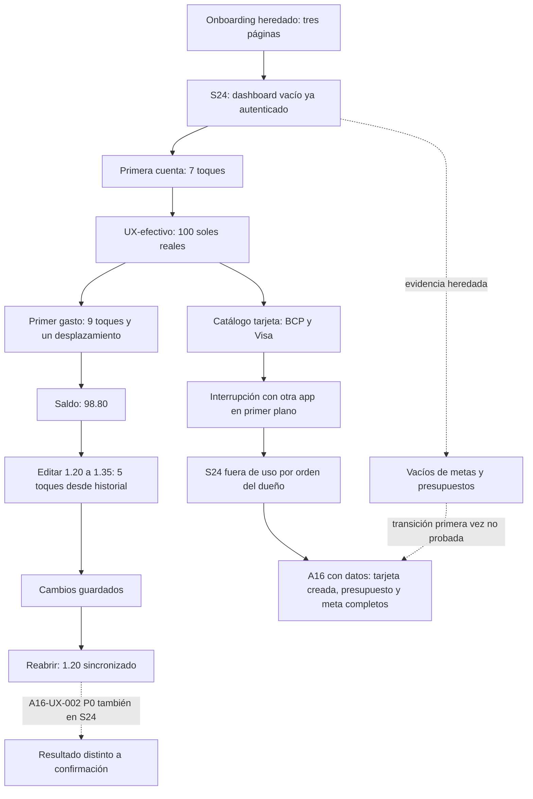
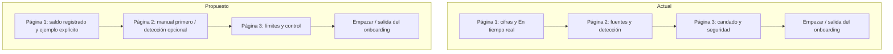

Method: design review only (detector not applicable, native platform)

# S24 — primer uso y sustitución parcial en A16 · 2026-11-05

Revisión nativa en modo **Operate**. El S24 comenzó con sesión Premium iniciada y sin movimientos ni cuentas. Se inspeccionó evidencia heredada de Antigravity y se continuó en vivo hasta que el dueño necesitó el teléfono. **Resultado propio actualizado: 6 P2; A16-UX-002 P0 corroborado, sin nuevo ID.** El primer informe registró un P2; la segunda pasada añadió cinco sobre onboarding, vacío, identidad, CTA y color. La tarjeta, el presupuesto y la meta se completaron en el **A16 con cuenta con datos**, por instrucción del coordinador. No representan primer uso en el S24.

## Procedencia, alcance y límites

Samsung S24 inalámbrico, serial histórico `192.168.18.89:36487`; Samsung A16 USB `RFGL70J9E2T` para sustituciones. En ambos se consultó `versionName=0.1.0`, `versionCode=1`; esos metadatos no identifican el commit del APK ni prueban despliegue del código actual. Densidad 420: 48 dp = 126 px. Capturas privadas en `_local-only`, ignoradas por Git; todas las citadas fueron vistas.

El onboarding se evaluó mediante capturas heredadas y `OnboardingScreen.kt`, no se vivió de nuevo. Los nombres heredados de archivos no prueban su contenido: las páginas 2 y 3 muestran control/captura y privacidad, respectivamente. La captura heredada 29 no era Kipu, se excluyó y retiró del conjunto de evidencia. La captura 33 es la lista de categorías verificada. Acceso/registro/recuperación quedan fuera de evaluación.

No se puede medir el tiempo desde el primer arranque. Un toque cuenta una pulsación sobre control o Back; escritura y desplazamiento se indican por separado. No se atribuyen a UX los fallos del conductor al localizar campos. No hay tiempos humanos ni medición de lectura/comprensión.

Se aplicó Impeccable nativo sin detector web ni subagentes, según el encargo; contexto y referencias de Android, Operate, critique, audit.native, onboard, clarify y harden. `NO_PRODUCT_MD` es una limitación; no se creó ese archivo. DOC-03 sigue abierto: Andean Modernist y Calm Emerald discrepan en autoridad visual. No se decidió una identidad nueva. No se editaron código, contratos, configuración del proyecto, tests ni datos administrativos remotos.

**Interrupciones:** el recorrido del S24 se interrumpió dos veces con WhatsApp en primer plano: una vez durante Antigravity y otra en esta continuación. La causa de ninguna está determinada. En la segunda se detectó otra app al comprobar el foco y se detuvo la interacción; no se capturó esa conversación. Una captura anterior de Kipu mostraba un aviso emergente en la parte superior; no se puede saber si apareció o fue pulsado uno en el último toque. No se atribuye ninguna interrupción al dueño, al agente ni a Kipu. Desde la orden final no se envió ningún comando al S24, ni de lectura o limpieza.

## Matriz de cobertura

«Revisada» corresponde a los estados descritos; no significa cobertura completa de permisos, planes ni ciclo de vida.

| Pantalla / estado | Resultado y procedencia | Capturas |
|---|---|---|
| Onboarding páginas 1–3 y Back | Revisada por evidencia heredada: dinero, control/captura, privacidad y salida; no ejecución en vivo | [S24 01](capturas/_local-only/s24/01-onboarding-p1-inicial.png), [S24 02](capturas/_local-only/s24/02-onboarding-p2-presupuestos-settled.png), [S24 03](capturas/_local-only/s24/03-onboarding-p3-metas.png), [S24 04](capturas/_local-only/s24/04-onboarding-back-to-p2.png) |
| Dashboard vacío y cuentas sin datos | Revisada heredada: cero, CTA primera cuenta y explicaciones; crear cuenta conduce a opciones en vivo | [S24 06](capturas/_local-only/s24/06-dashboard-empty.png), [S24 07](capturas/_local-only/s24/07-dashboard-empty-scrolled.png), [S24 08](capturas/_local-only/s24/08-dashboard-empty-bottom.png), [S24 36](capturas/_local-only/s24/36-primera-cuenta-opciones.png) |
| Movimientos vacío | Revisada heredada: CTA registrar; después se guardó el primer gasto en vivo | [S24 09](capturas/_local-only/s24/09-movimientos-empty.png), [S24 39](capturas/_local-only/s24/39-primer-gasto.png) |
| Metas vacío | Revisada por captura heredada de Planificación; no se completó alta con la cuenta vacía del S24 | [S24 10](capturas/_local-only/s24/10-planificacion-empty.png) |
| Presupuestos vacío | Revisada heredada; alta y detalle de primera vez en S24 no probados por interrupción | [S24 11](capturas/_local-only/s24/11-presupuestos-empty.png) |
| Deudas vacío | Revisada heredada; creación/pago con datos se cubrió en A16 | [S24 12](capturas/_local-only/s24/12-deudas-empty.png) |
| Analíticas y calendario vacíos | Revisados heredados; estados con datos en A16 | [S24 13](capturas/_local-only/s24/13-analisis-empty.png), [S24 14](capturas/_local-only/s24/14-calendario-empty.png) |
| Notificaciones vacío | Revisada heredada: Todo al día; no entrega de alertas reales | [S24 15](capturas/_local-only/s24/15-notificaciones-empty.png) |
| Ajustes y perfil | Revisados heredados y entrada de continuación; Claro seleccionado, moneda, ciclo y rutas de módulos | [S24 16](capturas/_local-only/s24/16-ajustes-perfil.png), [S24 17](capturas/_local-only/s24/17-ajustes-perfil-scrolled.png), [S24 30](capturas/_local-only/s24/30-continuacion-inicio.png) |
| Bandeja captura y explicación | Revisadas heredadas: vacío, captura automática desactivada, demostración informativa | [S24 18](capturas/_local-only/s24/18-captura-inbox-empty.png), [S24 19](capturas/_local-only/s24/19-captura-como-funciona.png), [S24 20](capturas/_local-only/s24/20-captura-como-funciona-scrolled.png) |
| Permisos de captura | Revisados estados desactivados y explicación; no se activó lectura real de notificaciones | [S24 21](capturas/_local-only/s24/21-permisos-captura.png), [S24 22](capturas/_local-only/s24/22-permisos-captura-scrolled.png), [S24 23](capturas/_local-only/s24/23-permisos-explicacion.png) |
| CaptureReviewScreen | No alcanzada: sin captura de prueba revisable; la demostración no equivale a revisión real | — |
| Biometría y privacidad | Revisadas superficies; no se activó biometría, ni exportó, restauró o borró | [S24 24](capturas/_local-only/s24/24-bloqueo-biometria.png), [S24 25](capturas/_local-only/s24/25-datos-privacidad.png) |
| Planes | Revisados selector y comparación; no compra; bloqueo externo Billing no se cuenta como defecto | [S24 26](capturas/_local-only/s24/26-planes-seleccion.png), [S24 27](capturas/_local-only/s24/27-planes-pantalla-completa.png), [S24 28](capturas/_local-only/s24/28-planes-free.png) |
| MerchantAliasRulesScreen | Revisada alta vacía; términos contrastados también en A16; no se guardó regla | [S24 31](capturas/_local-only/s24/31-alias-vacio.png) |
| MerchantCategoryPreferenceScreen | Revisada entrada y paso elegir comercio; no preferencia guardada | [S24 32](capturas/_local-only/s24/32-preferencia-comercio.png) |
| Categorías / CategoryFormScreen | Revisadas lista y alta real UX-categoria de gasto; éxito confirmado | [S24 33](capturas/_local-only/s24/33-categorias-lista.png), [S24 34](capturas/_local-only/s24/34-categoria-form.png), [S24 35](capturas/_local-only/s24/35-categoria-creada.png) |
| CategoryConflictScreen | No alcanzada: no apareció conflicto real; no se forzó con administración o datos externos | — |
| Primera cuenta efectivo | Revisada en vivo: UX-efectivo, saldo inicial S/ 100, PEN; valor real en dashboard | [S24 36](capturas/_local-only/s24/36-primera-cuenta-opciones.png), [S24 37](capturas/_local-only/s24/37-efectivo-primera-form.png), [S24 38](capturas/_local-only/s24/38-primer-valor-real.png) |
| QuickMovementScreen / primer gasto | Revisada en vivo: S/ 1.20 con nota UX y categoría Alimentación; saldo S/ 98.80 | [S24 39](capturas/_local-only/s24/39-primer-gasto.png) |
| Recurrencias vacío | Revisada en vivo desde formulario de recurrencia; no creada en S24 | [S24 40](capturas/_local-only/s24/40-recurrencias-vacio.png) |
| Historial / corrección | Revisada en vivo: 1.20 → 1.35, guardado anunciado y vuelta a 1.20 sincronizado; reproduce A16-UX-002 | [S24 41](capturas/_local-only/s24/41-edicion-propuesta.png), [S24 42](capturas/_local-only/s24/42-edicion-feedback.png), [S24 43](capturas/_local-only/s24/43-edicion-reapertura.png) |
| Primera tarjeta S24 / catálogo | Parcial: emisor BCP y productos Visa; no tarjeta guardada, recorrido interrumpido | [S24 44](capturas/_local-only/s24/44-tarjeta-catalogo.png), [S24 45](capturas/_local-only/s24/45-tarjeta-productos.png) |
| Alta tarjeta sustituida en A16 | Revisada con cuenta con datos y tarjeta previa: UX-tarjeta manual, línea S/ 1,000, cierre 26, pago 20, últimos 1234; no primer uso ni vacío de tarjeta S24 | [A16 83](capturas/_local-only/a16/83-tarjeta-alta-manual.png), [A16 84](capturas/_local-only/a16/84-tarjeta-configurada.png), [A16 85](capturas/_local-only/a16/85-tarjeta-creada.png), [A16 86](capturas/_local-only/a16/86-tarjeta-detalle-ux.png) |
| Presupuesto sustituido en A16 | Revisado con datos: UX-presupuesto creado, exceso, edición a 84 %; recorrido de fase 1 y consulta final. No alta de primera vez en S24 | [A16 32](capturas/_local-only/a16/32-presupuesto-crear.png), [A16 33](capturas/_local-only/a16/33-presupuesto-creado.png), [A16 34](capturas/_local-only/a16/34-presupuesto-detalle.png), [A16 35](capturas/_local-only/a16/35-presupuesto-84.png), [A16 88](capturas/_local-only/a16/88-presupuesto-contraste-final.png) |
| Meta sustituida en A16 | Revisada con datos: UX-meta creada, aporte, lograda, retiro; recorrido de fase 1 y consulta final. No alta de primera vez en S24 | [A16 37](capturas/_local-only/a16/37-meta-crear.png), [A16 38](capturas/_local-only/a16/38-meta-lista-creada.png), [A16 39](capturas/_local-only/a16/39-meta-aportar.png), [A16 40](capturas/_local-only/a16/40-meta-lograda.png), [A16 41](capturas/_local-only/a16/41-meta-retirar.png), [A16 42](capturas/_local-only/a16/42-meta-detalle.png), [A16 87](capturas/_local-only/a16/87-meta-contraste-final.png) |
| Widgets | No probado: colocación requería salir a launcher/otra app; no se ensayó una vía autorizada dentro de Kipu | — |
| Accesibilidad transversal | A16 claro/oscuro y fuente 1.3; en S24 solo Claro original. TalkBack, contraste instrumental, horizontal, tablets y rendimiento no probados | [A16 64](capturas/_local-only/a16/64-analiticas-texto130-estable.png), [A16 65](capturas/_local-only/a16/65-analiticas-oscuro130.png), [A16 89](capturas/_local-only/a16/89-cierre-continuacion.png) |

## Recorridos, coste y juicio

| Objetivo | Pasos y toques observados | Fricción / lo que funciona |
|---|---|---|
| Entender para qué sirve | Páginas heredadas: dinero → control → privacidad; Back vuelve a la anterior. Coste en vivo y tiempo no medidos | Ejemplos de finanzas y explicación de privacidad son concretos; permite omitir. No se infiere que el usuario entendiera todo por ver las capturas. |
| Obtener el primer valor real en S24 | Desde dashboard vacío: primera cuenta → Efectivo → alias → Back → saldo → Back → Guardar: **7 toques**, escritura aparte. UX-efectivo S/ 100 | Cuenta explícita, saldo actual opcional y sin pedir claves bancarias; el resultado aparece inmediatamente. |
| Registrar el primer gasto S24 | Desde cuenta creada: + → monto → Back → categoría → Alimentación → Más detalles → desplazar → nota → Back → Guardar: **9 toques + 1 desplazamiento**. Gasto ya predeterminado | S/ 98.80 confirma el efecto. Cuenta y acción Guardar persistentes; añadir nota exige desplegar y desplazar. **16 toques + 1 desplazamiento acumulados** desde dashboard vacío, no desde primer arranque. |
| Organizar categoría S24 | Desde lista: + → nombre UX-categoria → Back → Guardar: **4 toques**; icono/color predeterminados, gasto raíz | La creación confirma éxito. Se ven categorías predeterminadas y que no consumen cupo. No se probó conflicto ni persistencia de tipo ingreso. |
| Aprender regla o preferencia | Ajustes → entrada de regla / preferencia: **1 toque desde ajuste visible**. Formularios inspeccionados, sin guardar | La aplicación a futuros movimientos se explica; «canónico» y «normalizarán» aumentan trabajo de interpretación (S24-UX-001). No hay medición de alta completa. |
| Consultar recurrencias vacío S24 | Desde detalle del gasto → Registrar recurrente → Ver mis recurrencias: **2 toques desde detalle** hasta el vacío | Se puede volver al formulario sin crear por accidente; ciclo completo solo probado en A16. |
| Corregir el primer gasto S24 | Desde historial: fila → Editar → monto 1.35 → Back → Guardar: **5 toques**; reabrir detalle: **1 adicional** | El editor anticipa diferencia S/ 0.15, pero el valor final vuelve a 1.20 después del éxito. A16-UX-002 también afecta a esta cuenta nueva. |
| Añadir tarjeta en A16 con datos | Agregar tarjeta → BCP → Continuar → Agregar manualmente → cinco campos con Back → Guardar → detalle. Ruta útil reconstruida: **15 toques hasta éxito**, **1 adicional al detalle**; no medición continua por errores del conductor al localizar campos, sin tiempo válido | Alta final confirmada. Solo cuatro dígitos, TEA opcional, crédito y dinero propio separados. No se registró compra. El tramo final corregido (pago, Back, cuatro dígitos, Back, Guardar) tuvo **5 toques**. |
| Crear presupuesto en A16 con datos | Desde tab: + → límite → Back → nombre → Back → Crear → Ver: **7 toques**. Editar límite: acciones → Editar → límite → Back → Guardar: **5** | UX-presupuesto S/ 10 incorpora gastos previos y excede; S/ 400 muestra 84 %, restante y guía diaria. Consulta final 88 muestra gasto 337.60/restante 62.40 tras posteriores movimientos; no contradice 35 tomada antes. Entrega de alerta no probada. |
| Crear y usar meta en A16 con datos | Desde tab: + → nombre → Back → objetivo → Back → Guardar: **6**; aporte desde lista: **4**; retiro desde logro: **5** | UX-meta S/ 2 alcanza objetivo al reservar 2, libera 1 y conserva reserva 1. El respaldo y la diferencia entre reservar e ingresar dinero se explican. Se reutiliza recorrido completo de fase 1, confirmado en consulta 87. |

Los estados vacíos heredados de metas/presupuestos del S24 sí se inspeccionaron como imágenes; la experiencia completa de primera creación y transición desde vacío **no pudo evaluarse en vivo** en esos módulos. A16 aporta altas reales con datos existentes, no reemplaza esa prueba de primera vez. El catálogo de tarjeta del S24 quedó parcial; el A16 ya tenía tarjeta previa.

## Puntuación heurística de los estados revisados

Escala de `critique.md`: 0 fallo fundamental, 1 problemas mayores, 2 parcial, 3 bueno con brechas, 4 excelente. Juicio experto sobre lo observado, no test con participantes. H1 estado; H2 mundo real; H3 control; H4 consistencia; H5 prevención; H6 reconocimiento; H7 eficiencia; H8 minimalismo; H9 recuperación; H10 ayuda. En modo Operate se consideran las diez heurísticas. No se puntúan pantallas no alcanzadas.

| Flujo | H1 | H2 | H3 | H4 | H5 | H6 | H7 | H8 | H9 | H10 | Total |
|---|---|---|---|---|---|---|---|---|---|---|---|
| Onboarding heredado, solo presentación | 3 | 4 | 3 | 3 | 3 | 3 | 3 | 3 | 3 | 4 | 32/40 |
| Vacíos heredados / dirección inicial | 3 | 4 | 3 | 3 | 3 | 3 | 3 | 3 | 3 | 3 | 31/40 |
| Primera cuenta y primer gasto S24 | 3 | 4 | 3 | 3 | 3 | 3 | 2 | 3 | 3 | 3 | 30/40 |
| Categorías y reglas, entrada | 3 | 2 | 3 | 3 | 3 | 2 | 2 | 3 | 3 | 3 | 27/40 |
| Captura, permisos y privacidad, información | 3 | 4 | 3 | 3 | 3 | 3 | 3 | 3 | 3 | 4 | 32/40 |
| Corrección S24 | 1 | 3 | 2 | 2 | 3 | 3 | 2 | 3 | 1 | 2 | 22/40 |
| Alta manual tarjeta A16 con datos | 3 | 4 | 3 | 3 | 3 | 3 | 2 | 3 | 3 | 3 | 30/40 |
| Presupuesto A16 con datos | 3 | 4 | 3 | 3 | 3 | 3 | 3 | 3 | 3 | 3 | 31/40 |
| Meta A16 con datos | 3 | 3 | 3 | 3 | 3 | 3 | 3 | 3 | 3 | 4 | 31/40 |

La carga cognitiva es razonable hasta el primer saldo; la variedad de emisores y productos añade decisiones a la tarjeta, con salida manual visible. El punto emocional favorable es ver el dinero propio después del primer gasto. La caída grave ocurre al corregirlo y descubrir que el éxito no describe el valor retenido. La persona que solo quiere registrar manualmente puede hacerlo sin activar captura bancaria.

## Flujo actual del primer valor y sus límites

No se propone cambiar los pasos de primer uso por una evidencia parcial. La corrección propuesta y su flujo están documentados con el mismo ID A16-UX-002 en el informe integrado; no se duplica como S24-UX nuevo.

## Hallazgo nuevo y corroboración

### S24-UX-001 · P2 · Reglas de comercio / MerchantAliasRulesScreen

- **Clasificación:** Heurístico sobre textos observados; contraste entre dispositivos observado.
- **Qué pasa hoy:** El formulario pide «Texto fuente exacto» y «Buscar comercio canónico»; la ayuda explica que «Se normalizarán mayúsculas, tildes y espacios». Obliga a aprender vocabulario de implementación al intentar reconocer un comercio. Evidencia: [S24 31](capturas/_local-only/s24/31-alias-vacio.png); mismos términos en [A16 82](capturas/_local-only/a16/82-alias-contraste.png).
- **Qué cambiar, en concreto:** Campo «Texto que aparece en la operación»; selector «Elegir comercio»; ayuda «Por ejemplo: “TAMBO 123”. Elige Tambo para reconocer ese texto en tus próximos movimientos. Se ignoran mayúsculas, tildes y espacios». Mantener explícito que se pega el texto completo: no prometer coincidencias parciales ni cambios retroactivos.
- **Por qué:** Quien configura su primera regla conoce lo que ve en su operación, no un modelo canónico. Correspondencia con mundo real y reconocimiento; reduce la explicación que debe interpretar antes de empezar.
- **Impacto:** Medio en descubrimiento/configuración. No se afirma fracaso de una persona ni error de normalización. **Esfuerzo:** Bajo. **Prioridad:** P2.
- **Código afectado:** `app/src/main/java/com/kipu/app/feature/categories/presentation/merchantrules/MerchantAliasRulesScreen.kt:189`, `:190`, `:199`, `:251`, `:383`.
- **Cómo comprobar:** Una persona nueva puede explicar qué texto pegar y qué comercio elegir antes de guardar; comprobar con UX- que la coincidencia exacta normalizada y la aplicación a movimientos futuros conservan su funcionamiento.
- **Autoridad / decisión:** Cambio de vocabulario; no altera la política de coincidencia ni el alcance futuro. Cualquier cambio a esa política **requiere decisión del dueño de producto**.

**A16-UX-002 (P0), corroboración, Observado:** al cambiar el primer gasto de S/ 1.20 a 1.35, la confirmación «Cambios guardados» no se sostuvo al reabrir: S/ 1.20 y «Sincronizado». [S24 41](capturas/_local-only/s24/41-edicion-propuesta.png), [S24 42](capturas/_local-only/s24/42-edicion-feedback.png), [S24 43](capturas/_local-only/s24/43-edicion-reapertura.png). Se conserva el ID original y su recomendación completa en [informe-ux.md](informe-ux.md). No se determinó causa de conciliación ni servidor. A16-UX-001/003/004 no se reprodujeron en esta cuenta del S24 por interrupción y por no tener afiliada/tarjeta creada; no se afirma que estén ausentes.

## Qué preservar

La primera cuenta permite introducir saldo actual sin datos bancarios sensibles; el dashboard separa crédito de dinero propio; los vacíos muestran una acción y ejemplos; onboarding permite omitir y describe privacidad; captura distingue permisos de Android del tratamiento de documentos. Alias y preferencias explican efecto futuro. Presupuesto deja claro que no mueve dinero y la meta muestra reserva y respaldo. No se propone exigir permisos para usar el registro manual.

Los dos pendientes HU-32 y UI-F5-01 siguen como conocidos y no reciben nuevos IDs. Play Billing no se diagnosticó como fallo de Kipu. Revisión de notificaciones reales, OCR y permisos concedidos queda sin probar; ver una explicación no prueba esos comportamientos.

## Datos, limpieza y ajustes finales

En S24 se crearon **UX-efectivo** (saldo inicial 100), un gasto de 1.20 con nota **UX-primer-gasto** y **UX-categoria**. Se intentó editar el gasto, sin cambio de importe retenido. No se crearon tarjeta, presupuesto ni meta en ese teléfono. En A16 queda **UX-tarjeta**, además de **UX-presupuesto** y **UX-meta** de fase 1; las consultas finales confirman su presencia. No se borraron datos autorizados: A16 es la cuenta personal del dueño con uso libre permitido; S24 es la cuenta de prueba.

Se conservaron **45 PNG S24 y 89 PNG A16**. Se retiraron 25 archivos de trabajo/no evidencia únicamente dentro de la carpeta local S24, tras verificar su ruta absoluta, incluidos los contactos de inspección y la falsa captura 29. Los XML numerados válidos se conservan. Las imágenes sensibles no se versionan.

**A16, último cierre de interacción verificado (primera pasada):** animaciones `1.0 / 1.0 / 1.0`, `font_scale=0.9`, sistema `Night mode: no`, Kipu Claro; temporales `/sdcard/ux-a16.png` y `/sdcard/ux-a16.xml` eliminados. Evidencia visual: [A16 89](capturas/_local-only/a16/89-cierre-continuacion.png).

**S24:** al iniciar esta continuación se leyeron animaciones `1.0 / 1.0 / 1.0`, `font_scale=0.9`, sistema `Night mode: yes`; Claro en Kipu. No se modificaron esos ajustes en esta continuación. El valor original del modo noche no se había registrado y no puede certificarse. **Pendientes expresamente a cargo del coordinador cuando el dueño libere el teléfono:** borrar `/sdcard/ux.png` y `/sdcard/ux.xml`, y verificar al final animaciones y `font_scale`. No se ejecutaron esos comandos por la orden posterior de no tocar el S24. No se presenta como restauración final verificada.

Questions skipped: revisión documental terminada con límites explícitos; las decisiones de producto van al dueño mediante el informe integrado.

### A16-UX-002 — dato adicional de conciliación

- **Dato de servidor aportado por el coordinador (Observado, SQL de solo lectura, cuenta S24, instrucción de segunda pasada del 2026-11-05):** `public.transactions` conservaba `revision=1`, `amount_minor=120` y `updated_at=created_at`; `public.transaction_revisions` no tenía filas para esa cuenta, mientras S24/43 mostraba dos revisiones y Sincronizado. La corrección no había quedado en el servidor al momento de esa consulta; este worker no ejecutó esa consulta ni dispone de su hora exacta. Pudo no enviarse, ser rechazada o revertirse localmente: no se determinó causa.
- **Contraste de feedback en código:** `app/src/main/java/com/kipu/app/feature/movements/presentation/MovementHistoryScreen.kt:656` usa «Cambios guardados» si no está offline, mientras `app/src/main/java/com/kipu/app/feature/movements/presentation/MovementEditorViewModel.kt:409` emite «Movimiento corregido (Pendiente de sincronizar)». Son mensajes discrepantes pertinentes a investigar; no prueban la causa del resultado ni convierten estar online en aceptación del servidor.

## Segunda pasada visual — evidencia existente, sin usar teléfonos

La tabla heurística anterior es de primera pasada; la actualización visual deja onboarding en 25/40, dashboard vacío en 25/40 y entrada de categorías/reglas en 26/40, con vectores H1–H10 en el informe integrado. El resto conserva alcance y límites.

Se conserva S24-UX-001 y se añaden 002–006, todos P2: **6 P2 propios**, más A16-UX-002 P0 corroborado sin nuevo ID. No se usó el S24; el onboarding se revisó por capturas heredadas y los vacíos por imágenes. La sustitución previa A16 con cuenta poblada conserva sus límites de primer uso. El resultado propio de un P2 arriba corresponde al primer informe, no al conteo actualizado.

| Pantalla / estado capturado | Nota visual | Mantener | Cambiar o límite | Captura |
|---|---|---|---|---|
| Onboarding 1 | Saldo y tarjeta dominan; hueco largo después del cuerpo. | Omitir y ejemplo de dinero propio/crédito. | S24-UX-002: ejemplo visible, promesa y primer paso. | [S24 01](capturas/_local-only/s24/01-onboarding-p1-inicial.png) |
| Onboarding 2 estable | Flujo vertical comprensible; detección tiene más peso que registro manual. | Tres etapas y texto breve. | S24-UX-002: manual primero y detección opcional. | [S24 02](capturas/_local-only/s24/02-onboarding-p2-presupuestos-settled.png) |
| Onboarding 2, revelado intermedio | Faltan etapas aún animándose; no se interpreta como contenido final. | Secuencia conserva su posición. | Conclusión sobre contenido solo con 02 estable; S24-UX-002. | [S24 02](capturas/_local-only/s24/02-onboarding-p2-presupuestos.png) |
| Onboarding 3 | Candado y etiquetas ocupan más que la explicación del límite. | No mueve dinero y sin contraseñas. | S24-UX-002: límites y captura opcional; conservar salida. | [S24 03](capturas/_local-only/s24/03-onboarding-p3-metas.png) |
| Onboarding Back, transición | Página 2 a mitad de revelado; indicador aún en transición. | Back y contenido no evaluado como estado final. | Sin defecto de animación inferido de un fotograma. | [S24 04](capturas/_local-only/s24/04-onboarding-back-to-p2.png) |
| Transición de acceso | Fuera del alcance de acceso/autenticación. | Sin juicio visual de esta superficie. | No evaluada por exclusión expresa. | [S24 05](capturas/_local-only/s24/05-post-login.png) |
| Dashboard vacío, inicio | Cero gigante y desglose en cero antes de CTA; MC fijo. | Separación crédito/dinero y controles legibles. | S24-UX-003 y 004: primer paso antes de cifras e identidad correcta. | [S24 06](capturas/_local-only/s24/06-dashboard-empty.png) |
| Dashboard vacío, cuentas | Tarjeta vacía con CTA y Agregar duplicado; tarjeta de crédito vacía debajo. | CTA con verbo y explicación de cuenta. | S24-UX-003: una composición de inicio y secundario de crédito. | [S24 07](capturas/_local-only/s24/07-dashboard-empty-scrolled.png) |
| Dashboard vacío, final | Repite dos vacíos; buena distancia de navegación. | Acceso a crédito sin tratarlo como saldo. | S24-UX-003: quitar contenedores vacíos redundantes. | [S24 08](capturas/_local-only/s24/08-dashboard-empty-bottom.png) |
| Movimientos vacío | Icono, explicación y CTA centrados; búsqueda queda arriba. | Registrar movimiento explícito y aire útil. | Sin cambio visual adicional; no ocultar navegación. | [S24 09](capturas/_local-only/s24/09-movimientos-empty.png) |
| Metas vacío | Tarjetas de ideas protagonizan la entrada sin botón libre rotulado. | Ejemplos y texto de objetivo/fecha. | S24-UX-005: CTA explícita antes de ideas. | [S24 10](capturas/_local-only/s24/10-planificacion-empty.png) |
| Presupuestos vacío | Bloque inicial alto y tres Añadir de igual nivel. | Planificación no mueve dinero; ideas sugeridas. | S24-UX-005: crear libremente primero, ideas secundarias. | [S24 11](capturas/_local-only/s24/11-presupuestos-empty.png) |
| Deudas vacío | Resumen doble en cero, filtro y CTA libre; dos ideas inferiores. | CTA explícita y separación Debes/Te deben. | Sin nuevo defecto visual; usar CTA como referencia para metas/presupuestos. | [S24 12](capturas/_local-only/s24/12-deudas-empty.png) |
| Análisis sin cuentas | Vacío específico evita dona ficticia y dirige a primera cuenta. | Un CTA, explicación de lo que aparecerá. | Sin cambio visual adicional; mantener filtro de periodo contextual. | [S24 13](capturas/_local-only/s24/13-analisis-empty.png) |
| Calendario sin eventos | Mes, leyenda y mensaje de ausencia legibles. | Vacío contextual a mes; no exige crear una deuda. | Sin cambio: no introducir CTA de evento sin decidir el origen. | [S24 14](capturas/_local-only/s24/14-calendario-empty.png) |
| Notificaciones vacío | Composición sobria con campana y Todo al día. | No inventa urgencia ni exige activación. | Sin cambio; no llenar el espacio con promoción. | [S24 15](capturas/_local-only/s24/15-notificaciones-empty.png) |
| Ajustes, parte alta | Filas agrupadas en tarjetas; tema y selectores reconocibles. | Acciones ordenadas por configuración. | Sin cambio visual sustentado en esta vista. | [S24 16](capturas/_local-only/s24/16-ajustes-perfil.png) |
| Ajustes, parte baja | Tarjetas repetidas facilitan escaneo; cerrar sesión separado en rojo. | Iconos, verbos y separación destructiva. | Mantener; copy técnico de alias va en S24-UX-001. | [S24 17](capturas/_local-only/s24/17-ajustes-perfil-scrolled.png) |
| Captura desactivada / bandeja vacía | Aviso amarillo y configurar son foco correcto; explicación debajo. | Distinguir desactivado de ausencia de propuestas. | Sin cambio visual; no convertir aviso en error rojo. | [S24 18](capturas/_local-only/s24/18-captura-inbox-empty.png) |
| Cómo funciona captura, transición | Primera etapa atenuada en demostración. | Secuencia numerada y salida visible. | No evaluar opacidad transitoria como contraste final. | [S24 19](capturas/_local-only/s24/19-captura-como-funciona.png) |
| Cómo funciona captura, final | Tres pasos y resultado con ejemplo ficticio explícito. | Datos ficticios y confirmación de crédito explicados. | Sin cambio visual adicional; referencia para rotular onboarding. | [S24 20](capturas/_local-only/s24/20-captura-como-funciona-scrolled.png) |
| Permisos, inicio | Mucho texto por fuente, pero cada tarjeta tiene acción identificable. | Uso manual sin permisos destacado. | Mantener grupos; no se prueba comprensión ni target en captura. | [S24 21](capturas/_local-only/s24/21-permisos-captura.png) |
| Permisos, OCR y lectura | Estado Inactivo, explicación y Habilitar se repiten coherentemente. | Separación permiso del dispositivo/consentimiento. | Sin cambio visual demostrado; no afirmar permisos concedidos. | [S24 22](capturas/_local-only/s24/22-permisos-captura-scrolled.png) |
| Consentimiento explicado | Título largo con buen agrupado de fuentes y límites. | Acciones Dar consentimiento / Ahora no distintas. | Sin cambio de esta captura; contenido inferior no visible se cubre con límites. | [S24 23](capturas/_local-only/s24/23-permisos-explicacion.png) |
| Bloqueo local | Una explicación y un switch; espacio libre con propósito. | Estado desactivado textual. | Sin cambio; no añadir información por ocupar espacio. | [S24 24](capturas/_local-only/s24/24-bloqueo-biometria.png) |
| Datos y privacidad | Bloque explicativo denso y acciones con jerarquía clara. | Borrado separado, exportación y restauración distinguidas. | Sin nueva recomendación sin probar las acciones prohibidas. | [S24 25](capturas/_local-only/s24/25-datos-privacidad.png) |
| Resumen Premium, hoja | Una CTA y beneficios resumidos; cierre por hoja reconocible. | Vigencia y aviso sin cobro. | Mantener estructura; no diagnosticar Billing por imagen. | [S24 26](capturas/_local-only/s24/26-planes-seleccion.png) |
| Planes, oferta | Segmentos y oferta anual se reconocen; CTA deshabilitada explícita. | Precio y periodicidad juntos. | Sin nuevo cambio: referencia local posterior compacta; no compra. | [S24 27](capturas/_local-only/s24/27-planes-pantalla-completa.png) |
| Planes, modo desarrollador | Estado informativo diferente al anterior, acción y aviso visibles. | Aviso sin cobro. | No se infiere fallo de compra ni correspondencia del nombre del archivo. | [S24 28](capturas/_local-only/s24/28-planes-free.png) |
| Ajustes continuación | Lista alineada, iconos y descripciones regulares. | Ritmo entre filas y acción al extremo. | Mantener; alias S24-UX-001. | [S24 30](capturas/_local-only/s24/30-continuacion-inicio.png) |
| Alias vacío y formulario | Formulario tiene prioridad y el vacío queda debajo; ayuda técnica. | Guardar deshabilitado y aplicación futura. | S24-UX-001: vocabulario concreto; no hace falta otra tarjeta de tutorial. | [S24 31](capturas/_local-only/s24/31-alias-vacio.png) |
| Preferencia sin comercio | Paso 1 y búsqueda claros, espacio libre sin ruido. | Alcance futuro y disponibilidad Free. | Sin cambio visual adicional; alta completa no evaluada. | [S24 32](capturas/_local-only/s24/32-preferencia-comercio.png) |
| Categorías con aviso superpuesto | Lista distinguible; cabecera parcialmente cubierta por aviso externo. | Iconos de categorías y subcuentas rotuladas. | S24-UX-006 usando 35 estable; overlay externo no es defecto Kipu. | [S24 33](capturas/_local-only/s24/33-categorias-lista.png) |
| Nueva categoría | Nombre, iconos y colores bien agrupados; control de guardar separado. | Selección con contorno y marca, no solo color. | Sin nuevo cambio; no certificar contraste de todos los swatches. | [S24 34](capturas/_local-only/s24/34-categoria-form.png) |
| Categoría creada / selección Gastos | Tab y FAB coral concentran acento; etiqueta blanca 3.41:1. | Éxito por snackbar y nombre de tipo. | S24-UX-006: par accesible y FAB de acción consistente. | [S24 35](capturas/_local-only/s24/35-categoria-creada.png) |
| Tipo de instrumento | Cuatro filas con icono, título y explicación de función. | Crédito no es dinero propio; salida Cancelar. | Mantener, sin nueva capa de tarjetas. | [S24 36](capturas/_local-only/s24/36-primera-cuenta-opciones.png) |
| Primera cuenta de efectivo | Alias y saldo con obligatoriedad claros; Guardar fijo. | Ayuda de saldo de hoy y moneda explícita. | Sin cambio visual adicional. | [S24 37](capturas/_local-only/s24/37-efectivo-primera-form.png) |
| Primer saldo real | Saldo 100 domina con cuenta y efectivo coincidentes; MC fijo. | Resultado inmediatamente legible. | S24-UX-004; usar composición poblada después de primera cuenta. | [S24 38](capturas/_local-only/s24/38-primer-valor-real.png) |
| Primer gasto guardado | 98.80 y snackbar de pendiente coherentes con gasto. | Estado local frente a sincronización explícito. | S24-UX-004 de identidad; no quitar crédito separado. | [S24 39](capturas/_local-only/s24/39-primer-gasto.png) |
| Recurrencias vacío en diálogo | Mensaje corto sobre formulario existente, Volver visible. | No abre otro alta ni registra por accidente. | Mantener: Volver retorna al formulario de creación que ya estaba abierto. | [S24 40](capturas/_local-only/s24/40-recurrencias-vacio.png) |
| Editor, propuesta | Importe, cambio y consecuencia diferenciados con verde de estado. | Antes/diferencia y campos agrupados. | A16-UX-002: resolver feedback efectivo; sin rediseño del editor. | [S24 41](capturas/_local-only/s24/41-edicion-propuesta.png) |
| Guardado anunciado | Snackbar claro pero contradice cifra retenida. | Feedback visible y ledger ordenado. | A16-UX-002; no tratar el mensaje como prueba de persistencia. | [S24 42](capturas/_local-only/s24/42-edicion-feedback.png) |
| Detalle reabierto | Importe, estado y revisiones claros visualmente, semántica errónea. | Jerarquía de monto y acciones. | A16-UX-002/006; dato SQL aportado queda atribuido. | [S24 43](capturas/_local-only/s24/43-edicion-reapertura.png) |
| Emisor de tarjeta | Grilla de bancos y selección explícita; continuar nombra BCP. | Salida, progreso y alternativa Otra entidad. | Sin nuevo cambio visual; marcas no sustituyen títulos. | [S24 44](capturas/_local-only/s24/44-tarjeta-catalogo.png) |
| Producto de tarjeta | Redes agrupadas, búsqueda y manual visibles. | Selección progresiva y acción manual. | Sin cambio probado: recorrido interrumpido antes de completar. | [S24 45](capturas/_local-only/s24/45-tarjeta-productos.png) |

Las comparaciones con mockups, el detalle de composición de cada vacío y todos los flujos actuales/propuestos están incluidos en [informe-ux.md](informe-ux.md), que sigue siendo autocontenido. Estas fichas documentan propuestas, no cambios realizados o verificados en APK.

### S24-UX-002 · P2 · Onboarding / las tres páginas

- **Clasificación:** Observado en evidencia heredada; interpretación de promesa y composición heurística.
- **Qué pasa hoy:** Página 1 muestra S/ 8,420.50, Sueldo BCP y VISA con «En tiempo real», sin etiqueta visual de ejemplo; el código sí los describe como ficticios en semántica accesible. La app probada requiere registros manuales o fuentes compatibles, no se demostró un saldo conectado al banco. Tras el texto queda un vacío amplio hasta progreso/CTA. Página 2 ilustra fuentes → detección → Kipu aunque el texto también admite registro manual; página 3 presenta candado, «Local y seguro», «0% acceso» y «Sin APIs bancarias». No se afirma que todas esas frases sean falsas: la impresión del conjunto requiere aclaración. Evidencia: [S24 01](capturas/_local-only/s24/01-onboarding-p1-inicial.png), [S24 02](capturas/_local-only/s24/02-onboarding-p2-presupuestos-settled.png), [S24 03](capturas/_local-only/s24/03-onboarding-p3-metas.png).
- **Qué cambiar, en concreto:** Página 1: título «Tu dinero, según lo que registras»; cuerpo «Agrega tus cuentas o efectivo y anota gastos e ingresos para ver tu saldo registrado. El crédito se muestra por separado.»; sustituir En tiempo real por «Datos de ejemplo» visible en la maqueta. Bajo el cuerpo, a 24 dp, una línea con icono de cuenta: «Primer paso: agrega una cuenta o tu efectivo». Acercar ese bloque al progreso con mínimo 24 dp, sin rellenar todo el hueco ni fijar alturas. Página 2: título «Registra a tu manera»; cuerpo «Anota gastos, ingresos y transferencias. Si lo eliges, Kipu puede detectar avisos de fuentes compatibles.»; mostrar registro manual primero y detección como opción con rótulo «Ejemplo de detección opcional». Página 3: conservar «Tus finanzas son tuyas»; cuerpo «Kipu no mueve tu dinero ni te pide contraseñas bancarias. Puedes registrar manualmente sin activar la captura de avisos.»; sustituir las etiquetas de la ilustración por «Sin contraseñas bancarias» y «Captura opcional». Mantener Omitir, Back, tres pasos y Empezar; no agregar permisos ni formularios a estas páginas.
- **Por qué:** Quien decide quedarse necesita saber de dónde saldrá su saldo y cuál es el primer paso. Honestidad de ejemplos, menor promesa implícita de conexión bancaria y explicación progresiva. El hueco se usa para orientar, no para publicidad o más funciones.
- **Impacto:** Medio en expectativa y activación; no hay medición de confusión o abandono. **Esfuerzo:** Medio. **Prioridad:** P2.
- **Código afectado:** `app/src/main/java/com/kipu/app/feature/auth/presentation/OnboardingIllustrations.kt:56`; `app/src/main/java/com/kipu/app/feature/auth/presentation/OnboardingIllustrations.kt:70`; `app/src/main/java/com/kipu/app/feature/auth/presentation/OnboardingScreen.kt:114`; `app/src/main/java/com/kipu/app/feature/auth/presentation/OnboardingScreen.kt:127`; `app/src/main/java/com/kipu/app/feature/auth/presentation/OnboardingScreen.kt:139`.
- **Cómo comprobar:** Con persona nueva y tres imágenes/prototipo, pedir que explique si Kipu consulta su banco, si las cifras son suyas, si debe activar captura y qué hará primero. En 0.9/1.3 mantener ejemplo visible, copia legible, Omitir y CTA sin corte. No afirmar éxito de comprensión sin ese ensayo.
- **Autoridad / decisión:** **Requiere decisión del dueño de producto** cambiar el énfasis y los textos del onboarding; no se propone una integración bancaria, un permiso obligatorio ni datos de muestra en el ledger.

### S24-UX-003 · P2 · Primer minuto / Dashboard vacío

- **Clasificación:** Observado y heurístico.
- **Qué pasa hoy:** Antes de crear cuenta, una gran tarjeta «DINERO REAL DISPONIBLE» muestra S/ 0.00 y dos subimportes en cero. Después aparecen Calendario, encabezado Agregar y una segunda tarjeta con el CTA «Agregar mi primera cuenta», seguida de tarjetas vacías. Es un vacío guiado, pero la jerarquía asigna la mayor atención a cifras sin base registrada. Evidencia: [S24 06](capturas/_local-only/s24/06-dashboard-empty.png), [S24 07](capturas/_local-only/s24/07-dashboard-empty-scrolled.png), [S24 08](capturas/_local-only/s24/08-dashboard-empty-bottom.png).
- **Qué cambiar, en concreto:** Solo cuando se haya confirmado ausencia de instrumentos activos/archivados y no haya carga/error: poner primero un bloque «Empieza con tu dinero de hoy», texto «Agrega una cuenta, billetera o efectivo y su saldo actual.» y botón «Agregar primera cuenta» de 48 dp mínimo, margen 16 dp. Debajo, texto secundario «Aún no hay saldo registrado», sin cero gigante ni desglose banco/efectivo. Seguir con acción secundaria «Agregar tarjeta de crédito» de 48 dp y enlace Calendario; omitir las dos tarjetas vacías y sus Agregar duplicados en ese estado. Tras crear instrumento recuperar dashboard con saldos normal. Mantener navegación y acceso manual; sin sugerir que cero significa pobreza o saldo bancario confirmado.
- **Por qué:** La persona nueva necesita una acción para obtener valor, antes de interpretar tres ceros. Jerarquía y revelación progresiva; no elimina funciones ni aumenta requisitos para iniciar.
- **Impacto:** Medio en primer uso; la cuenta se logró crear, no hubo bloqueo. **Esfuerzo:** Medio. **Prioridad:** P2.
- **Código afectado:** `app/src/main/java/com/kipu/app/feature/accounts/presentation/dashboard/DashboardScreen.kt:329`; `app/src/main/java/com/kipu/app/feature/accounts/presentation/dashboard/DashboardScreen.kt:461`; `app/src/main/java/com/kipu/app/feature/accounts/presentation/dashboard/DashboardScreen.kt:479`; `app/src/main/java/com/kipu/app/feature/accounts/presentation/dashboard/DashboardScreen.kt:519`; `app/src/main/java/com/kipu/app/feature/accounts/presentation/dashboard/DashboardScreen.kt:539`; `app/src/main/java/com/kipu/app/feature/accounts/presentation/dashboard/DashboardSections.kt:139`.
- **Cómo comprobar:** Fixture sin instrumentos, con carga/error, con archivados y después de crear UX: solo el vacío real adopta la composición; CTA visible sin scroll a 0.9 y accesible a 1.3, crédito secundario y ningún dato real oculto. Comparar lectura del primer paso con personas.
- **Autoridad / decisión:** **Requiere decisión del dueño de producto** la composición condicional. El mockup dashboard-empty-after ya reduce el desglose y usa Saldo registrado; verificar por separado qué APK incluye esa variante, sin afirmar que el repositorio está desplegado.

### S24-UX-004 · P2 · Identidad de cuenta / DashboardTopBar

- **Clasificación:** Observado en captura y código; dato de nombre nulo aportado por coordinador.
- **Qué pasa hoy:** El avatar muestra MC junto a «Bienvenido» y «Mi dinero». El literal MC está fijo en DashboardScreen, sin depender de identidad; también aparece en la cuenta S24 de otro nombre y profiles.display_name nulo, según contraste del coordinador. No se consultó la base desde esta segunda pasada. Puede parecer que está abierta otra cuenta. Evidencia: [S24 06](capturas/_local-only/s24/06-dashboard-empty.png), [S24 38](capturas/_local-only/s24/38-primer-valor-real.png), [A16 89](capturas/_local-only/a16/89-cierre-continuacion.png).
- **Qué cambiar, en concreto:** Con nombre disponible, derivar hasta dos iniciales de palabras no vacías (por ejemplo Ana Pérez → AP); con un solo nombre usar una inicial, y sin nombre mostrar icono PersonOutline de 24 dp dentro del mismo contenedor de 46 dp, sin MC ni iniciales extraídas del correo. Mantener «Mi dinero» como único título visible y quitar el saludo genérico Bienvenido; el nombre, si se muestra, pertenece al perfil y no requiere inventarse en el encabezado. Conservar accesos de ajustes y avisos.
- **Por qué:** Quien comprueba su dinero debe reconocer que la cuenta es suya. Correspondencia con mundo real y confianza; avatar neutral comunica ausencia de nombre sin atribuir una identidad falsa. El título ya explica la pantalla y el saludo genérico no agrega contexto.
- **Impacto:** Medio en confianza; no se observó cambio real de cuenta. **Esfuerzo:** Bajo–medio. **Prioridad:** P2.
- **Código afectado:** `app/src/main/java/com/kipu/app/feature/accounts/presentation/dashboard/DashboardScreen.kt:248`; `app/src/main/java/com/kipu/app/feature/accounts/presentation/dashboard/DashboardScreen.kt:268`; `app/src/main/java/com/kipu/app/feature/accounts/presentation/dashboard/DashboardScreen.kt:276`.
- **Cómo comprobar:** Probar nombres Ana Pérez, Ana, espacios y nulo: AP, A y avatar neutral según corresponda, nunca MC fijo; no mostrar correo ni reducir targets. Con fuente 1.3 conservar título y acciones sin duplicar saludo.
- **Autoridad / decisión:** **Requiere decisión del dueño de producto** la derivación y exposición de identidad; el literal fijo se registra como defecto, y no obliga a pedir un nombre para usar la app.

### S24-UX-005 · P2 · Vacíos de Planificación / Metas y Presupuestos

- **Clasificación:** Observado y heurístico; estados vacíos también visibles en A16 con cuenta poblada.
- **Qué pasa hoy:** Metas ofrece texto y cuatro tarjetas de ideas; Presupuestos ofrece texto y tres ejemplos con Añadir. La acción libre de crear está en el FAB + común, mientras Movimientos y Deudas tienen botón de texto dentro de su vacío. No hay bloqueo: las ideas y el FAB permiten empezar. Falta una jerarquía consistente entre iniciar libremente y usar una sugerencia. Evidencia: [S24 10](capturas/_local-only/s24/10-planificacion-empty.png), [S24 11](capturas/_local-only/s24/11-presupuestos-empty.png), [S24 12](capturas/_local-only/s24/12-deudas-empty.png), [A16 31](capturas/_local-only/a16/31-presupuestos-lista.png), [A16 36](capturas/_local-only/a16/36-metas-lista.png).
- **Qué cambiar, en concreto:** Dentro del vacío, tras descripción breve y antes de ejemplos, botón principal «Crear mi primera meta» o «Crear mi primer presupuesto» con altura mínima 48 dp y separación 16 dp. Reusar los handlers actuales del FAB, sin crear directamente ni saltar cupos. Presentar «O usa una idea» como texto secundario a 24 dp y mantener ideas con tratamientos tonales/contorno, sin otra acción rellena de igual peso. En metas reducir la copia a «Define cuánto quieres apartar y para cuándo. Elige después desde dónde reservar.»; en presupuesto conservar «Un presupuesto es planificación: no mueve dinero». Mantener el FAB como acceso global sin añadir otro FAB.
- **Por qué:** Quien empieza sin una plantilla necesita reconocer la misma acción explícita que vio en movimientos/deudas. Consistencia y reconocimiento; las sugerencias ayudan pero dejan de ser la única acción que parece explicada.
- **Impacto:** Medio en descubrimiento; no se midió que el FAB fuera incomprensible. **Esfuerzo:** Bajo–medio. **Prioridad:** P2.
- **Código afectado:** `app/src/main/java/com/kipu/app/feature/goals/presentation/GoalListScreen.kt:207`; `app/src/main/java/com/kipu/app/feature/goals/presentation/GoalListScreen.kt:405`; `app/src/main/java/com/kipu/app/feature/budgets/presentation/BudgetListScreen.kt:160`; `app/src/main/java/com/kipu/app/feature/budgets/presentation/BudgetListScreen.kt:289`.
- **Cómo comprobar:** En vacíos embebidos de Planificación y listas independientes, botón y FAB abren el mismo formulario/cupo, sin duplicar creación; ideas siguen funcionando. Con 1.3, CTA precede ejemplos en el orden de lectura y no queda bajo navegación.
- **Autoridad / decisión:** **Requiere decisión del dueño de producto** añadir la CTA explícita y reordenar ideas; no altera reglas de reserva, alertas ni monetización y no duplica pendientes HU-32.

### S24-UX-006 · P2 · Color y contraste / Categorías seleccionada y FAB

- **Clasificación:** Observado, medido por RGB de captura y heurístico en uso semántico.
- **Qué pasa hoy:** Gastos seleccionado usa blanco sobre coral #E85D5D: contraste calculado 3.41:1, inferior al objetivo 4.5:1 para su etiqueta de 14 sp; no es texto grande. El FAB + también cambia a coral en Gastos mientras las altas generales son teal. El coral identifica el tipo, pero absorbe una función de selección/acción y compite con su lectura. Evidencia: [S24 35](capturas/_local-only/s24/35-categoria-creada.png).
- **Qué cambiar, en concreto:** Mantener el coral como pequeño icono/indicador de gasto; para la pestaña seleccionada usar superficie tonal coral y texto expenseText oscuro, o fondo #B91C1C con blanco (contraste 6.47:1 calculado). Mantener la pestaña Ingresos distinguible por texto e icono, no solo color. Hacer el FAB de crear consistente con primaryContainer teal #0F766E y blanco (5.47:1 calculado en claro); usar sus pares semánticos equivalentes en oscuro, sin copiar hexadecimal a todas las superficies.
- **Por qué:** La persona debe leer el tipo activo y reconocer que + crea una categoría. Contraste y consistencia semántica; se conserva identidad del gasto sin sacrificar la etiqueta ni usar la misma intensidad para todo.
- **Impacto:** Medio en legibilidad de selección; no se presume confusión con borrar ni incumplimiento global de contraste. **Esfuerzo:** Bajo. **Prioridad:** P2.
- **Código afectado:** `app/src/main/java/com/kipu/app/feature/categories/presentation/categories/CategoriesScreen.kt:268`; `app/src/main/java/com/kipu/app/feature/categories/presentation/categories/CategoriesScreen.kt:1020`; `app/src/main/java/com/kipu/app/feature/categories/presentation/categories/CategoriesScreen.kt:1042`.
- **Cómo comprobar:** Calcular contraste del par realmente renderizado para selección, normal y badges a 0.9/1.3 en ambos temas; cuerpo ≥4.5:1 e iconos ≥3:1. Pulsar ambas pestañas y crear para confirmar selección visible y acción intacta. Los pares propuestos son cálculos, no renders validados.
- **Autoridad / decisión:** **Requiere decisión del dueño de producto** unificar la semántica visual del FAB y selección; no se decide una nueva identidad de marca ni se cambia qué tipo de categoría se crea.

### Onboarding actual y propuesto (S24-UX-002)

### S24-UX-002 — Onboarding / las tres páginas

Onboarding no recorrido en vivo: coste actual no medido. Actual y propuesto tienen 2 Siguiente + Empezar = 3 acciones estructurales, no medición; se conserva Omitir. No se cambia el trayecto de acceso ni se evalúa autenticación.

La composición actual no demuestra que se consulte el banco: En tiempo real se retira como promesa ambigua, y las cifras se rotulan como ejemplo. No se toma la ausencia de prueba de integración como prueba de que toda automatización sea inexistente.

**Cierre de segunda pasada:** 134 capturas originales conservadas, sin nuevos PNG de teléfono, sin nuevas interacciones ni cambios de ajustes. Limpieza/ajustes S24 siguen pendientes del coordinador; las dos interrupciones mantienen causa no determinada. Questions skipped: propuestas y decisiones están documentadas para el dueño, sin implementar ni ampliar permisos.
