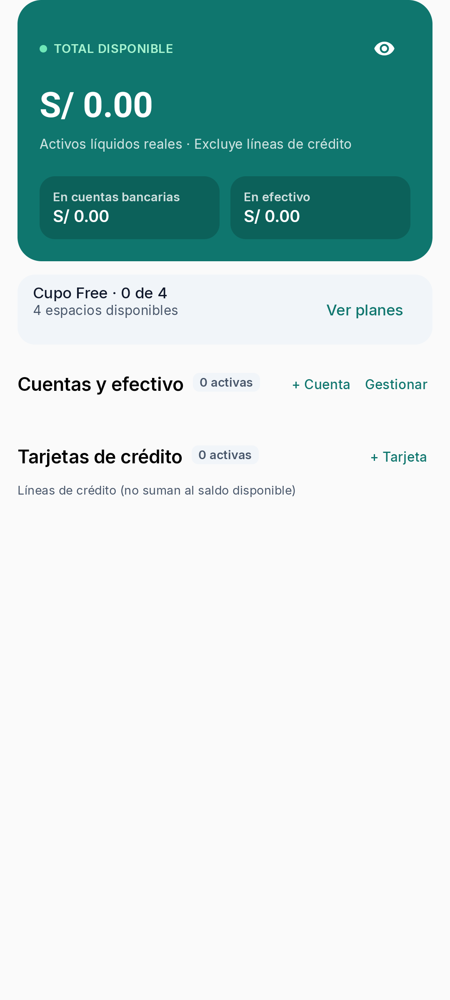
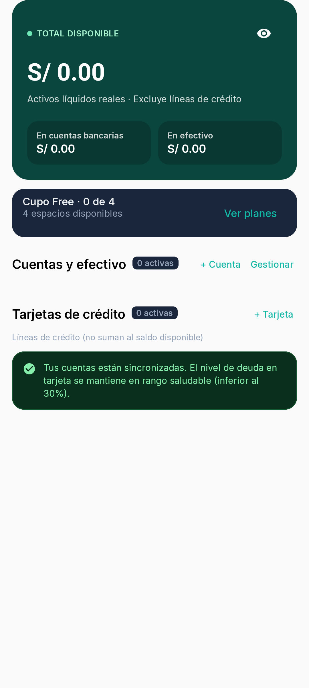
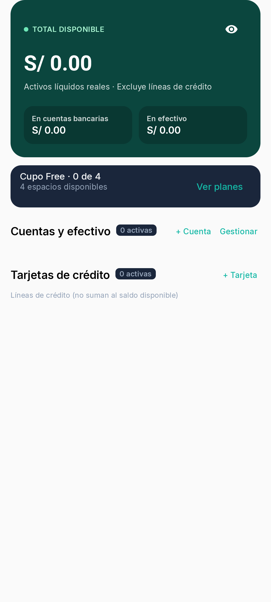

# Issue #47 — Dashboard financial banner

Before/after captures use the Pixel 8 emulator (API 36), the same empty-account/empty-card fixture with zero balances, default viewport and text scale, and the same scroll position at the end of the Dashboard. The before captures include the original banner; after captures omit it.

| Theme | Before | After |
|---|---|---|
| Light |  |  |
| Dark |  |  |

Captured by `DashboardFinancialMessagingTest` on the Pixel 8 AVD.
