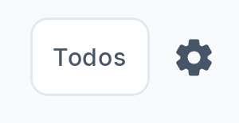
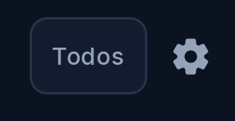

# Issue #70 — Accesos a Ajustes

Validación del 20 de octubre de 2026 sobre el código de `d84ee90`, en `work/issues-70-71`.

Mi dinero y Movimientos usan `Icons.Rounded.Settings` y el recurso común `settings_access_content_description` (`Ajustes`). Ambos controles son `IconButton` de 48 dp y conservan los callbacks que navegan a `PROFILE_SETTINGS_ROUTE` (`settings/profile`).

Mi dinero conserva su círculo de 38 dp y el glifo de 18 dp. El fondo y el borde se dibujan detrás del botón para mantener un único nodo accesible con el foco nativo. Movimientos conserva su glifo de 20 dp y su presentación existente.

## Capturas sanitizadas

Los recortes de 300 × 155 px contienen únicamente el extremo derecho de las cabeceras. Excluyen avatar, nombres, saldos y movimientos. Se obtuvieron de las pantallas reales de la instalación de prueba, sin crear ni editar datos financieros.

| Pantalla | Claro | Oscuro |
| --- | --- | --- |
| Mi dinero |  |  |
| Movimientos |  |  |

## Entorno

- Xiaomi 23129RA5FL, Android 15 / API 35.
- Pantalla de 1080 × 2400 px y densidad de 440 dpi.
- APK debug instalado como `com.kipu.app.preview`, mediante el script existente `gradle/preview-device.init.gradle`, conservando los datos de la instalación de prueba.
- Escala inicial de texto: 1.0. Se probó temporalmente 1.5 y se restauró 1.0.
- Tema inicial de Kipu: Oscuro. Se probó Claro para las capturas y se restauró Oscuro.

## Resultados

| Comprobación | Resultado |
| --- | --- |
| Icono canónico y recurso accesible compartido | Confirmados en ambos archivos de producción. |
| Mi dinero → Ajustes → volver | Aprobado en dispositivo. |
| Movimientos → Ajustes → volver | Aprobado en dispositivo; mismo título y destino. |
| Toque fuera del glifo, dentro del control | Aprobado desde ambas pantallas. |
| Una única etiqueta `Ajustes` por pantalla | Aprobado en el árbol de accesibilidad de Android. |
| Rol, acción y foco de ambos controles | `android.widget.Button`, `clickable=true`, `focusable=true`. |
| Objetivo táctil de ambos controles | 132 × 132 px a 440 dpi: 48 × 48 dp. |
| Tema claro y oscuro | Inspección visual y capturas anteriores. |
| Texto al 150 % | Ambos accesos conservan el tamaño, el foco y la navegación. |
| Tab/Enter | Aprobado en ambas pantallas: enfocar Ajustes, activar con Enter y volver al origen mediante eventos de teclado enviados por ADB. |
| Acción vecina de notificaciones | Abre `Avisos` y permite regresar a Mi dinero. |
| Escucha con TalkBack en Mi dinero | El usuario confirmó: «Ajustes, botón», una sola vez. |
| Escucha con TalkBack en Movimientos | El usuario confirmó que se escucha una sola vez. |
| Regreso con TalkBack | El usuario confirmó que regresó y escuchó correctamente el recorrido. |

## Compilación y alcance de la validación

```powershell
.\gradlew.bat -I gradle/preview-device.init.gradle :app:assembleDebug
git diff dd6758a..d84ee90 --check
```

La compilación del código final terminó con `BUILD SUCCESSFUL` (44 s). El APK instalado tiene SHA-256 `FB521F42C7004E777D955171CB4AEEFEF53E5DFF5B9E5E2CEA9AFB11705548F9`.

La accesibilidad se verificó mediante los nodos expuestos por Android, los recorridos de interacción y una escucha asistida con TalkBack en el mismo celular el 20 de octubre de 2026. El usuario escuchó los anuncios y confirmó que cada acceso anuncia «Ajustes, botón» una sola vez. Esta confirmación auditiva corresponde al usuario; el agente no escuchó el audio del celular.

Tras confirmar el regreso y la escucha correcta del recorrido, el usuario solicitó desactivar TalkBack. Se restauró y verificó la configuración original: sin servicios de accesibilidad habilitados y `accessibility_enabled=0`. No se ejecutó la suite completa de pruebas unitarias ni se añadieron tests de implementación para esta sustitución visual.

El cambio conserva navegación y reglas financieras. Los dumps completos, capturas de trabajo y scripts auxiliares permanecen en `scratch/issue-70/`, fuera de Git; solo se versionan estos recortes y el resultado de QA.
