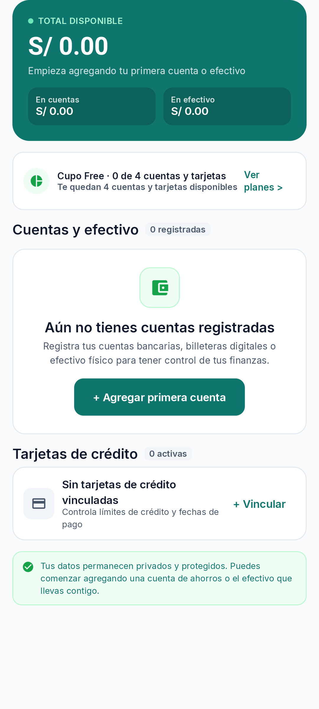
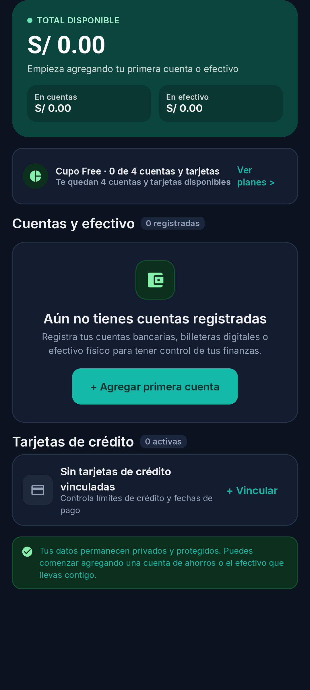
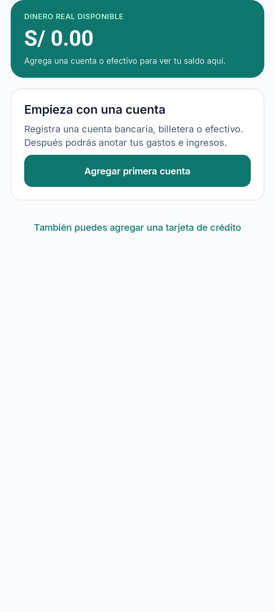
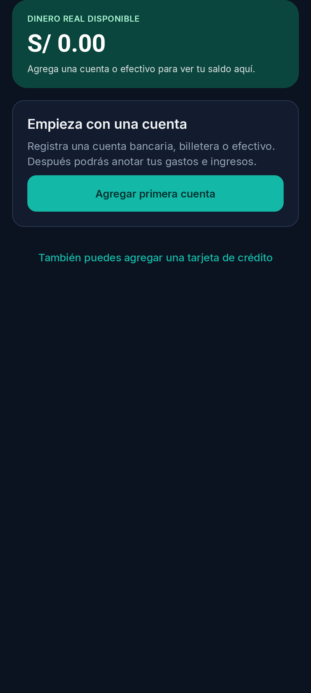

# Dashboard empty state — antes/después

Capturas del contenido del estado vacío del Dashboard generadas con `DashboardEmptyStateTest` en el emulador Pixel_8, usando un fixture determinista sin cuentas ni tarjetas activas y cupo Free 0/4. Se conserva el mismo viewport, tema y escala de texto para la comparación.

## Antes

| Claro | Oscuro |
| --- | --- |
|  |  |

## Después

El resumen conserva un único saldo disponible en cero. Una tarjeta concentra la explicación y la CTA principal para agregar una cuenta; el alta de tarjeta de crédito sigue disponible como acción secundaria.

| Claro | Oscuro |
| --- | --- |
|  |  |
