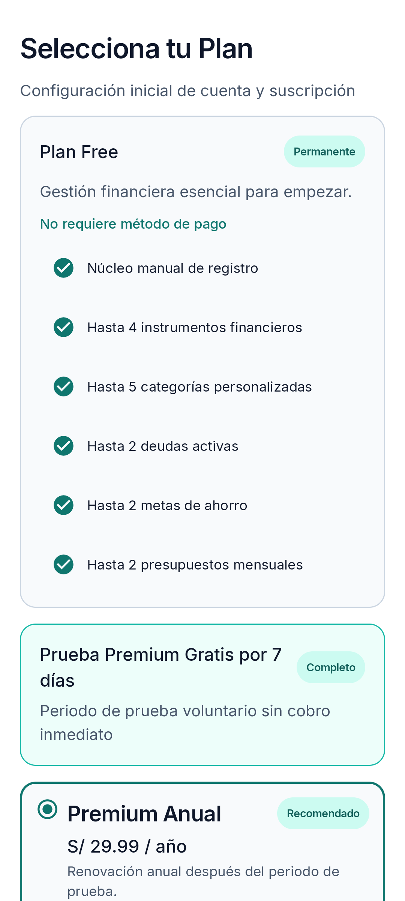
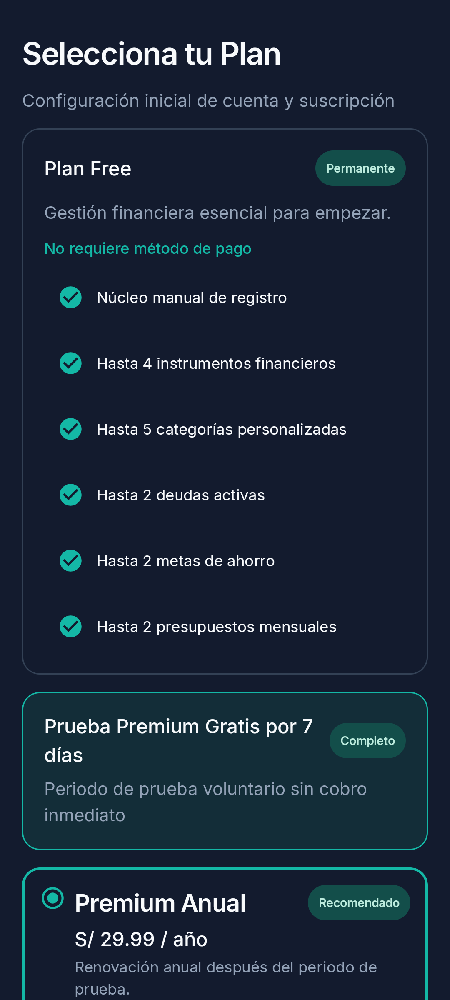
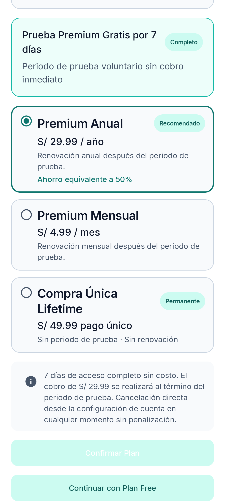
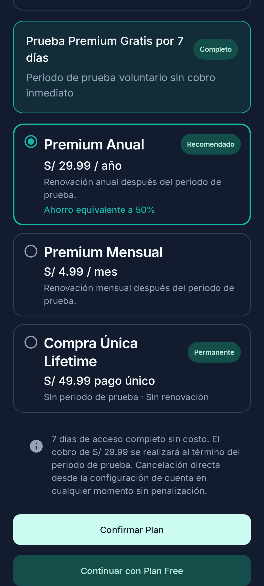
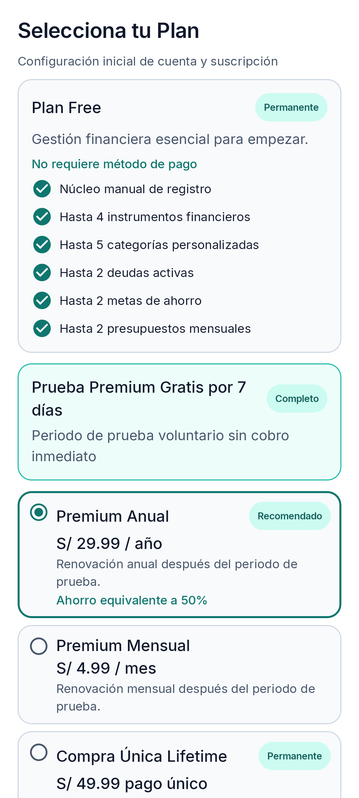
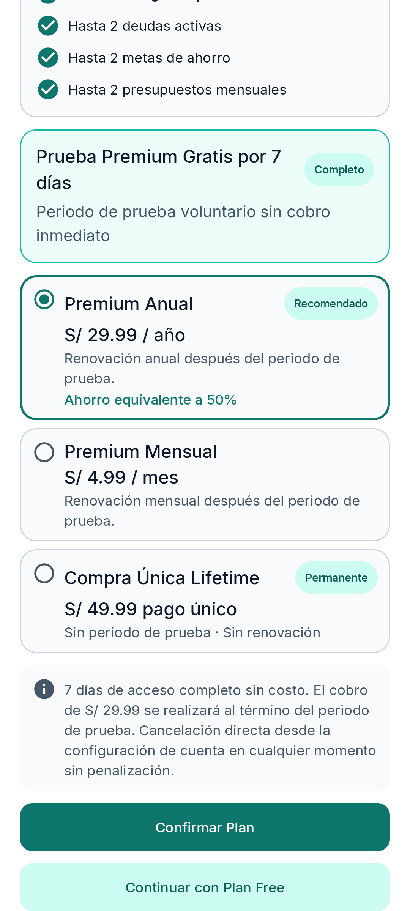
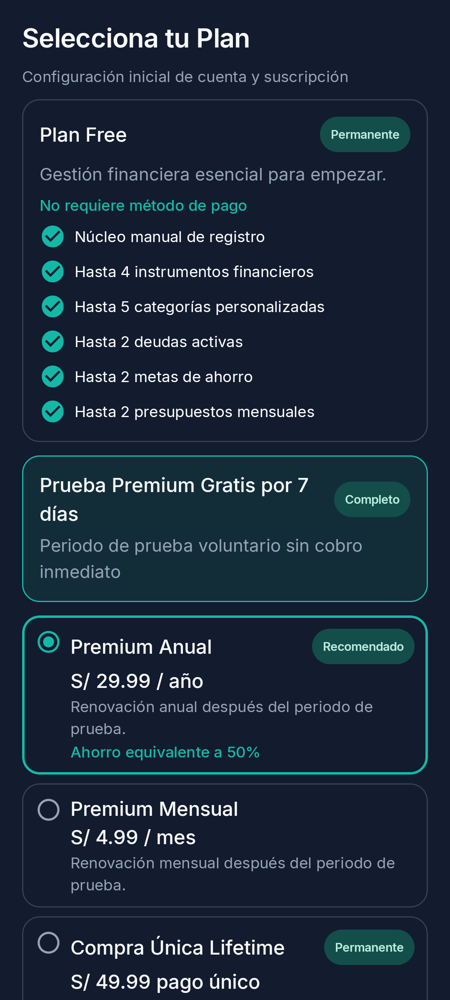
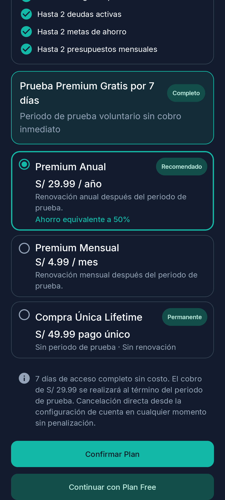

# Pantalla 1B — Antes/Después

Capturas generadas por `PlanSelectionScreenshotTest` en Pixel_8 con la oferta anual seleccionada y elegibilidad informativa `UNKNOWN`. Las capturas cubren la parte superior, las alternativas Premium y el disclosure/acciones con el mismo viewport y escala, en Claro y Oscuro.

## Antes

| Estado | Claro | Oscuro |
| --- | --- | --- |
| Inicio y resumen Free |  |  |
| Opciones, disclosure y acciones |  |  |

## Después

Se mantiene toda la información, el copy estático del Trial y las acciones requeridas. El ajuste compacta jerarquía tipográfica, espaciado y elementos decorativos estáticos; además, el CTA principal usa el par semántico de color con contraste para cada tema.

### Claro

| Posición | Antes | Después |
| --- | --- | --- |
| Inicio y resumen Free |  |  |
| Opciones, disclosure y acciones |  |  |

### Oscuro

| Posición | Antes | Después |
| --- | --- | --- |
| Inicio y resumen Free |  |  |
| Opciones, disclosure y acciones |  |  |
