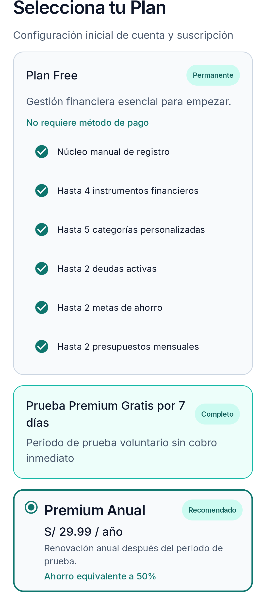
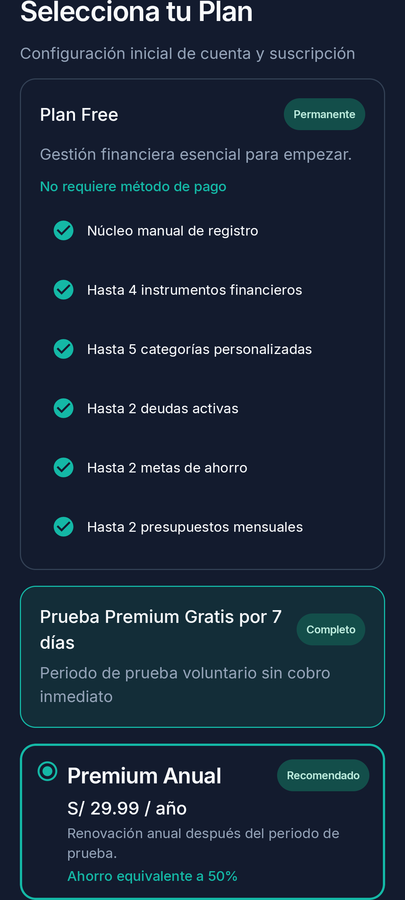

# Pantalla 1B — Antes/Después

Capturas generadas por `PlanSelectionScreenshotTest` en Pixel_8 con la oferta anual seleccionada y elegibilidad informativa `UNKNOWN`. Las capturas cubren la parte superior, las alternativas Premium y el disclosure/acciones con el mismo viewport y escala, en Claro y Oscuro.

## Antes

| Estado | Claro | Oscuro |
| --- | --- | --- |
| Inicio (Free y Trial) |  |  |
| Opciones Premium |  |  |
| Disclosure y acciones |  |  |
