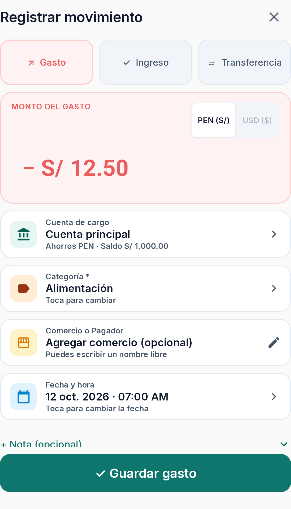
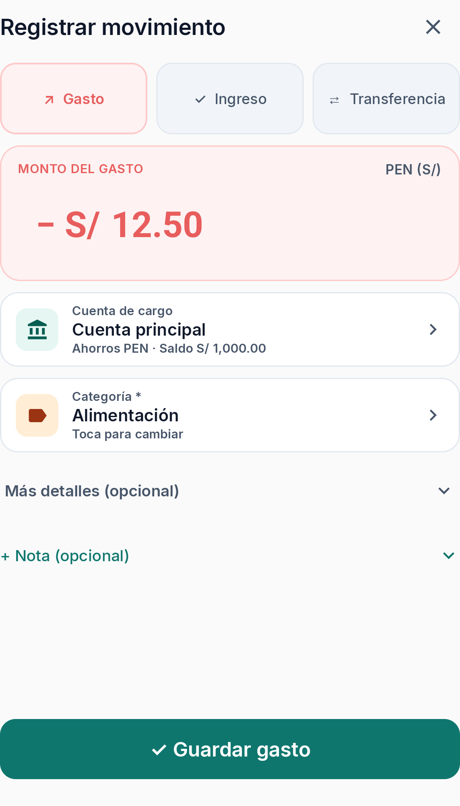

# Issue #46 — comparación visual

Capturas del mismo estado preparado de Gasto en un **Pixel 8 (Android 16)**, con viewport de **1080 × 1920**, tema claro y teclado cerrado.

- Fixture: cuenta principal PEN, categoría Alimentación e importe S/ 12.50.
- **Antes:** `main` (`abcdb22`), controles de comercio y fecha visibles en el formulario.
- **Después:** rama `feat/issue-46-quick-movement`, detalles opcionales contraídos y moneda única mostrada como resumen.

| Antes | Después |
|---|---|
|  |  |

La captura Antes/Después usa el mismo fixture, dispositivo, resolución, tema y escala de texto. No se capturó el estado con teclado: las pruebas instrumentadas mantienen oculto el IME del emulador.
