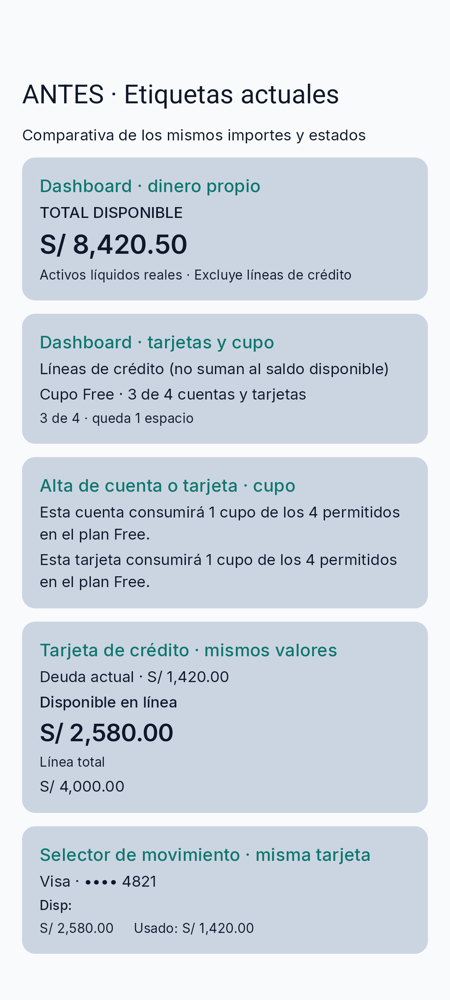
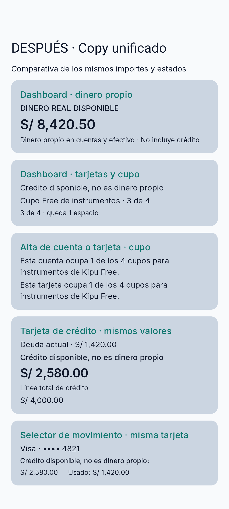

# Issue #48 — Matriz y evidencia de copy

Issue: https://github.com/Lume03/Kipu/issues/48
Base normativa: EP-CTA (SC-004, SC-009, SC-015), el contrato UI EP-CTA Sprint 3, EP-MOV y EP-PLA.

## Matriz de términos aplicada

| Concepto | Copy acordado para la interfaz | Dónde se usa | Regla / estado ilustrativo |
|---|---|---|---|
| Dinero propio líquido | **Dinero real disponible**; explicación: «Dinero propio en cuentas y efectivo · No incluye crédito» | Dashboard, estado con y sin instrumentos | Saldos PEN/USD separados; no incluir crédito ni sumar monedas distintas. El vacío invita a agregar una cuenta o efectivo. |
| Dinero de una cuenta | **Saldo** / **Disponible** | Fila de cuenta en Dashboard y selector de movimientos | Representa saldo de una cuenta propia; no se usa para capacidad de tarjeta. |
| Deuda de tarjeta | **Deuda actual**; **Deuda pendiente** solo en estados archivados/pendientes | Resumen y detalle de tarjeta, selector de movimientos | La deuda confirmada es pasivo. Pagarla no genera otro gasto. |
| Límite de crédito | **Línea total de crédito** | Configuración, edición, resumen y detalle | Es el límite autorizado por el emisor; no es un activo ni dinero disponible en cuentas. |
| Capacidad no utilizada | **Crédito disponible, no es dinero propio** | Dashboard, resumen/detalle de crédito, confirmación de compra y selector | Capacidad de endeudamiento; nunca se suma al dinero real disponible. |
| Límite del plan | **Cupo Free de instrumentos** | Dashboard, formulario de cuenta y formulario de tarjeta | El conteo numérico es de instrumentos computables (cuentas/tarjetas), no de efectivo. El estado completo indica que no quedan cupos. |
| Tipos principales | **Gasto**, **Ingreso**, **Transferencia** | Registro y filtros de movimientos | Una transferencia entre cuentas propias no es ingreso ni gasto. Se conservan los labels y contratos existentes. |
| Pago de tarjeta | **Pago de tarjeta** / **abono a la deuda** en contexto de crédito | Historial y flujo especializado | Reduce efectivo y principal; no agrega un segundo gasto. No se recategoriza como transferencia genérica en copy de tipo. |

## Antes → Después (copy de interfaz)

| Pantalla/elemento | Antes | Después |
|---|---|---|
| Dashboard, encabezado (vacío y con saldos) | `TOTAL DISPONIBLE` | `DINERO REAL DISPONIBLE` |
| Dashboard, aclaración del total | `Activos líquidos reales · Excluye líneas de crédito` | `Dinero propio en cuentas y efectivo · No incluye crédito` |
| Dashboard, encabezado de tarjetas | `Líneas de crédito (no suman al saldo disponible)` | `Crédito disponible, no es dinero propio` |
| Dashboard, cupo (vacío y con instrumentos) | `Cupo Free · n de 4 cuentas y tarjetas` | `Cupo Free de instrumentos · n de 4` |
| Dashboard, espacios restantes / lleno | `n cuentas y tarjetas disponibles` / `Cupo de cuentas y tarjetas completo` | `n espacios para cuentas y tarjetas` / `Cupo de instrumentos completo` |
| Formulario de cuenta | `Esta cuenta consumirá 1 cupo de los 4 permitidos en el plan Free.` | `Esta cuenta ocupa 1 de los 4 cupos para instrumentos de Kipu Free.` |
| Formulario de tarjeta | `Esta tarjeta consumirá 1 cupo de los 4 permitidos en el plan Free.` | `Esta tarjeta ocupa 1 de los 4 cupos para instrumentos de Kipu Free.` |
| Formulario, detalle y catálogo de tarjeta, límite | `Línea de crédito autorizada` / `LÍNEA DE CRÉDITO` / `LÍNEA ASIGNADA` / `LÍNEA TOTAL` / `Línea autorizada` / `Línea total` / `Línea:` | `Línea total de crédito` / `LÍNEA TOTAL DE CRÉDITO` / `Línea total de crédito:` |
| Detalle y simulador de compra, capacidad restante | `Línea de crédito` / `Línea liberada` / `Línea libre` / monto seguido de `libre` / `Disponible de crédito` / `Crédito disponible`; se mostraba además `Línea total` bajo el monto disponible | `Crédito disponible, no es dinero propio`; se retiraron los rótulos redundantes que no correspondían al monto disponible |
| Resumen de tarjeta | `Disponible en línea` | `Crédito disponible, no es dinero propio` |
| Selector de tarjeta en movimientos | `Disp:` / descripción accesible `Disponible:` | `Créd. disp.:` / `Crédito disponible, no es dinero propio:` |
| Historial de tarjeta, pago | `Abono a línea` | `Abono a la deuda` (se conserva el tipo de movimiento y el efecto contable) |

Los pares de texto anteriores ayudan a leer el diff. Las imágenes heredadas muestran un harness comparativo en Compose; no son capturas de rutas productivas.

## Capturas comparativas de los fragmentos de copy

Capturadas desde Compose en el mismo Pixel 8 AVD (API 36, viewport 1080×2400, densidad 420 dpi), tema claro y escala predeterminada. Los importes/estados son idénticos en ambas imágenes. Son capturas de fragmentos comparativos de copy, no pantallas completas de los recorridos de la aplicación.

### Antes

### Después

## Revisión de estados

- **Dashboard vacío:** mantiene el monto de PEN en cero y el CTA existente; el encabezado identifica que se trata de dinero propio disponible.
- **Dashboard con saldo:** mantiene PEN y USD separados; la explicación debajo del monto excluye crédito explícitamente.
- **Sin tarjetas:** el copy existente de estado vacío invita a agregar una tarjeta; no atribuye valor a crédito no registrado.
- **Cuenta en selector:** «Saldo disponible» describe solo el saldo de esa cuenta.
- **Tarjeta en selector:** el crédito disponible lleva la aclaración explícita «no es dinero propio» y la deuda se presenta por separado.
- **Movimiento de pago/transferencia:** sin cambios en la naturaleza contractual; pagos siguen siendo amortización y transferencias entre cuentas propias conservan ambos extremos.

## Revisión y evidencia

### Revisión de producto

Estado al 2026-10-17: **pendiente; no se encontró una aprobación de producto trazable** en la discusión consultada de GitHub ni en la búsqueda de la memoria del proyecto. La issue #48 requiere revisión de producto.

La conversación disponible incluye la matriz publicada por el autor y una auditoría de QA del owner del repositorio con observaciones de cobertura ([comentario de QA en PR #54](https://github.com/Lume03/Kipu/pull/54#issuecomment-6159323459)); no contiene una decisión identificada como aprobación de producto. La issue #48 no tiene comentarios y la PR no registra reviews formales. No se infiere aprobación a partir de la matriz, el comentario de QA ni el código existente. El criterio queda abierto hasta registrar una decisión del responsable autorizado.

### Capturas Antes/Después

Estado: **adjuntas, como evidencia histórica del harness**. `Issue48CopyScreenshotTest` renderiza `CopyComparisonScreen` con `CopyVersion.Before/After` y textos de ejemplo; no compone las rutas productivas. El comentario de QA confirma ese límite. Las imágenes se generaron previamente en Pixel 8 AVD (API 36, 1080×2400, 420 dpi), tema claro y escala predeterminada; no se regeneraron en esta actualización y no prueban la integración actual.

La cobertura instrumentada ahora comprueba copy en componentes productivos: `DashboardEmptyStateTest` inspecciona `EmptyDashboardContent`, `CardFormScreenTest` inspecciona `CardFormScreen`, `AccountDetailScreenTest` inspecciona `AccountDetailContent` y `CreditAccessibilitySemanticsTest` inspecciona `CreditCardSummaryCard`. Estas comprobaciones se añadieron/ajustaron en esta actualización, pero no se ejecutaron aquí; requieren una ejecución posterior para producir evidencia vigente.

La validación SC-013 permanece como criterio de éxito de EP-CTA y no sustituye la revisión de producto exigida por la issue #48.
